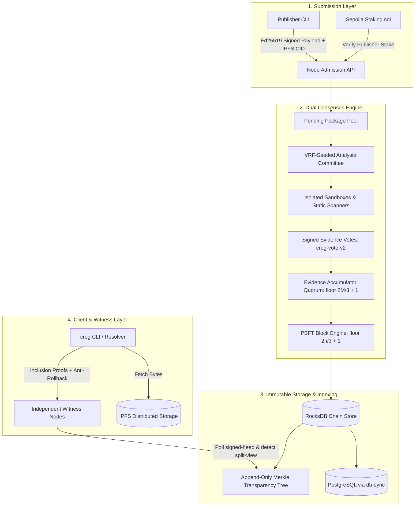
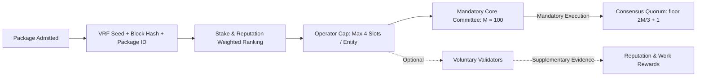
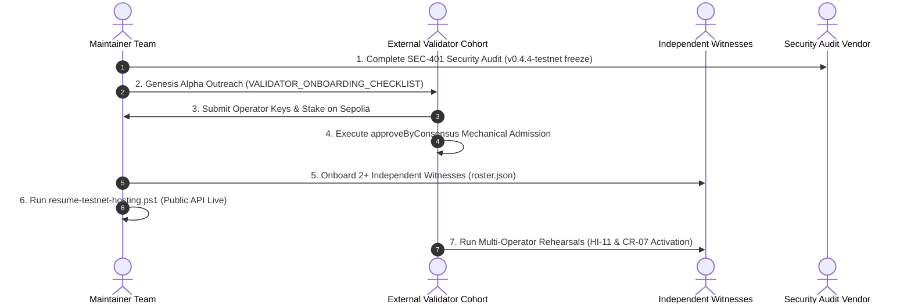

# CREG Blockchain Architecture & Decentralization Report

**Date:** August 27, 2026  
**Protocol Version:** `v0.4.4-testnet` (Public Alpha)  
**Consensus Domain:** PBFT Block Finality (`creg-pbft-v1`) & Package Evidence Accumulation (`creg-vote-v2`)  
**Settlement / Staking Layer:** Ethereum Sepolia (`creg-testnet-1`)  

---

## Executive Summary

The **Chain Registry (CREG)** is a purpose-built, evidence-backed blockchain network engineered to secure open-source software supply chains (npm, PyPI, Cargo). Rather than placing blind trust in centralized package registry maintainers or single publisher API keys, CREG turns package verification, namespace ownership, and malware analysis into an **economically bonded, multi-validator consensus decision**.

This report details CREG's underlying blockchain architecture, consensus engine, multi-tiered trust framework, cryptographic primitives, and extensive suite of decentralization and anti-capture mechanisms.

---

## 1. Core Blockchain Architecture

CREG separates the heavy, non-deterministic workload of package analysis from the fast, deterministic requirements of Byzantine-fault-tolerant state finality.



### 1.1 Dual Consensus Engine

CREG operates two interconnected consensus mechanisms:

1. **Package Evidence Consensus (`creg-vote-v2`):**
   - **Role:** Reaches cryptographic consensus on whether a specific package artifact is safe and admissible to the registry.
   - **Evidence Binding:** Validator votes are strictly domain-separated and cryptographically bind:
     $$\text{Signature} = \text{Sign}_{\text{validator}}(\text{canonical\_id} \parallel \text{content\_hash} \parallel \text{decision} \parallel \text{scanner\_digest} \parallel \text{evidence\_digest})$$
   - **Quorum Requirement:** $\lfloor 2M / 3 \rfloor + 1$ approvals from the assigned analysis committee of size $M$.
   - **Determinism:** Only deterministic, reproducible analysis (pinned static rules, sandboxed syscall inspection, YARA hashes) counts toward consensus. Advisory data (such as LLM insights) is strictly excluded from the consensus digest.

2. **Block-Level PBFT Finality (`creg-pbft-v1`):**
   - **Role:** Orders finalized package admissions, revocations, and validator-set updates into immutable blocks.
   - **3-Phase Execution:** Standard Practical Byzantine Fault Tolerance (Pre-Prepare, Prepare, Commit) with round-robin / VRF-elected block proposers.
   - **Quorum Requirement:** $\lfloor 2n / 3 \rfloor + 1$ active validators in the global validator set of size $n$.
   - **View Change Threshold:** $\lfloor n / 3 \rfloor + 1$ view-change certificates to prevent stalling if a proposer fails while resisting malicious view changes.

### 1.2 Storage & Deterministic State Reducer
- **RocksDB State Store:** Stores raw block headers, transaction payloads, validator signatures, state Merkle trees, and anti-rollback journals.
- **Relational Sync (`db-sync`):** Decoupled daemon projecting finalized chain state into PostgreSQL for high-speed public querying and explorers without placing query load on validator nodes.
- **Deterministic Reducer:** The identical state-transition logic is executed during proposal, PBFT verification, historical catch-up, node rebuild, and fork reorg preflight, preventing chain-state divergence across nodes.

---

## 2. Key Decentralization & Anti-Centralization Features

CREG incorporates specialized architectural features to eliminate single points of failure, prevent cartel formation, and withstand Byzantine adversaries:

| Decentralization Feature | Centralized Threat Mitigated | Technical Implementation |
| :--- | :--- | :--- |
| **VRF Hybrid Committees** | Compute bottleneck & Sybil dominance | Deterministic VRF selection + stake/reputation bias + 4-slot operator cap. |
| **Mechanical Admission** | Gatekeeper / foundation censorship | 2/3 validator consensus via EIP-712 attestations on `Staking.sol`. |
| **Weak Subjectivity (HI-11)** | Long-range attacks & history rewrite | Cryptographically certified validator-set transition certificates & checkpoints. |
| **Witness Daemon Network** | Split-view attacks & stealth rollbacks | Standalone witness daemons (`creg witness run`) cross-signing Merkle tree heads. |
| **Client Anti-Rollback** | Client freeze & stale data injection | Local monotonic client journal enforcing strict sequence & timestamp freshness. |
| **Namespace Provenance (CR-07)** | Account takeover & typosquatting | Upstream OIDC trusted-publisher provenance verified via off-consensus sidecars. |
| **Content Addressing & Pinning** | Hostile package deletion / CDN outage | SHA-256 + IPFS CIDs backed by decentralized `PinningRewards.sol`. |

---

### 2.1 Hybrid Mandatory + Voluntary Committee Scaling

Running heavy sandboxes and full static analysis on thousands of nodes for every single package publish would paralyze network throughput. CREG solves this with a **Hybrid Committee Model**:



- **VRF-Seeded Randomness:** The analysis committee is deterministically chosen using verifiable randomness derived from the preceding block's VRF output combined with the package canonical ID.
- **Sybil Resistance (Operator Capping):** A strict limit (maximum 4 committee seats per Ethereum address / operator entity) prevents large stake pools from monopolizing the review committee.
- **Accountable Work Rewards:** On-chain rewards (`ValidatorRewards.sol`) reward mandatory validators who deliver valid, timely consensus-grade evidence with proof of work participation (`isMandatory[]`).

---

### 2.2 Mechanical Validator Admission (Zero-Admin Onboarding)

Unlike permissioned consortium chains where a central entity approves node operators, CREG implements **Mechanical Admission Consensus**:

1. **Economic Bonding:** The candidate validator deposits the minimum stake in `tCREG` on Ethereum Sepolia (`Staking.sol`).
2. **Deterministic Evaluation:** Active validator nodes automatically verify the applicant's on-chain stake, public key registration, and cooldown requirements.
3. **EIP-712 Attestation:** Each validator signs an EIP-712 structured message binding `(applicant, stake, nonce, ruleSetVersion, validatorSetEpoch)`.
4. **On-Chain Activation:** Once $\ge \frac{2}{3}$ of the active validator set signs, any node submits the sorted attestation bundle to `Staking.approveByConsensus()`.
5. **Epoch Invalidation:** The contract enforces that any change in active validator membership increments `validatorSetEpoch`, instantly invalidating stale or in-flight attestation bundles.

---

### 2.3 Weak Subjectivity & Certified Validator-Set Transitions (HI-11)

In Proof-of-Stake / BFT systems, long-range attacks occur if historical validators sell or discard old private keys. CREG prevents history rewrites through:

- **Transition Certificates:** Changing the active validator set requires a cryptographically signed certificate from a $\lfloor 2n / 3 \rfloor + 1$ quorum of the *prior* validator set.
- **Stable Logical IDs:** Transition IDs exclude replaceable signature subsets, enabling decentralized nodes to converge without creating false split conflicts.
- **Weak Subjectivity Checkpoints:** New or recovering nodes sync from an independently published, signed checkpoint root. Nodes reject any historical chain branch that diverges from the certified checkpoint ancestry.

---

### 2.4 Decentralized Transparency Log & Independent Witness Network (WITNESSED-LOG)

To protect developers from **split-view attacks** (where a compromised or coerced node serves one version of a package to target victim A and another to the rest of the world):

```text
               +-------------------------------------------+
               |        CREG Transparency Log Node         |
               | (GET /v1/public/transparency/.../signed-head)
               +---------------------+---------------------+
                                     |
                 +-------------------+-------------------+
                 |                                       |
                 v                                       v
    +-------------------------+             +-------------------------+
    |  Witness Operator 1     |             |   Witness Operator 2    |
    | (Independent Host/Key)  |             | (Independent Host/Key)  |
    | - Checks monotonicity   |             | - Checks monotonicity   |
    | - Verifies STH sig      |             | - Verifies STH sig      |
    | - Fails closed on split |             | - Fails closed on split |
    +------------+------------+             +------------+------------+
                 |                                       |
                 +-------------------+-------------------+
                                     |
                                     v
                        +-------------------------+
                        |  Client CLI / Resolver  |
                        | (verify_witnessed_incl) |
                        | - Multi-witness quorum  |
                        | - Anti-rollback journal |
                        +-------------------------+
```

1. **Signed Tree Heads (STH):** The log node signs Merkle tree heads only when authenticated with `CREG_TRANSPARENCY_LOG_KEY`. Unsigned heads are rejected by clients.
2. **Standalone Daemon (`creg witness run`):** Third-party witnesses run independent processes that periodically fetch and verify the consistency of the log head.
3. **Split-View Freeze:** If a witness detects a non-monotonic tree size or an inconsistent root hash, it immediately logs a cryptographic divergence proof and halts (fail-closed).
4. **Multi-Witness Client Verification:** The `creg` CLI queries multiple independent witness URLs (`CREG_WITNESS_HEAD_URLS`) and validates inclusion proofs before permitting local package installation.

---

### 2.5 Client-Side Anti-Rollback & Freshness (ADR-010)

Even if network communication is intercepted or cached by an attacker:
- The local CLI resolver maintains a persistent **anti-rollback journal** on disk (`~/.creg/freshness_journal.json`).
- Clients enforce monotonically increasing sequence numbers and reject responses with clock skew greater than configured thresholds.
- Attempts to downgrade a package to a vulnerable older version or replay an expired revocation are blocked client-side.

---

## 3. Network Topologies: Current Alpha vs Target Scale

| Parameter | Current Public Alpha (`main`) | Target Scale Architecture (Phase 3) |
| :--- | :--- | :--- |
| **Active Validators** | 4 coordinated bootstrap nodes | 10,000+ independent nodes in batched waves |
| **Operator Model** | Coordinated maintainer environment | 1 operator = 1 host (bare-metal / VM) |
| **Bootnodes** | `[]` (Local / direct P2P) | Globally distributed seed & bootstrap nodes |
| **GCP Cloud Services** | Paused (cost optimization) | Distributed observer pools behind Anycast edge TLS |
| **Consensus Safety** | Strict 4-node PBFT quorum ($\ge 3$) | Standard $\lfloor 2n/3 \rfloor + 1$ PBFT with view changes |
| **Namespace Verifiers** | Checked-in sidecars (mock-gated) | Production sandboxed npm/PyPI OIDC verifiers |
| **Decentralization State** | **Protocol Ready / Operator Gated** | **Fully Autonomous & Decentralized** |

---

## 4. Decentralization Roadmap & Next Steps

To advance the network from the current **coordinated public alpha** to **full operational decentralization**, the following milestones must be executed:



1. **External Operator Recruitment (`VAL-INDEPENDENCE`):** Onboard the first wave of 10–50 independent validators using [VALIDATOR_ONBOARDING_CHECKLIST.md](./VALIDATOR_ONBOARDING_CHECKLIST.md) to eliminate reliance on coordinated bootstrap keys.
2. **Witness Roster Population (`WITNESSED-LOG Track B`):** Secure commitments from at least 2 independent organizations/maintainers to run `creg witness run` and populate `testnet/witnesses/roster.json`.
3. **Public Fleet Resumption (`TESTNET-RESUME`):** Re-enable GCP observer services (`resume-testnet-hosting.ps1`) and verify health endpoints across the public domain (`api.testnet.cregnet.dev`).
4. **Ceremony & Rehearsals (`HI11-ACTIVATE` & `CR07-ACTIVATE`):** Complete live partition, reorg recovery, and weak-subjectivity checkpoint rehearsals across distinct operators before activating certified mode.
5. **Formal Security Audit (`SEC-401`):** Complete third-party auditing of the Rust core, PBFT state engine, and Sepolia smart contracts.
