# Chain Registry (CREG) — Complete Documentation

**Document version:** 1.0 · **As of:** 2026-11-14 · **Network described:** `creg-phase-c-testnet-2026-09-26-r7` (public alpha on Ethereum Sepolia)

This is the single, end-to-end explanation of CREG: what it is, how it is built, how a package moves through it, how validators work, how the token works, what the chain stores, and what a publisher, validator or consumer actually does. It is written for three readers at once:

- **Newcomers and stakeholders** — read the *In plain words* boxes and Part I.
- **Developers and publishers** — read Part III (user flows) and the CLI commands.
- **Operators, auditors and contributors** — read Parts II and IV, and follow the source links.

> **How to read the status tags.** CREG is a public alpha, and several things in the repository are designed or built but not running. Every capability in this document carries a tag so you can tell the difference:
>
> | Tag | Meaning |
> |---|---|
> | **[LIVE]** | Running on the R7 testnet and backed by evidence (live endpoints or recorded acceptance runs). |
> | **[BUILT]** | Implemented in source but disabled, unproven on the live network, or not yet deployed. |
> | **[DESIGN]** | Specified in docs or contracts, but not wired up end to end. |
> | **[RETIRED]** | Removed from the live path; kept only for history or research. |
>
> **Where the facts come from.** Numbers were checked against source code in this repository (Rust crates, Solidity contracts, the signed R7 chain spec) and against the 2026-11-14 deep-dive audit. When older documents disagree with the code, the code and the R7 spec win. Section 17 lists the known disagreements.

**Diagrams** use Mermaid, which renders on GitHub, GitLab, Obsidian and VS Code (with a Mermaid preview extension). The two most important diagrams also have plain-text versions.

---

## Table of contents

**Part I — Understand CREG**
1. [What CREG is](#1-what-creg-is)
2. [System architecture](#2-system-architecture)
3. [System workflow](#3-system-workflow)

**Part II — How it works inside**
4. [Structure of the blockchain](#4-structure-of-the-blockchain)
5. [Consensus](#5-consensus)
6. [Validator architecture](#6-validator-architecture)
7. [Tokenomics](#7-tokenomics)
8. [Smart contracts on Sepolia](#8-smart-contracts-on-sepolia)

**Part III — User flows**
9. [Publisher flow](#9-publisher-flow)
10. [Validator flow](#10-validator-flow)
11. [Consumer flow](#11-consumer-flow)
12. [Other roles](#12-other-roles)

**Part IV — Trust, operations and the road ahead**
13. [Security model](#13-security-model)
14. [Governance](#14-governance)
15. [Networking and APIs](#15-networking-and-apis)
16. [Operations and monitoring](#16-operations-and-monitoring)
17. [Current status and known limitations](#17-current-status-and-known-limitations)
18. [Roadmap](#18-roadmap)
19. [Suggested documentation plan](#19-suggested-documentation-plan)
20. [FAQ](#20-faq)
21. [Glossary](#21-glossary)

**Appendices**
- [A. Key parameters](#appendix-a-key-parameters)
- [B. Command cheat sheet](#appendix-b-command-cheat-sheet)
- [C. Contract and service addresses](#appendix-c-contract-and-service-addresses)
- [D. Source map](#appendix-d-source-map)

---

# Part I — Understand CREG

## 1. What CREG is

### 1.1 Summary

**Chain Registry (CREG)** is a decentralized *package-integrity network* for software supply chains. Instead of trusting one company's database (npm, PyPI, crates.io) to say "this package is safe and unaltered", CREG asks a group of independent **validators** to inspect each package, sign what they found, and agree on the result through a Byzantine-fault-tolerant vote. The agreed result is written to a purpose-built blockchain. Anyone installing the package can check that result — and prove it was not altered — before running a single line of the package's code.

CREG is built from two cooperating ledgers:

| Ledger | Technology | What it does |
|---|---|---|
| **CREG chain** | Rust, libp2p, PBFT consensus, RocksDB | Records package verdicts with fast finality (5-second blocks). |
| **Ethereum Sepolia** | Solidity contracts | Holds stakes, validator admission, governance and the CREG token. |

> **In plain words.** Think of CREG as a *customs-and-notary office for software*. A developer who wants to ship a package puts down a small deposit and signs the package. Several independent inspectors open it in a sealed room, write down what they saw, and sign. If enough inspectors agree, the result is stamped into a public ledger that nobody can quietly edit. Anyone installing the package checks the stamp first.

### 1.2 The problem

Today's package registries have a single point of failure:

| Attack | How it works today |
|---|---|
| **Account takeover** | A stolen maintainer password or API token lets an attacker publish a malicious "1.0.1" under a trusted name. |
| **Typosquatting and dependency confusion** | Look-alike names or private-name collisions trick developers and build systems into installing malware. |
| **Silent tampering** | A registry (or someone who breaches it) can swap a published tarball without any public record. |
| **Split view** | A malicious registry shows different contents to different users, so no one notices. |

### 1.3 How CREG answers it

| Defense | Mechanism |
|---|---|
| Publishers have skin in the game | A publisher must hold an on-chain **stake** (1 tCREG minimum) and sign every release with an Ed25519 key. |
| Packages are pinned to exact bytes | Content-addressed storage (IPFS CID) plus a SHA-256 content hash bind every verdict to the exact tarball. |
| Independent inspection | Validators fetch the package, run static analysis and a sandboxed behavior test, and sign an **evidence digest**. |
| No single decision-maker | A package is verified only when `⌊2M/3⌋ + 1` validators approve, and the block that records it is finalized by PBFT (`⌊2n/3⌋ + 1`). |
| Verifiable by the consumer | The `creg` CLI checks the verdict, a Merkle inclusion proof and validator signatures locally, and fails closed. |
| Tamper-evident history | A transparency log with signed tree heads lets independent **witnesses** detect split views. |

### 1.4 What CREG is not

- **Not a general-purpose smart-contract chain.** You cannot deploy arbitrary contracts to CREG. Its blocks contain package verdicts and registry events, not EVM bytecode. Ethereum Sepolia hosts the contracts.
- **Not an L2 rollup.** The earlier idea of anchoring CREG state to Sepolia with a ZK checkpoint is **[RETIRED]**. `Registry.submitRollupBatch` now reverts.
- **Not a malware guarantee.** The scanner is a deterministic, rule-based analyzer. It reliably blocks known-bad hashes and strong rule hits; it will not catch every novel attack (see §6.5).
- **Not a production network yet.** It is a maintainer-operated public alpha (see §17).
- **Not a replacement for npm or pip.** Packages still originate in those ecosystems. CREG adds a verified layer in front of installation.

### 1.5 Who does what

| Role | What they do | What they need |
|---|---|---|
| **Publisher** | Signs and submits package releases. | An Ed25519 key, an EVM wallet, ≥ 1 tCREG staked. |
| **Validator** | Analyzes packages, signs votes, finalizes blocks with PBFT. | ≥ 100 tCREG staked, Ed25519 key, real sandbox, independent infrastructure. |
| **Observer** | Syncs the chain and serves read APIs. Never votes. | A node and disk space. |
| **Consumer** | Installs packages and verifies proofs. | The `creg` CLI. No tokens. |
| **Witness** | Independently checks that the log's signed head only ever grows (anti-split-view). | A witness key and the `creg witness run` daemon. |
| **Pinner** | Keeps package bytes retrievable on IPFS. | IPFS node; 1,000 tCREG stake for the (unfunded) incentive program. |
| **Governance signer** | Co-signs protocol changes on Sepolia (2-of-3 multisig). | A signer key. |

### 1.6 Status at a glance

> **As of 2026-11-14** (read from public endpoints and the audit):

| Item | State |
|---|---|
| Network | `creg-phase-c-testnet-2026-09-26-r7`, public alpha, Sepolia as L1 |
| Validators / observers | 4 / 4, **all run by one operator** |
| Chain height | 20; the last block is older than six weeks because an idle chain produces no blocks |
| Packages | 8 published, **all revoked**; 0 currently verified; 1 publisher |
| L1 validator-set sync | **Degraded** — cannot read pruned Sepolia history |
| Faucet | Token claims paused (ledger reconciliation failing) |
| Rewards, slashing, fees | **Not live** |
| External audit | **Not started** |

The consensus core is solid and well tested. The surrounding operation (L1 history access, independent operators, economics, scanner scale) is what is unfinished. Section 17 has the full picture.

---

## 2. System architecture

### 2.1 The big picture

```
  PEOPLE AND TOOLS
  ├─ Publisher ....... creg publish        signs and submits a package
  ├─ Consumer ........ creg install        checks the verdict before installing
  ├─ Operator ........ creg-node           runs a validator or an observer
  ├─ Witness ......... creg witness run    watches the log for split views
  └─ Explorer ........ web UI              read-only browsing of blocks and packages
          │
          ▼
  PUBLIC EDGE ........ TLS gateway · REST / JSON-RPC / SSE · IPFS gateway
                       signed chain-spec server · faucet
          │
          ▼
  CREG CHAIN  (Rust · libp2p gossip · PBFT · RocksDB)
  ├─ Validators ...... admit, scan, vote, finalize blocks
  └─ Observers ....... sync and serve reads, never vote
          │
          │  reads stakes and the validator set (eth_call, eth_getLogs)
          ▼
  ETHEREUM SEPOLIA (Layer 1)
       Staking · Governance (2-of-3) · CregToken · Registry · Reputation · Appeal
       ValidatorRewards · PinningRewards
```

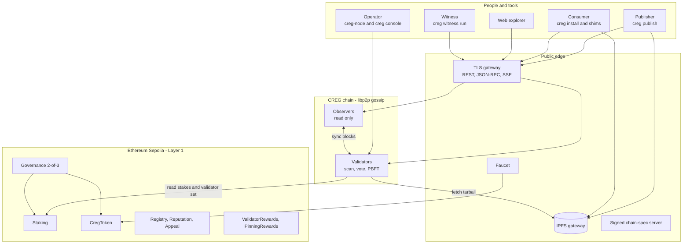

### 2.2 Inside one node

Validators and observers run the **same binary**, `creg-node`. A flag (`CREG_IS_VALIDATOR`) decides whether the scanning and voting parts are switched on.

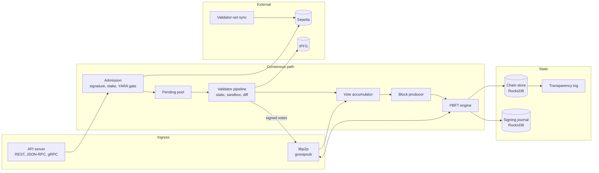

### 2.3 Repository and crate map

The Rust workspace (`chain-registry/`) has 17 crates, about 105,000 lines.

| Crate | Purpose | In the live R7 path? |
|---|---|---|
| `node` | The `creg-node` binary: API, P2P, chain store, sync, admission, L1 sync | **[LIVE]** |
| `cli` | The `creg` command-line tool, TUI console, shims, witness | **[LIVE]** |
| `validator` | Static analysis, sandbox ladder, risk scoring, PGP, reputation | **[LIVE]** (LLM stage skipped) |
| `common` | Block, transaction and package types, chain spec, canonical encoding, transparency log, L1 RPC quorum | **[LIVE]** |
| `consensus` | PBFT, vote accumulator, VRF, validator set, forced inclusion | **[LIVE]** (slashing relay not wired) |
| `resolver` | Client trust: freshness, anti-rollback, light-client proofs | **[LIVE]** |
| `ml-validator` | YARA-X rules, OSV snapshot, threat-intel hashes (not an ML model) | **[LIVE]** |
| `faucet` | tCREG faucet service with PostgreSQL ledger | **[LIVE]** (claims paused) |
| `db-sync` | Chain → PostgreSQL indexer | optional |
| `relayer` | Sponsored (gasless) staking | partly |
| `secrets` | Hot-key loading from Vault or environment | **[LIVE]** |
| `wasm-sandbox` | WASM fallback sandbox | fallback only |
| `zk-validator`, `threshold-encryption`, `ipfs-pinner`, `insurance`, `cross-chain` | Research and future features, flags off | **[BUILT]**, not active |

Other top-level directories: `chain-registry/contracts` (Solidity + Foundry tests), `chain-registry/explorer` (React web explorer), `chain-registry/testnet` (chain specs, compose files, operator scripts), `circuits/` (Circom ZK circuits — retired path), `docs/`.

### 2.4 Technology stack

| Concern | Choice |
|---|---|
| Language and runtime | Rust, Tokio |
| API | axum (REST, SSE, WebSocket), tonic (gRPC), JSON-RPC (`creg_*` methods) |
| Networking | libp2p 0.53: gossipsub, Kademlia, identify, Noise, yamux |
| Consensus crypto | Ed25519 signatures, SHA-256 hashing |
| EVM crypto | secp256k1 wallets, EIP-712 typed signatures, EIP-2612-style permit |
| Storage | RocksDB (chain, signing journal), IPFS/Kubo (tarballs), PostgreSQL (indexer and faucet ledger) |
| Contracts | Solidity 0.8.24, Foundry tests |
| Analysis | YARA-X, OSV advisory snapshot, MalwareBazaar hash snapshot |
| Sandbox | nsjail → gVisor → Docker → WASM, then fail closed |
| Observability | Prometheus, Grafana, Loki, Tempo |

### 2.5 Keys and identities

CREG separates **who you are on the CREG chain** from **who holds your money on Ethereum**.

| Key | Curve | Used for | Held by |
|---|---|---|---|
| **Consensus / publisher key** | Ed25519 | Signing package releases, votes, PBFT messages, peer identity | Publishers, validators, witnesses |
| **EVM wallet key** | secp256k1 | Holding tCREG, staking, signing L1 transactions | Publishers, validators |

Never reuse one key for the other role. A validator binds the two with a **dual-signed identity registration** (an EVM signature and an Ed25519 signature over the same payload). A publisher can let `creg login` derive the Ed25519 key from their wallet via an EIP-712 signature (HKDF-SHA512), so there is only one secret to back up.

### 2.6 Trust boundaries

| Boundary | What is trusted | What is verified instead |
|---|---|---|
| Signed chain spec | A pinned Ed25519 key, compiled into the binary | Every node verifies the spec signature at boot; the genesis hash is bound to it |
| L1 reads (Sepolia) | At least a majority of configured RPC providers agree | Security-critical reads use quorum, not first-success (**[BUILT]**; canary observer only, see §17) |
| Validators | Fewer than one third are Byzantine | Every vote and block signature is verified |
| IPFS | Nothing | SHA-256 of the downloaded bytes must equal the on-chain content hash |
| The public API | Nothing, for installs | Merkle proof and validator signatures are checked on the client |

---

## 3. System workflow

### 3.1 The whole journey in one picture

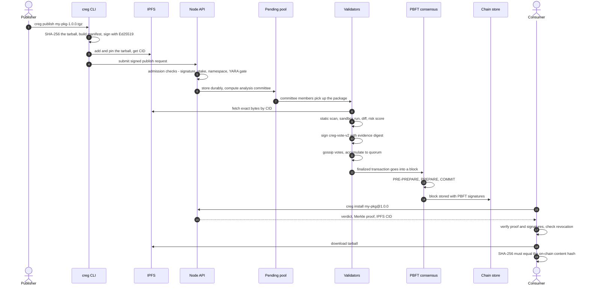

### 3.2 Stage by stage

| # | Stage | Owner | What happens | If it fails |
|---|---|---|---|---|
| 1 | **Prepare** | Publisher CLI | Hash the tarball (SHA-256), declare behavior in a manifest, sign the release payload with Ed25519 (v4 authorization, bound to the chain ID and genesis hash). | Nothing is sent. |
| 2 | **Pin** | Publisher CLI | Upload the tarball to IPFS and get a CID. Validators must be able to fetch it. | Submission later times out with a 502 or fetch error. |
| 3 | **Admit** | Node | Validate the package ID, publisher signature, on-chain stake, namespace ownership, and run the pre-mempool YARA gate. Store the request durably. | HTTP 4xx with a reason; nothing enters the pool. |
| 4 | **Assign** | Node | Compute the **analysis committee** for this package from the validator set and recent randomness (§6.8). | Admission fails closed if a certified committee is required but unavailable. |
| 5 | **Analyze** | Committee validators | Fetch bytes, verify the hash, run static analysis, sandbox, diff against the previous version, produce a risk summary and evidence digest. | Hash mismatch becomes a revoke; fetch failure rejects the package. |
| 6 | **Vote** | Committee validators | Sign a `creg-vote-v2` message and gossip it. | Degraded or incomplete votes are kept for transparency but do not count. |
| 7 | **Reach quorum** | Vote accumulator | When `⌊2M/3⌋ + 1` consensus-grade votes agree, the verdict is final: approve → publish, reject → revoke. | Timeout removes the package from the pool. |
| 8 | **Order** | Block producer | The selected proposer puts finalized transactions into a block (every 5 s when there is work). | Another proposer takes over after a fallback delay. |
| 9 | **Finalize** | PBFT | PRE-PREPARE → PREPARE → COMMIT with `⌊2n/3⌋ + 1` signatures. The block is written to RocksDB. | View change picks a new leader. |
| 10 | **Consume** | Client | Fetch verdict and proof, verify locally, download from IPFS, compare hashes. | Installation stops. CREG is fail-closed. |

### 3.3 Admission checks, in detail

These run on the node that receives the submission (`package_admission.rs`):

1. The package ID must parse as `<ecosystem>:<name>@<version>`.
2. Shielded (encrypted) publishing is refused — it is disabled on the testnet.
3. The publisher signature must verify (v4 authorization after namespace-authority activation).
4. Already **verified** → rejected. Already **revoked** → rejected ("cannot be resubmitted"). Already pending with the same content hash → rejected.
5. **Namespace ownership.** The first accepted version of a name establishes its controller. A different key can publish later versions only through a delegation or an authenticated key rotation.
6. The publisher must have a non-zero **on-chain stake** (read from `Staking.stakedBalance` over L1 RPC and cached). If the stake lookup is unavailable, admission fails closed. The 1 tCREG minimum is enforced by the contract when the stake is created.
7. The **pre-mempool YARA gate** scans the tarball before it can enter the pool.
8. The request is stored in the durable pending pool and the analysis committee is computed.

### 3.4 Package life cycle

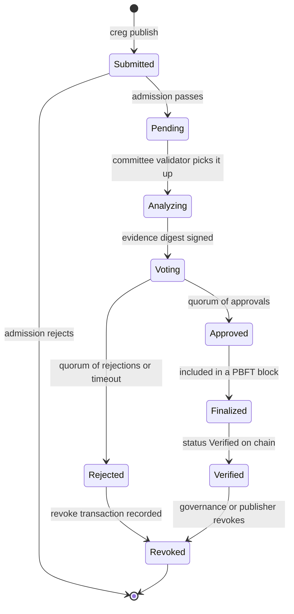

| Status | Meaning |
|---|---|
| `UNKNOWN` | This node has no record and nothing pending. |
| `pending` | Admitted; waiting for validator quorum and block finality. A pending package is durable on the node that admitted it, but it is **not** a global record. |
| `verified` | Recorded on chain after quorum and block finality. Safe to install. |
| `revoked` | Rejected by validators, or revoked later. Cannot be resubmitted under the same version. |

### 3.5 Timings that matter

| Setting | Value | Notes |
|---|---|---|
| Block interval | 5 s (`CREG_BLOCK_INTERVAL`) | Blocks are only produced when there is finalized work. There is **no heartbeat block**, so an idle chain looks frozen. |
| Pending-pool poll | every 1 s | Validator pipeline |
| Vote-accumulator poll | every 500 ms | |
| Vote timeout | 10 s in the chain spec; the node floors it at 120 s | A sandbox run can take that long |
| PBFT phase timeout | 30 s default (`CREG_PBFT_TIMEOUT`) | Then a view change |
| Max view-change retries | 3 default | |
| Proposer fallback | 2 × block interval | Next-ranked proposer may step in |
| Chain sync | every 10 s | Lagging nodes fetch missing blocks |

---

# Part II — How it works inside

## 4. Structure of the blockchain

> **In plain words.** The CREG chain is a list of blocks. Each block holds a handful of "events" (a package was verified, a package was revoked, a validator joined…) and carries the signatures of the validators that agreed to it. Each block also contains the fingerprint of the block before it, so changing any old block would change every fingerprint after it.

### 4.1 Chain at a glance

```
 Block 0 (genesis) ◄── Block 1 ◄── Block 2 ◄── ... ◄── Block N (tip)

 Each block stores   prev_hash = SHA-256 of the previous block's header
 Each header stores  merkle_root = fingerprint of all transactions in the block
 Each block carries  pbft_signatures = the COMMIT signatures that finalized it
```

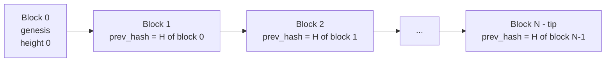

### 4.2 Anatomy of a block

```
Block
├── header
│   ├── height ................ position in the chain (0 = genesis)
│   ├── prev_hash ............. SHA-256 of the previous block's header
│   ├── merkle_root ........... Merkle root over this block's transaction hashes
│   ├── proposer_id ........... validator that proposed this block
│   ├── timestamp ............. strictly later than the parent's
│   ├── validator_set_hash .... fingerprint of the active validator set
│   ├── vrf_output / vrf_proof  proposer-selection randomness (optional)
│   ├── view_number ........... PBFT view in which the block was authorized
│   └── view_change_certificate  quorum of view-change votes (proof only)
├── transactions[] ........... the events (see 4.3)
└── pbft_signatures[] ........ Ed25519 COMMIT signatures over the block hash
```

- **Block hash** = SHA-256 of the JSON-encoded header. The `view_change_certificate` is deliberately **excluded** so a certificate can refer to earlier block hashes without hashing itself recursively.
- **Merkle root** = pairwise SHA-256 of the concatenated hex hashes of the transactions; an odd leaf is duplicated; an empty block uses `sha256("empty")`.
- **Canonical encoding.** Phase C uses `creg-sorted-json-v1`: every JSON object has its keys sorted before hashing. This fixed a real bug (2026-09-26) where the same record hashed differently after a reload because a map was serialized in random order.
- **Genesis.** Height 0, no transactions, `prev_hash` of 64 zeros. In Phase C the genesis header embeds the SHA-256 of the signed chain spec, so a different spec produces a different chain that cannot be confused with this one.

### 4.3 Transactions

Every action on the chain is a typed transaction.

| Type | Purpose | In use on R7 |
|---|---|---|
| `publish_authorized_v1` | A verified package record **plus** the full publisher authorization that proves who allowed it. Mandatory for new publications after namespace-authority activation. | **[LIVE]** — block #11 contains one |
| `publish` | Legacy verified-package record | decodable for history |
| `revoke` | A package was revoked (carries reason, who revoked, evidence hash) | **[LIVE]** |
| `slash` | A validator was penalized | **[BUILT]**, not triggered automatically |
| `validator_join` / `validator_leave` | Validator-set changes | **[BUILT]** |
| `rotate_publisher_key` | Legacy key rotation (nonce-protected) | legacy |
| `namespace_lifecycle` / `namespace_lifecycle_v2` | Delegate, transfer or recover control of a package namespace | **[BUILT]** (CR-07 activation is disabled) |

### 4.4 The package record (`ChainRecord`)

The record is the heart of the registry. It is what a consumer checks.

| Group | Fields | Why it exists |
|---|---|---|
| **Identity** | `id` (`ecosystem:name@version`), `content_hash` (SHA-256), `ipfs_cid` | Binds the verdict to exact bytes |
| **Publisher** | `publisher_pubkey`, `publisher_pubkeys` + `threshold` (multi-sig), `pgp_fingerprint` | Who vouched for it |
| **Status** | `status`: `Verified`, `Pending` or `Revoked { reason }` | The verdict |
| **Validator proof** | `validator_signatures[]` — each has validator ID and pubkey, signature, vote, `evidence_digest`, scanner profile references, risk summary | Independently checkable approvals |
| **Evidence** | `findings[]` (static / sandbox / diff), `evidence_digest`, `analysis_bundles`, `deterministic_risk` (score, band, disposition, finding counts) | What validators actually saw |
| **Manifest** | Declared behavior: network hosts, file writes, process spawns | Compared against observed behavior and the next version |
| **Committee** | `analysis_committee` — size, ordered members, selection seed, effective size, per-member performance at finalization | Auditable proof of *who was asked to review* |
| **Placement** | `block_hash`, `published_at` | Where it lives on the chain |

### 4.5 Storage layout

**On each node** (`{CREG_DATA_DIR}`):

| Store | Contents |
|---|---|
| `chain.rocksdb` | The chain. Column families: `blocks_by_hash`, `blocks_by_height`, `packages`, `namespace_controllers`, `namespace_delegations`, `namespace_lifecycle_nonces`, `applied_namespace_lifecycle_nonces`, `applied_publisher_authorization_nonces`, `publisher_admission_nonces`, `publisher_rotation`, `finalized_work`, `finalized_work_dead_letter`, `transparency_events`, `transparency_leaves`, `transparency_heads`, `reorg_journal` |
| PBFT signing journal | A **separate** RocksDB that records every vote the validator has signed (§5.4) |
| `pending_pool.json` | Admitted packages awaiting consensus |
| `authority-artifacts/` | Evidence archived for namespace-authority claims (when enabled) |

**Beside the nodes:**

| Store | Contents |
|---|---|
| **IPFS** | The package tarballs, addressed by CID |
| **PostgreSQL (indexer)** | A *mirror* for the explorer: `sync_state`, `packages`, `validator_votes`, `blocks`, `publisher_stats`. The node itself reads RocksDB, not PostgreSQL. |
| **PostgreSQL (faucet)** | The faucet's claim and reconciliation ledger |

### 4.6 The signed chain spec

The **chain spec** is a signed JSON file every node loads at boot. It is the network's constitution.

| Field | R7 value |
|---|---|
| `chain_id` | `creg-phase-c-testnet-2026-09-26-r7` |
| `genesis_hash` | `0x1852b9a86dd3b53e7b2de4a774723a4fe48e862f9c61d14e5917b42b21055234` |
| `genesis_time` | 2026-09-26T06:11:38Z |
| `consensus_params` | block time 5 s · max validators 50 · quorum 67% · publisher stake 1 tCREG · validator stake 100 tCREG · slash 2% / 10% / 30% · unbonding 1,209,600 s (14 days) · vote timeout 10,000 ms · encoding `creg-sorted-json-v1` |
| `l1` | Sepolia, chain ID 11155111, minimum finality 6 blocks |
| `feature_flags` | `ml_validation`, `wasm_sandbox`, `private_registries` on · `zk_validation`, `cross_chain`, `insurance`, `threshold_encryption` **off** |
| `validator_set` | validator-1…4, each with 100 stake, reputation 100, active |
| `bootnodes` | 2 (Europe and Africa regions) |
| `signing` | Ed25519, public key `3fe87833…1c01`, pinned at build time (a runtime override is ignored) |

Changing any signed value invalidates the signature, which is why fixes to the spec (for example support contacts) wait for the next re-sign.

### 4.7 Transparency log

Every finalized change is also appended to a **transparency log**: a Merkle tree whose **signed tree heads** can be checked for consistency over time. Witnesses poll the head, verify that each new head extends the old one (a *consistency proof*), and co-sign it. A client that sees a witnessed head knows the operator is not showing it a private version of history. The software is **[BUILT]** and works, but no independent witness exists yet, so split-view protection is theoretical today.

### 4.8 Reorganizations

The chain is BFT-final, so forks should not occur. Sync still supports recovery from forks up to `MAX_REORG_DEPTH = 64` blocks, replaying namespace and nonce state deterministically. Deeper divergences need operator intervention.

---

## 5. Consensus

> **In plain words.** CREG makes two separate group decisions. First, *"is this package safe?"* — decided by the reviewers assigned to that package. Second, *"which batch of decisions goes into the next block, and in what order?"* — decided by all validators. Both use the same rule: more than two thirds must agree.

### 5.1 Two layers

| | **Layer 1 — package evidence** | **Layer 2 — block finality** |
|---|---|---|
| Decides | Whether a package becomes verified or rejected | Whether a block is final |
| Run by | The package's **analysis committee** (`M` members) | The full validator set (`n` validators) |
| Message domain | `creg-vote-v2` | `creg-pbft-v1` |
| Threshold | `⌊2M/3⌋ + 1` consensus-grade approvals | `⌊2n/3⌋ + 1` signatures |
| Cost | Heavy compute (scanner, sandbox) | Light (hash and sign) |
| Code | `consensus/vote_accumulator.rs` | `consensus/pbft.rs` |

`M = n` while `n ≤ 50` and is capped at 100 above that. With 4 validators, `M = n = 4`.

### 5.2 Quorum arithmetic

`quorum = ⌊2n/3⌋ + 1` and `f = ⌊(n−1)/3⌋` Byzantine faults tolerated.

| Validators `n` | Faults tolerated `f` | Quorum | Can be offline |
|---:|---:|---:|---:|
| 3 | 0 | 3 (strict) | 0 |
| **4 (today)** | 1 | 3 | 1 |
| 5 | 1 | 4 | 1 |
| 6 | 1 | 5 | 1 |
| **7 (recommended next step)** | 2 | 5 | 2 |
| 10 | 3 | 7 | 3 |

Five and six validators add no fault tolerance over four. Seven is the first real improvement. A three-validator set needs unanimity unless a dev-only flag (`CREG_PBFT_ALLOW_SMALL_CLUSTER_QUORUM`) is set; that flag is never a production assumption.

### 5.3 Layer 1: package evidence votes

Each committee validator signs this domain-separated message:

```text
creg-vote-v2|<canonical>|<content_hash>|<approved>|<validator_pubkey>|<scanner_profile_digest>|<evidence_digest>
```

Because the message binds the package ID, exact content hash, scanner profile and evidence digest, a signature cannot be replayed for a different package, a different decision, or a different set of evidence.

A vote counts toward quorum only if it is **consensus-grade**:

- the signer is a known active validator and the Ed25519 signature is valid;
- the evidence digest is non-empty and the analysis bundle references are complete;
- the scanner profile is not degraded (no mock model, no dev-sandbox bypass, no missing YARA rules);
- the quorum votes agree on the same profile and evidence.

Duplicate votes from one validator count once. Enough rejections make approval impossible and the package is rejected. In the live block #11, all three approving validators carry the **identical** evidence digest — exactly what a deterministic scanner should produce.

### 5.4 Layer 2: PBFT block finality

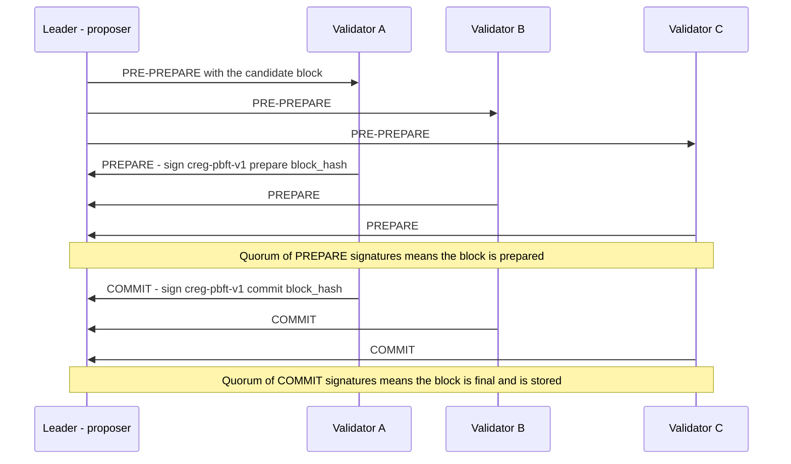

(In practice every message is gossiped to everyone; the diagram shows the logical flow.)

**Phase signature format:** `creg-pbft-v1:<phase>:<block_hash>`.

**Leader failure → view change.** If a round does not progress within the phase timeout, validators sign a **view-change vote** for the next view. A replacement leader needs a certificate of `2f + 1` view-change votes (3 of 4 today) and must carry forward the highest block that already reached PREPARE quorum. This is what prevents two different blocks from ever committing at the same height. The team found and fixed a real counterexample here during Phase C: copying only the transaction root into a replacement header changes the block hash.

**The durable signing journal** is the most important safety artifact in the repository:

- It is a separate RocksDB database, bound to `(genesis_hash, validator_id, pubkey)`.
- Every PREPARE lock, COMMIT lock and view-change vote is written with an fsync **before** the vote is broadcast.
- PREPARE locks are per view; COMMIT locks span all views at one height.
- A node refuses to start if its journal is missing or belongs to a different identity ("recover its original durable state before signing").

This is the equivalent of Tendermint's `priv_validator_state`: a restarted validator can never be tricked into signing two conflicting votes.

**Other rules:** every block's timestamp must be strictly later than its parent's; a live proposal must use whole Unix seconds and be within 60 s of the receiver's clock (so validators need NTP); unknown validators are rejected at P2P ingress; observers never vote.

### 5.5 Choosing the proposer

The next proposer is chosen by a **VRF-seeded ranking** of the validator set. If the VRF proofs are incomplete, a deterministic ranking is used. If the tip stalls for twice the block interval, the next-ranked validator may propose. For a permissioned alpha this is acceptable; a hard VRF guarantee matters for mainnet.

### 5.6 Censorship resistance

A **forced-inclusion tracker** watches for transactions that proposers keep leaving out. After a delay (default 5 blocks, `CREG_FORCED_INCLUSION_DELAY`) an omitted transaction can be flagged as evidence of griefing.

### 5.7 Who is in the validator set

The validator set is **chain-authoritative**: nodes read it from the `Staking` contract's events on Sepolia, after a finality lag, and apply changes deterministically. New validator-set transitions are signed by a quorum of the *preceding* set, so a rebuilt node can verify history from a trusted checkpoint (`CREG_WEAK_SUBJECTIVITY_CHECKPOINT`).

---

## 6. Validator architecture

> **In plain words.** A validator is a server that (1) proves it has real money at stake, (2) inspects each package it is asked about in a sealed sandbox, (3) signs what it found, and (4) helps all other validators agree on the order of results. It must run on its own, independently controlled hardware — running three validators yourself does not make the network safer.

### 6.1 Validator versus observer

Both are the same `creg-node` binary; configuration decides the role.

| | **Validator** | **Observer** |
|---|---|---|
| `CREG_IS_VALIDATOR` | `true` | `false` (default) |
| Admits publish requests | Yes | Yes (keeps them pending) |
| Drains the pending pool and analyzes | **Yes** | No |
| Signs package votes | **Yes** | No |
| Takes part in PBFT | **Yes** (PREPARE, COMMIT) | No — syncs finalized blocks |
| Serves public API reads | Yes | Yes (usually the public face) |

An observer deliberately does not drain the pending pool: if it did, packages would vanish from the API without a chain record.

### 6.2 Runtime architecture

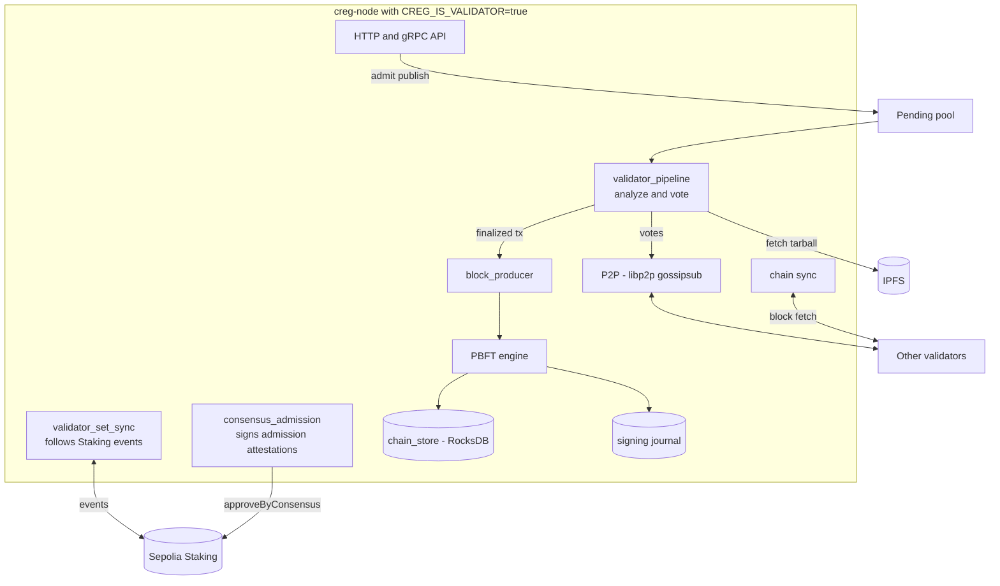

| Subsystem | Module | Job |
|---|---|---|
| Validator-set sync | `validator_set_sync.rs` | Polls `Staking` events; updates the active set after a finality lag; uses RPC quorum |
| Consensus admission | `consensus_admission.rs` | Signs EIP-712 attestations for pending validator applicants |
| Validator pipeline | `validator_pipeline.rs` | Drains the pending pool, analyzes, signs and gossips votes |
| Block producer | `block_producer.rs` | Builds blocks from finalized transactions; runs on every node so nothing is dropped when it is not the proposer |
| PBFT engine | `consensus/pbft.rs` | PRE-PREPARE → PREPARE → COMMIT; view changes |
| P2P | `p2p.rs` | Gossip with ingress validation, peer scoring, rate limiting |
| Chain sync | `sync.rs` | Catches up from peers; reorg recovery to depth 64 |

### 6.3 What a validator does for one package

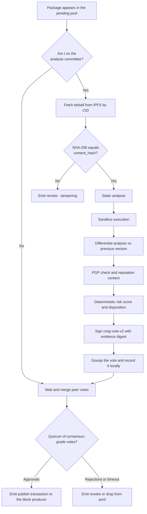

### 6.4 The analysis pipeline, stage by stage

| Stage | Where | What it looks for |
|---|---|---|
| **Admission gate** | `node/admission_scan` | Quick YARA pre-scan before the package enters the pool |
| **Static analysis** | `validator/static_analysis.rs` | Dangerous APIs, install hooks, obfuscation and high-entropy blobs, credential-exfiltration patterns, typosquatting signals, ecosystem-specific files, pinned advisories |
| **Behavioral sandbox** | `validator/sandbox.rs` | Runs install lifecycle scripts in isolation and records network hosts, file writes, process spawns, timeouts and manifest violations |
| **Differential analysis** | `validator/diff.rs` | Compares with the prior verified version — a new network beacon or install script raises risk |
| **Deep scan** | `ml-validator/deep_scan.rs` | YARA-X rule probability, OSV advisories, known-bad content hashes (see §6.5) |
| **PGP** | `validator/pgp.rs` | Optional detached signature verification |
| **Reputation** | `validator/reputation.rs` | Publisher and validator history as a *context* signal, never a substitute for evidence |
| **LLM review** | `validator/llm.rs` | Advisory only; **skipped** on the live fleet; never a trust root |

**Sandbox ladder.** The validator tries `nsjail` first, then `gVisor`, then `Docker`, then `WASM`. If none is available it **fails closed**. The dev bypass (`CREG_DEV_SANDBOX=true`) injects a High finding (`SB012`) and is prohibited on public validators. The sandbox looks for reverse shells (`/bin/sh` spawns), reads of `~/.ssh` or `~/.aws`, outbound sockets to unknown hosts, and obfuscated payload unpacking such as `eval()`.

**Determinism.** Consensus needs every validator to reach the same answer. The scanner therefore uses **pinned inputs**: a digest-pinned OSV snapshot, a MalwareBazaar hash snapshot and a YARA rule bundle. Live lookups and LLM output are advisory and kept out of the consensus path. The scanner profile digest must match across the fleet, or votes are rejected as mismatched.

### 6.5 Risk scoring and the verdict

Each validator turns its findings into a score from 0 to 100:

```text
score = deterministic_score
      + 25 × (critical findings)
      + 15 × (high findings)
      +  5 × (medium findings)
      +  1 × (low findings)
      ± reputation adjustment            (clamped to 0..100)
```

| Score | Band |
|---|---|
| 0–19 | low |
| 20–44 | guarded |
| 45–69 | elevated |
| 70–89 | high |
| 90–100 | critical |

| Disposition | Rule | Vote effect |
|---|---|---|
| **Block** | any critical finding, **or** score ≥ 85 (`CREG_RISK_BLOCK_THRESHOLD`) | Rejecting verdict |
| **Review** | score ≥ 55 (`CREG_RISK_REVIEW_THRESHOLD`), or any high finding | Approve with a recorded warning |
| **Accept** | otherwise | Approve |

> **Honest limitation.** Only the Block disposition stops a package. "Guarded" and "elevated" packages are still approved with a warning. The deep scan combines its layers with `max()`, so any single detector can raise a flag, which is why popular benign packages (`ms`, `kleur`, `has-flag`, `escape-html`) show as guarded or elevated on the testnet. The component named "AI Deep Scan" is a rule-and-hash engine; the ML model is retired. In practice the scanner blocks known-bad hashes, strong YARA hits and OSV malware entries; novel malware can pass. See §17.

### 6.6 Analysis committee selection

At admission time the node picks the committee for each package:

1. Snapshot the active validator set (with stake and EVM address).
2. Seed = `SHA256("hybrid:" + canonical + content_hash + vrf_output_or_tip_hash)`, where `vrf_output` comes from a recent finalized block.
3. For each validator, `score = u128(SHA256(seed + validator_id))`, then divide by stake (and by reputation and performance factors) so higher-stake, higher-performing validators rank earlier.
4. Sort ascending. Enforce a **cap of 4 slots per EVM address** so one operator cannot dominate.
5. The ordered list is attached to the pending entry, gossiped, and later written into the chain record.
6. On timeout, the effective committee can expand along the pre-computed order.

Other validators recompute the assignment and reject any substitution. In certified mode the selection is also bound to the authenticated validator set, a fork anchor and the public randomness. Today `M = n = 4`, so every validator is on every committee; the cap and sampling matter once the set grows beyond a few dozen. Only mandatory members vote in the public alpha; voluntary analysis is **[DESIGN]**.

### 6.7 Validator life cycle on Ethereum

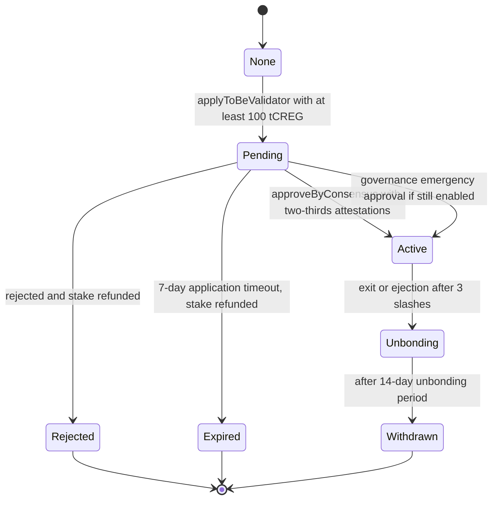

**Mechanical admission (`approveByConsensus`).** No foundation key admits a validator:

1. The applicant stakes at least the minimum and becomes `Pending`.
2. Each active validator checks a deterministic rule set (stake present, identity registered, cooldown respected, application not expired, rule-set version current) and signs an **EIP-712 attestation** over `(applicant, stake, nonce, ruleSetVersion, validatorSetEpoch)`.
3. Any node holding attestations from at least two thirds of the active set submits the sorted bundle to `Staking.approveByConsensus`.
4. The contract verifies: applicant is `Pending`, stake ≥ minimum, application inside the timeout, nonce unused, the signed epoch equals the live epoch, signers are active, strictly sorted (no duplicates), signatures recover correctly, and `signerCount × 3 ≥ activeCount × 2`.

A governance **emergency** approve/reject path exists and can be disabled permanently; **on R7 it is still enabled** and `disableEmergencyGovernance()` has not been called.

### 6.8 Penalties

| Offense (design) | Penalty | Status |
|---|---|---|
| Low severity | 2% of stake | Contract supports it |
| Medium severity | 10% | Contract supports it |
| Critical severity | 30% | Contract supports it |
| Third slash | Automatic ejection to unbonding, then a 7-day re-stake cooldown | Contract supports it |

Slashed tokens go to a **slash pool** (they are not burned) and can be redistributed to honest active validators. Validators stay slashable while unbonding, so they cannot misbehave and instantly exit.

> **Detection only, on one observer.** Nothing triggers a slash today, so a validator that double-signs suffers no penalty. Detection itself now exists: a node started with `CREG_EQUIVOCATION_DETECTION=true` records self-contained, independently verifiable evidence, serves it at `/v1/public/evidence/equivocation`, exports metrics and raises a critical alert. It never slashes. Since 2026-11-15 it runs on **observer-3 only** (the r34 image). Because the chain is idle, it has not yet seen a PBFT round. The design, the penalty paths and the observer-3 canary procedure are in [ADR-016](./adr/ADR-016-EQUIVOCATION-SLASHING.md) (§18).

### 6.9 Requirements and configuration

| Requirement | Value |
|---|---|
| Hardware | 4 vCPU, 8 GB RAM, 50 GB SSD, Linux (or Windows with Docker Desktop) |
| Network | Reliable connection; inbound port 9000 (P2P) reachable |
| Stake | ≥ 100 tCREG staked as validator |
| Sandbox | Real engine (`nsjail`, `gVisor` or `Docker`); dev bypass forbidden |
| Scanner profile | Matches the fleet digest; YARA rules mounted |
| Clock | NTP-synced (PBFT rejects proposals more than 60 s off) |
| Uptime target | ≥ 95% during alpha |
| L1 access | An RPC with **full log history** for Sepolia (pruned providers break validator-set sync) |
| Independence | Own keys, accounts, monitoring and incident authority |

| Variable | Purpose |
|---|---|
| `CREG_IS_VALIDATOR=true` | Enable the analysis and voting pipeline |
| `CREG_VALIDATOR_KEY` | Ed25519 private key (hex) |
| `CREG_NODE_ID` | Must match the registered identity |
| `CREG_CHAIN_SPEC_URL` | Signed chain spec (boot trust root) |
| `CREG_ETH_RPC`, `CREG_ETH_RPC_FALLBACKS` | Sepolia RPCs; fallbacks enable quorum reads |
| `CREG_STAKING_ADDR` | Staking contract (adopted from the signed spec if empty) |
| `CREG_IPFS_URL` | IPFS API for fetching tarballs |
| `CREG_P2P_LISTEN`, `CREG_P2P_SEEDS` | Peer connectivity |
| `CREG_YARA_RULES_DIR` | YARA rules (votes are degraded if empty) |
| `CREG_DEV_SANDBOX` | Must be unset or `false` |
| `CREG_WEAK_SUBJECTIVITY_CHECKPOINT` | Verified validator-set checkpoint for new or rebuilt nodes |

### 6.10 Health signals

| Signal | Healthy |
|---|---|
| `GET /v1/health` | HTTP 200; `validator_set_sync.state` is `synced`, not `degraded` |
| `GET /v1/chain/stats` | `tip_height` advances when there is work; `peer_count` > 0; active validators match the fleet |
| `GET /v1/runtime/config` | `sandbox_engine` ∈ {nsjail, gvisor, docker}; `sandbox_dev_bypass` = false |
| Vote participation | Your node appears in `validator_votes` for new packages |
| Metrics | `creg_chain_tip_age_seconds` is bounded when work is pending |

---

## 7. Tokenomics

> **In plain words.** CREG the token is a *deposit and incentive* token, not a currency and not the fuel for transactions. Publishers lock a small amount to show they are serious; validators lock a larger amount that can be partly confiscated if they misbehave. A capped reserve is meant to pay validators for real work later. On the testnet the token is called **tCREG** and has no monetary value. Gas on Sepolia is paid in Sepolia ETH.

### 7.1 Token facts

| Property | Value |
|---|---|
| Name / symbol | Chain Registry Token / `CREG` (`tCREG` on testnet) |
| Standard | ERC-20 with `permit` (gasless approvals), `mint` (owner only) and `burn` |
| Decimals | 18 |
| **Maximum outstanding supply** | **42,000,000** |
| Initial supply minted at deployment | **20,000,000** |
| Unminted headroom | 22,000,000 |
| Mint authority | The token owner — on R7, the 2-of-3 Governance contract |
| Gas token? | **No.** Sepolia ETH pays gas. |
| Token address (R7) | `0xbC2a72107C6765364D0A822a88A6e6C61f30EAa6` |

### 7.2 What the token is for

| Function | How |
|---|---|
| **Publisher bond** | Locked before publishing; at risk if a package is revoked as malicious |
| **Validator bond** | Locked to join consensus; slashable |
| **Slash redistribution** | Confiscated stake accumulates in a pool for honest validators |
| **Reserve for growth** | The capped reserve can fund validator rewards, grants and ecosystem work by governance decision |

There is **no per-package fee, no transaction fee, no block reward and no scheduled inflation**. The token has no verified market value, and no document defines fee capture, a buy-back or a demand model.

### 7.3 Supply and allocation

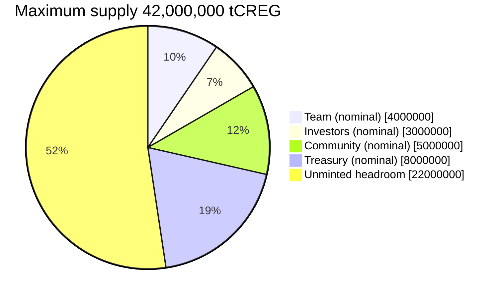

| Bucket | Amount | Share of cap | What actually happened on R7 |
|---|---:|---:|---|
| Team | 4,000,000 | 9.52% | Minted to the **treasury/deployer address** |
| Investors | 3,000,000 | 7.14% | Minted to the treasury/deployer address |
| Community | 5,000,000 | 11.90% | Minted to the treasury/deployer address |
| Treasury | 8,000,000 | 19.05% | Minted to the treasury/deployer address |
| **Initial total** | **20,000,000** | 47.62% | All 20,000,000 started in **one address** |
| Unminted headroom | 22,000,000 | 52.38% | No balance exists until a governance mint |

> **Important.** The four bucket names are an *intended* distribution, not four separate wallets. The fresh Phase C deployment passed the same address for all four constructor recipients, so no on-chain separation, lockup or vesting exists. The 2026-09-28 snapshot showed that address holding 19,989,590 of 20,000,000 tCREG (99.95%).

**How the cap works.** The contract enforces `totalSupply + mintAmount ≤ 42,000,000`. This caps *outstanding* supply, not lifetime issuance: `burn` lowers `totalSupply` and therefore reopens headroom. There is no emission schedule, vesting curve or automatic mint. The "42M maximum supply" claim is accurate, but "no more than 42M can ever be minted in total" is not.

**Testnet target.** The decision recorded on 2026-09-28 is to reach 42,000,000 tCREG outstanding through a reviewed 2-of-3 Governance `mint`, with the new reserve held by the Governance contract and released in approved tranches. **That mint has not been executed.**

### 7.4 Where the tokens move

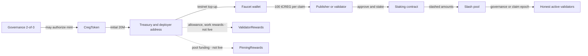

### 7.5 Staking and bonds

| Role | Minimum | Contract call | Notes |
|---|---:|---|---|
| **Publisher** | 1 tCREG | `stakeAsPublisher` | Admission needs a non-zero on-chain stake |
| **Validator** | 100 tCREG | `applyToBeValidator` | Governed by `updateMinStakes` |
| Light validator | 50 tCREG | constant only | Not the normal admission path |
| Namespace tiers | 1 / 3 / 10 tCREG | tier minimums | Standard / Infrastructure / RootCritical; tunable |
| Pinner | 1,000 tCREG | `PinningRewards` | Program is unfunded |
| Appeal | 0.1 **ETH** | `Appeal.sol` | Paid in Sepolia ETH, not tCREG |
| Panelist vote | 0.01 **ETH** | `Appeal.sol` | Correct voters split losers' bonds |

| Time parameter | Value |
|---|---|
| Validator application timeout | 7 days |
| Unbonding (validator exit) | 14 days |
| Re-stake cooldown after ejection | 7 days |
| Publisher release-bond liability window | 30 days |
| Automatic ejection | after 3 slashes |

**Publisher bond lifecycle.** The bond is reserved when a release is qualified and stays reserved for a 30-day challenge window. If governance revokes the package as malicious, the reserved amount can be slashed into the slash pool. Otherwise it can be released after the window.

### 7.6 Rewards: designed, not live

The reward contract (`ValidatorRewards`) pays a tiny amount per verified package, so the capped supply can last a very long time.

| Case | Formula | At reputation 100 |
|---|---|---:|
| Correct vote | `0.000010 + 0.000005 + (0.000010 × reputation / 500)` | **0.000017 tCREG** |
| Incorrect vote | `0.000010 − 0.000001` | 0.000009 tCREG |

*Illustration only:* four validators earning 0.000017 each move 0.000068 tCREG per package; one million packages would cost 68 tCREG. This is arithmetic on the formula, **not** a forecast or a promise. Package volume, gas, operator costs and token value are unknown, and a tiny token payout does not prove that running a validator is economically attractive.

**Status — [BUILT], not live.** Rewards paid so far: **zero**. The node deliberately skips L1 reward dispatch (`validator_pipeline.rs`) until a durable, replay-safe dispatcher exists. Before activation the contract needs repair:

- no per-package replay protection and no verification of vote data;
- the reputation input is not capped;
- the points calculation compares the vote with the wrong flag (a correct *reject* can lose its bonus);
- a simplified payout path can accrue more than it pulls;
- the treasury granted the contract a near-unlimited allowance.

**Pinning rewards (`PinningRewards`).** Pinners stake 1,000 tCREG and earn 0.01 tCREG per GB per day for pinned CIDs, doubled after more than 1,000 reported accesses and scaled by their verification success rate; a failed verification burns 1% of their stake into the pool. **[BUILT]**, pool balance zero, and the code has open bugs (anyone can call `reportAccess`; CID/pinner accounting can overwrite; a pinner with no rewards can be unable to withdraw). Do not fund it yet.

### 7.7 Faucet and testnet distribution

The faucet gives testers tCREG. It is a **bounded, prefunded wallet**, not a mint.

| Parameter (R28/R29 policy) | Value |
|---|---:|
| Tokens per claim | 100 tCREG |
| Per-address lifetime ceiling | 100 tCREG (one claim) |
| Daily program ceiling | 50,000 tCREG |
| Cumulative claim ceiling | 1,000,000 tCREG |
| Working-balance limit | 100,000 tCREG |
| Cooldown | 60 s per address and per IP |
| Anti-abuse | Browser proof-of-work (20 leading zero bits) |
| Sepolia ETH per claim | **0** — you must get gas ETH elsewhere |

On 2026-09-29 the treasury sent 92,000 tCREG to the faucet (on top of the earlier 10,000 seed), taking the working balance to 100,000. As of 2026-11-14 the faucet holds 99,900 tCREG but **token claims are paused**: its ledger cannot reconcile against Sepolia Transfer history (most likely the same pruned-RPC problem that degrades validator-set sync). A single 100 tCREG claim is enough for one validator stake or 100 publisher stakes.

### 7.8 Custody and control (testnet facts)

| Control | Holder |
|---|---|
| Token `owner` (can mint) | Governance contract (2-of-3) |
| Treasury balance | One EOA (≈ 19.9 million tCREG after the faucet top-up; verify on-chain) |
| Staking contract `owner` | The **deployer EOA** — not the multisig |
| PinningRewards admin and verifier roles | The deployer EOA |
| Governance delay | **None.** Approved proposals execute immediately (no timelock) |

A 2-of-3 pair of Governance signers can therefore mint up to the cap, and one EOA controls the existing balance and several economic settings. This is acceptable for a maintainer-run testnet and must be fixed before mainnet.

### 7.9 What is live and what is not

| Mechanism | Status |
|---|---|
| Publisher and validator staking | **[LIVE]** — 4 validators staked 100 each |
| Validator admission by two-thirds attestations | **[LIVE]** |
| Faucet distribution with durable ledger | **[LIVE]** (claims paused) |
| Slash-pool contract and severity tiers | **[BUILT]** — never triggered |
| Automatic slashing from the node | **[DESIGN]** — not wired |
| Validator work rewards | **[BUILT]** — dispatch disabled, zero paid |
| Pinning rewards | **[BUILT]** — unfunded, buggy |
| 22M reserve mint | **[DESIGN]** — approved as a target, not executed |
| Protocol fees, buy-back, revenue model | **[DESIGN]** — none defined |
| Allocation vesting and lockups | **[DESIGN]** — none implemented |

### 7.10 Before any mainnet economics

1. Publish a real allocation and custody policy: separate wallets or vesting contracts, signers, spending limits, reporting.
2. Ship reward contract v2: one payout per `(chain, finalized package, finalization hash)`, bounded inputs, exact pre-funding, durable dispatcher in the node.
3. Wire and prove equivocation slashing; add a governance **timelock**; transfer Staking ownership to Governance.
4. Model security budget: validator costs, expected package volume, treasury runway, abuse cases.
5. Decide whether burning should reopen mint headroom (a cumulative cap needs a new token version).
6. External audit of token, staking, registry, rewards and governance, and a legal review of any distribution.

---

## 8. Smart contracts on Sepolia

### 8.1 The deployed R7 set

| Contract | Role | Live use |
|---|---|---|
| `CregToken` | ERC-20 tCREG; mint, burn, permit | Yes |
| `Staking` | Publisher and validator bonds, admission, unbonding, slashing, slash pool | **Core** — validator set and publisher gate |
| `Governance` | 2-of-3 multisig: proposals, parameter changes, emergency pause, token ownership | Yes |
| `Registry` | L1 package lifecycle and EIP-712 finalize/revoke paths | **Effectively unused** by the live path |
| `Reputation` | Validator and publisher scoring signals | Present |
| `Appeal` | Appeal mechanics with ETH bonds | Present |
| `ValidatorRewards` | Work-reward escrow and claims | Deployed, **inactive** |
| `PinningRewards` | Storage incentive pool | Deployed, **inactive**; address not in the signed spec |
| `VRF`, `ZKVerifier` | On-chain randomness and Groth16 verifier | **Not deployed** (zero address) |

Contracts in the repository but **not** in the R7 deployment: `CrossChainRegistry`, `GovernanceV2`, `PackageInsurance`, `SlashingEvidence`, `ZKSlashingVerifier`, `Groth16Verifier`, `BatchOperations`, `PrivateRegistry`. About half of the production Solidity is outside the live path.

### 8.2 Four consensus surfaces

| Surface | Verified where | Threshold |
|---|---|---|
| Validator admission | `Staking.approveByConsensus` (on-chain) | ≥ 2/3 of active validators |
| Package evidence | CREG vote accumulator (off-chain) | `⌊2M/3⌋ + 1` committee approvals |
| Block finality | CREG PBFT engine (off-chain) | `⌊2n/3⌋ + 1` validators |
| L1 package finalization | `Registry.finalizePackage` (on-chain) | EIP-712 verdicts meeting `quorumPct` (67%) — **unused on R7** |

### 8.3 How L1 is used today

- The node reads the **validator set** from `Staking` events.
- The node reads **publisher stake** from `Staking.stakedBalance` at admission.
- Governance holds token ownership and Staking's governance role.
- **L1 checkpointing and ZK anchoring are retired.** Sepolia does not settle or finalize CREG blocks.

### 8.4 Known contract issues

Proof-of-concept tests confirmed three bugs; fixes are in the working tree but **not yet deployed** (deploying means a contract migration with new addresses and a re-signed spec).

| ID | Issue | Source fix |
|---|---|---|
| AUD-07 | `_validatorList` is never de-duplicated, so a re-applying validator is counted twice and can inflate quorum | De-duplicated with a membership map |
| AUD-08 | Slash-pool shares are computed from a shrinking pool (order-dependent payouts; can block the next epoch) | Epoch snapshot with carry-over |
| AUD-09 | A publisher who self-revokes gets the bond released without a slash | Bond stays reserved for the 30-day window |

Other open items: no governance timelock; an emergency admission path that remains enabled; silent `try/catch` blocks hide accounting failures in `Registry`.

---

# Part III — User flows

## 9. Publisher flow

> **In plain words.** To publish: get a small deposit of tokens, lock it, sign your package, upload it, and wait while the validators inspect it. When they agree, your package is stamped "verified" and anyone can install it with proof that it is exactly what you released.

> **Heads-up (as of 2026-11-14).** The public testnet is a maintainer-run alpha. Faucet claims are paused and the scanner is currently tuned **per package** (publishing a *new* package name requires a fleet-wide scanner-profile rollout by operators). Treat the steps below as the intended flow; if the faucet or admission is unavailable, check the status in §17 first.

### 9.1 The journey

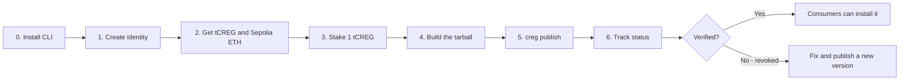

### 9.2 Step by step

**Step 0 — Install the CLI and point it at the network**

```bash
# from a clone of the repository (see releases for the latest tag, e.g. v0.4.9-testnet)
./chain-registry/scripts/install-creg.sh --version v0.4.9-testnet     # Linux and macOS
.\chain-registry\scripts\install-creg.ps1 -Version v0.4.9-testnet     # Windows PowerShell

# or build from source
cd chain-registry && cargo build --release -p cli

export CREG_NODE_URL=https://api.testnet.cregnet.dev
export CREG_IPFS_URL=https://ipfs.testnet.cregnet.dev
creg doctor        # checks configuration, warns if the node is remote but IPFS is local
```

**Step 1 — Create your identity.** Choose one:

```bash
# Option A (recommended): derive the Ed25519 key from your Ethereum wallet.
creg login                       # opens the wallet bridge; sign the EIP-712 request
creg login --private-key 0x...   # headless or CI
creg profile                     # shows your EVM address and Ed25519 public key

# Option B: generate keys by hand.
creg keygen publisher --key-path ~/.creg/publisher.key
# ...and use a separate Ethereum wallet for staking.
```

**Step 2 — Get tokens.** You need tCREG for the stake and Sepolia ETH for gas.

```bash
creg testnet drip 0xYourEthAddress --faucet-url https://faucet.testnet.cregnet.dev
```

The faucet sends **100 tCREG and no ETH**; get Sepolia ETH from a public Sepolia faucet.

**Step 3 — Stake as a publisher.** This performs the ERC-20 approve and `stakeAsPublisher`.

```bash
creg stake 1 --role publisher \
  --key-file ~/.creg/publisher-eoa.key \
  --rpc-url "$SEPOLIA_RPC_URL" \
  --staking-addr 0x61c00EBe7C46f0bcE63942F7E15Bcc434DFC9B7C \
  --token-addr   0xbC2a72107C6765364D0A822a88A6e6C61f30EAa6
```

> Older guides show `--amount`; the current CLI takes the amount as a positional argument. Run `creg stake --help` to confirm. Use the **R7** addresses above — addresses in older guides belong to the retired `creg-testnet-1` network.

**Step 4 — Build your tarball** with normal tooling:

```bash
npm pack                     # Node.js
python -m build --sdist      # Python
cargo package                # Rust
```

**Step 5 — Publish**

```bash
creg publish ./my-package-1.0.0.tgz \
  --key-file ~/.creg/publisher.key \
  --publisher-address 0xYourStakedEvmAddress
# With an active `creg login` profile, the key and address are taken from your profile.
```

Useful variants:

| Need | Command |
|---|---|
| Sign on an offline machine | `creg publish ./pkg.tgz --offline signed.json`, then `creg submit-signed signed.json` |
| Declare behavior explicitly | `--manifest ./manifest.json` |
| Different IPFS | `--ipfs-url https://ipfs.testnet.cregnet.dev` |
| Multi-signature (legacy, lab only) | `--extra-key-file ...` (disabled unless `CREG_ALLOW_LEGACY_PUBLISHER_PROOF=true`; never in production) |

**Step 6 — Track it**

```bash
creg status npm:my-package@1.0.0        # pending, verified or revoked
creg watch --filter packages            # live event stream
creg chain-record npm:my-package@1.0.0  # full record, including the committee
```

Or open the explorer at `https://explorer.testnet.cregnet.dev`.

### 9.3 What happens behind the scenes

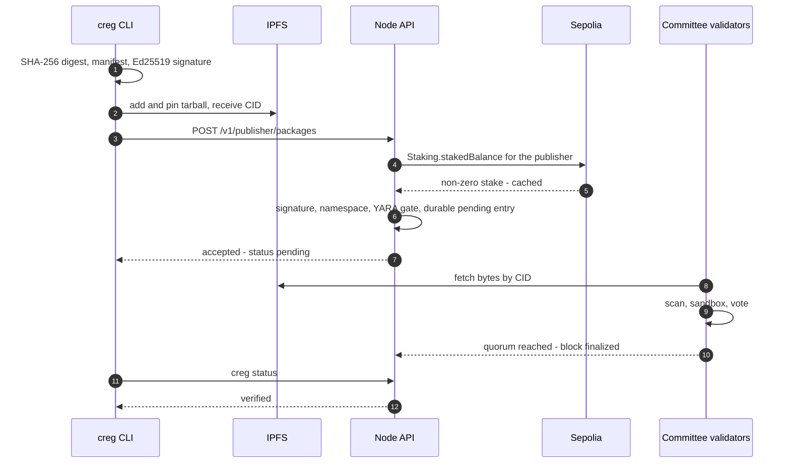

### 9.4 Outcomes

| You see | Meaning | What to do |
|---|---|---|
| `pending` | Waiting for committee votes or block finality | Wait; check the explorer |
| `verified` | Quorum approved and the block is final | Done — consumers can install |
| `revoked` | Validators rejected it, or it was revoked later | The ID cannot be reused. Fix the issue and publish a **new version** |
| `UNKNOWN` | The node you asked has no record | Ask the node that admitted it; pending state is not global |

### 9.5 Your money and responsibilities

- **Bond:** 1 tCREG, held in the `Staking` contract. It stays at risk for a 30-day window after a release, and governance can slash it if a package is revoked as malicious.
- **Namespace ownership:** the first accepted version of a name makes your key the controller. Later versions must be signed by you or by a key you delegate to. Key rotation is an explicit, authenticated action.
- **Never share** the Ed25519 key. Back it up (`creg keygen --mnemonic`, or rely on your wallet with `creg login`).

### 9.6 Troubleshooting

| Symptom | Fix |
|---|---|
| `Publisher has no on-chain stake` / 403 | Run the stake step; confirm `Staking.stakedBalance(yourAddress) > 0` |
| `Publisher stake enforcement unavailable` | The node cannot read Sepolia right now; retry shortly |
| 502 or admission timeout | Your tarball is not reachable by validators. Set `CREG_IPFS_URL` to the public gateway and confirm `curl -I https://ipfs.testnet.cregnet.dev/ipfs/<cid>` |
| `expected value at line 1 column 1` | A UTF-8 BOM in `package.json` inside the tarball |
| `already verified` / `revoked` | Publish a new version number |
| `UNKNOWN` status | Wrong node — set `CREG_NODE_URL` |
| Consensus timeout | Validator scanner profiles are out of alignment; tell the operators |

---

## 10. Validator flow

> **In plain words.** To run a validator you stake 100 tCREG, set up a server that can safely open untrusted software, register your keys, get admitted by the existing validators, and then keep the server healthy and honest. In return you help secure the registry; today there is no payout, because rewards are not live.

> **Heads-up.** External validator onboarding is documented but **not yet rehearsed with an independent operator**, and the live set is four maintainer-run validators. Admission needs two-thirds of the *existing* validators to sign an attestation, so a new operator coordinates with them.

### 10.1 What "independent" means

Running several nodes yourself does **not** add Byzantine fault tolerance. An operator counts as independent only if its governance, keys, host or cloud account, deployment credentials, monitoring and incident authority are not controlled by an existing operator. The onboarding record includes a control-domain statement reviewed by two people.

### 10.2 The journey

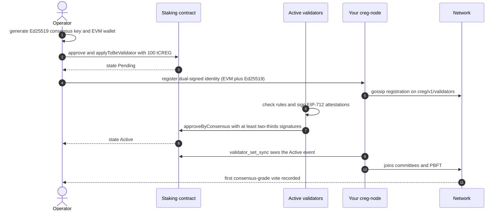

### 10.3 Step by step

**Step 1 — Prepare the host.** Linux server (4 vCPU, 8 GB RAM, 50 GB SSD), Docker or the release `creg-node` binary, an NTP-synced clock, inbound TCP 9000, and a Sepolia RPC with **full log history**. Use the secure image (`Dockerfile.secure`) so the sandbox engine is `nsjail`.

**Step 2 — Generate keys.** Two separate keys, both stored outside the repository, with offline backups:

```bash
creg keygen validator --key-path ~/.creg/validator.key      # Ed25519 consensus key
# Create a separate EVM wallet for the stake (e.g. ~/.creg/validator-eoa.key)
```

**Step 3 — Fund and stake.**

```bash
creg testnet drip 0xYourValidatorEvmAddress --faucet-url https://faucet.testnet.cregnet.dev
creg stake 100 --role validator \
  --key-file ~/.creg/validator-eoa.key \
  --rpc-url "$SEPOLIA_RPC_URL" \
  --staking-addr 0x61c00EBe7C46f0bcE63942F7E15Bcc434DFC9B7C \
  --token-addr   0xbC2a72107C6765364D0A822a88A6e6C61f30EAa6
```

Your state becomes `Pending`. You have **7 days** to be admitted before the application expires and the stake is refunded. (Helper scripts also exist: `testnet/stake-validator.sh|.cmd`.)

**Step 4 — Register your dual-signed identity.** This binds your EVM address, node ID and Ed25519 public key with both signatures and a replay-protecting nonce, via `POST /v1/validators/register` on a reachable node. The helper script is `testnet/register-validator-identity.sh` (also `.cmd` and `.js`); `GET /v1/runtime/config` shows the exact payload in `validator_registration_note`.

**Step 5 — Get admitted.** Active validators evaluate your application and sign attestations; any node with two thirds submits `approveByConsensus`. Governance has an emergency path, but the design goal is that no foundation key is needed. Confirm admission in the explorer's validator list.

**Step 6 — Configure and start the node.**

```bash
export CREG_IS_VALIDATOR=true
export CREG_VALIDATOR_KEY=<ed25519 private key hex>   # from a secret manager, not a shell profile
export CREG_NODE_ID=<your registered node id>
export CREG_CHAIN_SPEC_URL=https://spec.testnet.cregnet.dev/phase-c/r7/chain-spec.json
export CREG_ETH_RPC=<primary sepolia rpc>
export CREG_ETH_RPC_FALLBACKS=<second>,<third>        # use one or at least three providers
export CREG_IPFS_URL=<your kubo api>
export CREG_P2P_SEEDS=<bootnode multiaddr>

./chain-registry/testnet/start-external-validator.sh   # or .ps1 on Windows
```

Do **not** set `CREG_DEV_SANDBOX=true`. Votes from a dev-sandbox or degraded node do not count toward quorum.

**Step 7 — Verify before you rely on it.**

```bash
curl -s "$CREG_NODE_URL/v1/runtime/config" | jq '{sandbox_engine, sandbox_dev_bypass}'
creg doctor --node-url "$CREG_NODE_URL"
curl -fsS "$CREG_NODE_URL/v1/health"
creg console          # interactive terminal dashboard
```

Healthy means: sandbox engine is `nsjail`/`gvisor`/`docker` with bypass false, `validator_set_sync.state` is `synced`, peers > 0, height advancing, and your node appears in vote records.

**Step 8 — Operate.** Keep logs for at least 7 days (vote evidence may be requested in a dispute). Apply security releases within 72 hours. Follow the key-handling and incident runbooks. Keep NTP healthy.

**Step 9 — Exit.** Announce your exit so the network does not lose quorum by surprise, stop the node, start unbonding, and withdraw after the **14-day** unbonding period. You remain slashable while unbonding.

### 10.4 Sign-off checklist (summary)

- Stake ≥ 100 tCREG; dual-signed identity registered; admitted on L1.
- Real sandbox verified; scanner profile matches the fleet digest.
- Node has cast at least one consensus-grade vote.
- Independent-control statement and a rehearsal record (partition/heal, process kill during durable work, rebuilt node from a checkpoint) are filed and reviewed by someone outside your control domain.

### 10.5 Costs and earnings

| Item | Reality today |
|---|---|
| Stake | 100 tCREG (testnet; recoverable after unbonding unless slashed) |
| Infrastructure | Server, disk, bandwidth, an RPC subscription for L1 history |
| Gas | Sepolia ETH for staking transactions |
| Rewards | **None live.** The reward formula is designed (§7.6) but dispatch is disabled |
| Risk | Slashing exists in the contract; automatic slashing is not wired in the node |

---

## 11. Consumer flow

> **In plain words.** Before CREG lets software onto your machine, it asks the network "was this inspected and approved?", checks the proof itself instead of trusting the answer, and confirms the file it downloaded is byte-for-byte the one that was approved. If anything is missing, it refuses.

### 11.1 Everyday commands

```bash
export CREG_NODE_URL=https://api.testnet.cregnet.dev

creg install lodash@4.17.21 --ecosystem npm   # fail-closed install through the registry
creg status npm:lodash@4.17.21                # verdict only, no install
creg verify npm:lodash@4.17.21 --checkpoint proof.json   # light-client proof, optionally saved
creg audit --strict                           # audit everything already installed
creg lockfile --diff                          # compare pkg-lock.chain with current chain state
creg setup-shims                              # make npm, pip and other supported package managers go through the gate
```

### 11.2 What `creg install` checks

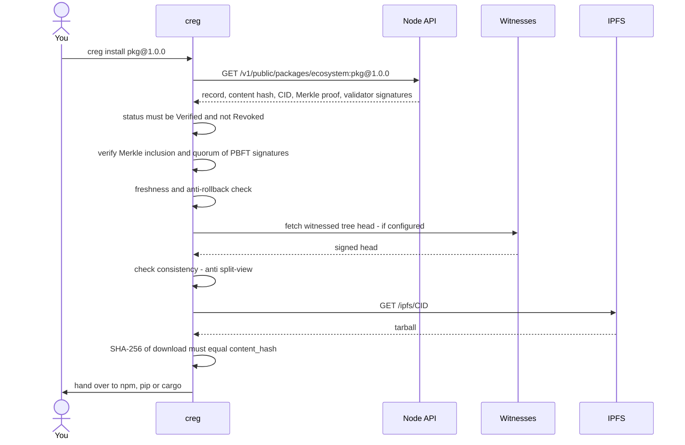

If an attacker controls the API or the gateway and serves a different file, the hash or proof check fails **locally** and the install stops.

### 11.3 Fail-closed rules

| Situation | Result |
|---|---|
| Package unknown, pending or revoked | Refused |
| Node unreachable | Refused |
| Proof or signature check fails | Refused |
| Stale or rolled-back chain data | Refused (freeze, skew and mix-and-match checks) |
| `--unverified` flag | Allows pending/unknown with a warning — but **never overrides revocation** |
| `CREG_ALLOW_UNVERIFIED=true` | Break-glass for shims |

A 5-minute local cache avoids repeated lookups. The anti-rollback journal remembers the highest chain state your client has seen.

### 11.4 Coverage limits

- Bare `npm install` / `npm ci` through the shims gates **direct** dependencies (up to 200); transitive dependencies are not scanned.
- `pip install -r requirements.txt` is refused unless the break-glass is set.
- The live registry currently has **no verified packages**, so a strict install of anything will be refused until packages are published and verified.
- Without independent witnesses, split-view protection is not yet in force.

---

## 12. Other roles

### 12.1 Observer node

An observer runs `creg-node` with `CREG_IS_VALIDATOR=false`. It syncs finalized blocks from validators, serves the public API and explorer, and keeps new submissions pending without processing them. Observers sit behind the public gateway so that validators stay off the public internet. Four observers run in different regions, with automatic failover at the edge.

### 12.2 Witness

A witness is **not** a validator and never joins PBFT. It polls a log's signed tree head, verifies that every new head extends the previous one, detects non-monotonic roots (split-view), and publishes a co-signed `witnessed-head.json` that clients can fetch.

```bash
creg keygen witness --key-path ~/.creg/witness.key
creg witness run \
  --node-url https://api.testnet.cregnet.dev \
  --log-id <transparency log id> --log-pubkey <log operator ed25519 pubkey hex> \
  --witness-id <your witness id> \
  --out-path ./witnessed-head.json --interval-secs 30
```

The witness ID must differ from the log signer. **No independent witness exists yet.**

### 12.3 Pinner

Pinners keep package bytes available on IPFS (content addressing proves bytes are correct, not that someone still stores them). On the alpha, operators pin their own fleet's packages. The `PinningRewards` incentive program is **[BUILT]** but unfunded and not recommended yet.

### 12.4 Governance signer

Three signers control the 2-of-3 `Governance` contract: submit, vote and execute proposals such as parameter changes, emergency pause and token mints. There is currently **no timelock**, so signer key hygiene is critical. See §14.

### 12.5 Service operators

The **faucet** (PostgreSQL-backed, fail-closed, reconciles against Sepolia transfers), the **relayer** (sponsored staking via EIP-712 permit) and the **indexer** (chain → PostgreSQL for the explorer) are separate services run beside the nodes.

---

# Part IV — Trust, operations and the road ahead

## 13. Security model

### 13.1 Assumptions

1. **Fewer than one third of validators are Byzantine** (for `n = 4`, at most one). This only means something if validators are independently operated.
2. Clocks are synchronized (NTP) to within the 60-second proposal window.
3. Ethereum Sepolia is honest and its RPC providers, taken as a majority, tell the truth about contract state.
4. The sandbox isolates untrusted code from the validator host.
5. The signing key pinned in the binary and the chain spec are trustworthy.

### 13.2 Threats and defenses

| Threat | Defense | Status |
|---|---|---|
| Stolen publisher credentials | Release must be signed by the namespace controller's Ed25519 key; stake at risk | **[LIVE]** |
| Tampered tarball | Content hash and IPFS CID bound into a signed verdict; client re-hashes | **[LIVE]** |
| One malicious validator | Needs `⌊2n/3⌋ + 1`; per-address cap on committees | **[LIVE]** |
| Double-signing or crash-replay | Durable fsync'd signing journal; locks per view and height | **[LIVE]** |
| Vote replay across packages | Signed domain binds package, hash, profile, evidence | **[LIVE]** |
| Leader failure | Certified view change preserving prepared blocks | **[LIVE]** |
| Spec tampering | Ed25519-signed spec; genesis bound to its hash | **[LIVE]** |
| API compromise | Client-side Merkle and signature verification; fail-closed install | **[LIVE]** |
| Malicious or buggy L1 RPC | Quorum reads across providers | **[BUILT]** — in the r33 image, running on one canary observer; only effective once three or more providers are configured (with one provider behavior is unchanged) |
| Split-view by the log operator | Transparency log plus independent witnesses | **[BUILT]** — no witnesses yet |
| Validator equivocation penalty | Detection with verifiable evidence, then slashing | Detection **[BUILT]**, running on one canary observer (r34) since 2026-11-15; slashing **[DESIGN]**, not wired |
| Sandbox escape | nsjail/gVisor, no network, fail-closed ladder | **[LIVE]**, audit pending |
| Sybil validators | Stake, committee caps, 2/3 admission | **[LIVE]** at small scale |
| Namespace squatting on npm or PyPI names | CR-07 authority proofs from upstream registries | **[BUILT]**, disabled |

### 13.3 What is not solved

- **Single-operator control** — all validators belong to one party, so this is not yet independent BFT.
- **Scanner depth** — rule-and-hash detection; limited threat intel (a 100-record MalwareBazaar sample); false positives on popular packages; novel malware can pass.
- **Governance immediacy** — no timelock; any two compromised signers act at once.
- **Economic enforcement** — no slashing, rewards or fees in operation.
- **External audit** — contracts, consensus and sandbox have not had an independent review.
- **Hardening gaps** — one shared operator API key; permissive CORS on faucet and relayer; the dependency audit in CI is advisory only. (Ed25519 consensus signatures are now verified with `verify_strict` in source, which rejects weak keys; this is not yet deployed, and a mixed fleet only disagrees on signatures honest signers never produce.)

---

## 14. Governance

| Aspect | Today |
|---|---|
| **Structure** | `Governance.sol`: 2-of-3 multisig; submit → vote → execute |
| **Powers** | Token mint, minimum stakes, slashing, revocation, emergency pause and (while enabled) emergency validator admission |
| **Validator admission** | Mechanical via `approveByConsensus` (two-thirds of active validators); governance emergency path still enabled on R7 |
| **Delay** | None — approved proposals execute immediately |
| **Other owners** | `Staking.owner` and PinningRewards admin and verifier roles are the deployer EOA |
| **Off-chain** | Operators coordinate through GitHub and the operator channels; chain-spec updates are re-signed |

**Principles for maturing governance** (from the roadmap): add an execution delay with a cancel path; disable the emergency admission path once consensus admission is proven end to end; move all owner roles to the multisig (or a successor); separate signer custody across independent people; publish a proposal and incident process.

---

## 15. Networking and APIs

### 15.1 Peer-to-peer

libp2p over TCP with Noise encryption and yamux multiplexing; Kademlia and identify for discovery; gossipsub for messages. Peer scoring, rate limiting and subnet filtering are on. P2P port: **9000**.

| Topic | Carries |
|---|---|
| `creg/v1/votes` | Package votes |
| `creg/v1/blocks` | PBFT PRE-PREPARE, PREPARE, COMMIT |
| `creg/v1/submissions` | Publish gossip |
| `creg/v1/vrf-proofs` | Proposer VRF proofs |
| `creg/v1/validators` | Ed25519↔EVM identity registrations |
| `creg/v1/validator-set-transitions` | Quorum-certified validator-set transitions |
| view-change topic | Signed view-change votes |

Every received message is validated before acceptance: known validator, valid signature, consensus-grade metadata, rate limits. Gossip is best-effort; submissions should be sent to a **validator**, not only to an observer.

### 15.2 HTTP API

Port **8080** by default. Routes are grouped by trust level; older unprefixed aliases still work.

| Group | Examples | Access |
|---|---|---|
| `/v1/public/*` | `chain/stats`, `health`, `packages`, `packages/:canonical`, `packages/:canonical/proof`, `blocks`, `blocks/:height`, `blocks/hash/:hash`, `transactions/:canonical`, `publishers/:pubkey`, `addresses/:address`, `validators/:address`, `search`, `metrics/history`, `bridge/status`, `governance/proposals`, `reorgs`, `richlist`, `evidence/equivocation`, `evidence/equivocation/:evidence_id` | Open reads |
| `/v1/publisher/*` | `POST packages`, `POST rotate-key`, namespace lifecycle | Signed by the publisher |
| `/v1/validator/*` | `POST register`, `POST consensus/vote`, `GET consensus/state`, `GET consensus/pbft`, `GET set-transitions` | Validator-facing |
| `/v1/operator/*` | `runtime/config`, `nodes`, `p2p/status`, `pending`, governance proposals | Operator API key (**fails closed** with 503 if unset) |
| `/v1/internal/*` | Appeal audit | Internal |

Other surfaces: **JSON-RPC** (`creg_chainId`, `creg_blockNumber`, `creg_getBlockByNumber`) — deliberately *not* `eth_*`; **SSE/WebSocket** event streams; **gRPC** (`common/proto/node.proto`); **Prometheus** at `/metrics`.

### 15.3 Public endpoints (testnet)

| Service | URL |
|---|---|
| API and RPC | `https://api.testnet.cregnet.dev` |
| Explorer | `https://explorer.testnet.cregnet.dev` |
| Faucet | `https://faucet.testnet.cregnet.dev` |
| IPFS gateway | `https://ipfs.testnet.cregnet.dev` |
| Signed spec | `https://spec.testnet.cregnet.dev/phase-c/r7/chain-spec.json` (+ `.sig`) |
| Sepolia explorer | `https://sepolia.etherscan.io` |

---

## 16. Operations and monitoring

| Area | Practice |
|---|---|
| **Health** | `/v1/health`, `/v1/chain/stats`, `/v1/runtime/config`; `creg doctor` |
| **Metrics** | Prometheus scrapes every node; Grafana dashboards. New gauge `creg_chain_tip_age_seconds` shows time since the last block |
| **Alerts** | Rules for block production stalled (only with pending work), idle chain, PBFT quorum lost, fault margin consumed (any validator inactive), validator-set cursor lagging, node down, equivocation detected (on nodes running detection). Notifications need a configured Slack or PagerDuty receiver |
| **Idle versus stalled** | The chain makes no heartbeat blocks, so use tip age combined with pending-work metrics, or run a synthetic publish canary |
| **Key management** | Hot keys from a secret manager; never in repo, OneDrive-synced folders or shell history |
| **Rollouts** | Canary one observer first, then observers, then validators one at a time while **preserving signing journals** |
| **Incident response** | Runbooks for forks, split views, consensus halts and malicious-package outbreaks (`docs/INCIDENT_RESPONSE_RUNBOOK.md`) |
| **Cost** | The audit estimated roughly $350/month at list price for the idle fleet plus an RPC node (an estimate, not an invoice) |

Runbooks live in `docs/` (`SECURITY_OPS_RUNBOOK.md`, `OPS_HARDENING_RUNBOOK.md`, `INCIDENT_RESPONSE_RUNBOOK.md`, `UNINTERRUPTIBLE_OBSERVER_NODE_SYSTEM.md`).

---

## 17. Current status and known limitations

### 17.1 Proven versus not proven

| Capability | Status | Evidence |
|---|---|---|
| 3-of-4 PBFT finality on 4 validators and 4 observers | **Proven** | Heights 1–20 identical on all 8 nodes; public API agrees |
| Real publish → scan → votes → block → verify → revoke | **Proven** | 8 real npm tarballs, ≥ 3 distinct validator approvals each |
| Durable signing journal and prepared-value recovery | **Proven** | Recorded drills |
| Certified view change | **Proven** | Recovered through view changes |
| Durable COMMIT crash-replay on a validator | **Not proven** | Drill armed repeatedly, never accepted |
| Partition, chaos and soak testing | **Not done** | Open work items |
| Independent operators | **None** | One operator runs all 8 nodes |
| Witnessed transparency log | **Software only** | No witnesses enrolled |
| L1 validator-set sync | **Failing** | Cursor ~300,000 Sepolia blocks behind; pruned-history errors |
| Redundant L1 RPC | **Canary only** | Quorum-read code (PRs #57–#59) runs on observer-3 since 2026-11-14 (r33, now r34), but that node still has a single provider, so behavior is unchanged. The rest of the fleet runs older images. |
| Equivocation detection | **Canary only** | Runs on observer-3 since 2026-11-15 (r34, detection only). No PBFT traffic yet, so 0 votes observed. |
| Rewards, slashing, fees | **Not live** | See §7 |
| External security audit | **Not started** | |

### 17.2 Why the network has been idle

All progress after 2026-10-02 depended on one blocker: free public RPC tiers prune old `eth_getLogs` history, so the observer's validator-set sync and the faucet's ledger reconciliation fail. The fix (a self-hosted Sepolia node plus a three-provider quorum) was designed but not finished. Because an idle chain produces no blocks, there was also no signal that anything was wrong.

**What has changed since (2026-11-14):**

- Quorum reads for L1 calls, the tip-age metric, corrected alert rules and the explorer transaction-count fix were merged (PRs #57–#59) and tested (1,028 workspace tests pass).
- The resulting **r33 node image** was built from the merged source and smoke-tested on **observer-3 only**. It came up healthy and unchanged at height 20 with all 8 packages, 4 of 4 validators and peers connected. The other seven nodes still run older images.
- That observer still has **one** RPC provider, so validator-set sync is still degraded (cursor at Sepolia block 11,850,628 against a finalized head above 12,135,000) and the chain tip is about 47 days old.
- Provisioning scripts and a runbook for a **second self-run Sepolia node** (Nethermind plus Teku) were added as another full-history source; its sync state is not recorded here.
- Contract fixes AUD-07, AUD-08 and AUD-09 exist in source only; the R7 contracts on Sepolia still run the original code.
- A follow-up code batch adds:
  - strict Ed25519 verification for consensus signatures (AUD-19);
  - about 30 new faucet tests (AUD-27);
  - golden-vector tests that pin block, transaction, Merkle and view-change hashes, and the signed vote and PBFT message formats, in both encodings;
  - a fix that stops observers logging the "durable safety journal is not initialized" warning every block interval;
  - opt-in equivocation detection (ADR-016);
  - CI that lints and tests the production feature set;
  - non-blocking `cargo-deny` and Dependabot configuration.
- On 2026-11-15 the node part of that batch was built as the **r34 image** and canaried on **observer-3 only**, with detection turned on. Every r33 readiness check and every detection check passed, with 0 ERROR lines, and the journal warning stopped. See [the r34 evidence](./testnet-heal-evidence/2026-11-15-r34-observer3-equivocation-canary/README.md). The faucet changes and the other seven nodes are not deployed.

The remaining sequence is: configure two full-history providers, confirm all three agree on chain ID, block hashes and the Staking log set, point observer-3 at them, confirm validator-set sync reaches `synced`, then roll out to the other observers and to validators one at a time while preserving their signing journals.

### 17.3 Ratings from the 2026-11-14 audit

| Question | Score |
|---|---:|
| Private maintainer-run testnet | 8 / 10 |
| Closed alpha (invited publishers) | 6 / 10 |
| Open public testnet | 4 / 10 |
| Mainnet | 1.5 / 10 |
| Overall engineering maturity | 5.7 / 10 |

### 17.4 Where older documents disagree with the code

| Topic | Older docs | Current truth |
|---|---|---|
| Contract addresses | Staking `0x3060…7331`, Token `0x167A…99E2`, Governance `0x0fC1…5D4E` / `0x122B…5b9D`, Registry `0xD0F4…AF3B` | Those belong to the retired `creg-testnet-1`. R7 addresses are in Appendix C. |
| Chain ID and topology | `creg-testnet-1`, two or four validators | `creg-phase-c-testnet-2026-09-26-r7`, four validators and four observers |
| "State root anchored on Sepolia" | Several workflow diagrams | **[RETIRED]**; `submitRollupBatch` reverts |
| "Rewards distributed to validators" | Whitepaper §11.7, workflow §9.12 | Dispatch is disabled; zero paid |
| "Validator admission by multisig" | Whitepaper and checklist | Mechanical `approveByConsensus` is the design; emergency path still on |
| CLI flags | `--amount`, `--out`, `creg validator register` | Amount is positional; key path flag is `--key-path`; identity registration is `POST /v1/validators/register` or the helper script |
| "AI deep scan" | Marketing language | Rule, advisory and hash engine; ML model retired |
| Publisher minimum | "1 tCREG minimum" at admission | Contract enforces 1 tCREG at staking; the node gate checks non-zero stake |

---

## 18. Roadmap

The audit recommends five phases. Operator recruiting and the external audit are the schedule drivers.

| Phase | Weeks | Goal | Key deliverables |
|---|---|---|---|
| **0 — Unblock** | 1 | Restore L1 history and make failure loud | Paid or self-hosted full-history RPC; quorum reads deployed; heartbeat or canary; alerts to a human; explorer and docs fixes; secrets cleanup; reopen faucet. *Progress: quorum-read code merged and canary-tested on observer-3; explorer and alert fixes merged; full-history providers still to be configured* |
| **1 — Converge** | 2–3 | One tested image on every node | CI runs the production feature set; `cargo audit`/`deny`; staged rollout; move the laptop validator to a server; accept the durable-COMMIT drill; one-command release pipeline |
| **2 — Harden** | 3–6 | Close economic and contract gaps | Contract migration with the AUD fixes; governance timelock; wire equivocation slashing ([ADR-016](./adr/ADR-016-EQUIVOCATION-SLASHING.md)); reward contract v2; epoch-signed scanner snapshots; published false-positive and false-negative rates; fuzzing |
| **3 — Decentralize** | 4–10 | Real BFT | ≥ 3 independent operators; **7 validators** (quorum 5, tolerate 2); ≥ 2 independent witnesses; ≥ 4 DNS-named bootnodes; chaos suite; 14-day soak |
| **4 — Launch** | ~10–12 | Public testnet | External audit on a frozen tag; bug bounty; go/no-go checklist |

**Go / no-go thresholds for a public testnet**

| Criterion | Threshold |
|---|---|
| Validators / operators | ≥ 7 / ≥ 3 independent |
| L1 reads | ≥ 3 providers with quorum and verified full history |
| Soak | 14 days, ≥ 99% finality availability, zero safety violations |
| Chaos | Kill 2 of 7 (continues), 3 of 7 (halts, recovers without fork); 4/3 partition; clock skew; RPC outage and lying RPC |
| Slashing | Equivocation slashing demonstrated on the testnet |
| Governance | Timelock live; emergency path disabled |
| Open findings | No Critical or High |
| Scanner | Published error rates; any package can be published without a fleet redeploy |
| Monitoring | Alerts reach a named on-call human |

**Product strategy.** A registry with no verified packages protects nobody. The audit suggests an **attestation overlay**: validators attest widely used upstream npm versions (reproducible from the public registry) without waiting for publishers to opt in, which gives real coverage, a large benign corpus for the scanner, and a reason to run `creg install`.

---

## 19. Suggested documentation plan

You asked what the CREG documentation set should contain. This file covers the explanatory layer. A complete, trustworthy docs set for a protocol like CREG has the sections below. The last column is where CREG stands today.

| # | Section | Who it is for | Why it matters | Where it is today |
|---|---|---|---|---|
| 1 | **Overview and concepts** | Everyone | Explains the problem and the idea in plain words | This document, §1 |
| 2 | **Architecture** | Engineers, auditors | One accurate system map and trust boundaries | This document, §2 |
| 3 | **Normative protocol specification** | Implementers, auditors | Exact message formats, domains, hashing rules, state-transition rules and **golden test vectors**, so a second implementation could interoperate | **Gap.** Pieces are spread across `docs/protocol/`, the whitepaper and code. Needs one spec with test vectors |
| 4 | **Chain data reference** | Indexer and explorer builders | Block, transaction and record schemas with JSON examples; storage layout | This document §4; **gap:** JSON Schema or OpenAPI examples |
| 5 | **Consensus and validator guide** | Operators | How voting, PBFT and the pipeline behave and fail | This document §5–6; `PHASE-C-PBFT-SAFETY.md` |
| 6 | **Tokenomics** | Validators, investors, auditors | Supply, custody, incentives, and honest status | This document §7; **gap:** a single token-facts page generated from on-chain reads so numbers cannot drift |
| 7 | **Smart-contract reference** | Integrators, auditors | ABI, events, roles, upgrade and migration plans | This document §8; **gap:** per-contract reference with roles and invariants |
| 8 | **User guides: publisher, consumer, validator, witness** | Each role | Task-oriented, copy-paste-safe steps | This document Part III; existing quickstart and onboarding checklist |
| 9 | **API reference** | Developers | Every endpoint, auth level, error code | This document §15 (overview); OpenAPI file exists — publish it rendered |
| 10 | **Operations and runbooks** | Operators | Deploy, upgrade, monitor, recover | Exists in `docs/` runbooks |
| 11 | **Security and threat model** | Researchers | Assumptions, known gaps, audit status, disclosure policy | This document §13; **gap:** a working security contact and bug-bounty policy |
| 12 | **Governance process** | Community | Who can change what, with what delay | This document §14; **gap:** a written proposal and incident process |
| 13 | **Status and roadmap** | Everyone | One accurate, dated page of what is live | This document §17–18; **gap:** an auto-updated status page |
| 14 | **FAQ and glossary** | Newcomers | Fast answers | This document §20–21 |
| 15 | **Changelog and decisions (ADRs)** | Contributors | Why things are the way they are | ADRs exist; add a release changelog |

**Documentation hygiene rules I recommend**

1. **Stamp every page** with "last verified" and the commit or network it describes.
2. **Use status tags** (Live / Built / Design / Retired) on every capability, as this document does, so aspiration never reads as fact.
3. **Generate tables from sources of truth** — contract addresses from the deployment manifest, parameters from the signed chain spec, balances from chain reads — instead of copying numbers by hand. Most drift found in this repo (old addresses, old chain IDs, old flags) came from hand-copied values.
4. **One canonical page per topic**, with other pages linking to it. Archive superseded documents instead of editing around them.
5. **Test the quickstarts** with a stranger on a clean machine before each release.
6. **Keep a "Must not claim" list** (for example: not "L1 settlement", not "AI-powered", not "decentralized BFT" until independent operators exist).

---

## 20. FAQ

**Is CREG a blockchain or a layer 2?**
It is a specialized blockchain (BFT chain) for package verdicts. It is not an EVM L2 and does not run user smart contracts. Ethereum Sepolia holds its staking and governance contracts.

**Do I need tokens to install packages?**
No. Consumers need no tokens. Publishers need 1 tCREG staked; validators need 100.

**Is tCREG worth anything?**
No. It is a testnet token with no verified value. CREG does not currently charge package fees, and no market model is defined.

**What does "verified" actually mean?**
A package is verified when the queried node's chain contains a record approved by a quorum of validators that ran the pinned scanner and signed identical evidence, in a block finalized by PBFT. It means *inspected and agreed*, not *guaranteed safe*.

**What if every validator colludes?**
Then the guarantees fail. With `n` validators, safety needs fewer than a third to be Byzantine. That is why independent operators (target: seven validators across at least three operators) matter more than any code change.

**Can a package be removed after it is verified?**
It can be **revoked** by governance or the publisher. A revoked ID can never be republished; the clients refuse revoked packages even with `--unverified`.

**Why can't I publish a brand-new package today?**
The scanner's pinned data is built per package, so adding a new package name needs a fleet scanner-profile rollout. Epoch-based signed snapshots (roadmap, phase 2) remove this limit.

**Why does the explorer show an old latest block?**
The chain only makes blocks when there is finalized work. No heartbeat block exists, so an idle chain looks stalled. A tip-age metric and alerts now distinguish the two.

**How is this different from npm provenance or Sigstore?**
Those prove *who built* an artifact. CREG adds *independent behavioral inspection by a staked validator set*, an *agreed, tamper-evident public verdict*, and client-side proofs. The two are complementary, and CREG's namespace-authority work (CR-07) is designed to consume upstream provenance.

**Is the code audited?**
No external audit has been performed. The consensus core has strong internal engineering (1,028 passing workspace tests, a durable signing journal, adversarial review notes), but the contracts and sandbox need independent review before mainnet.

**Where do I run into the older instructions that no longer work?**
See §17.4 for the list of stale addresses, flags and claims.

---

## 21. Glossary

| Term | Meaning |
|---|---|
| **Admission** | The checks a node performs before a publish request enters the pending pool |
| **Analysis committee** | The validators assigned to inspect one package (size `M`) |
| **Anti-rollback journal** | Client-side record of the highest chain state seen, to reject stale data |
| **Attestation (admission)** | An EIP-712 signature by an active validator approving a validator applicant |
| **BFT / PBFT** | (Practical) Byzantine Fault Tolerance — agreement despite up to `f` faulty nodes out of `3f + 1` |
| **Bond** | Tokens locked as a deposit that can be confiscated |
| **Canonical id** | `<ecosystem>:<name>@<version>` |
| **Chain spec** | The signed JSON that defines a network's parameters, validators and contracts |
| **CID** | IPFS content identifier — the hash-address of a file |
| **Consensus-grade vote** | A complete, non-degraded vote that counts toward quorum |
| **Content hash** | SHA-256 of the tarball bytes |
| **CR-07** | The namespace-authority work: proving ownership of npm or PyPI names (disabled on the live testnet) |
| **Evidence digest** | Hash over the deterministic evidence behind a vote |
| **Faucet** | A service that gives testnet tokens |
| **Finality** | The point after which a block cannot be reverted (PBFT COMMIT quorum) |
| **Genesis** | Block 0, the start of the chain |
| **Journal (signing)** | Durable record of every vote a validator signed, written before broadcast |
| **Light client** | A client that verifies proofs without storing the whole chain |
| **Mandatory committee** | The assigned subset required to vote for a package |
| **Merkle proof** | Short proof that an item is part of a hashed set |
| **Namespace** | A package name prefix controlled by one publisher |
| **nsjail / gVisor** | Linux sandboxing technologies used to run untrusted installs safely |
| **Observer** | A non-voting node that syncs and serves reads |
| **OSV** | Open Source Vulnerabilities database |
| **Pending pool** | Durable queue of admitted, not-yet-final packages |
| **Pinner** | Someone who keeps IPFS content available |
| **Proposer / leader** | The validator that builds the next block |
| **Quorum** | The number of agreeing signers needed: `⌊2n/3⌋ + 1` |
| **Revocation** | Marking a package as no longer safe |
| **Scanner profile** | The pinned set of rules and data used for analysis; its digest must match fleet-wide |
| **Slash pool** | Where confiscated stake accumulates |
| **Slashing** | Confiscating part of a bond for misbehavior |
| **Split view** | Showing different histories to different observers |
| **Staking** | Locking tokens to take part in the network |
| **Transparency log** | An append-only Merkle log with signed heads |
| **Unbonding** | The waiting period (14 days) before a validator can withdraw |
| **View change** | PBFT procedure to replace a failed leader |
| **VRF** | Verifiable random function used for unpredictable, checkable selection |
| **Weak-subjectivity checkpoint** | A verified validator-set snapshot a new node trusts as its starting point |
| **Witness** | An independent daemon that co-signs the log's head to catch split views |
| **YARA / YARA-X** | A pattern-matching rule language for malware detection |

---

# Appendices

## Appendix A. Key parameters

| Parameter | Value | Source |
|---|---|---|
| Chain ID | `creg-phase-c-testnet-2026-09-26-r7` | signed spec |
| Block time | 5 s | spec, `CREG_BLOCK_INTERVAL` |
| Max validators | 50 | spec |
| Quorum percentage | 67 | spec |
| Package quorum | `⌊2M/3⌋ + 1` | `vote_accumulator.rs` |
| Block quorum | `⌊2n/3⌋ + 1` | `pbft.rs` |
| Vote timeout | 10,000 ms in spec; floored at 120 s in node | `config.rs` |
| PBFT phase timeout | 30 s | `pbft.rs` |
| Max view changes | 3 | `pbft.rs` |
| Max reorg depth | 64 blocks | `sync.rs` |
| Max committee slots per EVM address | 4 | committee selection |
| Forced-inclusion delay | 5 blocks | `forced_inclusion.rs` |
| Live proposal clock window | 60 s | PBFT validation |
| Risk thresholds | block 85 · review 55 · LLM 40 | `risk.rs` |
| Publisher stake | 1 tCREG | `Staking.sol` |
| Validator stake | 100 tCREG | `Staking.sol` |
| Unbonding | 14 days | `Staking.sol` |
| Application timeout | 7 days | `Staking.sol` |
| Re-stake cooldown | 7 days | `Staking.sol` |
| Publisher liability window | 30 days | `Staking.sol` |
| Slash tiers | 2% / 10% / 30%; eject at 3 | `Staking.sol` |
| Token max supply / initial | 42,000,000 / 20,000,000 | `CregToken.sol` |
| Base work reward | 0.00001 tCREG | `ValidatorRewards.sol` |
| Pinning rate / stake | 0.01 tCREG per GB per day / 1,000 tCREG | `PinningRewards.sol` |
| L1 | Sepolia, chain ID 11155111, 6 finality blocks | spec |
| Default ports | API 8080, P2P 9000 | docs |

## Appendix B. Command cheat sheet

> The CLI is the source of truth. Run `creg <command> --help`.

| Goal | Command |
|---|---|
| Check setup | `creg doctor` |
| Guided setup | `creg init` |
| Log in with a wallet | `creg login` · `creg profile` · `creg logout` |
| Generate a key | `creg keygen <publisher\|validator\|witness\|log-signer> --key-path <file>` |
| Get test tokens | `creg testnet drip <address> --faucet-url <url>` |
| Stake | `creg stake <amount> --role <publisher\|validator> --key-file <file> --rpc-url <url>` |
| Publish | `creg publish <tarball> [--key-file <file>] [--publisher-address <0x..>] [--offline <file>]` |
| Submit a pre-signed publish | `creg submit-signed <file>` |
| Look up a verdict | `creg status <canonical>` |
| Verify with a proof | `creg verify <canonical> [--checkpoint <file>]` |
| Install | `creg install <name@version> [--ecosystem npm]` |
| Audit installed packages | `creg audit [--strict] [--fix]` |
| Dump a chain record | `creg chain-record <canonical>` |
| Inspect validator performance | `creg performance <validator id or address>` |
| Install package-manager shims | `creg setup-shims` · `creg remove-shims` |
| Watch events | `creg watch [--filter packages\|blocks\|votes]` |
| Browse blocks | `creg blocks --limit 10` · `creg console` |
| Run a witness | `creg witness run --log-id ... --log-pubkey ... --witness-id ...` |
| Start a local cluster | `creg testnet start --nodes 4` · `creg testnet stop` |

## Appendix C. Contract and service addresses

**R7 network on Ethereum Sepolia (chain ID 11155111)** — from `chain-registry/testnet/phase-c/r7/chain-spec.json` and `deployment-manifest.json`.

| Component | Address |
|---|---|
| `CregToken` (tCREG) | `0xbC2a72107C6765364D0A822a88A6e6C61f30EAa6` |
| `Governance` (2-of-3) | `0x0AB4Db22A9902B8Ef678aBd408889af22277d24E` |
| `Staking` | `0x61c00EBe7C46f0bcE63942F7E15Bcc434DFC9B7C` |
| `Registry` | `0x23c7FB8e6fd932C1078Ff76244470557E5e6bd99` |
| `Reputation` | `0x0106D8696B110aBbe0DFa7476b58104fF4c3e5f7` |
| `Appeal` | `0x277958bcaEb9aE728755F9dA97861cab7d7D6611` |
| `ValidatorRewards` | `0xf616699ff68E2a310549fa4280475589B0EB0E49` |
| `PinningRewards` (not in the signed spec) | `0xC35C52315492e5A062f3280829Ba714442216B46` |
| `VRF`, `ZKVerifier` | not deployed (zero address) |
| Treasury / deployer EOA | `0x3A3206D683441AA91cCA7CD5757B1F0ca463213A` |
| Faucet wallet | `0x721C8dBD8208CA9dBdcC12AE9339225458608B81` |

> Always confirm addresses against the signed spec for the network you are joining. The older `creg-testnet-1` addresses (`0x3060…7331`, `0x167A…99E2`, `0xD0F4…AF3B`, `0x0fC1…5D4E`) are retired.

## Appendix D. Source map

Where to verify each claim in this document.

| Topic | File |
|---|---|
| Block, transaction, header types | `chain-registry/crates/common/src/block.rs` |
| Package and chain record types | `chain-registry/crates/common/src/package.rs` |
| Chain spec | `chain-registry/crates/common/src/chain_spec.rs`, `chain-registry/testnet/phase-c/r7/chain-spec.json` |
| Storage column families | `chain-registry/crates/node/src/chain_store.rs` |
| Admission checks | `chain-registry/crates/node/src/package_admission.rs` |
| PBFT engine and quorum | `chain-registry/crates/consensus/src/pbft.rs` |
| Durable signing journal | `chain-registry/crates/node/src/pbft_safety.rs` |
| Vote accumulator | `chain-registry/crates/consensus/src/vote_accumulator.rs` |
| Validator pipeline | `chain-registry/crates/node/src/validator_pipeline.rs` |
| Risk scoring | `chain-registry/crates/validator/src/risk.rs` |
| Sandbox | `chain-registry/crates/validator/src/sandbox.rs` |
| Deep scan | `chain-registry/crates/ml-validator/src/deep_scan.rs` |
| API routes | `chain-registry/crates/node/src/api.rs` |
| CLI commands | `chain-registry/crates/cli/src/main.rs` |
| L1 RPC quorum | `chain-registry/crates/common/src/l1_rpc.rs` |
| Token | `chain-registry/contracts/CregToken.sol` |
| Staking and slashing | `chain-registry/contracts/Staking.sol` |
| Rewards | `chain-registry/contracts/ValidatorRewards.sol`, `PinningRewards.sol` |
| Whitepaper | `docs/WHITEPAPER.md` |
| Tokenomics review and plan | `docs/CREG_TOKENOMICS_DEEP_DIVE_2026-09-28.md`, `docs/CREG-TOKENOMICS-IMPLEMENTATION-PLAN.md` |
| Latest audit and live state | `docs/CREG-DEEP-DIVE-AUDIT-2026-11-14.md` |
| Operator checklist | `docs/VALIDATOR_ONBOARDING_CHECKLIST.md` |
| Publisher quickstart | `docs/PUBLIC_TESTNET_QUICKSTART.md` |

---

*This document was assembled on 2026-11-14 from the repository source, the signed R7 chain spec and the project's own audit and evidence files. It was not able to run builds or query live endpoints itself, so live-state figures are those recorded by the audit. When something here disagrees with the code or the signed spec, trust the code and the spec, and please fix this page.*
