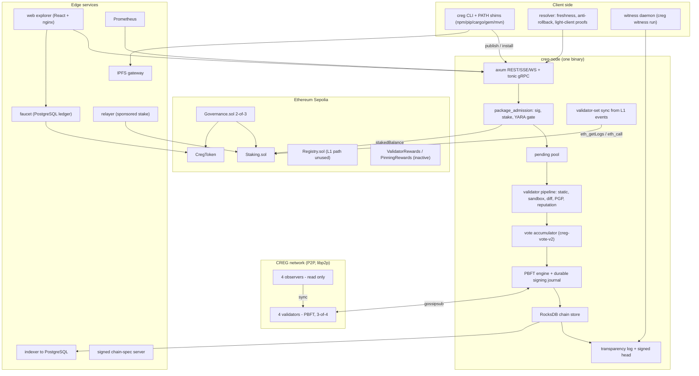
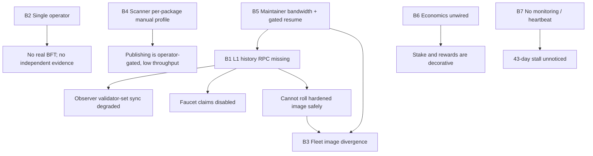
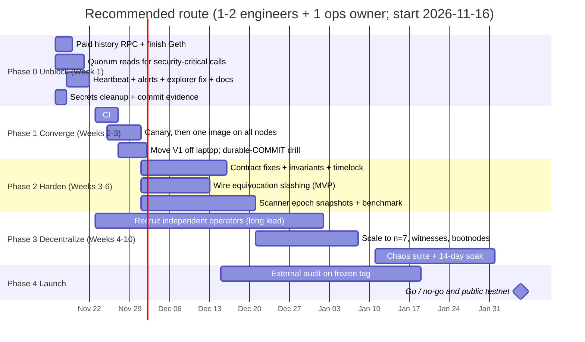

# CREG — Deep-Dive Audit, Review & Testnet-Readiness Report

**Report date:** 2026-11-14
**Repository HEAD audited:** `e8f18d5` ("Support offline signed chain spec recovery", committed 2026-10-02 ~14:48 UTC) plus uncommitted working-tree changes
**Network audited:** `creg-phase-c-testnet-2026-09-26-r7` (public alpha, Ethereum Sepolia as L1)
**Scope:** protocol/consensus, Rust workspace (17 crates), Solidity contracts, data pipelines, explorer/faucet/relayer, CLI/client, infrastructure, CI/release, security posture, documentation, and live public endpoints.

---

## Table of contents

0. [How to read this report — method, evidence tags, limits](#0-how-to-read-this-report)
1. [Executive summary](#1-executive-summary)
2. [Where we are — progress, live state, stall analysis](#2-where-we-are)
3. [Architecture and system deep dive](#3-architecture-and-system-deep-dive)
4. [What is working — pros](#4-what-is-working--pros)
5. [What is not — cons and gaps](#5-what-is-not--cons-and-gaps)
6. [Bottlenecks, ranked, with cause-and-effect chains](#6-bottlenecks)
7. [Audit findings register](#7-audit-findings-register)
8. [Ratings and testnet readiness](#8-ratings-and-testnet-readiness)
9. [Recommended implementation route](#9-recommended-implementation-route)
10. [Risks, budget, and decisions needed from you](#10-risks-budget-and-decisions)
11. [Appendices](#11-appendices)
12. [Phase 0 implementation log (2026-11-14)](#12-phase-0-implementation-log)

---

## 0. How to read this report

### Evidence tags

Every non-trivial claim carries one tag so you can tell how strongly it is supported.

| Tag | Meaning |
|-----|---------|
| **[LIVE]** | I read it from a public CREG endpoint on 2026-11-14 (read-only HTTPS GETs). |
| **[CODE]** | I read the cited source lines in this checkout. |
| **[DOC]** | Reported in the repository's own docs or evidence files. I did not re-verify it. |
| **[HYP]** | A hypothesis from code reading. It needs a proof-of-concept test before you treat it as fact. |

### What I did

- Read the maintainers' briefings, status files, ADRs, whitepaper sections, tokenomics plan, the Oct 1–2 acceptance and blocker-repair evidence, and the GCP cost audit.
- Read the security-critical source: PBFT engine, durable signing journal, L1 RPC failover and quorum modules, publisher-admission path, API auth/CORS, scanner combination logic, `Staking.sol`, `Registry.sol`, `Governance.sol`.
- Ran size, test-marker, `unsafe`, `unwrap`/`panic`, TODO, secrets and dependency sweeps across the tree.
- Queried the public API, health, faucet, and explorer endpoints (GET only) and summarised the package registry.

### Limits you should know about

1. **I could not run builds or tests.** The shell tools in this session failed with `EPERM: mkdir ...\AppData\Local\Temp\claude\...` on every call. So there are no `cargo test`, `forge test`, `git diff`, or `cargo audit` results from me. Test counts below are grep-based markers; pass/fail figures are quoted from repo docs and CI evidence **[DOC]**. Appendix D lists the exact commands to run once a shell works.
2. **No on-chain queries.** I did not call Sepolia. Contract facts come from source and docs.
3. **No cloud access.** I cannot tell you the current state of the Geth VM, the candidate image build `f50a2977`, or the real GCP bill.
4. **Private repos not reviewed.** The Contribution Arena (private submodule) and waitlist SPA are out of scope.
5. **Contract findings are from reading source.** They are tagged **[HYP]** where a test is needed. None were exploited or tested.
6. **Scores are judgment.** The rubric is in §8. Treat the numbers as a structured opinion, not a measurement.

I wrote nothing to the repository except this file. No transactions were sent and no service was modified.

---

## 1. Executive summary

### Verdict

CREG is a **serious, unusually well-documented prototype with real BFT-grade safety engineering, running as a maintainer-operated private testnet that has stalled for 43 days on a single, fixable blocker.** It is **not** ready for an open public testnet. It is **close to ready** for a closed alpha (invited publishers, maintainer-run validators) once about five operational items are closed.

The software is ahead of the operation. The consensus core and fail-closed design are strong. What holds the project back is (a) one infrastructure root cause, (b) single-operator control of the whole validator set, (c) an economic layer that is mostly not wired, and (d) release/ops processes that are still bespoke scripts and human memory.

### Scorecard (details in §8)

| Question | Rating | Meaning |
|----------|-------:|---------|
| Private maintainer-run testnet | **8 / 10** | Achieved. Currently degraded (see below). |
| Closed alpha (invited publishers, maintainer validators) | **6 / 10** | Close. Roughly 2–3 weeks of focused work. |
| Open public testnet (external validators and publishers) | **4 / 10** | Not ready. Roughly 10–14 weeks, gated on recruiting operators. |
| Mainnet | **1.5 / 10** | Far. Needs audit, real economics, legal, independent operators. |
| Overall engineering maturity (weighted) | **5.7 / 10** | Strong core, weak edges. |

### The seven findings that matter most

1. **One root cause, three live failures. [LIVE]** The public observer's L1 validator-set sync is `degraded` with `eth_getLogs ... "pruned history unavailable"`. Its cursor is stuck at Sepolia block 11,827,964 while the finalized source block is 12,132,126 — about 304,000 blocks, roughly 42 days, behind. The faucet sits at `ledger_reconciled: false` and `token_claims_enabled: false`; this is **most likely the same missing-history problem** (it reconciles against full Transfer history through the same free providers), but I did not see its error log, so treat that link as inferred. The fix was designed on 2026-10-02 (self-hosted Geth plus three-provider quorum) and never reached production.
2. **The chain and registry are idle. [LIVE]** Tip is still **h20**, identical to 2026-10-02 (last block 46 days old). All **8 of 8** packages ever published are **revoked**; there are zero verified packages, one publisher, and the faucet has served 3 unique addresses, none since 2026-09-29. Nobody outside the maintainer has used the network.
3. **The "failover" RPC transport is first-success, not quorum. [CODE]** `rpc_failover.rs` returns the first endpoint that answers without error. Security-critical reads — the publisher stake gate, consensus admission, governance — therefore trust one provider, and that provider is documented to return incomplete logs. Quorum logic exists, but only in `validator_set_sync.rs`.
4. **No slashing is wired. [CODE]** `EquivocationDetector` is dead code and nothing in the node calls any slashing function. Staked validators face no automatic penalty for double-signing. Economic security is not enforced.
5. **One operator controls everything. [DOC]** All four validators and four observers are run by one party, on one cloud organization plus a laptop. 3-of-4 finality is real, but it is not independent Byzantine fault tolerance. Governance is a 2-of-3 multisig with **no timelock** **[CODE]**.
6. **The production build is not the tested build. [CODE]** Consensus-critical code is gated behind the Cargo feature `phase-c-real-fleet` (default off). CI runs the full test suite only on default features; the production feature gets a compile check and one test module.
7. **Contracts have real logic bugs. [CODE/HYP]** `Staking.sol` never de-duplicates `_validatorList` (re-applying double-counts validators and inflates quorum denominators), and `claimSlashPoolShare` computes shares from a shrinking pool (order-dependent payouts; can permanently block the next epoch). Publisher self-revocation escapes slashing. None of these have tests.

### Recommended route in one paragraph

Spend **Week 1** unblocking L1 history (buy archive-grade log access now, finish Geth as the third leg, replace first-success failover with quorum reads for security-critical calls) and fixing the cheap items (secrets, support contact, explorer bug, docs, heartbeat, alerts). Spend **Weeks 2–3** converging the fleet on one tested image, closing the durable-COMMIT drill, fixing the three contract bugs, and making CI test what you deploy. Spend **Weeks 3–8** on the hard part: wire equivocation slashing, add a governance timelock, make the scanner scale beyond per-package manual profiles, move to **7 validators across at least 3 independent operators**, and run chaos plus a 14-day soak. Commission the external audit on a frozen tag, then launch publicly. Details, exit criteria, and a go/no-go checklist are in §9.

---

## 2. Where we are

### 2.1 Progress timeline

| Date | Milestone | Source |
|------|-----------|--------|
| 2026-06-06 | Deep-dive analysis v0.1.0; issue registry ISSUE-001…010 | [DOC] `chain-registry/DEEP_DIVE_ANALYSIS.md` |
| 2026-06-26 | Iterations 5–6: gossip signature validation, BatchOperations identity fix, finalize-relay controls | [DOC] |
| 2026-08-22/23 | PRs 25–52: fail-closed hardening (governance API, shims, freshness, SBOM, witness Track A/B) | [DOC] `docs/PROTOCOL_PROGRESS.md` |
| 2026-09-23 | `genesis2` / `creg-testnet-1` spec with 2 validators (still the file checked in as `chain-spec.sepolia.json`) | [CODE] |
| 2026-09-24/25 | Phases A/B on two validators: h1/h2 diverged (v1=h2, v2=h1, observer=h0). Root cause: node-local liveness metadata leaked into the block-header validator-set hash | [DOC] `TESTNET-HEAL-STATUS.md` §13 |
| 2026-09-25 | **Phase C begins.** Fresh Sepolia contracts; 4 validators staked 100 CREG and admitted; 8 real hosts (4 validators, 4 observers) | [DOC] |
| 2026-09-26 | r1–r7: namespace-certificate mismatch, expired-authorization retry loop, HashMap-order hashing bug → canonical sorted-JSON encoding, genesis hash bound to signed spec, real scanner feeds (MalwareBazaar 100 records, OSV, YARA). h1–h4 on all 8 nodes | [DOC] |
| 2026-09-27/28 | Explorer pipeline repairs (R14–R25), faucet rebuilt on PostgreSQL, scanner R12 on all 8 nodes, CLI Windows/Linux builds, tokenomics plan | [DOC] |
| 2026-09-29 | R29 faucet policy live: 92,000 tCREG transfer, 100 tCREG acceptance claim | [DOC] |
| 2026-09-30 → 10-01 | `testnet-r29` source prerelease, CLI `v0.4.9-testnet`, public API/explorer cut over to R7 (h20) | [DOC][LIVE] |
| 2026-10-01 | Multi-validator acceptance: shared h20 on all 8 nodes, but three readiness gates false (1 RPC provider, V4 sync stale, image drift) | [DOC] |
| 2026-10-02 | V4 sync recovered; failover transport committed; Geth+Lighthouse VM provisioned; GCP cost audit; **last commit `e8f18d5`**; checkpoint written 15:53 UTC | [DOC][CODE] |
| 2026-10-02 → 11-14 | **No commits. No new blocks. Same blocker.** | [LIVE] |

Phase C took the network from "two validators that disagree" to "four validators that agree and survive restarts," in eight days and roughly 32 numbered builds (R1…R32). That is a genuine engineering result.

### 2.2 Live state on 2026-11-14 [LIVE]

| Surface | Observation | Interpretation |
|---------|-------------|----------------|
| `api.testnet.cregnet.dev/v1/public/chain/stats` | R7 chain, `tip_height: 20`, `block_count: 21`, 4/4 validators active, `total_stake: 400`, `peer_count: 2`, `pending_tx_count: 0`, `spec_signature_verified: true`, `validator_set_sync_state: "degraded"` | Chain is consistent and idle. L1 sync is degraded. |
| `/v1/health` | `node_id: observer-1`, `validator_set_sync.state: degraded`, `cursor_block: 11827964`, `last_finalized_source_block: 12132126`, `last_poll_at` current, `last_error: eth_getLogs RPC error {code 4444, "pruned history unavailable"}`; sandbox `nsjail`, `dev_bypass: false`, `isolated: true` | Polling works; history reads fail; cursor cannot advance. Sandbox status is reported as isolated (note: this observer has no local engine, so the value is proxied from the validator fleet via `fleet_sandbox_from_peers`, `api.rs:685-690`). |
| Registry contents (`/v1/public/packages`) | 8 packages, **all `revoked`**; one publisher; last published 2026-09-28 | No verified packages exist. |
| Scanner outcomes | `ms@2.1.3` score 43 "guarded", `kleur@4.1.5` score 55 "elevated", `has-flag@5.0.1` 43, `escape-html@1.0.3` 31 — all benign, all flagged | High false-positive rate (see AUD-12). |
| Block `#11` via API | Contains one `publish_authorized_v1` tx (`ms@2.1.3`) with 3 validator approvals | Evidence format is rich and consistent. |
| Explorer home | Shows `TXS 0` for blocks #11–#20, including #11 | **Explorer display bug** (AUD-15). |
| Explorer home | Newest block "46d ago"; live-event feed "Waiting for events…" | Confirms idle chain. |
| `faucet.testnet.cregnet.dev/api/stats` | `ledger_reconciled: false`, `token_claims_enabled: false`, `token_distribution_open: true`, 3 lifetime drips, 3 unique addresses, last drip 2026-09-29, balance 99,900 tCREG, 3.15 Sepolia ETH | Faucet fail-closed itself correctly; no public user can claim. |
| Bridge | "Legacy checkpointing disabled by Phase 0 safety freeze"; `l1_block: 0` | L1 anchoring is off by design. |

### 2.3 What is proven versus not

| Capability | Status | Evidence |
|------------|--------|----------|
| 3-of-4 PBFT finality on 4 real validators plus 4 real observers | **Proven** | h1–h20 on all 8 nodes; independent hash, Merkle-root and ≥3-signature checks [DOC]; public API agrees [LIVE] |
| Real package publish → scanner votes → block → verify → revoke | **Proven** | 8 real npm tarballs, 3 distinct validator approvals each [LIVE][DOC] |
| Durable PBFT signing journal; prepared-value recovery after crash | **Proven** | `pbft_safety.rs`; V4 prepared-state recovery [DOC] |
| Durable **COMMIT** crash-replay on a validator | **Not proven** | Drill armed repeatedly (R22, R25, h18, h20) but never accepted [DOC] |
| Certified view change with real quorum | **Proven** (h1 recovered via view changes; "3-vote certified view change") | [DOC] |
| Partition / chaos / soak | **Not done** (SEC-402, SOAK-301 open) | [DOC] |
| Independent operators | **None** | [DOC] |
| Witnessed transparency log | **Software only**; witness roster empty | [DOC] |
| L1 validator-set sync healthy | **Failing now** | [LIVE] |
| Redundant L1 RPC in production | **Not deployed** | [DOC][LIVE] |
| Rewards, slashing, pinning payouts | **Not live** | [CODE][DOC] |
| External security audit | **Not started** | [DOC] |

### 2.4 Stall analysis: why nothing has happened in 43 days

The Oct 2 checkpoint [DOC] lists a strict sequence: finish the pinned image build → wait for Geth to finish execution and state sync → compare block hashes and contract logs across three providers → stage on observer-3 → stop and report. Each step depends on the previous one, and several wait on multi-hour external processes (Geth at 54% chain / 3% state with estimates of 5–7 hours; an 89-minute node compile). The work was also strictly gated ("do not update any validator until the observer canary passes"). Once the session ended at the checkpoint, nothing in the system moves forward by itself, so the live system sat on the old image with the single-provider profile — and the failure mode (`pruned history`) that the evidence predicted on 2026-10-02 is exactly what the live health endpoint shows today.

Two lessons follow. First, a plan that requires a human to resume each gate has a stall risk of its own. Second, free public RPC tiers were chosen as a dependency for something that needs historical log access, and the project then spent days building around the limitation rather than removing it (see §6, B1).

Also: the working tree currently holds **uncommitted source** (`chain-registry/crates/node/src/validator_set_history.rs`) and about 30 untracked evidence directories. That is a loss risk, even though the folder lives under OneDrive.

---

## 3. Architecture and system deep dive

### 3.1 System map



### 3.2 Codebase inventory [CODE]

Non-blank source lines (in-file unit tests included, separate `tests/` dirs excluded). Measured by me with per-file counts.

| Crate | Lines | Role | In live R7 path? |
|-------|------:|------|------------------|
| `node` | 41,053 | Validator/observer binary: API, P2P, PBFT glue, chain store, sync, L1 sync, admission | Yes |
| `cli` | 23,054 | `creg` CLI, TUI explorer (5,338 lines alone), shims, publish, witness, SBOM | Yes |
| `validator` | 7,183 | Static analysis, sandbox (nsjail→gVisor→Docker→WASM), LLM review, risk | Yes (LLM skipped) |
| `common` | 6,096 | Block/package/ownership types, chain spec, canonical encoding, transparency log | Yes |
| `consensus` | 4,544 | PBFT, VRF, vote accumulator, validator set, forced inclusion | Yes (slashing relay unused) |
| `faucet` | 3,873 | Single-file service | Yes |
| `resolver` | 3,443 | Client trust: freshness, light client, install gate | Yes |
| `ml-validator` | 3,006 | YARA, OSV snapshot, threat intel, deep scan | Yes |
| `zk-validator` | 2,575 | Groth16 circuits | **No** (`zk_validation: false`) |
| `threshold-encryption` | 2,437 | Shamir/threshold crypto | **No** (flag off) |
| `relayer` | 2,049 | Single-file sponsored-staking service | Partly (not in public stack) |
| `ipfs-pinner` | 1,592 | Pinning rewards client | **No** |
| `insurance` | 1,474 | Package insurance | **No** (flag off) |
| `cross-chain` | 1,216 | Cross-chain scaffolding | **No** (flag off) |
| `wasm-sandbox` | 1,029 | Wasmtime 18 fallback sandbox | Fallback only |
| `db-sync` | 617 | PostgreSQL indexer | Yes (optional) |
| `secrets` | 340 | Vault/env hot-key loading | Yes |
| **Total Rust** | **≈105,600** | | |
| Solidity (production) | ≈7,500 | 18 contracts | R7 uses ≈3,470 lines (46%) |
| Solidity tests | ≈3,250 | 129 Foundry test functions | |

Observations:

- About **7,700 Rust lines (7%)** are in crates that are switched off in the R7 spec, yet the `node` crate depends on `zk-validator`, `cross-chain`, and `threshold-encryption` **[CODE]** (`crates/node/Cargo.toml`). Retired code compiles into the production binary. That adds attack surface and compile time (the node compile took about 89 minutes on Cloud Build [DOC]).
- **54% of production Solidity** (CrossChainRegistry, GovernanceV2, PackageInsurance, SlashingEvidence, ZKSlashingVerifier, ZKVerifier, Groth16Verifier, VRF, BatchOperations, PrivateRegistry) is not in the R7 deployment manifest **[CODE]**. It adds audit scope without adding testnet value.
- Large single files: `api.rs` 7,318 lines, `explorer_tui.rs` 5,338, `chain_store.rs` 4,235, `faucet/main.rs` 3,873, `p2p.rs` 2,476, `sync.rs` 2,173, `relayer/main.rs` 2,049, `package_admission.rs` 1,939, `pbft.rs` 1,956.
- Hygiene signals are good: only **2** TODO/FIXME markers in all Rust; about **734** test markers (`#[test]`/`#[tokio::test]`) in `crates/`; **2** `#[ignore]`; `unsafe` limited to 24 mentions, mostly Windows job-object FFI in `authority_adapter.rs`. Most `unwrap`/`expect` hits in `chain_store.rs` (278) and `validator_set_history.rs` (64) sit in test modules, but I did not separate them exactly **[HYP]**.
- **Lint debt:** `Cargo.toml` allows `dead_code`, `unused_*`, and about 50 Clippy lints workspace-wide **[CODE]**. That is how an entire unwired feature (equivocation slashing) stays invisible.

### 3.3 Consensus layer

**Two separate voting layers**

1. **Package-evidence votes** (`vote_accumulator.rs`, message domain `creg-vote-v2`). Each validator runs the scanner and signs a vote bound to `(canonical, content_hash, pubkey, scanner_profile_digest, evidence_digest)`. In the live block #11 all three approving validators carry the identical `evidence_digest` **[LIVE]** — the scanner is deterministic, which is exactly what consensus needs.
2. **Block finality** (`pbft.rs`, domain `creg-pbft-v1:{phase}:{block_hash}`). PRE-PREPARE → PREPARE → COMMIT with Ed25519.

**Quorum arithmetic** [CODE] `pbft.rs:503-509`: `quorum = ⌊2n/3⌋ + 1`, with a gated 2-of-3 dev shortcut (`CREG_PBFT_ALLOW_SMALL_CLUSTER_QUORUM`, default off).

| Validators n | Byzantine faults tolerated f | Quorum | Validators that can be offline |
|-------------:|-----------------------------:|-------:|-------------------------------:|
| 4 (today) | 1 | 3 | 1 |
| 5 | 1 | 4 | 1 |
| 6 | 1 | 5 | 1 |
| **7** | **2** | **5** | **2** |
| 10 | 3 | 7 | 3 |

n = 5 and n = 6 buy no extra fault tolerance. **n = 7 is the first meaningful step up from 4.** With n = 4, any two simultaneous failures — a laptop reboot plus one VM — halt finality. V1 is the maintainer's laptop under Docker Desktop **[DOC]**; the Oct 1 evidence records exactly that kind of outage (the Docker engine stopped).

**What is genuinely strong**

- **Durable signing journal** (`pbft_safety.rs`) **[CODE]**. A separate RocksDB database, identity-bound to `(genesis_hash, validator_id, pubkey)`, written with `set_sync(true)` **before** any vote is broadcast. PREPARE locks are per view, COMMIT locks span all views at a height, view-change votes persist atomically with their full certificate. It refuses to open if the journal is missing ("recover its original durable state before signing") or if identity differs. This is the equivalent of Tendermint's `priv_validator_state` and is the single most important safety artefact in the repo.
- **Certified view change and prepared-certificate reproposal** (`pbft.rs:550-755`). A replacement leader must carry the highest prepared block forward, with a quorum certificate of view-change votes and a leader signature over the exact block hash. The docs record that the team found and fixed a real safety counterexample: copying only the transaction root into a replacement header changes the block hash, which could let two hashes commit at one height **[DOC]**. Catching that by review is a good sign.
- **Canonical encoding.** The 2026-09-26 bug (nested `HashMap` serialized in non-deterministic order, so the same record hashed differently after a reload) was root-caused and fixed with sorted-key JSON (`creg-sorted-json-v1`) **[DOC]**.
- **Chain-bound genesis.** The actual block-zero hash is bound to the signed spec, so a new chain ID genuinely isolates PBFT parent domains **[DOC]**.
- **Observers never vote** and the header validator-set hash is derived from authenticated authority, not node-local metadata **[DOC]**.

**Gaps**

- **No equivocation slashing.** `consensus/src/slashing_relay.rs` defines `EquivocationDetector`; it is referenced only by its own tests **[CODE]** (grep across `crates/` finds no other use) and nothing in `crates/node/src` calls any slashing function.
- **Signature verification uses `verify`, not `verify_strict`** **[CODE]** (`pbft.rs:59-82`; zero uses of `verify_strict` in the workspace). For a BFT system you want canonical-signature enforcement so a malleable duplicate cannot be treated as a distinct vote.
- **Hash-encoding inconsistency.** `prepared_block_hash` uses `serde_json::to_vec` (`pbft.rs:535`) while the rest of consensus uses `common::consensus_json_bytes`. It is probably safe today if `PreparedBlockHeader` has no map types **[HYP]**, but two encoders for one security-critical hash is a standing trap.
- **No liveness heartbeat.** `block_producer.rs:764-767` returns early when there is no pending work. An idle chain produces no blocks, so "tip frozen for 46 days" is indistinguishable from "network stalled" (AUD-14).
- **Proposer selection is deterministic ranking, not a VRF in practice** (the VRF output is only used if every validator supplies one) **[DOC]**. That is acceptable for a permissioned-ish testnet; it matters for mainnet.

### 3.4 Package evidence pipeline (scanner)

Flow: `pending → fetch from IPFS → static analysis → sandbox → diff vs prior → (LLM, skipped) → PGP → reputation → deterministic risk → signed vote`.

**Strengths**

- Sandbox ladder nsjail → gVisor → Docker → WASM → **fail closed**; `CREG_DEV_SANDBOX` injects a finding (SB012). Live health shows `engine: nsjail, dev_bypass: false, isolated: true` **[LIVE]** (proxied from the validator fleet by the observer, not measured on the observer itself).
- Deterministic design: scanner profile digest pinned across nodes; OSV snapshot, MalwareBazaar snapshot, and YARA bundle are digest-pinned inputs **[DOC]**. Non-deterministic lookups (live OSV) are deliberately removed from consensus rounds **[DOC]**.
- Degraded-mode votes (mock ML, incomplete bundle refs) are excluded from consensus-grade tallies **[DOC]**.

**Weaknesses**

- **The "AI Deep Scan" is not AI.** `deep_scan.rs:264-268` combines three layers by `max()`: YARA-rule probability, OSV, and content-hash threat intel. The ONNX model is retired **[CODE]**. The `DS001 "AI Deep Scan: Suspicious"` label fires for any YARA level-3 match (probability 0.55 < 0.60). Only `ConfirmedMalicious` (≥ 0.85) blocks (`should_block`, `deep_scan.rs:101-103`). The naming overstates capability.
- **High-recall, low-precision by design.** `max()` over layers flags any single detector. Live evidence: `ms`, `kleur`, `escape-html`, `has-flag` — all popular and benign — are "guarded" or "elevated" **[LIVE]**. And because `Suspicious` does not block, the disposition is still "accept". So today the scanner **blocks essentially only known-bad hashes, level-5 YARA hits, and OSV malware entries**. Novel malware passes.
- **Tiny threat-intel set.** The MalwareBazaar input is **100 records** **[DOC]**. That is a token sample of the real feed.
- **Does not scale per package.** The OSV snapshot is keyed by explicit queried package-version keys. Publishing a new package required building a new scanner profile and rolling it to all 8 nodes first (the R12 → R13 → R14 sequence) **[DOC]**. This is the single biggest throughput limit on the product (AUD-12, B4).
- **LLM review is skipped**, so the "defense in depth" claim for semantic review is not exercised.
- **Publisher reputation**: every package carries "Publisher reputation delta -100/-40 increases deterministic risk" **[LIVE]** — a cold-start penalty that makes every new publisher look riskier. Needs a defined reputation model.

### 3.5 Ethereum contracts and economics

Deployed R7 set (Sepolia 11155111) **[CODE]** `testnet/phase-c/deployment-manifest.json`: Governance `0x0AB4…d24E`, Staking `0x61c0…9B7C`, Registry `0x23c7…bd99`, Reputation, Appeal, CregToken `0xbC2a…EAa6`, ValidatorRewards `0xf616…0E49`, PinningRewards. VRF and ZKVerifier are the zero address.

**How L1 is actually used.** The node reads the validator set from Staking events ("chain-authoritative" mode) and checks publisher stake. **L1 package finalization and ZK checkpointing are retired** (`Registry.submitRollupBatch` reverts `LegacyCheckpointingRetired`; `verifyZKProof` reverts) **[CODE]**. So "Sepolia hosts staking, registry, and governance" is accurate for staking and governance; **the L1 Registry is effectively unused** by the live path.

**Strengths**

- EIP-712 consensus admission with chain ID and verifying contract in the domain, strict-ascending signer order (no duplicates), low-s enforcement, nonce replay protection, ≥ 2/3 on-chain check (`Staking.sol:487-541`).
- Reentrancy guards on value-moving paths; permit-based relayed staking; unbonding 14 days; publisher liability bonds with a 30-day maturation window.
- 129 Foundry tests including fuzz tests for staking **[DOC][CODE]**; pinned Foundry version in CI.

**Weaknesses** (full detail in §7)

- No timelock on governance; emergency admission path still exists unless disabled on-chain.
- `_validatorList` duplicates; slash-pool epoch arithmetic; self-revoke slashing escape; silent `try/catch`.
- About **99.5% of the token supply sat in one treasury EOA** (19,989,590 of 20,000,000 tCREG at the 2026-09-28 snapshot, before the 92,000 tCREG faucet transfer) **[DOC]**. The token owner is Governance, so a 2-of-3 signer pair can mint up to the 42m cap **[DOC]**.
- `ValidatorRewards` has a near-unlimited treasury allowance, a pre-finality reward hook, no replay key, and no durable outbox; the node deliberately skips reward dispatch (`validator_pipeline.rs:665-675`) **[CODE][DOC]**. No incentives are live.
- Slashing is unwired (AUD-04) and the Rust-side relayer, faucet, and pinner still use single-endpoint RPC.

### 3.6 P2P and sync

- libp2p 0.53 with gossipsub, Kademlia, identify, Noise, yamux **[CODE]**; peer scoring, rate limiting, subnet filter, and bootnode modules exist (`p2p_peer_score.rs`, `p2p_rate_limit.rs`, `p2p_subnet_filter.rs`, `p2p_bootnodes.rs`).
- R7 spec lists **2 bootnodes** (validator-3 in europe-west1, observer-4 in africa-south1) **[CODE]**. The older checked-in spec lists a different pair. Observers rely on outbound connections; inbound TCP 9000 on the observer is filtered **[DOC]**.
- Gossip is best-effort with no retry on the submissions topic **[DOC]**; the operator rule "submit to a validator, never the edge" is a symptom: the public edge proxies to an observer which files but does not process submissions.
- **Untested under adversity:** no partition, eclipse, or Sybil-peer exercise has been run (SEC-402 open) **[DOC]**.

### 3.7 API and trust boundaries

- Route taxonomy `/v1/public`, `/v1/publisher`, `/v1/validator`, `/v1/operator`, `/v1/internal`, with legacy aliases still enabled **[CODE]** (`api.rs:133-188`, `api.rs:707-726`).
- Private routes **fail closed**: if `CREG_OPERATOR_API_KEY` is unset, they return 503; comparison is constant-time-style (`api.rs:604-674`). Governance writes require the operator key **and** a governance key; the bridge key cannot vote **[DOC]**.
- **Weaknesses:** one shared static operator secret (no per-operator identity, rotation, or lockout); CORS `*` on faucet and relayer (`faucet/main.rs:2590`, `relayer/main.rs:1303`) and configurable `*` on the node (`api.rs:527`); health endpoint exposes the last RPC error string **[LIVE]**.

### 3.8 Client side (CLI, shims, resolver)

- `creg install` is fail-closed; PATH shims share the gate; `--unverified` cannot override revocation; 5-minute install cache **[DOC]**.
- Anti-rollback journal, freeze/skew/mix-and-match rejection, light-client Merkle + PBFT-signature proofs **[DOC]** (`resolver/freshness.rs` 1,328 lines; `light_client.rs` 828).
- Transparency log: Merkle inclusion and consistency proofs, signed heads, witness daemon **[CODE]**. **No independent witness exists**; the roster is empty **[DOC]**, so split-view protection is theoretical.
- Coverage limits: bare `npm install`/`ci` gates **direct** dependencies only (max 200); transitive graphs are not scanned **[DOC]**.
- Release: `v0.4.9-testnet` for Windows/Linux/macOS with checksums **[DOC]**. Installer fail-safe staging (verify, then replace) was added after cold-install gates failed **[DOC]** — a good process outcome.

### 3.9 Data pipelines

```mermaid
flowchart LR
    PUB[Publisher CLI] --> IPFS[(IPFS)]
    PUB --> NODE[Validator node API]
    NODE --> CHAIN[(RocksDB chain)]
    CHAIN --> EVT[SSE / WS event stream]
    CHAIN --> IDXR[Indexer -> PostgreSQL]
    CHAIN --> TLOG[Transparency log + signed head]
    NODE --> PROMM[/metrics -> Prometheus]
    L1[(Sepolia)] -->|eth_getLogs| VSYNC[Validator-set sync]
    VSYNC --> NODE
    L1 -->|Transfer logs| FREC[Faucet reconciliation]
    FREC --> PG[(Faucet PostgreSQL ledger)]
    EVT --> EXPL[Web explorer]
    CHAIN --> EXPL
    PROMM --> EXPL
    TLOG --> WITN[Witnesses - none yet]
    CHAIN --> CLIENT[Client verification]
```

| Pipeline | State | Notes |
|----------|-------|-------|
| Chain → explorer REST | Working, **TXS column wrong** | Block API contains the txs; explorer shows 0 (AUD-15) |
| Chain → SSE/WS events | Working; no replay of earlier events | Explorer shows "Waiting for events…" when idle |
| Metrics history | Working | Prometheus 14-day retention; survived restarts [DOC] |
| L1 → validator-set sync | **Degraded** | Cursor 304k blocks behind [LIVE] |
| L1 → faucet reconciliation | **Failing**, faucet closed | Same root cause |
| Chain → PostgreSQL indexer | Optional; not evidenced live | |
| IPFS storage and gateway | Working; public gateway repaired 2026-09-27 [DOC] | Single gateway host; no multi-domain replication |
| Transparency log → witnesses | **Not running** | Roster empty |
| Reward / pinning dispatch | **Disabled** | Intentionally skipped |

### 3.10 Infrastructure topology [DOC]

| Role | Host | Notes |
|------|------|-------|
| V1 validator | **Maintainer laptop** (Docker Desktop) | Single point of failure, goes offline when laptop sleeps or Docker stops |
| V2 validator | GCP `creg-validator-1`, us-east1-b | |
| V3 validator | GCP `creg-validator-3`, europe-west1-b | |
| V4 validator | GCP `creg-validator-4`, asia-southeast1-b | |
| O1 observer + edge | GCP `creg-testnet-vm`, us-central1-b | Shares host with Caddy, explorer, faucet, IPFS |
| O2, O3, O4 | GCP us-central1-a, us-west1-b, africa-south1-a | Right-sized to `e2-small` on 2026-10-02 |
| Sepolia RPC | GCP `creg-sepolia-rpc` (Geth 1.17.6 + Lighthouse), us-west1-b, 400 GiB disk | Syncing as of Oct 2; current state unknown |
| Build | Cloud Build, Rust 1.93.0 pinned, digest-pinned images | ~89 min node compile |

Three GCP projects are involved (`gen-lang-client-0022105784`, `fiffi-500411`, `gen-lang-client-0098858574`). Two of the three project IDs are auto-generated names (`gen-lang-client-…`), which suggests they were not created specifically for CREG — an inference, not something I verified. Either way, three projects complicate billing and ownership clarity.

**Cost.** The GCP audit estimates **$198/month** for the 7 running VMs, disks, and IPs, **before** NAT/egress, plus about **$150/month** list price for the Geth node **[DOC]**. That is roughly **$350/month** at list price (estimate; no invoice was available). The project's own budget alert is $200/month and is an alert, not a cap.

### 3.11 Build, CI, and release

- Rust CI (pinned 1.93.0): `fmt`, `clippy -D warnings`, `cargo test --workspace --locked`, security-freeze guard, and a "Phase C production build" job **[CODE]** (`.github/workflows/rust-ci.yml`). Remote CI **runs again** (docs from September said it did not; Oct 1–2 evidence shows passing runs [DOC]).
- Contract CI pins Foundry and dependency commits **[DOC]**.
- **Not present:** `cargo audit`/`cargo deny`, Dependabot, CodeQL/Semgrep/Slither, any fuzzing, any SBOM/provenance job in CI (the CLI has `supply-chain check`, but no workflow runs it) **[CODE]**.
- Consensus smoke test: `continue-on-error: true`, scheduled/manual only — never a gate **[CODE]** (`rust-ci.yml:160-164`).
- Release evidence (`testnet-r29` prerelease, SHA-256 sums, manifest) is thorough **[DOC]**.
- `Cargo.toml` pins `wasmtime = 18`, `alloy = 0.6`, `reqwest = 0.11`, `sled = 0.34`, `ort = 2.0.0-rc.12` **[CODE]**. Several of these are old; `sled` is long-unmaintained.

---

## 4. What is working — pros

| # | Strength | Why it matters | Evidence |
|---|----------|----------------|----------|
| P1 | **Real BFT safety engineering**: durable, identity-bound, fsync'd signing journal; certified view change; prepared-certificate reproposal; counterexample found and fixed | This is where most hobby chains are wrong, and it is right here | [CODE] `pbft_safety.rs`, `pbft.rs`; [DOC] `PHASE-C-PBFT-SAFETY.md` |
| P2 | **Fail-closed everywhere** | Unavailable stake lookup → reject; unset operator key → 503; reconciliation failure → faucet closed; mismatched signer/address → refuse boot; spec/signature mismatch → refuse | [CODE] `package_admission.rs:1150-1184`, `api.rs:608-637`, `faucet/main.rs:2577-2581` |
| P3 | **Deterministic evidence votes** | Validators sign identical `evidence_digest`; scanner inputs are digest-pinned | [LIVE] block #11 |
| P4 | **Evidence discipline** | Every claim has an artifact, failed attempts are preserved, "Must not claim" tables exist. Rare and valuable for audit | [DOC] 20+ evidence directories |
| P5 | **Real isolation** | nsjail on validators with no bypass, reported (via the observer's fleet proxy) and recorded in evidence | [LIVE] `/v1/health`, [DOC] |
| P6 | **Real L1 integration** | Fresh Sepolia deployment, chain-authoritative validator set, EIP-712 admission, working token faucet with durable ledger | [CODE][DOC] |
| P7 | **Client-side supply-chain gate** | Fail-closed install, anti-rollback journal, light-client proofs, shims, SBOM/supply-chain checks | [DOC] |
| P8 | **Honest self-assessment** | Docs say "not BFT", "not live network", "must not claim". The README even understates progress now | [DOC] |
| P9 | **Reproducible builds** | Pinned toolchain, digest-pinned images, committed-source archives, SOURCE_DATE_EPOCH | [DOC] |
| P10 | **ADR culture** | 15 ADRs, protocol specs, threat sections | [DOC] `docs/adr/` |
| P11 | **Clean code hygiene** | 2 TODOs in 105k lines, ~734 tests, limited `unsafe` | [CODE] |
| P12 | **Recovery tooling** | Fleet capture scripts, readiness gates, guarded rollouts that preserve signing journals | [DOC] |

---

## 5. What is not — cons and gaps

| # | Gap | Impact |
|---|-----|--------|
| C1 | **Single operator** for all 8 nodes; V1 on a laptop | Not independent BFT; one compromise = total control; reboots cause outages |
| C2 | **L1 history access broken** on live observer and faucet | Validator set frozen at early-October state; faucet closed |
| C3 | **Idle, unused network**: 8/8 packages revoked, 1 publisher, 3 faucet users | No product validation; no real-world data on load, abuse, or UX |
| C4 | **No slashing, no rewards, no fees live** | The "staked validators" premise is decorative |
| C5 | **Governance has no timelock**; emergency validator-admission path likely still on | Any 2 compromised signers control Staking, token mint, Registry immediately |
| C6 | **Scanner does not scale and has weak detection**: per-package manual profile; tiny threat intel; "AI" label misleading; high false positives | Throughput of a handful of packages per week; unclear security value |
| C7 | **Production ≠ tested** (feature-gated code paths) | Regression risk in exactly the code that matters |
| C8 | **Fleet divergence**: 5 distinct image IDs across 8 nodes (Oct 2) | Consensus-critical encoding must match; rollout debt |
| C9 | **No chaos, soak, partition, or load testing**; durable-COMMIT drill never accepted | Unknown behaviour under failure |
| C10 | **Documentation drift** (README, spec file, PROTOCOL_PROGRESS, `.env.example`) | Outsiders get wrong picture; auditors get wrong spec |
| C11 | **Secrets hygiene**: keys in OneDrive-synced tree; private-key literal in `.env.example`; Anvil default keys in ~12 deploy scripts | Credential exposure risk |
| C12 | **Dependency and security tooling gap** | No audit/deny/fuzz/static analysis; old `wasmtime` in the sandbox path |
| C13 | **Scope sprawl**: 17 crates, 18 contracts, 181+ docs; ~54% of Solidity unused | Audit cost, build time, cognitive load |
| C14 | **Bespoke ops**: 183 files in `testnet/phase-c/` (PowerShell/bash/Python/JS) per rollout | High bus factor; error-prone; no IaC evidence |
| C15 | **Transparency log has no witnesses** | Split-view protection is theoretical |
| C16 | **No chain heartbeat or alerting evidence** | Failures go unnoticed (this one sat 43 days) |
| C17 | **Single-maintainer cadence**: bursts of R-number builds then total silence | Project-level risk independent of code quality |

---

## 6. Bottlenecks

Ranked by how much of the system each one blocks.



| # | Bottleneck | Cause → effect | Unblocks |
|---|------------|----------------|----------|
| **B1** | **L1 history access.** Free-tier RPC (PublicNode) prunes `eth_getLogs`; the 1RPC tier allows 200 req/day; Google Blockchain RPC was shut to new endpoints (2026-06-15 disable, 2026-12-15 shutdown) [DOC]. Self-hosted Geth takes days to sync. | Validator-set cursor stuck, faucet ledger probably cannot reconcile (inferred), hardened image cannot be validated against three providers | Everything operational |
| **B2** | **Independence.** One operator, one cloud org, one laptop. | Fault tolerance is nominal; no one outside can falsify claims; fleet-wide mistakes propagate | Public-testnet credibility |
| **B3** | **Release engineering.** Per-node image divergence, bespoke scripts, one-node-at-a-time canaries, 89-minute builds, 2-hour CLI compile timeouts. | Each fix takes days; drift persists | Faster iteration |
| **B4** | **Scanner profile pinned per package.** | Each new package needs profile build + 8-node rollout before publish | Publisher throughput |
| **B5** | **Human bandwidth.** Strictly gated sequences that need the maintainer to resume each step; 6-week silence. | Stall risk | Project momentum |
| **B6** | **Economic layer incomplete.** | No penalty for misbehaviour, no reward for work, no sustainability model | Real validator recruitment |
| **B7** | **Observability.** No chain heartbeat; no evidenced alert routing; explorer data bug. | Failures invisible | Operability |
| **B8** | **Compile weight.** Retired crates (zk, threshold, cross-chain, insurance) compile into the node; alloy "full", arkworks, wasmtime, tract/ort, libp2p. | 89-minute builds; CI strain | Iteration speed |

---

## 7. Audit findings register

**Severity scale** (for a *public testnet*; mainnet severity noted where different):
**Critical** = loss of safety or funds, or total loss of availability, likely; **High** = serious weakness blocking public launch; **Medium** = should fix before public launch; **Low** = hygiene.
**Confidence:** Confirmed ([LIVE]/[CODE]) or Hypothesis ([HYP], needs test).

### 7.1 Summary table

| ID | Sev | Area | Title | Evidence | Conf. |
|----|-----|------|-------|----------|-------|
| AUD-01 | **High** | Infra/L1 | L1 history RPC failure: validator-set sync degraded ~42 days (faucet closed, likely same cause) | `/v1/health`, `/api/stats` | Sync: confirmed [LIVE]; faucet link: inferred |
| AUD-02 | **High** | Node/L1 | "Failover" RPC is first-success; security-critical reads trust one provider | `rpc_failover.rs:52-85`, `package_admission.rs:1169` | Confirmed [CODE] |
| AUD-03 | **High** | CI/Build | Production feature path (`phase-c-real-fleet`) not covered by the full test suite | `node/Cargo.toml:96-100`, `rust-ci.yml:105-158` | Confirmed [CODE] |
| AUD-04 | **High** | Economics | No slashing wired; equivocation detector is dead code | `slashing_relay.rs:53`; no node callers | Confirmed [CODE] |
| AUD-05 | **High** (mainnet: Critical) | Contracts | Governance executes immediately with no timelock; emergency admission path | `Governance.sol:394-403`; `Staking.sol:433-465` | Confirmed [CODE] |
| AUD-06 | **High** | Decentralization | Single operator controls all 8 nodes; validator on a laptop | docs | [DOC] |
| AUD-07 | Medium-High | Contracts | `_validatorList` never de-duplicated; double-counting; unbounded growth | `Staking.sol:425,576-580,621-627` | **Confirmed by PoC test; fixed in source** (§12.7) |
| AUD-08 | Medium | Contracts | `claimSlashPoolShare` uses a decaying pool; order-dependent; can block next epoch | `Staking.sol:845,858,813` | **Confirmed by PoC test; fixed in source** (§12.7) |
| AUD-09 | Medium | Contracts | Publisher self-revoke releases bond without slash | `Registry.sol:426-435` | **Confirmed by PoC test; fixed in source** (§12.7) |
| AUD-10 | Medium | Contracts | Silent `try/catch` hides accounting failures | `Registry.sol:395,435,462` | [CODE] |
| AUD-11 | Medium | Secrets | Keys in OneDrive-synced tree; private-key literal in `.env.example`; two deploy scripts could use Anvil keys against a non-local RPC | see detail | [CODE] |
| AUD-12 | Medium | Scanner | Per-package manual profile; weak detection; high false positives; misleading "AI" label | `deep_scan.rs:264-268` | [CODE][LIVE] |
| AUD-13 | Medium | Product | 8/8 packages revoked, 1 publisher, 3 faucet users: no external validation | `/v1/public/packages` | Confirmed [LIVE] |
| AUD-14 | Medium | Consensus/Ops | No chain heartbeat; idle chain indistinguishable from stalled | `block_producer.rs:764-767` | Confirmed [CODE][LIVE] |
| AUD-15 | Medium | Explorer | Block list shows `TXS 0` for blocks containing txs | explorer vs `/v1/public/blocks/11` | Confirmed [LIVE] |
| AUD-16 | Medium | Release | 5 different node image IDs across 8 nodes (Oct 2) | `ACCEPTANCE-STATUS.md` | [DOC] |
| AUD-17 | Medium | Dependencies | `wasmtime 18`, old stack; no audit/deny/fuzz/static analysis in CI | `Cargo.toml`, `.github/` | Confirmed [CODE] |
| AUD-18 | Medium | Docs/Config | README and spec drift; signed spec points support to unowned domains | see detail | Confirmed [CODE][LIVE] |
| AUD-19 | Low-Med | Crypto hygiene | `verify` not `verify_strict`; two hash encoders | `pbft.rs:59-82,535` | Confirmed [CODE] |
| AUD-20 | Low-Med | API | Single shared operator key; CORS `*` on faucet/relayer; error string in public health | `api.rs:604-674`, `faucet/main.rs:2590` | Confirmed [CODE][LIVE] |
| AUD-21 | Low | Code quality | Lint debt hides dead code; god-files | `Cargo.toml:84-143` | Confirmed [CODE] |
| AUD-22 | Low | Claims | "L1 settlement" and "witnessed log" claims exceed live behaviour | README vs live | Confirmed |
| AUD-23 | Low | Scope | Retired crates and 54% of Solidity not in live path | manifest vs source | Confirmed [CODE] |
| AUD-24 | Medium | Services | Relayer/faucet/pinner single-endpoint RPC; relayer nonce persistence non-fatal; rewards path unsafe | `relayer`, `faucet`, `validator_pipeline.rs:665` | [DOC][CODE] |
| AUD-25 | Low | Cost | ~$350/month list-price run-rate for an idle network; budget alert is not a cap | cost audit | [DOC] (estimate) |
| AUD-26 | **High** | Monitoring | Production Prometheus evaluates no alert rules, has no Alertmanager, scrapes only O1; local receivers are empty; two rules were mis-specified | `testnet/monitoring/prometheus-gcp.yml.example`, `creg-alerts.yml`, `observability/alertmanager.yml` | Confirmed [CODE] (found in Phase 0) |
| AUD-27 | Medium | Test coverage | The `faucet` crate (≈3,900 lines; signs real Sepolia token transfers and reconciles the claim ledger) has zero tests | workspace test run, §12.5 | Confirmed (found in Phase 0) |

### 7.2 Detailed write-ups

#### AUD-01 — L1 history failure (High) [LIVE]

**Evidence.** `/v1/health` on 2026-11-14: `state: degraded`, `cursor_block: 11827964`, `last_finalized_source_block: 12132126`, `last_error: "eth_getLogs RPC error: {code:4444, message:'pruned history unavailable'}"`. Faucet `/api/stats`: `ledger_reconciled: false`, `token_claims_enabled: false`.
**Impact.** The validator-set view cannot advance past ~Oct 2. Any validator admitted, unbonded, or slashed on L1 since then is invisible to the node. The faucet is closed to users. The hardened image (quorum reads) cannot be accepted.
**Why it was predictable.** The Oct 2 checkpoint documented that PublicNode returned **zero** staking logs where Tenderly returned 13, and that incomplete receipt data existed for known transactions **[DOC]**.
**Fix.** (1) Today: contract a paid RPC tier with full log history for at least one provider. (2) Finish Geth (snap-synced Geth retains all receipts, so `eth_getLogs` works over full history). (3) Deploy three-provider **quorum** reads (AUD-02). (4) Add an alert on `validator_set_sync.state != synced` and on cursor lag > N blocks.
**Effort.** 1–3 days.

#### AUD-02 — First-success failover (High) [CODE]

**Evidence.** `rpc_failover.rs:52-85`: `call()` loops over upstreams and returns the first `Ok(response)`. It only advances on transport/HTTP errors. A syntactically valid but **empty or stale** `eth_getLogs`/`eth_call` answer from the first endpoint is accepted. `build_l1_provider` is used by the API, bridge, consensus admission, governance, and package admission (`package_admission.rs:1169`, `consensus_admission.rs:362,415,591,651`, `governance_api.rs:469,644`, `api.rs:899,922,939`). Quorum logic (`l1_quorum.rs`) is used only in `validator_set_sync.rs:352,399,423`.
**Impact.**
- A lagging, pruned, or lying primary silently returns wrong answers. For `ensure_publisher_staked` (`package_admission.rs:1124-1201`) that means a false "staked" or "unstaked" result, then cached in memory.
- No health ordering: a dead primary adds up to the 5 s connect plus 15 s request timeout **to every call** before failover.
- Writes go to the primary only (documented), so there is no write failover.
**Fix.**
1. Introduce a `QuorumProvider` for security-critical reads: fan out to all endpoints, require ≥ ⌊n/2⌋+1 identical normalised results, and pin a common block number (query at `finalized − k`).
2. Keep first-success only for non-critical reads.
3. Add per-endpoint health scoring and a circuit breaker so dead endpoints are skipped.
4. Test: two mock endpoints, first returns an empty log list, second returns 13 logs; assert the quorum path refuses or reconciles instead of accepting the empty one.
**Effort.** 3–5 days.

#### AUD-03 — Tested ≠ deployed (High) [CODE]

**Evidence.** `node/Cargo.toml`: `default = []`; `phase-c-real-fleet = ["common/phase-c-canonical-transactions", "ml-validator/phase-c-real-fleet"]`. The feature gates 23 sites across `consensus_encoding.rs`, `block_producer.rs` (7), `chain_store.rs`, `main.rs` (6), `p2p.rs`, `sync.rs`, `scanner_profile.rs`. `rust-ci.yml:105-106` runs `cargo test --workspace --locked` on default features only. The Phase C job (`rust-ci.yml:151-158`) runs `cargo check` with the feature, plus `pbft_safety::tests` and the relayer tests.
**Impact.** The canonical-encoding, block-producer, sync, and p2p code that production actually runs is exercised by the full suite only in its non-production configuration. A regression in the feature-on path would not fail CI.
**Fix.** Run the full workspace tests (and clippy) a second time with `--features phase-c-real-fleet`; better, make Phase C the default and delete the pre-Phase-C path. Add a golden-vector test for canonical hashes.
**Effort.** 1–2 days for CI; 1–2 weeks to remove the fork.

#### AUD-04 — Slashing not wired (High) [CODE]

**Evidence.** `consensus/src/slashing_relay.rs:53` defines `EquivocationDetector`; grep across `crates/` shows it referenced only in its own file and re-exported in `lib.rs`. A search of `crates/node/src` for `slash`, `slashing_relay`, `equivocation` returns nothing. `Staking.slash`/`slashSeverity` are reachable only from Registry, Governance, or authorised slashers.
**Impact.** A validator that double-signs suffers no automatic consequence. Stake (400 tCREG across 4 validators) cannot be forfeited except by a manual governance action. This is the central gap between "economically staked validators" and enforced mechanics.
**Fix.** Minimum viable: have the node feed observed PBFT and vote messages into `EquivocationDetector`, persist evidence, expose it on an operator endpoint, and add a governance-executed `slash` path with the evidence hash recorded on-chain. Next: on-chain verification of two conflicting signatures (the `ZKSlashingVerifier`/`SlashingEvidence` contracts exist but are not wired). Add the exercise to the chaos suite.
**Effort.** 1–2 weeks (MVP); 3–4 weeks (on-chain verification).

#### AUD-05 — Governance without timelock; emergency path (High) [CODE]

**Evidence.** `Governance.sol:359-379` auto-executes at threshold; `_execute` (`:394-403`) performs `p.target.call(p.callData)` immediately. A grep for `timelock|delay` in the file returns no matches, despite whitepaper wording about timelock patterns. Voting window is 3 days (`:138`) but there is no minimum delay between approval and execution. `Staking.approveValidator`/`rejectValidator` (`:433-456`) let Governance admit or reject validators until `disableEmergencyGovernance()` is called (`:460-465`); the docs say the emergency path "remains enabled" as of 2026-09-25 **[DOC]**. Governance owns the token and can mint to the 42m cap **[DOC]**.
**Impact.** Two compromised signers (of three) can immediately: admit arbitrary validators, slash any staker, change governance, mint tokens. With the signer keys held on maintainers' machines (see AUD-11) the real exposure is higher than a multisig implies.
**Fix.** (1) Add a minimum execution delay (e.g., 24–48 h on testnet) with cancel rights. (2) Call `disableEmergencyGovernance()` before external operators join, after confirming `approveByConsensus` works end to end. (3) Move signers to separate hardware or custody. (4) Verify on-chain whether the emergency path is still enabled — I could not.
**Effort.** 3–5 days (contract + tests); redeploy requires a spec update and fleet coordination (a new Governance means a new signed spec).

#### AUD-06 — Single operator (High) [DOC]

All four validators and four observers are operated by one party. The project's own docs say this repeatedly ("Four coordinated spec IDs are not BFT"; "does not demonstrate independent validator operators"). V1 runs on the maintainer's laptop; the Oct 1 capture recorded Docker Desktop stopped. 3-of-4 with n = 4 tolerates one failure.
**Fix.** §9 Phase 3: recruit ≥ 3 independent operators, move to n = 7, move V1 off the laptop immediately.

#### AUD-07 — Duplicate validator list entries (Medium-High) [CODE] [HYP]

**Evidence.** `_applyToBeValidator` blocks only `Pending` and `Active` states (`Staking.sol:404-405`) and always executes `_validatorList.push(validator)` (`:425`). The list is never shrunk or de-duplicated (only `.push` appears). Addresses can re-apply from `Expired`, `Rejected`, or `Withdrawn`. `_countActive` (`:576-580`) and `activeValidatorCount` (`:621-627`) iterate the list and count every entry whose state is `Active`.
**Consequences.**
1. A validator that leaves and rejoins is counted twice while Active. `approveByConsensus` computes `required = ⌈2·activeCount/3⌉` from this inflated count (`:530-535`); in the worst case admission needs more distinct signers than exist, locking admission. `Registry.finalizePackage` uses the same count (`Registry.sol:334-341`).
2. `distributeSlashPool` credits a duplicated validator twice (`:778-800`).
3. Anyone with ≥ `minValidatorStake` (testnet: 100 tCREG, obtainable from the faucet) can cycle apply → wait 7 days → `expireApplication` → re-apply to grow the list without bound, making every loop gas-heavier — a gas-griefing path against admission.
**Fix.** Replace the array scan with an `activeCount` counter updated on every state transition, plus a mapping for membership; cap list growth; use pull-based enumeration off-chain. Add a Foundry invariant: `activeValidatorCount()` equals the number of distinct addresses in state Active.
**Test names.** `test_reapplyAfterExpiryDoesNotDoubleCountActive`, `invariant_activeCountMatchesDistinctActive`.

#### AUD-08 — Slash-pool epoch accounting (Medium) [CODE] [HYP]

**Evidence.** `commitSlashPoolEpoch` snapshots `slashPoolEpochAmount` and `slashPoolEpochTotalWeight` (`Staking.sol:811-831`). `claimSlashPoolShare` computes `share = slashPoolEpochAmount * score / slashPoolEpochTotalWeight` (`:845`) and then **reduces `slashPoolEpochAmount`** by the share (`:858`). The next claimant therefore computes against a smaller numerator but the same denominator.
**Worked example.** Pool 100, four equal weights. Claims: 25, 18.75, 14.06, 10.55 — first claimer gets 2.4× the last. The remainder never reaches zero, and `commitSlashPoolEpoch` requires `slashPoolEpochAmount == 0` (`:813`). Eventually `share` rounds to zero and claims revert (`:846`). The epoch can never be re-committed, so slashed funds accumulate in `slashPool` indefinitely.
**Also:** a grep over `contracts/test/` finds **no tests** mentioning `claimSlashPoolShare`, `commitSlashPoolEpoch`, or `slashPoolEpoch`.
**Fix.** Store an immutable `epochAmount` snapshot and a separate `epochClaimed` counter; compute shares from the snapshot; allow re-commit when `epochClaimed == epochAmount` or after an expiry window with sweep of dust. Add tests.

#### AUD-09 — Self-revoke escapes slashing (Medium) [CODE]

**Evidence.** `Registry.revokePackage` allows `rec.publisher` to revoke any non-revoked package (`Registry.sol:426-435`). When the caller is the publisher, `resolvePublisherLiability(key, isGov=false, …)` **releases** the bond without slashing; the later governance revoke then reverts `AlreadyRevoked`.
**Impact.** A publisher who sees a governance proposal against their malicious package can revoke it first, unlock the bond, and unstake. This turns the 30-day liability window into a no-op against a watchful attacker.
**Fix.** Self-revocation should keep the bond reserved for the remainder of `PUBLISHER_LIABILITY_PERIOD` (still slashable by governance or an appeal), or only free it after the window. Note: the L1 Registry is not in the live path today (§3.5), so this is a pre-launch design fix rather than a live exposure.

#### AUD-10 — Silent `try/catch` (Medium) [CODE]

`staking.markPackageFinalized(key)` (`Registry.sol:395`), `resolvePublisherLiability` (`:435`, `:462`) are wrapped in `try … catch {}`. If the call fails (misconfigured registry address in Staking, liability missing), the bond clock never starts or the reservation persists, and nothing is emitted. Emit an event on catch and add a reconciliation view; prefer reverting for protocol-critical calls.

#### AUD-11 — Secrets hygiene (Medium) [CODE]

1. **OneDrive-synced secrets.** The working tree is `C:\Users\samue\OneDrive\Desktop\projects\…`. The folder contains `chain-registry/testnet/secrets/` with `sepolia-authority-*.key` and `governance-signer-sepolia-latest.key`. They are correctly gitignored (`**/testnet/secrets/`, `*.key`), but gitignore does not stop OneDrive from uploading them to Microsoft's cloud and every synced device. The earlier `creg-test/` holds publisher/EVM keys [DOC].
2. **A private-key literal in a tracked example file.** `chain-registry/.env.example:75` sets `RELAYER_PRIVATE_KEY=0x2a871d07…26f8f` — a real-looking 32-byte key, while every other secret in the file is a placeholder. Treat it as burned and confirm the corresponding address holds nothing.
3. **Anvil default keys in deployment scripts.** *Correction (Phase 0 review):* `deploy-sepolia.sh:27` and `deploy-sepolia.ps1:80` define the Anvil key only to **reject** it, which is correct, and most other scripts hard-code a local Anvil RPC, where these keys are appropriate. The real trap was narrower: `deploy-testnet.sh` and `deploy-testnet.ps1` accept an `RPC_URL` override while still using the public Anvil deployer and faucet keys, so pointing them at Sepolia would deploy with keys anyone can use. Both now refuse any node whose client version is not Anvil (fixed in Phase 0, §12).
4. **History.** Two live governance signer keys were previously embedded in `testnet/approve-validator.js` **[DOC]**. The fresh Phase C contracts use new keys, but git history still contains the old ones; confirm they are retired everywhere.
**Fix.** Move the repo out of OneDrive (or exclude `secrets/`, `*.key`, `creg-test/`, `C:\Users\samue\CREG-backups` from sync); keep signing keys in Secret Manager or a hardware signer; replace the example key with a placeholder; make deployment scripts refuse the Anvil key unless the RPC is local; run a secret scan over full history (gitleaks) and rotate anything found.

#### AUD-12 — Scanner capability and scale (Medium) [CODE][LIVE]

See §3.4. Specific fixes:
1. Replace per-package OSV keys with **epoch-based full-snapshot** distribution: a signed, versioned OSV/threat-intel snapshot (content-addressed on IPFS), activated at a chain-agreed height. Every validator then evaluates any package against the same snapshot with no per-package rollout.
2. Build a **benchmark corpus**: top ~1,000 npm packages (expected benign) plus the 7 existing `malicious-fixtures/` plus public malware samples. Publish false-positive and false-negative rates. Make a target (e.g., FP < 2% on the top-1000, 100% on the fixtures) part of the testnet gate.
3. Rename "AI Deep Scan" to what it is (YARA/OSV/hash intel) or reintroduce a real model.
4. Define the reputation model; remove the unexplained flat -100 penalty for new publishers or document it.
5. Increase threat-intel volume beyond 100 records and track freshness.

#### AUD-13 — No external validation (Medium) [LIVE]

8/8 packages revoked; `publisher_count: 1`; faucet `unique_addresses: 3`; last activity 2026-09-29. A registry with zero verified packages protects no consumer, and the consumer-side gate is only valuable once there is coverage. Strategic recommendation in §9 (attestation overlay for top packages).

#### AUD-14 — No heartbeat (Medium) [CODE][LIVE]

`block_producer.rs:764-767` logs "no pending finalized transactions" and returns. With no work there are no blocks and no PBFT traffic, so liveness is only tested when something is published. Add a low-rate **heartbeat block** (e.g., every 10–15 minutes) or a synthetic publish canary, and alert when tip age exceeds the threshold. This also gives passive evidence that quorum is reachable.

#### AUD-15 — Explorer TXS bug (Medium) [LIVE]

The explorer's "Latest blocks" table shows `TXS 0` for #11–#20, but `GET /v1/public/blocks/11` returns one `publish_authorized_v1` transaction. **Root cause (confirmed in Phase 0):** `/v1/public/blocks` returns full block objects (`header`, `transactions`, `pbft_signatures`, `hash`, `finalized`) with no `tx_count` field, although the OpenAPI `BlockSummary` documents one. `explorer/src/api/normalize.js` projected height, producer and transactions but never set `tx_count`, and both list views render `b.tx_count ?? 0`. Every block from h9 to h20 actually contains one transaction. Fixed in the normaliser with a regression test (§12). The API/OpenAPI mismatch remains a follow-up.

#### AUD-16 — Image divergence (Medium) [DOC]

On 2026-10-01 the eight nodes ran **five** image IDs. Validators V3, V4, and observers differ. Canonical-encoding and consensus changes must be uniform. Fix by converging on one verified image after the staged canary.

#### AUD-17 — Dependencies and tooling (Medium) [CODE]

`wasmtime 18` (early 2024) is the sandbox fallback; Wasmtime has shipped numerous security releases since. Check `cargo audit` (RUSTSEC) results rather than assuming. `sled 0.34` is unmaintained; `ort` is a release candidate; `reqwest 0.11`/`axum 0.7`/`alloy 0.6` are behind current lines. There is no `cargo audit`, `cargo deny`, Dependabot, CodeQL, Semgrep, Slither, or fuzzing in CI. Add them, and add fuzz targets for: P2P message decode, block/PBFT message decode, package manifest parsing, tar/gzip extraction, and the chain-spec parser — the parts that touch untrusted bytes.

#### AUD-18 — Documentation and configuration drift (Medium) [CODE][LIVE]

| Claim | Reality |
|-------|---------|
| README: API "serves a fresh empty chain (tip 0, no peers, no validators)"; "Four foundation observer identities (non-voting)"; genesis `0x9d9e…` | Live API serves R7, h20, 4 active validators, genesis block `0f2a3b10…` [LIVE] |
| README/PROGRESS: `chain-spec.sepolia.json` is the signed spec with genesis `0x9d9e…` | The checked-in file has genesis `0x66aa…`, `genesis_time` 2026-09-23, **2** validators, and **old** contract addresses [CODE]. The live spec is `testnet/phase-c/r7/chain-spec.json` (genesis `0x1852b9a8…`, 4 validators) |
| PROTOCOL_PROGRESS (2026-09-20): "GitHub Actions does not start" | Remote CI runs and passes [DOC] |
| `.env.example`: contract addresses `0xF232…`, `0xE906…`, `0x6221…` | Stale; none match R7 [CODE] |
| Signed spec `support.security`: `security@chain-registry.github.io`; issues/discussions at `github.com/chain-registry/chain-registry` | The canonical repo is `samuel-1-avson/chain-registry-blockchain-CREG-`. Vulnerability reports sent to the spec's address may go nowhere [CODE] |
| README "SEC-401 freeze candidate `v0.4.3-testnet`" while releases are `v0.4.9-testnet` and `testnet-r29` | Audit scope target unclear |

**Impact.** Auditors, operators, and outsiders get a wrong picture; a security researcher may not be able to report a bug. **Fix.** One status page generated from the live endpoints plus a short hand-written README; update the signed spec's support block at the next re-sign.

#### AUD-19 — Crypto hygiene (Low-Medium) [CODE]

Use `verify_strict` for Ed25519 on consensus and vote signatures (reject non-canonical encodings and small-order keys). Unify hashing on `consensus_json_bytes` and add golden-vector tests. The workspace has zero `verify_strict` uses.

#### AUD-20 — API surface (Low-Medium) [CODE][LIVE]

Single shared operator secret for all privileged routes; add per-operator keys or signed requests, rotation, and failed-auth rate limiting. Replace `allow_origin(Any)` on faucet/relayer with an explicit origin list. Sanitise `last_error` in the public health payload.

#### AUD-26 — Alerting was never wired in production (High) [CODE]

Found while implementing Phase 0. It is the direct reason the L1 failure went unnoticed for six weeks.

1. `testnet/monitoring/prometheus-gcp.yml.example` (the R7 production profile) "intentionally omits Alertmanager" and has **no `rule_files`**. No alert rule is evaluated.
2. It scrapes **only observer O1**. Validators are not scraped, so a validator going offline is invisible.
3. `creg-alerts.yml` keys `CregNodeDown` on `job="creg-node"`, but the profile's job is named `creg-phase-c-r7-primary-observer`, so that alert could never fire.
4. `CregBlockProductionStalled` used `delta(tip)==0` alone, which fires permanently on an idle chain (blocks are produced only when work exists).
5. `CregPbftQuorumAtRisk` used `creg_active_validators < 2`; with 4 validators the quorum is 3, so it would not fire until finality was already lost.
6. In the local stack, `observability/alertmanager.yml` routes to three receivers with **no configuration**, despite comments promising Slack and email.

`CregValidatorSetSyncDegraded` already existed and would have caught the outage within 10 minutes if rules had been loaded and routed. Fixes are in §12. **Enabling notifications needs a real webhook and is the operator's decision.**

#### AUD-21 – AUD-25 (shorter)

- **AUD-21 Lint debt:** remove `dead_code = "allow"` and re-enable lints incrementally; the unwired slashing relay is the proof of cost. Split `api.rs` (7.3k lines), `chain_store.rs`, faucet and relayer `main.rs`.
- **AUD-22 Claims:** reword README and whitepaper to "staking and governance on L1; consensus off-chain; L1 anchoring paused"; state that the transparency log has no witnesses.
- **AUD-23 Scope:** move `zk-validator`, `threshold-encryption`, `cross-chain`, `insurance`, and the non-live Solidity into an `experimental/` workspace excluded from default build, CI, and audit scope.
- **AUD-24 Services:** relayer needs a durable transaction journal (exact signed tx, deterministic hash, nonce reservation, ambiguity recovery); faucet/relayer/pinner need the same RPC resilience as the node; reward contract v2 with replay keys, bounded inputs, and exact funding before any activation **[DOC]**.
- **AUD-25 Cost:** about $350/month at list price (estimate). Decide whether to pause the eight-node fleet while idle; keep the signing journals and disks.

### 7.3 Things I looked for and did **not** find (good news)

- No hard-coded live private keys in Rust source; test keys appear only in tests (`cli/src/auth.rs` uses Anvil keys in unit tests).
- No `danger_accept_invalid_certs`, no `CorsLayer::permissive`.
- Operator auth is fail-closed and compared in constant time.
- No panics-on-input patterns in the consensus decision path that I could see (the `.expect("PBFT reproposal payload must be serializable")` at `pbft.rs:54` is on locally constructed data).
- Ed25519 and Solidity signature handling check ordering, length, and malleability (low-s) correctly in `Staking._recoverSigner`.
- Staking uses `nonReentrant` on every ETH/token-moving external function I read.

---

## 8. Ratings and testnet readiness

### 8.1 Rubric

Scores are 0–10 for *testnet purposes*.
**9–10** production-grade with external validation. **7–8** strong; known small gaps. **5–6** works, but material gaps. **3–4** partial; major rework. **0–2** absent or unsafe.

### 8.2 Subsystem scorecard

| Subsystem | Weight | Score | Rationale |
|-----------|-------:|------:|-----------|
| Consensus and safety (PBFT, signing journal, view change) | 20% | **7.5** | Excellent safety design; proven at n=4 on real hosts. Loses points: no slashing, no chaos/soak, durable-COMMIT drill never accepted, `verify` not strict. |
| Package evidence pipeline | 15% | **5.0** | Deterministic and sandboxed (strong). Weak detection, high false positives, per-package manual rollout, LLM skipped, 100-record intel set. |
| L1 contracts and economics | 15% | **5.0** | Sound base and decent tests; but logic bugs (AUD-07/08/09), no timelock, rewards and slashing inactive, single-EOA treasury. |
| Network, P2P, sync | 10% | **5.5** | Reasonable libp2p setup and scoring; 2 bootnodes; never stress-tested; observers rely on outbound connections. |
| Operations, infra, release | 15% | **4.5** | Careful, reproducible, evidence-rich — but bespoke, slow, single-operator, laptop validator, image drift, no alert evidence, 43-day stall. |
| Security process and hygiene | 10% | **5.0** | Fail-closed culture; no audit; secrets in OneDrive; no scanning/fuzzing; old sandbox dependency. |
| Client and data pipelines | 10% | **6.5** | Strong client gate and freshness; working explorer/metrics/events; L1 pipeline degraded; explorer bug; no witnesses. |
| Docs and truth maintenance | 5% | **6.0** | Honest, voluminous, with ADRs; but drifted and sprawling. |
| **Weighted overall** | 100% | **5.7** | = 1.50 + 0.75 + 0.75 + 0.55 + 0.675 + 0.50 + 0.65 + 0.30 |

### 8.3 Readiness by tier

| Tier | Definition | Rating | Status | Main blockers |
|------|-----------|-------:|--------|---------------|
| **A. Private maintainer testnet** | Maintainers run all nodes and publish | **8 / 10** | **Achieved, currently degraded** | L1 sync, faucet |
| **B. Closed alpha** | Invited publishers; maintainers still run validators | **6 / 10** | Close | AUD-01/02/03/14/15/16, durable-COMMIT drill, monitoring, scanner throughput, faucet reopen, docs |
| **C. Open public testnet** | External validators and public publishers | **4 / 10** | Not ready | Everything in B plus AUD-04/05/06/07/08/09, independent operators, chaos/soak, external audit |
| **D. Mainnet** | Real value at stake | **1.5 / 10** | Far | Audit, economics, legal, governance, independence, incident ownership |

### 8.4 Gate checklist

| Gate | A | B | C |
|------|:-:|:-:|:-:|
| 3-of-4 finality on real hosts | ✅ | ✅ | ✅ |
| Real publish/verify/revoke end to end | ✅ | ✅ | ✅ |
| Signed spec and client verification | ✅ | ✅ | ✅ |
| Public explorer/API/CLI | ✅ | ✅ | ✅ |
| L1 sync healthy, ≥ 3 providers, quorum reads | ❌ | **Required** | **Required** |
| One verified image on all nodes | ❌ | **Required** | **Required** |
| Durable-COMMIT crash-replay accepted | ❌ | **Required** | **Required** |
| Monitoring, alerts, heartbeat | ❌ | **Required** | **Required** |
| Faucet claims open, ledger reconciled | ❌ | **Required** | **Required** |
| Explorer data correct | ❌ | **Required** | **Required** |
| Scanner scales without fleet redeploy; FP/FN benchmark published | ❌ | Recommended | **Required** |
| Docs and spec accurate | ❌ | **Required** | **Required** |
| Validator off the laptop | ❌ | **Required** | **Required** |
| Slashing for equivocation live | ❌ | — | **Required** |
| Governance timelock; emergency path disabled | ❌ | — | **Required** |
| Contract bugs fixed with tests | ❌ | Recommended | **Required** |
| ≥ 7 validators, ≥ 3 independent operators | ❌ | — | **Required** |
| ≥ 2 independent witnesses | ❌ | — | **Required** |
| Chaos suite and 14-day soak pass | ❌ | — | **Required** |
| External audit, no open Critical/High | ❌ | — | **Required** |

### 8.5 Pros / cons at a glance

**Pros:** correct consensus safety primitives; deterministic evidence; real sandbox; fail-closed design; real L1 integration; excellent evidence discipline; client-side verification; reproducible builds; honest documentation culture.
**Cons:** single operator; broken L1 history path; idle and unused; no slashing/rewards; no timelock; scanner scale and quality; tested ≠ deployed; no chaos/soak; secrets and dependency hygiene; scope sprawl; bespoke ops and a 43-day stall.

---

## 9. Recommended implementation route

### 9.1 Principles

1. **Unblock before you build.** The one live blocker (L1 history) is worth more than any new feature.
2. **One image, tested as shipped.** Remove the feature-gated fork or test both sides.
3. **Quorum, not first-success, for anything security-relevant.**
4. **Make failure loud.** Heartbeat and alerts before more rollouts.
5. **Independence is a deliverable**, not a footnote: recruit operators early because it has the longest lead time.
6. **Freeze scope.** Park everything not in the R7 live path.
7. **Replace scripts with a pipeline.** One command to build, canary, verify, and roll.

### 9.2 Phase plan



Estimates assume 1–2 full-time engineers and one ops owner. Operator recruiting and the audit run in parallel and are the schedule drivers.

### 9.3 Phase 0 — Unblock (Week 1, ~5 working days)

| # | Task | Output / exit criterion |
|---|------|-------------------------|
| 0.1 | **Triage first:** check Geth VM status, Cloud Build `f50a2977`, and uncommitted `validator_set_history.rs`. Commit or archive the working tree | Written status; nothing uncommitted that matters |
| 0.2 | **Get full-history RPC today.** Contract a paid tier with complete log history for one provider. Keep Geth as the self-hosted third leg once it passes the block-hash and log-set comparison | `eth_getLogs` from Staking deploy block (11,781,426) to head succeeds on ≥ 2 providers |
| 0.3 | **Quorum reads** (AUD-02): implement `QuorumProvider`; route stake gate, consensus admission, governance, validator-set sync through it; tests for empty-vs-populated disagreement | New tests pass; no security-critical read uses first-success |
| 0.4 | Roll to **one observer canary** (observer-3) using the checklist already in the Oct 2 checkpoint | Cursor advances; `state: synced`; spec verified |
| 0.5 | **Heartbeat block** or synthetic publish canary (AUD-14) | Tip age metric < N minutes |
| 0.6 | **Alerts** to a real pager/channel: `validator_set_sync.state`, cursor lag, tip age, peer count, faucet `ledger_reconciled`, disk, validator offline | Test alert fires |
| 0.7 | Fix **explorer TXS** (AUD-15); correct README, spec pointers, `.env.example`, and support contacts (AUD-18) | Explorer matches API; docs match live |
| 0.8 | **Secrets cleanup** (AUD-11): move or exclude secrets from OneDrive, scrub `.env.example`, guard Anvil keys, run gitleaks over history | Report; rotations completed |
| 0.9 | Reopen **faucet** once reconciliation passes | `token_claims_enabled: true`; one real claim verified |

### 9.4 Phase 1 — Converge (Weeks 2–3)

| # | Task | Exit criterion |
|---|------|----------------|
| 1.1 | CI: run the **full** workspace tests and clippy with `--features phase-c-real-fleet`; add `cargo audit`, `cargo deny`, Dependabot; make the consensus smoke test a real gate on a staging network; add canonical-hash golden vectors | CI red on any regression in the production path |
| 1.2 | Decide the **fork**: make Phase C the default and delete the legacy path (preferred) | Single code path |
| 1.3 | Build one candidate image; **staged rollout** (observer → observers → validators one at a time, preserving signing journals) | All 8 nodes report one image ID and one tip |
| 1.4 | **Move V1 off the laptop** to a cloud VM (or a dedicated host) | No validator on a personal machine |
| 1.5 | **Durable-COMMIT crash/replay** drill accepted on a validator | Evidence captured and reviewed |
| 1.6 | Replace bespoke rollout scripts with one **pipeline** (build → verify → canary → roll → verify), checked in and documented | One command per stage; dry-run mode |
| 1.7 | **Acceptance package** h21 under the converged fleet (3 validator votes, identical hashes on all nodes) | Matches the Oct 1 acceptance plan |

### 9.5 Phase 2 — Harden (Weeks 3–6)

**Contracts** (new deployment or upgrade; requires a new signed spec and coordination)

1. Fix `Staking`: active counter instead of list scan; de-duplicate membership; snapshot-based slash pool; tests for epoch functions; invariants for solvency (`sum(stakes)+slashPool ≤ token.balanceOf(staking)`) and active-count correctness.
2. Fix `Registry`: self-revoke keeps bond locked; emit events in place of silent catches.
3. `Governance`: add execution delay and cancel; call `disableEmergencyGovernance()` after validating consensus admission end to end; separate signer custody.
4. Reward contract v2 per the tokenomics plan (replay key, bounded inputs, exact funding); keep payouts off until then.
5. Move non-live contracts to `contracts/experimental/`.

**Protocol**

6. **Wire equivocation slashing** (AUD-04): detect → persist evidence → governance-executed slash with recorded evidence hash → later on-chain proof.
7. `verify_strict` and unified hashing (AUD-19).
8. Durable relayer transaction journal; resilient RPC on faucet, relayer, pinner (AUD-24).

**Scanner**

9. **Epoch-based signed snapshots** (AUD-12) so publishing no longer needs a fleet rollout.
10. **Benchmark corpus** and published FP/FN rates; rename or replace "AI Deep Scan"; fix reputation cold start.
11. Optional: run the LLM stage as an *advisory, non-consensus* signal to improve review without breaking determinism.

**Tooling**

12. Fuzz targets (P2P, block/PBFT decode, manifest, tar, chain spec); upgrade `wasmtime` and review the WASM fallback; resolve `cargo audit` results.

### 9.6 Phase 3 — Decentralize (Weeks 4–10; recruiting starts Week 1)

1. **Recruit** at least 3 independent operators (separate people or organisations, separate keys, separate cloud accounts or bare metal). Publish an operator guide (the repo has `VALIDATOR_ONBOARDING_CHECKLIST.md` — rehearse it with a stranger) and a stake faucet policy.
2. **Scale to n = 7** (quorum 5, two failures tolerated); no operator holds more than 2 validators; maintainers hold at most 3. Keep 4+ observers.
3. **Public bootnodes**: at least 4, DNS-named, across providers; document peers.
4. **Witnesses**: recruit ≥ 2 independent witness operators; run the split-view drill (the software exists).
5. **Chaos suite** (SEC-402): kill 2 of 7, then 3 of 7 (halt expected, then recover without fork); 4/3 partition; delayed and duplicated messages; clock skew; disk full; RPC outage and wrong-answer RPC; validator restart during PREPARE and COMMIT; publisher/validator key compromise drills.
6. **Soak** (SOAK-301): 14 days, synthetic publish every 5 minutes plus revoke cycles; SLOs: finality availability ≥ 99%, zero safety violations, zero manual interventions.

### 9.7 Phase 4 — Launch

- **External audit** (SEC-401) on a frozen tag: contracts (Staking, Governance, Registry, rewards), consensus (PBFT, signing journal), and sandbox. Reuse the existing audit scope docs. Fix all Critical/High before launch.
- **Bug bounty** with a working security contact (AUD-18).
- **Go / no-go checklist**:

| Criterion | Threshold |
|-----------|-----------|
| Validators / operators | ≥ 7 / ≥ 3 independent |
| L1 reads | ≥ 3 providers with quorum; verified full history |
| Soak | 14 days, ≥ 99% finality availability, 0 safety violations |
| Chaos | All scenarios pass with documented recovery |
| Slashing | Equivocation slashing demonstrated on the testnet |
| Governance | Timelock live; emergency path disabled |
| Open findings | 0 Critical/High; Mediums owned and dated |
| Scanner | Published FP/FN on the benchmark; arbitrary-package throughput without fleet redeploy |
| Monitoring | Alerts reach a human; runbooks exercised; named on-call |
| Docs | One accurate status page; README matches live; support contact works |

### 9.8 Strategic recommendation: get package coverage

A registry with no verified packages protects nobody. Consider an **attestation overlay**: validators attest upstream npm versions (the tarball hash is reproducible from the public registry) without waiting for publishers to opt in, starting with the top few hundred packages. That produces real coverage, gives the scanner a large benign corpus, exercises throughput, and gives early adopters a reason to run `creg install`. It aligns with ADR-004/ADR-015 and with the existing namespace-authority work, which is currently blocked externally (CR07).

### 9.9 Quick wins (≤ 1 day each)

1. Replace the `.env.example` key with a placeholder; move secrets out of OneDrive.
2. Fix the support contact and issues link in the next spec signing.
3. Fix the explorer `TXS` count.
4. Add `cargo audit` and `cargo deny` to CI.
5. Run tests with `--features phase-c-real-fleet` in CI.
6. Add an uptime check on `/v1/health` and an alert on `validator_set_sync.state`.
7. Update the README status block from the live endpoints.
8. Commit or archive the uncommitted evidence and source change.
9. Decide whether to **pause idle cloud spend** until Phase 1 begins.

### 9.10 What to stop doing

- **Build-number archaeology.** R1…R32 iterations with per-build evidence folders are valuable for forensics but cost days per change. Move to a pipeline with immutable tagged releases and one status file.
- **Evidence in markdown as primary state.** Generate status from the system (health endpoints, readiness captures) instead of editing long prose.
- **Gated sequences that require a human to resume.** Automate resumable steps (poll, compare, stage) so progress does not stop at the end of a session.
- **Adding features before the live path is solid.** ZK, threshold encryption, cross-chain, insurance — park them.

---

## 10. Risks, budget, and decisions

### 10.1 Top risks

| Risk | Likelihood | Impact | Mitigation |
|------|-----------|--------|-----------|
| Operator recruiting fails or is slow | High | Blocks public testnet | Start now; offer stake and infrastructure stipends; use a structured kit |
| Contract redeploy forces spec re-sign and coordinated rollout | Medium | Fleet downtime, confusion | Batch contract fixes into one migration; rehearse on a staging network |
| Scanner redesign slips | Medium | Throughput limit remains | Ship epoch snapshots first, defer model work |
| Key compromise (OneDrive, laptop) | Medium | Governance control | Phase 0.8; hardware or Secret Manager custody; timelock |
| Maintainer unavailable | Medium | Another long stall | Automate gates; document the pipeline; add a second maintainer |
| Free RPC tiers change again | Medium | Repeats B1 | Paid primary plus self-hosted Geth plus a third provider |
| Audit finds deep consensus issues | Low-Medium | Schedule slip | Fuzz and chaos first; freeze early |
| Cost drift | Medium | Budget overrun | Billing export and cap-style budget action; pause idle fleet |

### 10.2 Budget (estimates, not invoices)

| Item | Estimate |
|------|---------:|
| Current GCP baseline (7 VMs, disks, IPs) | ~$198 / month |
| Geth + Lighthouse VM (list price) | ~$150 / month |
| NAT, egress, snapshots, logging | not measured |
| Paid full-history RPC tier | provider-dependent; obtain a quote |
| 3 additional validators on independent operators | operator-funded or stipend |
| External audit | quote required (scope docs already exist) |

Use a Cloud Billing export to replace these estimates with real numbers.

### 10.3 Decisions I need from you

| Decision | My recommendation |
|----------|-------------------|
| Pay for a full-history RPC tier now? | **Yes.** It is the cheapest way to end the live regression; keep Geth as the third leg. |
| Move from 4 to 7 validators with independent operators? | **Yes**; it is the only credible path to the "independent BFT" claim. |
| Parking ZK, threshold encryption, cross-chain, insurance? | **Yes**; move to `experimental/`. |
| One contract migration (Staking, Registry, Governance, rewards) or incremental? | **One batched migration**, rehearsed on staging, with a single spec re-sign. |
| Keep idle fleet running at ~$350/month? | Pause non-essential nodes until Phase 1 starts, preserving disks and journals — unless you want a continuous-availability record. |
| Attestation overlay for top packages? | **Yes**, as a Phase 2–3 product bet. |
| Engage an external audit vendor now? | Start vendor selection now; the audit runs in parallel with Phase 2–3. |

---

## 11. Appendices

### Appendix A — Evidence index

**Live endpoints read (GET only, 2026-11-14)**
- `https://api.testnet.cregnet.dev/v1/public/chain/stats`
- `https://api.testnet.cregnet.dev/v1/health`
- `https://api.testnet.cregnet.dev/v1/public/packages`
- `https://api.testnet.cregnet.dev/v1/public/blocks/11`
- `https://faucet.testnet.cregnet.dev/api/stats`
- `https://explorer.testnet.cregnet.dev/`

**Key repo files**
- `docs/PROTOCOL_PROGRESS.md`, `docs/TESTNET-HEAL-STATUS.md`, `docs/RELEASE-STATUS-2026-10-01.md`
- `docs/testnet-heal-evidence/2026-10-01-multivalidator-acceptance/ACCEPTANCE-STATUS.md`
- `docs/testnet-heal-evidence/2026-10-02-blocker-repair/BLOCKER-REPAIR-STATUS.md`, `RESUME-CHECKPOINT-20261002.md`
- `docs/testnet-heal-evidence/2026-09-27-production-pipeline-cutover/PIPELINE-AUDIT.md`
- `docs/CREG-TOKENOMICS-IMPLEMENTATION-PLAN.md`, `docs/gcp-cost-audit-2026-10-02/REPORT.md`
- `docs/FULL_DECENTRALIZATION_ROADMAP.md`, `docs/architecture/DATA_FLOW.md`
- `chain-registry/DEEP_DIVE_ANALYSIS.md`, `chain-registry/testnet/phase-c/r7/chain-spec.json`, `deployment-manifest.json`

**Source files cited**
`crates/consensus/src/pbft.rs`, `crates/node/src/pbft_safety.rs`, `rpc_failover.rs`, `l1_quorum.rs`, `validator_set_sync.rs`, `package_admission.rs`, `block_producer.rs`, `validator_pipeline.rs`, `api.rs`, `crates/ml-validator/src/deep_scan.rs`, `crates/consensus/src/slashing_relay.rs`, `crates/faucet/src/main.rs`, `contracts/Staking.sol`, `Registry.sol`, `Governance.sol`, `.github/workflows/rust-ci.yml`.

### Appendix B — Size and test inventory

| Item | Count |
|------|------:|
| Rust crates | 17 |
| Rust non-blank source lines (src) | ≈ 105,600 |
| Rust test markers (`#[test]` / `#[tokio::test]`) in `crates/` | ≈ 734 across 124 files |
| `#[ignore]` tests | 2 |
| TODO/FIXME/`todo!`/`unimplemented!` in Rust | 2 |
| `unsafe` mentions | 24 (15 in `authority_adapter.rs`, Windows FFI) |
| Solidity production lines | ≈ 7,500 (18 contracts) |
| Solidity test lines / test functions | ≈ 3,250 / 129 |
| Docs (`docs/**/*.md`) | 181+ files |
| Evidence directories (`docs/testnet-heal-evidence/`) | ≥ 25, many untracked |
| Phase C operational scripts | 183 files in `testnet/phase-c/` |
| CI workflows | 9 (`rust-ci`, `contract-ci`, `consensus-evidence`, `cr07-activation`, `capability-matrix`, `release-binaries`, `release-assurance-smoke`, `weak-subjectivity-checkpoint`, `contribution-arena-ci`) |

Test results quoted in docs as of 2026-08-23 (not re-run by me): CLI 49/49, node lib 225/225, `creg-node` 227/227, node E2E 8/8, node integration 11/11, Foundry 129/129. Rust CI passes on GitHub as of 2026-10-01/02 [DOC].

### Appendix C — Proof-of-concept tests to write

**Foundry (`contracts/test/`)**
- `test_reapplyAfterExpiryDoesNotDoubleCountActive` — apply, expire, re-apply, get approved; assert `activeValidatorCount() == 1`.
- `invariant_activeCountMatchesDistinctActive`.
- `test_slashPoolClaimIsOrderIndependent` — four equal-weight validators; assert equal shares regardless of order.
- `test_slashPoolEpochCanBeRecommittedAfterAllClaims`.
- `test_publisherSelfRevokeDoesNotReleaseBondBeforeWindow`.
- `invariant_stakingSolvency` — `Σ validator stakes + Σ publisher stakes + slashPool ≤ token.balanceOf(staking)`.
- `test_governanceCannotExecuteBeforeDelay` (after the timelock is added).
- `test_emergencyApproveDisabledAfterToggle`.

**Rust**
- `failover_returns_first_success_even_if_empty` — documents the current behaviour; flip to `quorum_rejects_empty_logs_when_majority_disagrees` after the fix.
- `consensus_hash_golden_vectors` — fixed inputs and expected hashes for headers, prepared headers, transactions.
- `phase_c_feature_full_suite` — CI matrix that runs everything with `--features phase-c-real-fleet`.
- `explorer_tx_count_matches_block_payload` (frontend contract test).
- `equivocation_detected_and_persisted` — node-level test once wired.

### Appendix D — Commands to run when a shell works

```bash
# Rust
cd chain-registry
cargo fmt --all -- --check
cargo clippy --workspace --all-targets --locked -- -D warnings
cargo test --workspace --locked
cargo test --workspace --locked --features chain-registry-node/phase-c-real-fleet   # exercise the production path
cargo install cargo-audit cargo-deny && cargo audit && cargo deny check

# Contracts
cd contracts && forge test -vv && forge coverage

# Secrets scan (full history)
gitleaks detect --source .. --log-opts="--all"

# What changed since the last commit
git status --short && git diff --stat
```

### Appendix E — Glossary

- **PBFT**: Practical Byzantine Fault Tolerance, three-phase (pre-prepare, prepare, commit) consensus.
- **View change**: replacing a stalled leader via a quorum certificate.
- **Signing journal**: durable record of every vote a validator signed, so a restart cannot cause it to sign something conflicting.
- **Observer**: a node that syncs and serves data but does not vote.
- **Phase C**: the post-2026-09-25 rebuild with four real validators plus four observers and fresh Sepolia contracts.
- **R-number**: the build/rollout iteration label (R1…R32).
- **OSV**: Open Source Vulnerabilities database. **YARA**: pattern-matching rules for malware.
- **Quorum read**: asking several RPC providers and accepting only an answer a majority agree on.
- **Timelock**: a mandatory delay between approval and execution of a governance action.

---

## 12. Phase 0 implementation log

**Date:** 2026-11-14. The changes below were then **built and tested locally** on the maintainer laptop (Windows 11, Rust 1.98.1) through the app's Terminal panel; results are in §12.5. Nothing was committed, pushed, or deployed.

### 12.1 Status by Phase 0 item

| # | Item | Status | Where |
|---|------|--------|-------|
| 0.1 | Triage (git state, Cloud Build `f50a2977`, Geth VM) | **Not possible here** — needs a working shell and cloud access | — |
| 0.2 | Full-history RPC provider | **Your decision** (a paid tier or the finished Geth node). Configuration is documented | `.env.example` (`CREG_ETH_RPC_FALLBACKS`) |
| 0.3 | Quorum reads for security-relevant L1 reads (AUD-02) | **Done and tested** (10/10 new tests, full suites green) | `crates/node/src/rpc_failover.rs` |
| 0.4 | Observer canary rollout | **Not started** — needs a built image and your go-ahead | — |
| 0.5 | Heartbeat / liveness signal (AUD-14) | **Observability version done and tested** (tip-age metric with 2 unit tests + idle/stall alerts). A protocol heartbeat block was **deliberately not implemented**: it changes block production and chain growth, so it needs a protocol decision, compilation and a rehearsal | `crates/node/src/metrics.rs`, `creg-alerts.yml` |
| 0.6 | Alerts (AUD-26) | **Rules fixed; opt-in alerting profile added.** Turning notifications on needs a webhook | `testnet/monitoring/` |
| 0.7 | Explorer `TXS` bug (AUD-15) and docs drift (AUD-18) | **Done** (explorer unit tests 3/3). The signed spec's `support` links were **not** changed: editing a signed spec invalidates its signature, so fix them at the next re-sign | `explorer/src/api/normalize.js`, `README.md`, `docs/PROTOCOL_PROGRESS.md` |
| 0.8 | Secrets hygiene (AUD-11) | **Repo part done.** Moving keys out of OneDrive, rotating, and a full-history secret scan are yours | `.env.example`, `testnet/deploy-testnet.{sh,ps1}` |
| 0.9 | Reopen faucet | **Blocked on 0.2** — the faucet reopens itself once its ledger reconciles | — |

### 12.2 What changed, and why

**Quorum reads (`rpc_failover.rs`).** Every request through `build_l1_provider` is now routed by policy:

| Policy | Methods | Behaviour |
|--------|---------|-----------|
| Quorum | `eth_call`, `eth_getLogs`, `eth_getCode`, `eth_getStorageAt`, `eth_getBalance`, `eth_chainId` | Sent to all endpoints in parallel; returned only if a strict majority of **configured** endpoints give the same normalised answer; otherwise fails closed |
| Failover | other read-only methods (block numbers, receipts, fees) | First endpoint without a transport error, as before |
| Primary only | anything else (for example `eth_sendRawTransaction`, `eth_getTransactionCount`) | Primary once, as before |

Normalisation lowercases hex and reduces logs to their identifying fields, so honest providers that add fields such as `blockTimestamp` still agree. Because this lives in the shared transport, it covers the publisher stake gate, consensus admission, governance reads, and the bridge without touching each call site.

**Rollout implications you should know before deploying:**
- With **one** configured provider, behaviour is unchanged.
- With **two**, both must agree on every quorum read, so one outage blocks admission. Configure one or at least three.
- `eth_call` at `latest` can briefly disagree across providers right after a state change; those reads now fail closed and are retried (a publisher sees "stake enforcement unavailable" for a moment instead of a possibly wrong answer).
- Quorum methods now cost one request per provider, which matters on rate-limited free tiers.
- Not covered: the separate `relayer`, `faucet` and `ipfs-pinner` crates, and the startup bytecode probe in `main.rs` (`fetch_contract_code`), which still use their own first-success paths.

Tests added in the same file: method routing, batch routing, log normalisation (extras and case), the exact October failure (one provider returns no logs while two return them), configured-endpoint denominators, and three end-to-end tests against local JSON-RPC stubs (majority chain ID wins, no quorum fails closed, non-security reads still fail over).

**Explorer.** `normalizeBlock` now sets `tx_count` from the returned transactions (`blockTxCount`). `src/api/normalize.test.js` uses Node's built-in test runner (`npm run test:unit`, no new dependencies).

**Monitoring.**
- New gauge `creg_chain_tip_age_seconds` (seconds since the tip block's header timestamp).
- `CregBlockProductionStalled` now requires pending or ready work, so it no longer fires on an idle chain. New `CregDurableWorkAging` and `CregChainIdle` (info).
- `CregPbftQuorumAtRisk` replaced by `CregPbftQuorumLost` (below ⌊2n/3⌋+1) and `CregPbftFaultMarginConsumed` (any validator inactive).
- New `CregValidatorSetCursorLagging` (cursor more than ~1 h of Sepolia blocks behind the finalized source block) — the signal for the current outage.
- New `prometheus-gcp-alerting.yml.example`: loads the rules, wires Alertmanager, scrapes all eight nodes under `job="creg-node"`.
- Warning added to `observability/alertmanager.yml` that its receivers are empty.

Caveat: `creg_active_validators` may reflect validator-set membership rather than liveness on an observer. Scraping each validator (so `CregNodeDown` works) is the reliable liveness signal.

**Secrets and configuration.**
- `.env.example`: the relayer private-key literal and the Anvil faucet address replaced with placeholders.
- `.env.example`: the four stale contract addresses emptied. The node adopts addresses from the signed spec when these are empty, while a stale non-empty value is a hard startup error.
- `.env.example`: `CREG_ETH_RPC_FALLBACKS` documented.
- `testnet/deploy-testnet.sh` and `.ps1` now refuse any node whose client version is not Anvil.

**Docs.**
- README status, network, spec pointer, and quick-start comment updated to the 2026-11-14 live state.
- `PROTOCOL_PROGRESS.md` marked superseded for live status.
- This report corrected (AUD-11, AUD-15) and extended (AUD-26).

### 12.3 Things only you can do

1. **Optional — fix Claude's built-in shell.** `C:\Users\samue\AppData\Local\Temp\claude` still denies access (OS error 5), so verification ran through the Terminal panel instead. Removing or re-permissioning that folder restores the built-in shell.
2. **Choose the full-history RPC** (0.2) and put the URLs in Secret Manager, never in the repo.
3. **Rotate** anything associated with `0x2a871d07…` (the former `.env.example` relayer key) if it was ever funded or used. Run a full-history secret scan.
4. **Move key material out of OneDrive** (`chain-registry/testnet/secrets/`, `creg-test/`), or exclude those folders from sync.
5. **Decide on notifications**: create the Slack/PagerDuty receiver and enable `prometheus-gcp-alerting.yml`.
6. **Approve the observer-3 canary** once a candidate image containing these changes is built and its tests pass.

### 12.4 How to reproduce the verification on this laptop

Three environment details matter on Windows:

- **`LIBCLANG_PATH` is required.** RocksDB's build uses bindgen, which needs `libclang.dll`. It is not on `PATH`; it lives in `C:\Users\samue\AppData\Local\Programs\CREG-LLVM-23.1.2\bin`. Without it the build fails at `librocksdb-sys` with "Unable to find libclang".
- **Keep the build cache outside OneDrive.** A cold build creates many gigabytes; `C:\Users\samue\.cargo-targets\creg` was used.
- **Never regenerate `config/capability-matrix.json` from this checkout.** `core.autocrlf=true` leaves many files CRLF here, the generator hashes raw bytes, and CI hashes LF files on Linux. A matrix generated in this checkout changes 20 unrelated digests and would fail CI. Generate it from an LF checkout instead (below), or in CI/WSL.

```powershell
$env:LIBCLANG_PATH = 'C:\Users\samue\AppData\Local\Programs\CREG-LLVM-23.1.2\bin'
$env:CARGO_TARGET_DIR = 'C:\Users\samue\.cargo-targets\creg'
$env:CARGO_PROFILE_TEST_DEBUG = '0'
cd chain-registry
cargo fmt --all -- --check
cargo test --locked -j 4 -p chain-registry-node --lib rpc_failover -- --test-threads=1
cargo clippy --locked -j 4 -p chain-registry-node --all-targets -- -D warnings
cargo check --locked -j 4 -p chain-registry-node --bins --features phase-c-real-fleet
cargo test --locked -j 4 --workspace -- --test-threads=1
cd explorer; npm run test:unit; cd ..
```

Capability matrix from an LF checkout (copies in only the edited `.env.example`):

```powershell
git -c core.autocrlf=false worktree add --detach C:\Users\samue\.cargo-targets\capmatrix-wt HEAD
Copy-Item .env.example C:\Users\samue\.cargo-targets\capmatrix-wt\chain-registry\.env.example -Force
# in the worktree's chain-registry folder:
node scripts/generate-capability-matrix.mjs --output config/capability-matrix.json
# copy config\capability-matrix.json back, then:
git worktree remove --force C:\Users\samue\.cargo-targets\capmatrix-wt
```

`promtool check rules testnet/monitoring/creg-alerts.yml` is still worth running wherever Prometheus is installed (for example on the monitoring VM).

### 12.5 Verification results (2026-11-14, local Windows run)

| Check | Result | Notes |
|-------|--------|-------|
| `cargo fmt --all -- --check` | **Pass** | First run found formatting-only diffs in `rpc_failover.rs` and the new `metrics.rs` helper; fixed with `rustfmt` on those two files only |
| New `rpc_failover` tests | **10/10 pass** | Includes three end-to-end tests against local JSON-RPC stubs: majority chain ID wins, no quorum fails closed, non-security reads still fail over |
| Full node library suite | **282/282 pass** | 280 existing + 2 new tip-age tests |
| `cargo clippy -p chain-registry-node --all-targets -- -D warnings` | **Pass**, with two pre-existing lints allowed | Without the allowances, Clippy 1.98 flags `authority_adapter.rs:423` (`needless_return`, Windows-only code CI never compiles) and `:1301` (`chunks_exact_to_as_chunks`, newer than CI's 1.93 toolchain). Neither is in the changed files. Fix them separately if the project moves to a newer toolchain or adds Windows CI |
| Phase C production feature (`cargo check --features phase-c-real-fleet --bins`) | **Pass** | |
| Full workspace `cargo test` | **Pass — 1,024 passed, 0 failed, 2 ignored** | 17 crates. Highlights: `creg-node` 283, CLI 93, node E2E 8, integration 11, consensus 55, ml-validator 46, validator 42, resolver 37 |
| Explorer `npm run test:unit` | **3/3 pass** | |
| Alert rules | **Structure pass** | All 15 rules parse with valid severities and balanced expressions, and every referenced metric is exported by the node. Not checked by `promtool` (not installed; no Prometheus image cached) |
| Capability matrix `--check` | **Pass** after regeneration from an LF checkout | Changes 3 digests: the edited `.env.example`, plus `testnet/.env.example` and `testnet/sepolia-fleet.env.example`, which were already stale at `HEAD` |

**Not covered here:** CI's exact toolchain (Rust 1.93.0 is not installed locally; 1.98.1 was used), Linux, the Foundry contract suite (no contract changed), the explorer production build, and any deployment.

**New observation during the run (AUD-27):** the `faucet` crate (≈3,900 lines, which moves real Sepolia tokens) ran **0 tests**. Its reconciliation and claim logic has no automated coverage.

### 12.6 Sepolia RPC node: triage and repair (2026-11-14)

Read-only triage first, then two changes the operator approved.

**What was wrong**
- The VM `creg-sepolia-rpc` was **shut down from 2026-10-05 18:45 UTC until 2026-11-14 09:09 UTC** (39 days). Geth had reached the chain head around 5 October.
- After the restart, the Lighthouse beacon refused to start every ~64 s: *"current head state is outside the weak subjectivity period … purge your db and checkpoint sync."* Without a beacon, Geth was frozen at block 11,850,628, about 282,000 blocks behind.
- The data disk was 97% full (34 GB free of 1 TB).
- The RPC firewall allowlist (`creg-sepolia-rpc-allow-clients`) still holds the operator laptop's 2 October IP, so the RPC is unreachable from the laptop. It was queried over IAP SSH instead.
- The R32 candidate image build `f50a2977` **succeeded** on 2026-10-02 (digest `sha256:705b26f6…`) and was never deployed. It predates PR #57.

**What was changed**
1. **Beacon reset** (equivalent to `lighthouse --purge-db`). Deleted only `chain_db`, `freezer_db` and `blobs_db` (≈14 GB) and kept the node's network identity. Geth data was untouched. The beacon checkpoint-synced from the configured ethpandaops endpoint within a minute and reports `Synced` at the head.
2. **Disk grown online 1,024 → 1,124 GB** (filesystem now 130 GB free). The approved +500 GB was refused by the `us-west1` `SSD_TOTAL_GB` quota (1,200 GB, 1,094 used), so +100 GB was the most that fit.

**State at 14:01 UTC:** Geth importing at about 14,000 blocks/hour, about 18 hours from the head. Geth uses about 0.15 GB per 1,000 blocks, so the remaining catch-up needs about 38 GB plus the beacon's ~20-week history back-fill.

**Still to do:** confirm Geth reaches the head; compare its block hashes and staking logs with Tenderly; request a larger SSD quota if more growth is wanted; decide on operator access (refresh the allowlist or use IAP port-forwarding); build a new image including PR #57 before the observer canary.

### 12.7 Contract fixes for AUD-07, AUD-08, AUD-09 (2026-11-14)

Proof-of-concept tests in `contracts/test/AuditFindings.t.sol` asserted the intended behaviour and **all five failed against the original contracts**, confirming the findings:

| Test | Failure before the fix |
|------|------------------------|
| `test_AUD07_reappliedValidatorIsCountedOnce` | `6 != 5` — a validator that re-applied was counted twice |
| `test_AUD07_reapplicationsDoNotRaiseAdmissionQuorum` | `InsufficientQuorum(4, 5)` — 4 of 5 distinct validators could not admit an applicant |
| `test_AUD08_equalWeightsReceiveEqualShares` | Second claimer got 18.75 instead of 25 |
| `test_AUD08_nextEpochCanBeCommittedAfterAllClaims` | `previous epoch not fully claimed` after every validator claimed |
| `test_AUD09_selfRevocationKeepsTheBondReserved` | Available stake back to 2 CREG — the 1 CREG bond was released |

**Fixes**
- **AUD-07 (`Staking.sol`).** `_validatorList` is now de-duplicated with an `_inValidatorList` mapping, so re-applying never adds a second entry. Counting loops still read current state. The O(n) loops remain (gas concern with many distinct applicants); a cached active counter is a follow-up.
- **AUD-08 (`Staking.sol`).** `commitSlashPoolEpoch` snapshots the epoch total (`slashPoolEpochTotal`) and carries any unclaimed remainder into the next epoch instead of reverting. `claimSlashPoolShare` computes shares from the snapshot, capped by the remainder for solvency. **Behaviour change:** shares not claimed before governance commits the next epoch are forfeited to it.
- **AUD-09 (`Registry.sol`).** A publisher's self-revocation keeps the release bond reserved and starts the 30-day liability window; it no longer releases the bond. Governance can still slash it through `Staking.resolvePublisherLiability`, and anyone can release it after the window with `releaseMaturedPublisherLiability`. Governance revocation is unchanged. **Behaviour change** for publishers who self-revoke.

**Verification (Foundry 1.6.0-nightly, Solc 0.8.24, `via_ir`):** the 8 audit tests pass (the 5 above plus three behaviour tests: governance can slash after a self-revocation, the bond releases after the window, and an unclaimed remainder carries over). The full suite passes **137/137**, including the 1,000-run fuzz tests. `forge build --sizes` passes: `Staking` 15,589 B (8,987 B margin), `ChainRegistry` 14,487 B. CI pins Foundry v1.7.1, which is not installed locally.

**Not done:** these fixes are in source only. The R7 Sepolia contracts still have the original code. Deploying them is a contract migration (new addresses, re-signed spec, fleet rollout) — see W7 in the tokenomics plan. On the live R7 contracts, no validator has re-applied yet and the slash pool has never been used, so the bugs have not been triggered. `config/capability-matrix.json` hashes `contracts/Registry.sol` and must be regenerated (from an LF checkout) once these changes are committed.

---

*End of report. Everything in this file reflects only what I could read in the checkout and on the public endpoints on 2026-11-14. Items tagged [HYP] and everything under "Limits" should be confirmed before they drive a decision.*
