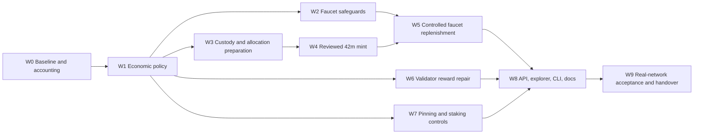

# CREG tokenomics, R7 testnet supply, and faucet implementation plan

**Date:** 2026-09-28

**Status:** Faucet W2/W5 are implemented on the real public service as R29: the approved 92,000 tCREG working-balance transfer and one real 100 tCREG acceptance claim are finalized and reconciled, and the bounded public policy is open. The public endpoint reports 20,000,000 tCREG total supply and a 99,900 tCREG faucet balance. W4 issuance toward the 42m target, reward and pinning changes, and remaining ecosystem acceptance gates are still pending. No governance mint, contract migration, or chain reset has been performed by this implementation.

**Network:** Existing public R7 testnet (`creg-phase-c-testnet-2026-09-26-r7`) with four real validators and four real observers; Ethereum Sepolia holds the economic contracts.

## 1. Objective and agreed policy

Implement the [tokenomics audit](CREG_TOKENOMICS_DEEP_DIVE_2026-09-28.md) and [supply/faucet decision](CREG_TESTNET_SUPPLY_AND_FAUCET_POLICY_2026-09-28.md) on the existing R7 network. The user chose **42,000,000 total outstanding tCREG** as the testnet supply target, with a **separate governance-approved faucet allocation**. The 42m target describes `CregToken.totalSupply()`, not the faucet wallet's balance. Keep tokens already staked or held by users in the supply accounting. The faucet remains a bounded distribution service fed from controlled reserves.

This is a Sepolia **testnet** economic program. The whitepaper's mainnet vesting, issuance, market, and security-budget questions remain separate policy decisions. On this testnet, completion means that live on-chain balances, governance records, the faucet, node reward state, explorer/CLI/API displays, and public documentation agree. Acceptance evidence must come from real Sepolia transactions, real package writes, and the real eight-node fleet; fabricated votes, simulated nodes, mock receipts, or a new chain history do not satisfy it.

### 1.1 Verified baseline to preserve

Read-only Sepolia calls at block **11,803,622** (2026-09-28 22:50:48 UTC) returned. The pinned balances, roles, validator entries, and code hashes are recorded in the [read-only inventory](CREG-TOKENOMICS-INVENTORY-2026-09-28.md).

| State | Observed value | Implication |
| --- | ---: | --- |
| Token contract | `0xbC2a72107C6765364D0A822a88A6e6C61f30EAa6` | Fresh Phase C token pinned by R7 spec |
| Token runtime code hash | `0xee4ee60af45e022c2673e37e21781b5d88d97164e768ad1d65293122aa1d2b16` | `keccak256(eth_getCode)` at the snapshot block |
| `totalSupply` / `MAX_SUPPLY` | 20,000,000 / 42,000,000 tCREG | Current mint gap is 22,000,000 tCREG |
| Token owner | Governance `0x0AB4Db22A9902B8Ef678aBd408889af22277d24E` | Mint requires a Governance contract call |
| Governance | 2-of-3 signers; not paused | Two approvals execute a valid proposal |
| Governance-held tCREG | 0 | Candidate custody address for newly minted reserve |
| Existing treasury EOA | 19,989,590 tCREG | Holds essentially all of the initial four named allocation buckets |
| Public faucet wallet | 8,000 tCREG | Existing 10,000-token seed, less two confirmed 1,000-token claims |
| Validator reward payouts | 0 on the last audit | Node skips dispatch pending a durable, authorized finality path |
| Pinning reward pool | 0 on the last audit | Do not announce payable pinning rewards |

The treasury and faucet figures are balances at one block, not permanent allocations. The live faucet API counter showed one 1,000-token claim while the confirmed on-chain history shows two, so that counter is not a lifetime ledger. Re-read all mutable values at every later transaction gate. The [fresh manifest](../chain-registry/testnet/phase-c/deployment-manifest.json), [R7 signed spec](../chain-registry/testnet/phase-c/r7/chain-spec.json), [funding receipt](testnet-heal-evidence/2026-09-27-production-pipeline-cutover/faucet-funding-receipt.json), and [audit](CREG_TOKENOMICS_DEEP_DIVE_2026-09-28.md) are the baseline sources. The older root Sepolia spec and older whitepaper contract addresses are historical references, not R7 deployment inputs.

## 2. Decisions needed before funds move

| Decision | Proposed direction | Required concrete output |
| --- | --- | --- |
| 42m issuance custody | Mint the then-current gap to the **Governance contract**, which can release tokens by 2-of-3 proposal | Exact recipient, amount, proposal description, gas budget, signer identities, approval record |
| Faucet distribution ceiling `F` | Governed cumulative **claim cap**; the two historical 1,000-token claims count against it | Exact `F`; durable reconciliation of confirmed, submitted, and reserved claims; separate authorization for every funding transfer |
| Faucet hot-wallet float `H` | Hold only a small tranche; replenish by governance-approved transfer | Maximum balance `H`, top-up threshold and tranche, emergency pause authority |
| Claim policy | Keep the current 1,000-token drip unless deliberately changed; add a lifetime limit and post-transfer cap | Per-address lifetime cap, daily program cap, cooldown/IP policy, eligibility rules |
| Sepolia ETH policy | Separate service transaction gas from user gas grants; current user gas drip is zero | Faucet gas reserve floor, operator top-up budget, public wording about zero ETH drips |
| Initial 20m custody | Reconcile 4m team, 3m investor, 5m community, 8m treasury accounting against the single EOA that received all four | Beneficiaries, wallet controls, vesting schedule, transfer ledger, spending authority |
| Burn and cap meaning | For R7, retain the deployed **maximum outstanding** 42m semantics | Explicit disclosure that burning can reopen mint headroom; decide cumulative cap only for a future token version |
| Reward and pinning budgets | Hold both payout paths at zero until repairs and a real funding policy pass | Per-program cap, rate table, authorization model, release schedule |

No arbitrary faucet allocation, vesting date, beneficiary address, reward budget, or gas amount is assumed in this plan. Document each decision before constructing a funding transaction. A vesting implementation may use a reviewed vesting wallet, but its schedule and beneficiary ownership must be approved first; [OpenZeppelin's VestingWallet documentation](https://docs.openzeppelin.com/contracts/5.x/api/finance#VestingWallet) describes the mechanism and its limitations.

## 3. Dependency order

W0–W3 are preparatory and reversible. W4 and W5 are separate on-chain actions with their own exact proposal packages. W6/W7 may require new contracts and address migration; no existing validator stake or CREG block history is discarded as an implicit step. W8 must report disabled features truthfully while their prerequisites are open.

## 4. Work packages

### W0 — Freeze a truthful economic baseline

- Query real Sepolia `totalSupply`, cap, token owner, governance signer threshold/pause state, treasury, Governance, faucet, Staking, ValidatorRewards, and PinningRewards balances and counters at one numbered block. Capture token code hash and contract addresses from the R7 signed spec/manifest. Read faucet `/api/stats` and health, and R7 public chain stats at the same review time.
- Reconstruct the initial 20m mint, 10k faucet transfer, validator/publisher deposits, faucet claims, and any burns from ERC-20 `Transfer` logs. Produce a ledger that balances issued supply against holder balances. Treat faucet process counters as service telemetry until reconciled against receipts.
- Inventory governance signers, deployer-held roles, large allowances, all active validator/publisher stake, any pinning positions, and any pending reward liabilities before designing migrations. Preserve current eight-node storage, signing journals, and existing evidence.

**Deliverable:** timestamped read-only inventory with block number, transaction hashes, contract code hashes, and discrepancies. **Gate:** every value in the later proposal packages traces to this inventory and is refreshed immediately before execution.

### W1 — Adopt a testnet economic policy

- Publish a 42m supply schedule: current 20m, requested additional amount at execution time, custody of the minted reserve, permitted release categories, and treatment of burns. Distinguish “minted but governance-held” from “in circulation.”
- Approve exact faucet claim ceiling `F`, hot-wallet limit `H`, claim and daily limits, replenishment tranches, and Sepolia ETH gas budget. The 10k seed is a past funding transfer; its two confirmed 1k claims count against `F`. Track cumulative authorized funding separately, and determine how returned or recovered tokens affect future tranche approvals.
- Formalize the four named initial allocation buckets. Because the current token minted all 20m to one EOA, identify the legal/operational beneficiaries and propose separate controlled wallets or vesting contracts. Do not infer vesting from the whitepaper's constructor labels.
- Specify reward and pinning program limits, rate-change authority, payout dispute handling, and public reporting cadence. Keep the current payouts disabled until W6/W7 acceptance.
- Model real validator CPU/scanner/storage costs, Sepolia gas, pinner storage costs, expected package volume, treasury runway, and low/high-abuse cases against the proposed reward rates. State what pays for ongoing operations; the tiny per-package token formula alone does not demonstrate a sustainable incentive or token value.

**Deliverable:** signed-off policy table containing all addresses, amounts, schedules, approvers, limits, and emergency rules. **Gate:** `F` and issuance custody are unambiguous, and total planned transfers never exceed available balances.

### W2 — Harden the public faucet before expanding its budget

- Extend `crates/faucet` and its PostgreSQL schema with a durable claim ledger keyed to recipient, request identity, chain ID, token, transfer hash, transaction status, and funding tranche. Reconcile confirmed on-chain transfers after crashes; expose `funded`, `confirmed distributed`, `available budget`, `hot-wallet balance`, and `failed/pending` separately. Keep the existing atomic address/IP cooldown semantics.
- Enforce the **post-transfer** wallet-balance threshold (`current balance + drip <= limit`), an approved per-address lifetime cap, daily program outflow, and remaining `F` budget. A token transfer must not start when durable budget storage is unavailable; a retry must not pay twice after an uncertain receipt.
- Trust client IP headers only from the configured edge proxy, preserve rate-limit state across restarts and replicas, and report accurate user gas availability. Set low-balance alerts for both tCREG and Sepolia ETH and provide an operator pause/runbook.
- Remove or guard the legacy deployment-script branch that can transfer all 20m to `FAUCET_ADDRESS`; it is not the approved faucet budget. Keep wallet signing material in the existing secret backend, never in the public UI or repo.

**Code surfaces:** [faucet service](../chain-registry/crates/faucet/src/main.rs), [public Compose](../chain-registry/testnet/docker-compose.public-faucet.yml), [deployment script](../chain-registry/contracts/script/DeploySepolia.s.sol). **Gate:** real Sepolia claim and restart evidence proves one transfer per approved request, durable accounting, budget enforcement, and correct public figures. The existing 8k tCREG remains in the faucet wallet; public distribution is paused until its governed allocation and caps are approved.

### W3 — Prepare custody and governance operations

- Review whether the Governance contract can custody and later release ERC-20 tokens via its existing `submit`/`vote`/`_execute` flow, including pause behavior and two distinct signer approvals. Make an on-chain proposal package containing target, recipient, exact token units, calldata, description, maximum ETH gas budget, signer verification, and post-execution checks. Prepare a separate package for any movement of the current treasury EOA's balance into approved wallets/vesting contracts.
- Record the existing ValidatorRewards near-unlimited treasury allowance. Plan a least-privilege replacement when the reward contract is migrated; the current allowance is permission, not an earmarked reward pool. Identify the custody implications of the staking owner and PinningRewards admin/verifier roles still held by the deployer EOA.
- Preserve a break-glass recovery route for governance custody without giving the public faucet hot key mint or reserve-release authority. Review contracts independently before making irreversible custody moves. [OpenZeppelin's access-control guidance](https://docs.openzeppelin.com/contracts/5.x/access-control) supports an explicit role inventory and least-privilege design.

**Deliverable:** reviewable transaction package and custody/role matrix. **Gate:** governance can demonstrably release an ERC-20 reserve under its actual 2-of-3 procedure; the target addresses and beneficiary ownership are verified.

### W4 — Reach 42m total outstanding supply through Governance

- Immediately before submission, read the real token `totalSupply`, `MAX_SUPPLY`, owner, Governance status, and intended recipient. Compute `amount = 42,000,000 × 10^18 - totalSupply`, without reusing a stale 22m constant if supply changed.
- Submit a Governance proposal whose target is the current token contract and whose calldata is `mint(governanceAddress, amount)`. The two required signers review the **same proposal ID and calldata**; the second approval executes it. The draft calldata for the 20m baseline is in the [supply policy](CREG_TESTNET_SUPPLY_AND_FAUCET_POLICY_2026-09-28.md#reviewable-issuance-call-at-the-snapshot). Do not combine this with faucet funding or allocations in one opaque operation.
- Record submitted/approved/executed transactions and token `Transfer(0, Governance, amount)`. Confirm `totalSupply == 42,000,000 × 10^18`, `balanceOf(Governance)` increased by the minted amount, the other holder balances did not change, and all live nodes still use the same R7 chain and Sepolia token.

**Gate:** approved exact issuance package, two distinct valid governance signers, final Sepolia receipts, and reconciled supply. **Recovery:** a failed proposal is investigated and re-read; a successful mint is irreversible under the present contract and is never described as rollback-capable.

### W5 — Fund only the approved faucet tranche

- Create a separate governance release proposal for no more than the approved tranche from Governance custody, or an explicitly approved transfer from the existing treasury EOA. Reconcile prior 10k seed against `F`, current hot-wallet balance, daily outflow, and service gas balance before execution.
- Confirm the ERC-20 transfer receipt and recipient wallet balance. Verify the hardened faucet reports total `F`, funded-to-date, user-distributed-to-date, remaining authorized funding, and current wallet balance correctly. Recheck the public page wording for zero user ETH drips.
- Keep the reserve in governance-controlled custody. The hot wallet receives only the bounded working float `H`, replenished through separately recorded approval events.

**Gate:** one reviewed tranche, actual transfer, correct accounting, and real user claim evidence. **Recovery:** pause the faucet and stop further tranche approvals if reconciliation fails; preserve all past transfer records.

**Status (2026-09-29): First tranche complete.** The user approved and the service executed a 92,000 tCREG transfer from the existing treasury EOA to restore the faucet's working float to 100,000. A real 100 tCREG acceptance claim survived restart and entered finalized history before public R29 promotion. The [release report](testnet-heal-evidence/2026-09-29-r29-public-faucet-release.json) and [live verification snapshot](testnet-heal-evidence/2026-09-29-r29-live-verification.json) confirm the bounded policy is open, total supply remains 20,000,000 tCREG, the faucet holds 99,900, and no claims are unresolved. Any later refill remains a separate exact approval.

### W6 — Repair validator work rewards and durable dispatch

- Design a new reward contract version or equivalent safe migration path. Require a trusted authorized dispatcher or certified-finality attestation, one payout per `(chain ID, finalized package identity, finalization hash)`, bounded participant count and reputation input, correct vote/points comparison, exact pre-funding, and clear accrued-versus-claimed counters. Remove or repair the simplified payout path that can accrue more than it pulls.
- In the node, persist a reward intent **after canonical CREG finality**, including committee/vote evidence, L1 nonce intent, transaction hash, confirmation state, and replay-safe recovery. Make the operator/API/explorer state say `disabled`, `pending`, `confirmed`, or `failed` truthfully; preserve the current skipped behavior until the new path passes acceptance.
- Migrate contract address/config/spec only after reviewing existing pending balances and revoking/limiting the old unlimited treasury allowance. Fund a bounded reward budget, then prove a real finalized package produces at most one Sepolia reward event and a claimable balance for a real active validator.

**Code surfaces:** [ValidatorRewards](../chain-registry/contracts/ValidatorRewards.sol), [node gate](../chain-registry/crates/node/src/validator_pipeline.rs#L665), [R7 spec](../chain-registry/testnet/phase-c/r7/chain-spec.json). **Gate:** one real finalized package, one authorized confirmed payout per eligible validator, restart-safe replay, correct points, and no payout for work that was non-final or revoked before settlement. Define separately whether a later revocation affects rewards already paid.

### W7 — Repair pinning and concentrate economic authority safely

- Repair `PinningRewards.unregisterPinner` so a zero-reward pinner can reclaim stake; key pin records by `(CID, pinner)`; start accrual from actual pin registration/last claim; authorize or verify `reportAccess`; define real proof/verifier policy and bounded reward rates. Inventory any live pinners before deploying a replacement. Fund its pool only after these mechanics pass real claim and withdrawal acceptance.
- Review Staking's deployer-held `owner` powers and absent owner-transfer path against Governance authority. Any staking contract migration must preserve every real publisher/validator deposit, pending liability, admission status, and the four-validator quorum. Treat it as a separate protocol migration with a signed-spec update and fleet rollout; a new token mint does not require it.
- Decide whether cumulative lifetime issuance protection is needed for a future token version. R7's deployed token caps **outstanding** supply; burning can reopen headroom. The 42m testnet target can be met on the current contract without silently changing its semantics.

**Code surfaces:** [PinningRewards](../chain-registry/contracts/PinningRewards.sol), [Staking](../chain-registry/contracts/Staking.sol), [token cap](../chain-registry/contracts/CregToken.sol#L124). **Gate:** no stranded pinner stake, credible access/verification input, exact accounting, and no validator-set or staked-balance regression after any contract migration.

### W8 — Public data pipes and documentation

- Expose real Sepolia `totalSupply`, cap, governance reserve, treasury/faucet balances, funded/distributed faucet amounts, staking lockup, slash pool, reward escrow, pending claims, and pinning pool through bounded API reads and durable metrics. Include block number, timestamp, contract address, and `unavailable/stale` state; never turn failed RPC calls into zero balances.
- Show these values consistently in web explorer, CLI explorer/wallet, and faucet UI. Label CREG-chain height separately from Sepolia contract block height. Show actual reward status, including skipped dispatch, instead of quoting the formula as an active payout.
- Update [whitepaper](WHITEPAPER.md), [workflow](CREG_SYSTEM_WORKFLOW.md), signed R7 spec if contract addresses change, public faucet help text, and operations runbooks **after** confirmed transactions or deployments. Replace the old Sepolia address table and change “22m unminted reserve” to “minted, governance-held reserve” only if W4 actually executes. Record approved faucet `F` and live tranche receipts.

**Gate:** browser, CLI, API, and contract reads agree at identified blocks; no stale hard-coded balances or old contract addresses appear on public routes.

### W9 — Real-network acceptance, rollout, and handover

- Stage each service/contract update on the existing real R7 environment in dependency order. Keep four voting validators and four observers independently running; a rollout must retain real quorum and signed-spec agreement. Reconcile each host's chain/genesis/tip after changes.
- Capture actual Sepolia receipts for mint, treasury/faucet funding, claim, stake, slash/reward/pinning actions that are in approved scope. Capture real service restart and uncertain-receipt recovery; verify no duplicate faucet or reward payment. Keep keys in the approved secret system and use actual upstream package data for reward-path acceptance.
- Prepare a final dossier with transaction hashes, code/image hashes, source manifests, public screenshots, accounting reconciliation, open risks, operator runbooks, and a staged service rollback route. Report irreversible token transfers and mints as historical facts, never as operations that can be rolled back.

**Gate:** all applicable items above pass on actual systems. Public pages and signed specs describe only confirmed capabilities.

## 5. Review gates and first execution wave

1. **Plan review gate:** confirm this scope and the unresolved W1 decisions. The settled choice is a 42m **total testnet supply target**, with a governed faucet allocation; the deployed token contract caps outstanding supply at 42m. The R28/R29 policy sets a 1m cumulative faucet claim ceiling, 100k working balance, and 100-token claim; each future transfer still needs exact review. Beneficiary schedules remain open.
2. **First code wave after review:** W2 faucet ledger, budget enforcement, reconciled supply display, and public status are implemented and live as R29. W0 inventory, the remaining W1 economic schedule, and W3 governance/custody preparation still need review and completion.
3. **On-chain issuance gate:** review the W4 exact amount, recipient, calldata, signers, ETH gas budget, and custody checks immediately before Governance submission. W4 needs the actual 2-of-3 signer process. A faucet tranche is a separate W5 gate.
4. **Incentive gate:** W6/W7 contract and node repairs, real acceptance, then bounded funding. Their present zero-payout state remains accurately visible throughout.
5. **Release gate:** W8/W9 proof across public service routes and the eight real nodes. No routine chain reset, new genesis, extra validator quota, or mock acceptance path is part of this plan.

## 6. Risks to keep visible during implementation

| Risk | Control in this plan |
| --- | --- |
| Entire supply reaches a public hot wallet | Governance custody of the new reserve; capped `F` and small working float `H` |
| Issuance exceeds intended amount after state changes | Recalculate from live `totalSupply` at execution; exact two-signer proposal |
| Existing 20m bucket labels imply vesting that never occurred | Reconcile current treasury EOA and publish actual allocation/vesting contracts |
| Double payment after service crash or RPC ambiguity | Durable claim/reward intent ledger, receipt reconciliation, on-chain idempotency |
| Reward formula and events overstate live economics | Leave dispatcher disabled until fixed; expose actual zero/pending/confirmed state |
| Contract migration strands stake or changes validator set | Inventory active positions, migration plan, signed spec, real four-validator/eight-node acceptance |
| Faucet metrics disagree with ERC-20 transfers | Log-based ledger and public figures derived from confirmed receipts |
| Governance or deployer role concentration | Role matrix, multisig-controlled reserve, bounded allowances, audited migrations |

**Plan maintenance:** update this file when a decision is approved or a gate passes, with a date and evidence link. Do not replace the verified baseline with an unconfirmed proposed state.

## 7. Implementation progress — 2026-09-29

The first reversible faucet and deployment-script safeguards are staged in source:

- The fresh Sepolia deployment script has no faucet funding path. A faucet tranche must be a separate, reviewed governance action after the allocation and hot-wallet limits are approved.
- Faucet claims now check the **resulting** recipient balance against the configured token/native thresholds. A transfer is not attempted when the balance would cross the threshold.
- Recipient and faucet balance RPC failures now fail closed for claims. Public balance and stats routes return an unavailable response instead of reporting an RPC error as a zero balance.
- Forwarded client IPs are accepted only when the direct socket peer falls within `FAUCET_TRUSTED_PROXY_CIDRS`. The public Compose deployment must set that variable to the actual Caddy source subnet after the host's Docker network is inspected.
- Faucet UI labels its current process counters as “Drips Since Restart” and shows unavailable values when the real chain RPC cannot supply stats. It no longer leaves template defaults looking like live readings after an API failure.
- The faucet governance funding script now previews an ERC-20 transfer from the Governance reserve instead of minting directly to the hot wallet. It defaults to read-only. Its explicit `-SubmitProposal` path requires the approved tranche value, one current Governance signer, and a typed recipient/amount confirmation; it submits the proposal without casting approval votes. Signers review and approve separately.

The faucet ledger now has a reconciliation and recovery implementation in source. It journals a token or native transaction hash as `submitted` immediately after broadcast, records confirmed reverts as `failed`, and checks pending receipts after restart. A broadcast that reached the chain but missed the database write can be recovered by matching its exact faucet `Transfer` event against the oldest compatible unresolved reservation. Ambiguous reservations remain unresolved and block token claims rather than being retried.

The history scanner verifies the configured Sepolia chain, token deployment receipt/address/block, and deployed bytecode. It imports faucet-related ERC-20 `Transfer` logs from the deployment block in bounded ranges, records incoming funding as `historical_unallocated`, imports outgoing claims idempotently, saves a database watermark, and verifies that the imported net flow equals `balanceOf(faucet)` at that same watermark. It checks the saved watermark’s canonical block hash before continuing and fails closed if the endpoint cannot supply the required history or the saved block no longer matches. The watermark is capped at the lower of consensus-finalized height and the configured confirmation depth. The deployment transaction and block for the current Sepolia token are listed in `.env.example`; the history endpoint is configurable separately from both transaction submission and the receipt fallback.

The candidate import, restart recovery, and production reconciliation now pass. Token claims remain disabled until `FAUCET_TOKEN_ALLOCATION_WEI`, `FAUCET_TOKEN_DAILY_CAP_WEI`, `FAUCET_TOKEN_ADDRESS_LIFETIME_CAP_WEI`, and `FAUCET_TOKEN_HOT_WALLET_FLOAT_WEI` contain approved values. The former `FAUCET_LEDGER_RECONCILED` operator boolean is no longer an authority; runtime readiness comes from successful chain and database verification. A mismatched token address, deployment receipt, chain, unavailable log range, RPC error, or ledger/balance discrepancy keeps claims disabled.

An authenticated `/admin/recovery` endpoint now lists unresolved claims and their receipt hashes for operator review. `/health` reports `degraded` with HTTP 200 when the process can reach PostgreSQL and Sepolia but token claims are disabled, so Docker and the edge proxy can keep serving the faucet page without treating policy lockout as a dead process. The faucet setup/sync scripts now select the R7 deployment manifest and carry its verified token deployment hash/block into the protected environment. Candidate staging requires an immutable image digest and asserts that reconciliation passed while token claims remain disabled.

The reconciliation and restart-recovery path has now passed on a real GCP candidate using a point-in-time clone of the production PostgreSQL database and live Sepolia reads. Routescan supplies the bounded Transfer-log scan, transaction receipts, canonical block headers, and historical `balanceOf`/`totalSupply` values at the same finalized watermark. At block **11,806,261**, the candidate persisted three faucet transfers (10,000 tCREG funded and two 1,000 tCREG claims), one unallocated funding record, an 8,000 tCREG faucet balance, and 20,000,000 tCREG total supply. It reported zero unresolved claim reservations. After restarting the candidate app against that same cloned database, `/admin/status` again reported `ledger_reconciled=true` and `token_claims_enabled=false`; `/admin/recovery` reported `clear`. The bounded `/health` endpoint returned HTTP 200 with `status=degraded` and claims still disabled. The evidence report is on the VM at `/var/lib/creg/faucet-ledger-reconciliation-r9/recovery-report.json`.

During the candidate restart check, a self-deadlock was found: the reconciliation task committed its database transaction and then attempted to reacquire the same single-connection mutex before releasing it. The lock is now released before the unresolved-claim check. The corrected image was compiled and pinned as `sha256:d5ae54b4e3d58e785a4aca24a385eddcdb025b62a6f6b56daf0500cdc6dc79df`, then used to recover the preserved candidate clone through [`resume-faucet-ledger-reconciliation-r9.sh`](../chain-registry/testnet/phase-c/resume-faucet-ledger-reconciliation-r9.sh).

On **2026-09-29**, the public faucet returned HTTP 502 because its R25 app container had stopped. The R26 rollout [backed up production PostgreSQL, reconciled through a private app, verified restart recovery, and then switched the public Compose service](../chain-registry/testnet/phase-c/restore-public-faucet-r26.sh). The live service now uses digest `sha256:11ac1d09ccd2c65fa56fb3fac63568b6f2302aa81ae601d1a22d7b18225d6550`. At Sepolia block **11,809,184**, the production ledger recorded three canonical faucet transfers, one funding row, an 8,000 tCREG faucet balance, and 20,000,000 tCREG total supply. The existing production PostgreSQL container and volume were preserved. The [rollout report](testnet-heal-evidence/2026-09-29-public-faucet-r26/production-rollout.json) and [real browser check](testnet-heal-evidence/2026-09-29-public-faucet-r26/public-faucet-r26-browser.json) show the public page at HTTP 200, the ledger reconciled, the claim button disabled, and zero native ETH drip amount. No claim or on-chain transaction was sent during the rollout.

The allocation cap represents the cumulative faucet claims counted by the ledger; it is separate from the global 42m testnet token cap. Historical incoming transfers are not assumed to be Governance-approved allocations. Exact faucet allocation `F`, hot-wallet float `H`, daily outflow cap, per-address lifetime cap, and Sepolia gas floor remain open policy inputs, so no numeric values have been invented or enabled. Token and native claims remain disabled on the public R26 service. No on-chain state was changed by this rollout.

W0 has a pinned read-only Sepolia snapshot at block **11,803,622** in the [inventory](CREG-TOKENOMICS-INVENTORY-2026-09-28.md). Remaining evidence includes the unattributed 10 tCREG in Staking, approved faucet policy values, and host-level proof for the eight-node fleet. W1 policy approval and W3 governance/custody preparation are not complete. The faucet crate compiled in a digest-pinned Docker image, and the public page passed a real browser check. The Solidity deployment script has not been compiled or validated. No on-chain transaction has been performed by this work.

## 8. Public supply visibility and requested full-faucet proposal — 2026-09-29

The R27 public faucet now shows the verified current Sepolia distribution: **20,000,000 tCREG total outstanding**, **19,989,590 in treasury**, **8,000 in the faucet**, **410 in Staking**, and **2,000 with other holders**. The `/api/supply` route combines the production faucet ledger's reconciled balance and total supply with historical treasury/governance/staking reads at the same canonical block; it reports unavailable on verification failure. The [R27 rollout](testnet-heal-evidence/2026-09-29-public-faucet-r27-rollout.json) preserved production PostgreSQL, passed private restart recovery, and switched the public site to the pinned image. The [real browser check](testnet-heal-evidence/2026-09-29-public-faucet-r27-browser.json) found the public page at HTTP 200 with the correct numbers and disabled claims. No on-chain transaction was submitted.

The user requested preparation of a full **20 million tCREG faucet balance**. The [review proposal](CREG-FULL-FAUCET-CUSTODY-PROPOSAL-2026-09-29.md) and [read-only transaction package](testnet-heal-evidence/2026-09-29-full-faucet-custody-proposal.json) show why a single 20 million treasury transfer cannot succeed: treasury owns only 19,989,590. Transferring all of it would bring the faucet to 19,997,590. A direct Governance mint of the missing 19,992,000 would instead put exactly 20 million in the faucet while leaving treasury and stakes intact, but total outstanding supply would rise to **39,992,000**. Transferring the treasury balance and separately minting 2,410 would reach the same faucet balance with **20,002,410** total outstanding and an empty treasury. Preserving exactly 20 million outstanding would require voluntary recovery of the 2,410 outside treasury/faucet, including active staking funds. None of these routes is approved or executed. The prior governed allocation preference and the new custody request need an explicit policy choice before any on-chain action; claims stay disabled.

## 9. Bounded faucet policy staged — 2026-09-29

The subsequent [R28 bounded faucet policy](CREG-FAUCET-R28-BOUNDED-POLICY.md) stages a 100 tCREG standard claim, 1,000,000 tCREG cumulative claim ceiling, 50,000 tCREG daily ceiling, 100 tCREG per-address lifetime ceiling, and 100,000 tCREG working-balance limit. This replaces the proposed full-custody route in section 8 for the current rollout. `FAUCET_TOKEN_DISTRIBUTION_OPEN=false` is an independent release gate, so staging the limits did not enable claims. The 1m setting limits cumulative claims; it is **not** a 1m transfer authorization or an on-chain escrow. The 42m total supply target remains a separate issuance decision.

The [R28 production rollout](testnet-heal-evidence/2026-09-29-public-faucet-r28-rollout.json) used an immutable image, preserved and backed up production PostgreSQL, and passed a private restart/reconciliation check. The [real browser check](testnet-heal-evidence/2026-09-29-public-faucet-r28-browser.json) confirmed the public page showed the staged policy and claims disabled before funding. The user approved the [exact Sepolia transfer proposal](testnet-heal-evidence/2026-09-29-r28-faucet-top-up-proposal.json): **92,000 tCREG** from treasury to faucet, with at most **0.001 Sepolia ETH** in gas. The [confirmed execution](testnet-heal-evidence/2026-09-29-r28-faucet-top-up-execution.json) at block **11,810,180** increased the live wallet balance from 8,000 to 100,000 tCREG; total outstanding supply stayed at 20 million. The actual gas cost was 0.000036824453043451 ETH.

The archive history provider lagged the real finalized Sepolia tip by hundreds of blocks. A protected configuration repair moved recent finalized-block, log, and balance reads to the fresh CREG Sepolia proxy while retaining Routescan for the old deployment receipt. The [production classification report](testnet-heal-evidence/2026-09-29-r28-funding-classification.json) shows the canonical 92,000 transfer imported at safe block **11,810,216**, with both the previous 10,000 seed and new tranche classified by their exact receipt hashes. A private R29 candidate then made one [real 100 tCREG claim](testnet-heal-evidence/2026-09-29-r29-real-claim.json) at block **11,810,329** to a dedicated GCP Secret Manager wallet, confirmed exact balance changes and durable claim storage, and passed an app restart. The claim reached the finalized/safe reconciliation watermark at block **11,810,376**, then the same digest-pinned image and bounded configuration were promoted to the public service. The [R29 release report](testnet-heal-evidence/2026-09-29-r29-public-faucet-release.json) records the preserved PostgreSQL container/volume, while the [live verification snapshot](testnet-heal-evidence/2026-09-29-r29-live-verification.json) records healthy public endpoints, zero unresolved claims, 99,900 tCREG in the faucet, and unchanged 20m total supply. The [read-only refill check](../chain-registry/testnet/phase-c/check-r28-faucet-refill.mjs) detects the proposed 25,000-token threshold but is not yet a scheduled alert or automatic transfer.
