# CREG Blockchain and Software Supply-Chain Verification Audit

**Assessment date:** 2026-07-10  
**Assessment basis:** repository source, configuration, tests, deployment material, operating documents, and current primary standards  
**Assurance level:** architecture and source review; not a formal audit, penetration test, smart-contract audit, economic audit, or legal opinion  
**Decision:** **redesign before any mainnet or production-security claim**

## Audit opinion

CREG contains a credible product idea and a substantial alpha implementation: a cross-ecosystem verification overlay that content-addresses artifacts, runs several analysis stages, collects signed validator evidence, records package history, and gates installation. That product is technically feasible.

The current system is not, however, a secure or economically justified Layer 1 and should not proceed to mainnet in its present form. The most important blockers are not polish issues:

1. **Publisher stake is not bound to publisher identity in the Rust admission path.** The node checks that the EVM address *claimed* in a request has stake, but it verifies only an Ed25519 signature created by a separately supplied key. It does not require proof that the Ed25519 signer controls that EVM address. A submitter can therefore reference someone else's staked address. See [`package_admission.rs`](../chain-registry/crates/node/src/package_admission.rs) around `verify_publish_sig` and `ensure_publisher_staked`.
2. **The ZK package fast path proves assertions, not package safety.** Hash limbs are now constrained, but the CLI deliberately supplies a score of 85 and `sandbox_safe=true` so any artifact can satisfy the package circuit. The circuit proves that those caller-selected values satisfy simple inequalities; it does not prove that a named scanner ran or produced them. [`publish.rs`](../chain-registry/crates/cli/src/publish.rs) labels the inputs as placeholders, while [`Registry.sol`](../chain-registry/contracts/Registry.sol) can mark the package `Verified` directly from that proof.
3. **The purported rollup proof does not prove a state transition.** The batch circuit exposes arbitrary old/data/new roots and proves only that a private `tx_count` is nonzero. It does not enforce `nextRoot = transition(prevRoot, batch)`, and the contract does not bind `publicInputs` to its `prevRoot`, `nextRoot`, or `dataRoot` arguments. Calling this a validity rollup is inaccurate.
4. **The large-validator committee path is internally inconsistent.** The recorded committee is stake/reputation/performance weighted, but validators decide whether to analyze using a separate hash-sampling function. Above 50 validators, a node can claim mandatory work only if it independently lands in both sets. At 10,000 validators, the expected intersection of two 100-member sets is about one validator, while the mandatory quorum is 67. The advertised large-scale workflow therefore cannot finalize reliably.
5. **The current chain is centralized.** The signed Sepolia chain specification contains one validator and no bootnodes. One signature is the entire security boundary; PBFT provides no Byzantine tolerance in that topology.
6. **Publisher economics are not slashable in practice.** A publisher can stake once, submit unlimited packages, and immediately withdraw because `unstakeAsPublisher` does not implement its own comment that active-package liability should block withdrawal. No per-package bond or liability window exists.
7. **Home-grown consensus has unresolved safety/liveness semantics.** Local timeouts change view without waiting for a view-change certificate, view changes do not alter the proposer-selection seed, finalized-height replacement/reorg code conflicts with deterministic-finality claims, and long-range sync does not have a fully specified historical validator-set trust model.

The recommended end state is a **hybrid verification network plus a witnessed append-only transparency log**, with package bytes and evidence off-chain, Merkle commitments anchored periodically to an established Ethereum L2, and no freely tradable native token during the proof-of-value stages. If independent consensus later becomes necessary, replace the custom PBFT implementation with CometBFT and a small application-specific state machine; do not evolve the current chain into mainnet consensus in place.

---

## 1. Executive summary

### 1.1 What CREG is

CREG is currently three things at once:

- a package-verification service that fetches content-addressed artifacts and applies static, sandbox, differential, ML/rule, advisory LLM, PGP, reputation, and vulnerability signals;
- a custom Rust blockchain that collects package-evidence votes and separately finalizes blocks through a PBFT-like protocol; and
- a Solidity contract suite on Sepolia for registry records, staking, governance, ZK verification, rewards, appeals, and experimental checkpointing.

It is better understood as a **verification overlay and trust-data network** than as a replacement for npm, PyPI, crates.io, Maven Central, or other package registries. The CLI ultimately delegates installation to existing package managers, and verified bytes are retrieved from IPFS or configured gateways.

### 1.2 Problem and strongest ideas

The real problem is not simply that registries are centralized. It is that developers usually receive weak, fragmented evidence about who produced an artifact, which source and build produced it, what analysis was performed, whether the artifact has changed, and what happened after a later compromise.

CREG's strongest ideas are:

- content-hash verification before installation;
- an explicit split between deterministic and advisory findings;
- signed evidence digests and scanner-profile identifiers;
- fail-closed behavior when a real sandbox is unavailable in non-development profiles;
- package revocation and historical evidence;
- a CLI that can enforce organization policy and refuse unverified fallback;
- cross-registry normalization; and
- operational attention to metrics, incident response, key handling, and public limitations.

These are useful with or without a blockchain.

### 1.3 Most serious weaknesses

- Publisher identity and stake are not cryptographically joined in node admission.
- Package namespace ownership across versions is not enforced.
- `Verified` is overloaded and can mean validator consensus, a self-declared ZK proof, or a record in one node's local chain.
- Package safety is treated too nearly as a binary state; unknown vulnerabilities and scanner evasion remain unavoidable.
- The ZK statements are materially weaker than their names and comments imply.
- The custom PBFT implementation has not earned production consensus trust.
- Committee selection and analysis assignment diverge at scale.
- Evidence-digest equality incorporates locally variable reputation and environment-dependent observations, harming heterogeneous-validator liveness.
- The current one-validator network cannot support decentralization or Byzantine-resistance claims.
- No complete source-to-build-to-artifact provenance chain is implemented.
- Package-level reproducible builds, diverse double compilation, secrets scanning, license analysis, and complete SBOM generation are not part of the consensus pipeline.
- The token reward is too small to pay for validation work, while publisher stake is too weakly locked to deter harm.
- Governance is a maintainer multisig; an emergency pause can be difficult or impossible to unwind because new proposals cannot be submitted while paused.
- Contract testing is not a reproducible CI gate, and web surfaces lack unit-test scripts.
- No external security audit has been completed.

### 1.4 Feasibility and readiness

| Question | Assessment |
|---|---|
| Is a cross-registry verification overlay feasible? | **Yes.** This is the core worth continuing. |
| Is independent multi-party attestation useful? | **Yes, selectively.** It adds value for high-risk packages and disputes. |
| Does every package need blockchain consensus? | **No.** It adds cost and latency without proving safety. |
| Is a standalone CREG L1 justified today? | **No.** Demand, governance, validator diversity, and protocol maturity are insufficient. |
| Is the current chain mainnet-ready? | **No.** Critical correctness and trust-binding issues remain. |
| Is the project public-alpha-ready? | **Only as a coordinated research alpha with no financial or safety guarantees.** |
| Should work stop? | **No.** Proceed through a redesigned, evidence-first phased program. |

### 1.5 Scorecard

Scores measure the current repository as a candidate for an open production network, not effort or ambition.

| Area | Score / 10 | Explanation |
|---|---:|---|
| Technical architecture | **4.5** | Broad implementation and sensible service separation exist, but trust boundaries are inconsistent and many components are experimental. |
| Blockchain design | **3.0** | Hash-linked records and signed votes are real; custom consensus, reorg semantics, historical-set verification, ZK checkpointing, and one-validator deployment are not production sound. |
| Package-verification strength | **4.0** | Useful static/sandbox/diff layers exist, but no authoritative build provenance, package ownership, full SBOM, reproducible-build gate, or reliable semantic-malware guarantee exists. |
| Security | **3.0** | Several fail-closed controls are strong, but publisher identity, ZK statements, pause recovery, and consensus liveness contain critical risks; no external audit exists. |
| Scalability | **2.5** | Expensive work is correctly recognized as off-chain, but the >50-validator selection algorithms conflict, buffers can drop finalized transactions, and no credible multi-host load evidence supports scale claims. |
| Tokenomics | **2.0** | A capped token and explicit stake roles exist, but reward/work economics do not clear, publisher liability is evadable, vesting is absent, and mint authority is concentrated. |
| Governance | **2.5** | Multisig and two-person pause are better than a single admin, but there is no broad legitimacy, independent security council, robust timelock, or safe paused-state recovery. |
| Developer experience | **4.5** | CLI, shims, API, explorer, docs, and policy are meaningful; wallet/token/IPFS requirements, ambiguous labels, and incomplete integrations impose high friction. |
| Economic sustainability | **2.0** | Tiny rewards conserve treasury but cannot finance real analysis; costs and revenue are not connected by a validated business model. |
| Real-world adoption potential | **4.0** | The problem is real and a cross-registry evidence overlay is attractive, but existing standards solve much of provenance more simply and the blockchain burden impedes adoption. |
| Overall project readiness | **2.5** | Suitable for controlled research and redesign, not open economic security or production package-safety claims. |

**Overall: 3.2/10 for production readiness.** The correct decision is **phased redesign**, retaining the verification overlay and discarding unsupported L1, ZK, token, and absolute-safety claims until each earns its place.

### 1.6 Required gates

**Before the next implementation milestone:** freeze terminology, define package identity/ownership, bind EVM and Ed25519 identities, remove or disable the ZK verification fast path, and select the target architecture.

**Before public testnet:** use at least four independently operated consensus/witness nodes; replace or formally specify consensus; make all security profiles reproducible; run partition, replay, key-compromise, malicious-package, and load tests; and publish evidence.

**Before mainnet or production adoption:** complete independent audits of contracts, protocol, ZK circuits if retained, sandbox, and client; prove governance recovery; validate economics with real workload; meet all acceptance gates in Section 21; and resolve every Critical/High item in the risk register.

---

## 2. Method, evidence, and limitations

### 2.1 Review method

The assessment covered the Rust workspace, Solidity contracts, Circom/Arkworks circuits, chain specification, CLI, resolver and package-manager shims, web applications, IPFS and database paths, Docker/Kubernetes/GCP material, monitoring, CI workflows, testing assets, whitepaper, workflow descriptions, readiness documents, and remediation records.

Evidence was classified as follows:

| Confidence class | Meaning |
|---|---|
| **Implemented** | The behavior is present in current source. |
| **Automated** | A relevant automated test is present. This does not mean the full suite ran in this assessment. |
| **Demonstrated** | Repository evidence reports an operational run, but the assessor did not independently reproduce it. |
| **Specified** | Documentation describes the behavior but source or deployment evidence is incomplete. |
| **Planned/scaffolded** | Types, contracts, flags, or scripts exist without an end-to-end production path. |

### 2.2 Verification limitation

Local command execution became inconclusive: the Windows execution environment stalled on Cargo invocations, including `cargo --version`, after repository reads had worked. This is recorded as an assessment-environment limitation, not a CREG test failure. The repository does define Rust format, Clippy, and workspace-test CI. Contract CI is expressly absent because Foundry dependencies are not reproducibly declared in a clean checkout. Web package manifests provide build/lint and Playwright commands but no unit-test gates.

No deployed endpoint, private key, cloud account, token balance, or third-party service was mutated. No formal legal conclusion is offered.

### 2.3 Primary external references

Recommendations were checked against authoritative sources current at the assessment date:

- [Sigstore security model](https://docs.sigstore.dev/about/security/) and [Rekor](https://docs.sigstore.dev/logging/overview/)
- [in-toto stable specifications](https://in-toto.io/docs/specs/) and [workflow model](https://in-toto.io/docs/getting-started/)
- [SLSA v1.2](https://slsa.dev/spec/v1.2/) and [SLSA build levels](https://slsa.dev/spec/v1.0/levels)
- [The Update Framework specification v1.0.34](https://theupdateframework.github.io/specification/latest/)
- [Reproducible Builds guidance](https://reproducible-builds.org/docs/)
- [SPDX specifications](https://spdx.dev/use/specifications/) and [CycloneDX specification](https://cyclonedx.org/specification/overview/)
- [OSV API](https://google.github.io/osv.dev/api/) and [OpenSSF Scorecard](https://scorecard.dev/)
- [NIST SSDF 1.1](https://csrc.nist.gov/pubs/sp/800/218/final); NIST 1.2 was still draft
- [CometBFT/Cosmos application architecture](https://docs.cosmos.network/sdk/latest/learn/intro/sdk-app-architecture) and [Polkadot FRAME](https://docs.polkadot.com/parachains/customize-runtime)
- [Ethereum optimistic-rollup architecture](https://ethereum.org/developers/docs/scaling/optimistic-rollups/) and [ZK rollups](https://ethereum.org/developers/docs/scaling/zk-rollups/)

---

## 3. Problem definition and market need

### 3.1 Problem-to-solution mapping

| Supply-chain problem | Current CREG mechanism | What it can do | What it cannot prove / missing dependency |
|---|---|---|---|
| Malicious package | YARA/static patterns, sandbox, deep scan, validator votes, revocation | **Reduce/detect** known and observable behavior | Cannot guarantee absence of novel, dormant, environment-aware, or logic-level malware |
| Dependency confusion | Ecosystem-qualified canonical IDs and policy | **Partially reduce** ambiguity | Needs organization namespace policy, private-index precedence, and lockfile provenance; current code does not establish those |
| Impersonation / typosquatting | Local popular-name edit-distance data | **Detect some** close-name cases | Cannot establish trademark, registry namespace ownership, or intent; false positives/negatives remain |
| Compromised maintainer | Multiple validators, signatures, later revocation | **Reduce and detect after evidence** | A valid compromised maintainer credential remains valid; needs identity transparency, threshold release policy, and anomaly monitoring |
| Tampered artifact | SHA-256 plus IPFS CID and download rehash | **Strongly detect** byte changes after the recorded digest | Does not prove the recorded bytes came from intended source/build |
| Registry attack | Independent CREG record and content-addressed copy | **Detect/route around** some tampering or outage | CREG's own node, gateway, spec, or index can fail; clients need witnessed log checkpoints and multi-source verification |
| Unsigned release | Ed25519/optional PGP and validator signatures | **Detect** missing CREG signatures | Current publisher Ed25519 key is not bound to EVM-stake identity or a registry/account identity |
| Reproducibility failure | Release-assurance scripts for CREG binaries | **Not implemented for submitted packages** | Needs hermetic builders, build recipes, source digest, toolchain digest, independent rebuilds, and diff evidence |
| Dependency hijacking | Version history, diff, vulnerability feeds | **Reduce/detect** suspicious changes | Cannot prevent upstream ownership transfer or compromised dependency release without authoritative upstream identity/provenance |
| Build-system compromise | No package build provenance gate | **Cannot currently solve** | Integrate SLSA provenance and in-toto attestations; rebuild high-risk artifacts |
| Metadata manipulation | Signed request and chain record | **Detect for fields covered by signatures** | Manifest is not part of the basic publish signature; canonical serialization and full metadata binding need specification |
| Abandoned package | Reputation/history scaffolding | **Signal only** | Needs objective maintenance policy, deprecation, successor delegation, and human governance |
| Validator collusion | Quorum, stake, transparent signatures | **Reduce only with independent operators** | Current one-validator topology does not reduce it; >1/3 voting power can break BFT assumptions |
| Central registry failure | IPFS copies and independent nodes | **Reduce availability/concentration risk** | IPFS is not permanence; pinning, mirrors, and signed metadata freshness remain necessary |
| False security claims | Alpha disclaimers and findings split | **Partially mitigated** | `Verified` and `is_safe()` remain overly strong names; ZK and local-chain semantics can mislead |
| Lack of provenance | Hashes, signatures, package record | **Partial provenance** | No complete source→builder→artifact chain or builder identity; adopt in-toto/SLSA/Sigstore |
| Weak maintainer accountability | Stake, pubkey history, revocation | **Potentially improve** | Stake identity binding and package ownership are incomplete; stake can be withdrawn immediately |
| Unknown/time-delayed vulnerability | OSV snapshots and revocation | **Detect after disclosure if rescanned** | Continuous rescan, affected-range quality, reachability, VEX, and notification workflows remain incomplete |
| Scanner compromise | Profile digests and validator diversity | **Detect disagreement** in principle | Exact-digest quorum plus homogeneous pinned bundles can turn common-mode compromise into consensus |

### 3.2 Full/reduce/detect/cannot-solve classification

- **Can strongly solve:** post-record byte-integrity checking when the client has an authentic canonical record; append-only evidence and revocation history if checkpoints are correctly witnessed.
- **Can reduce:** compromised-maintainer blast radius, malicious artifacts, typosquatting, registry tampering, validator negligence, package availability failures.
- **Can detect:** known vulnerabilities, known malware patterns, some behavioral changes, missing signatures, hash mismatches, later rule changes, validator disagreement.
- **Cannot solve alone:** unknown vulnerabilities, intentional but subtle malicious logic, stolen valid identities, compromised source/build before attestation, legal ownership, trademark disputes, zero-day risk, or collusion above the trust threshold.
- **Requires external systems/humans:** source-host identity, CI provenance, vulnerability databases, reproducible builders, license policy, incident adjudication, trademark/copyright claims, sanctions screening where applicable, and independent audits.

### 3.3 Market position

The defensible opportunity is not “blockchain makes packages safe.” It is **portable, cross-registry, policy-ready evidence with transparent re-evaluation and dispute history**. CREG should integrate mature standards instead of inventing substitutes: Sigstore for identity-bound signing and log inclusion, in-toto/SLSA for provenance, TUF for update metadata and key compromise resilience, SPDX/CycloneDX for BOMs, OSV for vulnerability data, and OpenSSF Scorecard for project-practice signals.

---

## 4. Vision, scope, and architecture choice

### 4.1 Goal quality

| Criterion | Assessment |
|---|---|
| Clearly defined | Partial. The overlay is clear; L1, L2, rollup, registry, and checkpoint terminology is inconsistent. |
| Technically realistic | The overlay is realistic; universal safety, 10k-validator analysis, current ZK validity, and mainnet L1 claims are not. |
| Economically sustainable | Unproven. No validated payer, price, cost-per-analysis, or validator break-even model exists. |
| Measurable | Partially. Metrics exist, but security efficacy targets, false-positive/negative baselines, and adoption outcomes are missing. |
| Prioritized | No. Cross-chain, insurance, private/shielded paths, ZK, token, two chains, multiple web surfaces, and broad package support dilute the core. |
| Suitable for blockchain | Tamper-evident shared checkpoints and economic bonds may be; scanners, reports, SBOMs, identities, search, and package bytes are not. |

### 4.2 Architecture options

| Model | Advantages | Disadvantages for CREG | Verdict |
|---|---|---|---|
| Custom standalone L1 | Maximum control | Reimplements consensus/networking/upgrades; must bootstrap security and economics | **Reject now** |
| Cosmos SDK + CometBFT appchain | Mature deterministic finality, staking/governance modules, ABCI boundary | Go/SDK migration, independent validator set still required | **Best fallback if an appchain later becomes necessary** |
| Polkadot SDK / appchain | Rust, modular FRAME runtime, upgrade support | Operational/ecosystem complexity and unnecessary runtime breadth | Viable but second choice |
| Avalanche-style L1 | Custom validator/economic design | Another independent security domain; no clear advantage for this workload | Reject |
| EVM appchain | Existing Solidity/tooling | Duplicates execution environment for mostly off-chain work | Reject |
| General-purpose L2 contracts | Inherits established settlement and wallets | Per-record cost, public-data/privacy limits | Use only for checkpoints/bonds/disputes |
| Optimistic/validity rollup | Settlement security and batching | Requires real DA plus fraud/validity proof system; current implementation has neither | Do not call current system a rollup |
| Hybrid verification network + witnessed transparency log + L2 anchor | Matches workload; cheap; independently auditable; gradual decentralization | Requires careful log-witness and governance design | **Recommended** |
| Traditional database only | Fastest MVP and search | Operator can rewrite history unless externally witnessed | Use behind a verifiable log, not as sole trust source |

### 4.3 Recommended decision

Adopt a **decentralized transparency-log architecture**, initially permissioned and progressively witnessed:

1. Verification workers produce signed in-toto-style evidence envelopes.
2. A deterministic policy engine derives bounded confidence labels.
3. An append-only Merkle log commits records, revocations, disputes, policy versions, and evidence digests.
4. Independent witnesses sign tree heads and monitor consistency.
5. A small checkpoint contract on an established L2 stores periodic tree heads and dispute/bond events.
6. PostgreSQL/OpenSearch provide derived query views; object storage/IPFS store immutable evidence and artifacts.
7. Package-manager clients verify signatures, inclusion, checkpoint freshness, hash, identity policy, and revocation before install.

This model captures almost all of CREG's differentiated value without forcing every scan through consensus or requiring a speculative token.

---

## 5. Current system architecture

### Diagram 1 — High-level ecosystem

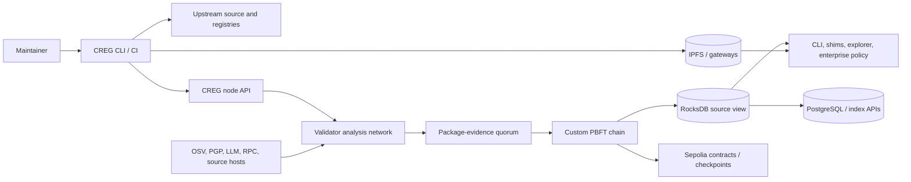

- **Components:** publishers, upstream ecosystems, IPFS, node API, validators, two consensus surfaces, storage, clients, and external intelligence.
- **Data flow:** signed package metadata and artifact hashes enter the node; validators analyze bytes; evidence votes become local-chain records and optional Ethereum activity; clients consume verdicts and bytes.
- **Trust boundaries:** publisher credentials, node admission, validator sandboxes, local chain state, L1 relayer, IPFS gateways, and external intelligence are distinct boundaries.
- **Failure points:** upstream outage, unpinned CID, scanner drift, quorum failure, PBFT halt, local-chain divergence, RPC failure, or compromised client policy.
- **Security:** the diagram shows that Ethereum does not validate package safety; it receives contract calls or checkpoints after off-chain decisions.

### Diagram 2 — Complete current architecture

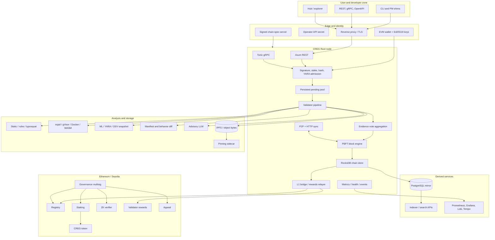

- **Components:** the implementation is a monolithic async node plus external content, derived database, observability, and L1 contract services.
- **Data flow:** REST/gRPC converge on shared admission; pending entries feed local validation and signed vote gossip; a second consensus path creates blocks; derived databases/indexers are not authoritative.
- **Trust boundaries:** the reverse proxy does not remove the need for node ACLs; analysis workers execute hostile content; bridge and reward keys can mutate L1; the index must never outrank signed records.
- **Failure points:** one process hosts many critical tasks, so memory exhaustion, RocksDB failure, deadlocked consensus, or malformed configuration can impair multiple planes simultaneously.
- **Security:** split the node into consensus/log, verification orchestration, and query services; isolate workers by tenant and package; use workload identities and HSM/KMS-backed signing.

### 5.1 Component assessment

| Component | Purpose / I/O | Trust and failure risks | Scale concern | Recommendation / placement |
|---|---|---|---|---|
| CLI and shims | Publish, verify, install, policy | Local config/cache, PATH interception, ambiguous `latest`, interactive override | Ecosystem-specific semantics | Keep off-chain; use signed update metadata and noninteractive enterprise policy |
| Hub/explorer | Human views | Can overstate local-node state; no unit tests | Polling/rate-limit load | Derived off-chain UI; label evidence source and freshness |
| REST/gRPC | Submission and query | 50 MiB request cap; proxy-IP and ACL assumptions | Horizontal read scale, stateful writes | Separate public query, authenticated submit, operator, and validator planes |
| Admission | Signature, claimed stake, content pre-scan | EVM/Ed25519 identity gap; no namespace ownership; replay domain gap | RPC latency per submit | Require dual proof or Sigstore identity; cache finalized stake proofs; ownership registry |
| Pending pool | Durable in-flight records | JSON corruption/manual deletion; replacement semantics | Whole-file persistence | Transactional DB/queue with idempotency keys |
| Validator pipeline | Security evidence | Hostile code, scanner drift, environment dependence | Dominant CPU/RAM/time cost | Off-chain workers, hermetic profiles, job queue, signed evidence |
| Committee selection | Assign expensive work | Two conflicting algorithms; performance bias centralizes | Fails above 50 | One deterministic, snapshot-bound VRF algorithm; audit proof |
| Evidence quorum | Aggregate signed decisions | Exact evidence digest harms diversity; opinion ≠ proof | O(committee) votes | Quorum on policy outcome + independently addressable evidence, not identical full result |
| PBFT chain | Order/finalize records | Custom safety/liveness and view-change issues | O(n²) messages | Replace with witnessed log or CometBFT |
| RocksDB | Canonical local chain | Local node is not global source of truth; reorg replacement | History and compaction | Merkle log + replicated object DB; define pruning/archive |
| PostgreSQL/indexer | Search and analytics | Reorg/cursor lag and derived-state confusion | Query and graph growth | Derived only; rebuildable from signed log |
| IPFS/pinning | Artifact/evidence bytes | CID does not ensure availability or legality | Storage/egress dominates | Multi-provider object storage + IPFS; availability SLO and deletion/legal process |
| Ethereum contracts | Bonds, checkpoint, governance | Large attack surface and duplicated states | Gas and RPC reliability | Reduce to checkpoint, bond escrow, dispute finality |
| ZK system | Claimed package and batch proofs | Statements are vacuous relative to safety/transition | Proving and setup complexity | Disable until a formal statement and audited circuit exist; likely remove package-safety ZK |
| Rewards | Pay analysis/pinning | Bridge-key authority, zeros for missing addresses, uneconomic amounts | O(committee) arrays/gas | Off-chain accounting + periodic Merkle claims if ever needed |
| Reputation | Bias and history | Circularity, poisoning, local divergence | Stateful and gameable | Advisory signal; never a safety proof or consensus weight without simulation |
| Monitoring | Health and alerting | Metrics can say healthy while trust assumptions fail | Cardinality and log volume | Keep; add SLOs for evidence freshness, log consistency, and sandbox profile |
| Secrets | Env/Vault abstractions | Environment keys and role reuse | Operator burden | Cloud KMS/HSM, workload identity, distinct consensus/evidence/L1 keys |
| External services | OSV, LLM, L1 RPC, source registries | Availability, compromise, non-determinism | Rate limits and latency | Pin snapshots for decisions; keep live intelligence advisory |

### Diagram 3 — Current Layer 1 / chain architecture

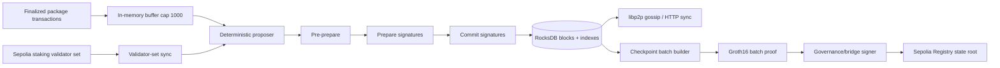

- **Components:** a bounded finalized-transaction channel, proposer, three PBFT phases, local store, peer synchronization, L1 validator-set reader, and checkpoint relay.
- **Data flow:** evidence-finalized transactions are buffered, placed into a proposed block, committed by Ed25519 signatures, persisted, and optionally represented by a checkpoint transaction.
- **Trust boundaries:** the runtime validator snapshot, peer-provided historical blocks, bridge key, and L1 RPC are separate authorities that must agree.
- **Failure points:** buffer eviction drops already-finalized transactions; the same proposer can remain selected after view change; a one-validator set finalizes alone; invalid historical-set assumptions can poison sync.
- **Security:** do not treat the L1 root as a validity proof. The current circuit does not prove transition correctness or data availability.

---

## 6. Blockchain and data-model analysis

### 6.1 Consensus, finality, and network behavior

| Topic | Current behavior | Assessment / required decision |
|---|---|---|
| Consensus | Custom Rust PBFT-like pre-prepare/prepare/commit | Useful prototype, not a production-proven implementation |
| Block time | Chain spec: 5 seconds | Unnecessary empty cadence for a low-volume registry; event-driven batches are cheaper |
| Quorum | `(2n/3)+1`; optional 2-of-3 test flag | Correct basic threshold, but power is by validator count in Rust and active EVM count in Solidity, not one canonical snapshot |
| Finality | Claimed deterministic after commit | Reorg/replacement code and HTTP sync recovery contradict an absolute finality model; specify whether conflicting committed heights are ever legal |
| Proposer | Deterministic hash fallback; optional proof fields | Not a robust VRF lottery; view number is absent from selection, so view change does not necessarily rotate a failed proposer |
| View change | Local timeout immediately resets; P2P separately accumulates certificates | Local state can advance without certificate quorum; new-view safety rules and prepared certificates are incomplete |
| Validator rotation | L1 staking sync plus local/static bootstrap | Historical validator-set verification remains incomplete; current spec has one validator |
| Mempool | Pending package pool plus finalized-tx channel/buffer | Package work and finalized transactions are different queues; finalized records can be evicted at cap |
| Account/tx model | Domain-specific package, revoke, slash, join/leave, rotate-key transactions | Sensible for an app state machine; lacks fees, sequence numbers, generic replay domain, and canonical serialization spec |
| Fees | No native chain fee; Ethereum gas and optional ZK fee | Spam control relies on rate limiting/stake; define quotas and per-work deposits |
| Block size | No explicit byte/gas limit; producer takes the buffer | A block can contain up to the current buffered set and large records; add consensus byte/tx/gas bounds |
| State | RocksDB blocks and package index, PostgreSQL mirror | No normative state root, proof format, pruning policy, snapshot protocol, or archive requirements |
| Light client | Package Merkle proof helpers exist | Needs signed tree heads, validator-set transitions, checkpoint freshness, and fork-choice verification |
| Peer discovery | libp2p and signed chain-spec inputs; spec bootnodes empty | Current public topology cannot bootstrap as a decentralized P2P network from the spec alone |
| Upgrade | Binary/config/contract governance paths | No complete on-chain runtime upgrade protocol, compatibility matrix, activation height, rollback, or migration proof |
| Recovery | Reorg recovery and runbooks | Define safety over availability: operators must not rewrite finalized history merely to follow a longer peer |
| Long-range attack | Current-set signature checks and planned history | Store authenticated validator-set transitions and weak-subjectivity checkpoints |
| DoS/Sybil | IP and peer limits, stake, payload caps | IP limits are weak behind proxies/botnets; validation cost needs deposits, quotas, and worker admission control |

### 6.2 Why the current L1 is both over-engineered and under-specified

It is over-engineered because CREG maintains custom consensus, a Solidity mirror, two validator identity systems, experimental ZK proofs, an L1 bridge, local reorg logic, and token governance for a workload whose essential output is a signed evidence record.

It is under-specified because there is no normative protocol document defining byte encoding, state transition function, fork choice, view-change safety, epoch transitions, mempool validity, block limits, evidence availability, pruning, upgrade activation, weak-subjectivity checkpoints, or catastrophic recovery. Source code and operational documents cannot substitute for a consensus specification.

### 6.3 Source of truth and canonical records

The current source-of-truth story is ambiguous:

- the Rust node treats its RocksDB chain as authoritative for CLI verdicts;
- the PostgreSQL index is a mirror;
- the Solidity registry can separately mark packages verified through PBFT signatures or a ZK path;
- checkpoint roots are described as an L2 settlement path but do not prove state transitions; and
- documentation says `verified` means a record in “this node's” chain.

Recommended canonical definitions:

| Object | Canonical definition |
|---|---|
| Package | `(ecosystem, normalized namespace/name)` plus an ownership/delegation record |
| Version | Package ID + immutable normalized version + release identity + source and artifact subjects |
| Artifact | Algorithm-tagged digest, media type, size, and immutable storage references |
| Evidence | DSSE/in-toto envelope with subject digest, predicate type/version, producer identity, profile digest, timestamps, and signature |
| Verification status | A policy evaluation over named evidence, at a policy version and evaluation time |
| Final status | A checkpointed log entry after witness threshold; never a claim of absolute safety |
| Revoked | An authorized, checkpointed event that causes fail-closed client behavior |
| Disputed | A nonterminal overlay state that preserves the prior record and exposes challenge evidence |
| Deprecated | Maintainer/governance metadata; installation policy decides behavior |
| Malicious | A high-severity adjudicated label with evidence and appeal path, not merely one scanner result |

Deletes must be tombstones, not history erasure. Ownership transfers must be dual-signed by old and new controllers or follow a documented recovery/adjudication process. Forks of source projects must use distinct names/identities rather than overwrite ownership. A disputed version remains immutable; only its decision state changes. Private metadata must never be placed directly in a public immutable log.

### Diagram 4 — Package-submission workflow

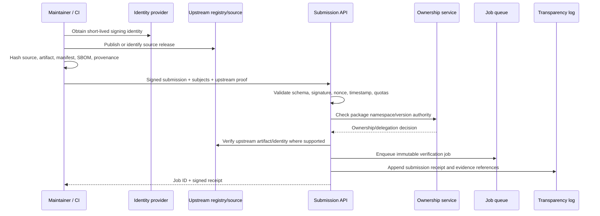

- **Components:** maintainer CI, identity, upstream ecosystem, submission gateway, ownership service, durable queue, and transparency log.
- **Data flow:** all relevant subjects and provenance are signed before admission; the log records the receipt before expensive analysis begins.
- **Trust boundaries:** identity proof, upstream ownership, and CREG policy are independent and explicitly represented.
- **Failure points:** upstream API outage should produce `ownership-unconfirmed`, not implicit approval; duplicate nonces and mismatched subjects fail closed.
- **Security:** use short-lived Sigstore-style identities or dual EVM/Ed25519 proof; include chain/service domain, nonce, expiry, and every security-relevant manifest field in the signature.

### Diagram 5 — Package-verification workflow

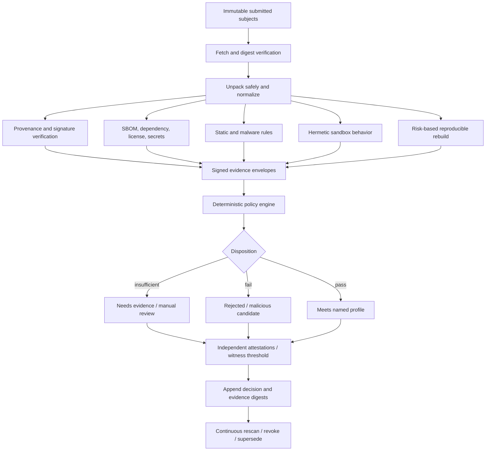

- **Components:** isolated evidence producers, policy engine, independent attestors, log, and continuous monitoring.
- **Data flow:** raw tool output becomes typed signed evidence; policy evaluates evidence without pretending to prove intent; later intelligence creates a new evaluation.
- **Trust boundaries:** fetching, unpacking, execution, external data, and policy signing are isolated; no LLM output is a deterministic trust root.
- **Failure points:** missing tools/models, nonreproducible builds, timeouts, disagreement, and unknown provenance produce explicit incomplete states.
- **Security:** each evidence item binds exact subjects, toolchain image digest, configuration, rule epoch, network policy, and timestamps.

### 6.4 What “verified” must mean

The existing `PackageStatus` has only `Pending`, `Verified`, and `Revoked`, while the CLI exposes `Unknown` and `Unverified`. This is too coarse. `PackageStatus::Verified` is even documented in source as “safe to install,” which is not a defensible guarantee.

Use independent claims rather than a single ladder; a consumer profile chooses required claims.

| Claim / state | Exact minimum requirement |
|---|---|
| `submitted` | Schema valid; artifact/source digests present; replay-safe signed receipt |
| `identity-verified` | Short-lived identity or dual-key proof; identity policy and issuer recorded |
| `ownership-verified` | Upstream namespace proof or existing CREG delegation chain |
| `source-bound` | Signed source repository/commit/tree digest and release tag |
| `provenance-verified` | Valid SLSA/in-toto provenance whose subject matches artifact and builder is allowed |
| `build-verified` | Build recipe/toolchain inputs recorded and artifact matches authorized build output |
| `reproducible` | At least two independent hermetic rebuilds match under the named profile |
| `security-scanned` | Required static, malware, secrets, dependency, license, and sandbox evidence complete at stated epochs |
| `committee-attested` | Threshold of independent eligible validators signed the same policy result and subject, with evidence available |
| `profile-qualified` | All claims required by named profile are satisfied; confidence and residual risks displayed |
| `disputed` | Active challenge exists; default install behavior defined by policy |
| `revoked` | Authorized revocation event is checkpointed; installation hard-blocked unless an explicit forensic mode is used |
| `malicious` | Evidence plus authorized adjudication meets the malicious-label standard; appeal remains possible |

Never use `fully verified` or `safe` as an unqualified terminal claim. Recommended UI: **“Meets CREG Baseline v1, confidence 78/100, evaluated 2026-07-10; no guarantee of absence of vulnerabilities.”**

### Diagram 6 — Validator consensus workflow

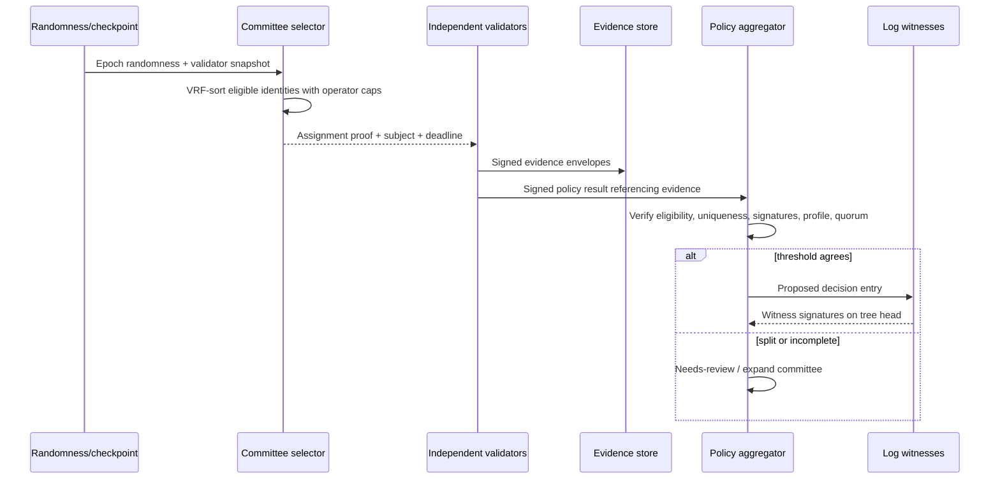

- **Components:** unbiased randomness, one canonical selector, validators, evidence store, aggregator, and independent log witnesses.
- **Data flow:** validators need not produce byte-identical sandbox logs; they agree on a typed policy result while retaining individual evidence.
- **Trust boundaries:** committee eligibility, operator identity, evidence production, aggregation, and log witnessing are separately auditable.
- **Failure points:** unavailable validators trigger deterministic expansion; split results never silently become approval.
- **Security:** cap common cloud/operator/control domains, require evidence before vote reveal where copying is a concern, and use commit-reveal or encrypted submissions for high-value reviews.

### Diagram 7 — Package-verification state machine

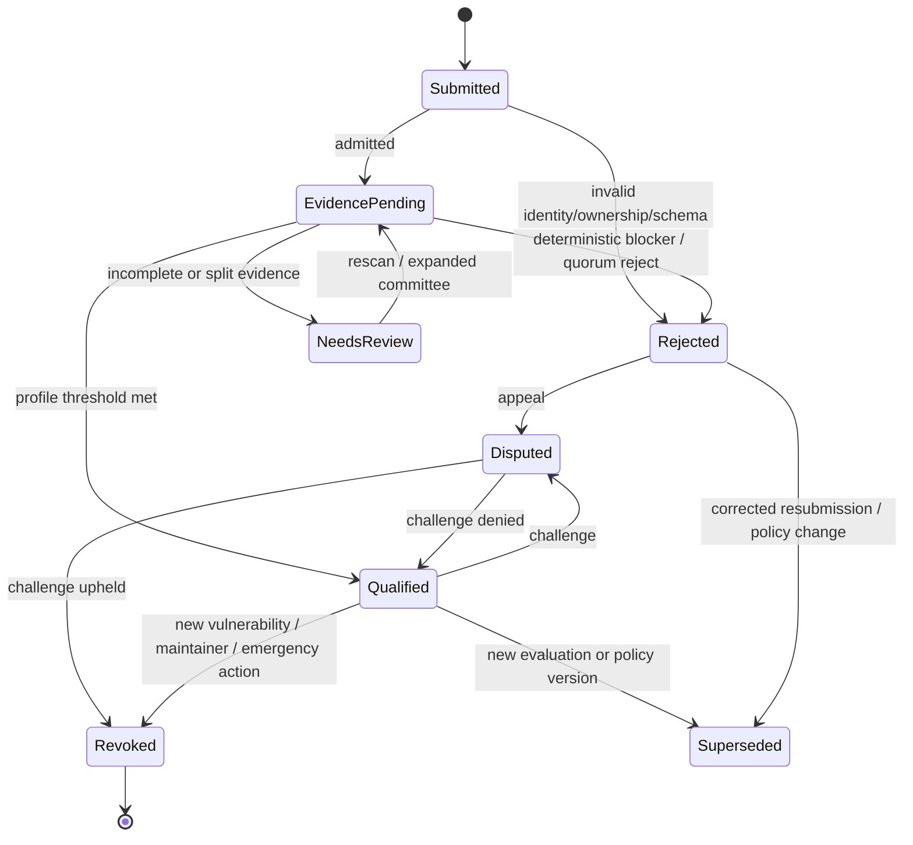

- **Components:** submission, evidence, review, qualified, rejected, disputed, revoked, and superseded states.
- **Data flow:** every arrow is an immutable event; current status is a derived fold over history.
- **Trust boundaries:** automated policy cannot resolve legal/ownership disputes by itself; adjudication events name their authority.
- **Failure points:** stale evidence and policy changes must supersede, not mutate, earlier results.
- **Security:** revocation is always available even during an emergency pause; clients consume signed freshness metadata to prevent freeze/rollback attacks.

### Diagram 8 — Validator decision flow

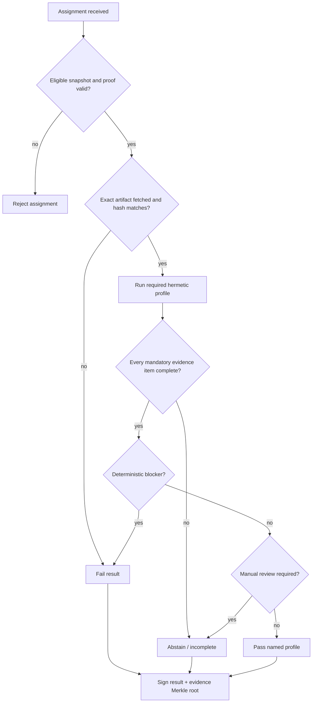

- **Components:** assignment validation, subject verification, hermetic profile, deterministic policy, and signed output.
- **Data flow:** fail, abstain, and pass are distinct; unavailable tooling is never converted to approval.
- **Trust boundaries:** operator identity and worker environment are attested separately.
- **Failure points:** a worker timeout or missing model yields incomplete, preserving liveness through committee expansion rather than lowering standards.
- **Security:** require anti-copy measures only where they improve assurance; independent reproduction is more valuable than secrecy of findings.

### Diagram 9 — On-chain and off-chain data

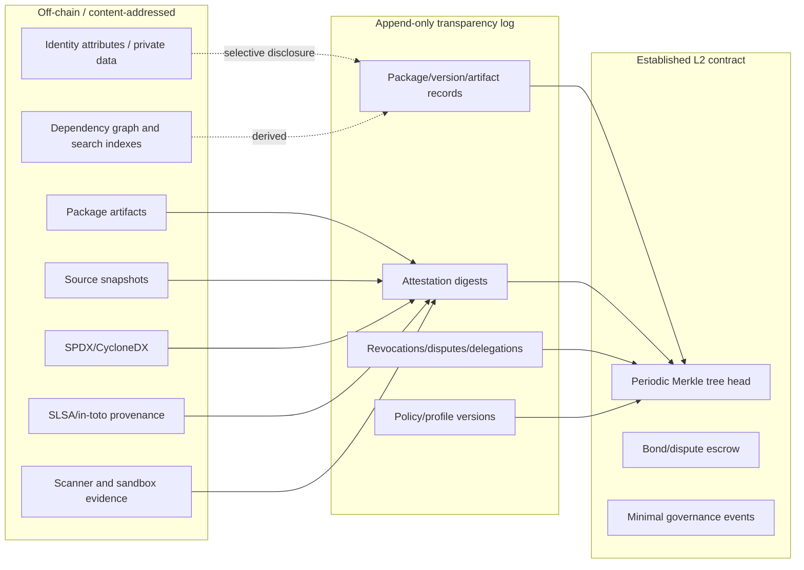

- **Components:** large/private evidence stays off-chain; compact canonical events enter a Merkle log; only checkpoints and economic escrow reach an established L2.
- **Data flow:** content digests bind off-chain bytes to log events, and log roots bind many events to one anchor transaction.
- **Trust boundaries:** an L2 confirms checkpoint inclusion, not evidence truth; storage providers ensure availability, not correctness.
- **Failure points:** lost evidence reduces assurance even if its digest remains; replication and retention classes are mandatory.
- **Security:** never place personal data, proprietary code, raw vulnerability details, or mutable reputation scores in immutable public state.

### 6.5 Data-availability strategy

Use immutable object storage in at least two administrative domains, IPFS as an additional distribution path, signed manifests with size/digest/media type, and periodic retrieval audits. Evidence required to validate a current qualification must meet a retention SLO. L2 checkpoints should contain a log root and metadata hash, not package payloads. Witnessed tree heads and consistency proofs are preferable to storing every record in contract state.

---

## 7. Package evaluation and Diverse Double-Compiling

### 7.1 Current pipeline coverage

| Stage | Current status | Material gap |
|---|---|---|
| Submission/authentication | Implemented | Claimed staked EVM address not bound to Ed25519 signer |
| Ownership verification | Missing | No namespace owner/delegation check across versions |
| Source retrieval | Partial | Artifact/IPFS retrieval, not authoritative source-to-artifact binding |
| Dependency resolution | Very limited | No complete locked dependency graph in consensus evidence |
| Static/malware analysis | Implemented rules/ML/YARA | Heuristic coverage, rule quality, language parsers, evasion |
| Dynamic analysis | Implemented sandbox selection | Environment dependence, egress policy, package-manager behavior, evasion |
| Secret detection | Not a defined pipeline gate | Add dedicated tools and typed results |
| License analysis | Not a defined pipeline gate | Add SPDX expressions, detected/declared distinction, policy |
| SBOM | CLI emits one-component documents | It is not a material inventory and uses outdated CycloneDX 1.4; no dependency graph/completeness |
| Vulnerability analysis | Pinned OSV paths | Advisory by default, snapshot operations and reachability incomplete |
| Reproducible build | CREG release scripts only | No submitted-package rebuild pipeline |
| DDC | Inventory validator only | No active direct targets; not package verification |
| Signature/provenance | Ed25519/optional PGP | No Sigstore/in-toto/SLSA chain or upstream identity proof |
| Validator consensus | Implemented for small sets | Large-set selection mismatch; identical evidence digest requirement |
| Ongoing monitoring | Scaffolding/docs | Need scheduled rescans, notifications, freshness, VEX, revocation SLO |

### 7.2 False positives, false negatives, and confidence

Validator consensus cannot make a package safe. It can only make a statement such as: “At least `q` eligible validators reported that this artifact met profile P using evidence epochs E at time T.” Common-mode scanner failure, shared cloud compromise, malicious maintainers, dormant payloads, and unknown vulnerabilities survive unanimous votes.

Recommended confidence calculation, used only for ordering/review and never as a probability of safety:

`confidence = completeness × independence × reproducibility × freshness × evidence_strength`

Each factor is bounded `[0,1]` and displayed separately. Do not average away a missing hard requirement. A profile qualification is Boolean over required claims; confidence describes the quality of supporting evidence.

### 7.3 DDC assessment

Diverse Double-Compiling is useful for detecting a self-propagating compiler backdoor when source for a compiler and a sufficiently diverse trusted compiler path are available. It does **not** establish that arbitrary package source is benign, that build scripts are safe, or that dependencies are uncompromised.

The repository's `ddc-verify.sh` exits successfully when there are no declared DDC artifacts; its inventory currently has an empty direct-DDC target. That is an inventory check, not DDC execution.

Recommended policy:

- **Mandatory only** for CREG-owned compiler-like generators, circuit compilers, code generators, and bootstrap toolchains that can self-propagate.
- **Risk-based reproducible rebuilds** for critical submitted packages.
- **Optional diversity** across compiler versions/implementations, OS images, architectures, and builders when the build supports it.
- **Explicit nonreproducible status** for packages that cannot be rebuilt; do not reject all such packages automatically.
- Archive build recipes, source/toolchain/base-image digests, environment, network transcript, output digests, and diffoscope-style mismatch evidence.

Costs grow roughly as `packages × build variants × average build minutes × worker cost`, with storage and dependency-cache egress added. Run DDC on toolchains, not every package. Run two independent hermetic builds on high-criticality packages and sampling on the long tail.

---

## 8. Validator architecture and attacks

### 8.1 Recommended eligibility and lifecycle

Validators need a unique operator identity, declared control domain, stake or contractual bond, independently attested worker profile, minimum availability, key separation, and a passed conformance suite. Admission should be permissioned during alpha, then transparently governed. The committee selector must snapshot eligibility, stake/bond, operator and infrastructure domains, profile capabilities, and reputation at an epoch.

Quorum should be based on one snapshot and use both a cryptographic threshold and diversity constraints—for example, `>=2f+1` signatures and no more than one-third from any operator/control domain. Reputation may affect assignment priority, not reduce the signature threshold.

### 8.2 Attack analysis

| Attack | Current exposure | Countermeasure |
|---|---|---|
| Collusion/cartel | One-validator deployment; stake concentration unknown | Independent operators, domain caps, public votes, witness monitors, challenge bonds |
| Sybil | Stake and address caps, but one actor can use many addresses | KYC/organization proof for high-assurance tier, operator disclosure, graph analysis, capped voting power |
| Bribery | Public assignment/votes enable targeted bribery | Unpredictable late assignment, commit-reveal/encrypted votes for critical jobs, strong slashing evidence |
| Lazy validation | Validators can copy profile/evidence outcomes | Require signed worker evidence, randomized canary tasks, spot re-execution, evidence availability |
| False approval | Binary consensus may accept | Deterministic hard blockers, post-publication monitors, disputes, revocation, bounded labels |
| False rejection/censorship | Committee can deny liveness | Expansion, appeals, forced receipt inclusion, independent witnesses, objective timeout rules |
| Front-running | Package names/versions visible | Ownership must pre-exist submission; do not award ownership by first pending transaction |
| Stake concentration | Count-based Rust votes diverge from economic L1 state | One voting-power model, caps, delegation limits, snapshot proof |
| Governance capture | Multisig controls parameters and minting | Timelocks, public proposals, independent security veto, scoped emergency power |
| Infrastructure monoculture | Performance bias selects the same capable clouds | Diversity objective in committee selection; multiple sandbox/toolchain profiles |
| Scanner compromise | Exact common profile can turn compromise into consensus | N-version evidence, signed supply chain for tools, reproducibility, independent rule governance |
| Key compromise | Environment/Vault support but many hot roles | KMS/HSM, short-lived worker certificates, role-specific keys, rapid epoch revocation |

### 8.3 Slashing standard

Slash only objectively provable behavior: equivocation, invalid signature/eligibility claims, fabricated evidence whose stated digest does not match retrievable bytes, failure of deterministic canary tasks, or violation of an accepted availability obligation. Do not automatically slash for disagreement with a later vulnerability discovery or a scanner false negative. Negligence penalties require due process, evidence standards, proportional caps, and appeal.

---

## 9. Smart-contract and runtime analysis

### Diagram 10 — Contract interaction

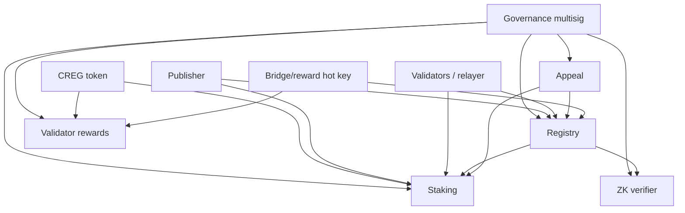

- **Components:** token, staking, registry, verifier, rewards, appeal, governance, and bridge roles.
- **Data flow:** publishers and validators bond; relayers finalize or checkpoint; governance changes parameters and can revoke/slash; rewards pull treasury allowance.
- **Trust boundaries:** governance, bridge key, verifier key, active-validator snapshot, and reward accounting can each alter security/economics.
- **Failure points:** duplicate state between Rust and Solidity, missing identity mapping, unavailable L1 RPC, gas-size arrays, and paused-state deadlock.
- **Security:** radically reduce this suite; keep only checkpoint, bond escrow, dispute finalization, and timelocked governance after redesign.

### 9.1 Module/contract requirements

| Module | Core state/functions/events | Required invariants and risks | Strategy |
|---|---|---|---|
| Package registry | Package/version/artifact keys; submit, qualify, revoke, transfer | One owner chain per namespace; immutable subjects; no terminal safety claim; bounded loops | Move records to log; contract stores roots only |
| Ownership | Controller/delegates/recovery; transfer events | Dual authorization or adjudicated recovery; upstream proof | New explicit service/log module |
| Attestations | Subject, predicate/profile, signer, evidence digest | Signature domain/nonce/expiry; signer eligible at snapshot; evidence retrievable | Log-native typed envelopes |
| Validator registry | Identity, operator domain, capability, status | EVM and evidence keys linked; no duplicates; epoch transitions | One canonical registry, not Rust/L1 dual state |
| Staking/bonds | Deposits, locks, unbonding, slash claims | Liabilities remain locked through challenge window; per-work exposure | Replace unlimited publisher stake with per-release bonds |
| Rewards | Work receipts, claim root, treasury | No zero addresses, duplicate claims, arbitrary reputation input, unbounded arrays | Off-chain accounting + Merkle claim |
| Disputes | Challenge, evidence, panel/arbitrator, resolution | Timelines, conflicts, appeal, no AI-only final authority | Human/security council plus objective proof paths |
| Governance | proposals, votes, timelock, pause | Can recover while paused; no instant cancellation; signer uniqueness; scoped calls | New timelocked multisig/council model |
| Treasury/token | balances, mint/burn, grants | Vesting, mint schedule, spend caps, disclosure | Postpone tradable token; stablecoin/fiat budget first |
| Revocation | reason/evidence/scope/supersession | Available during pause; client freshness guaranteed | Minimal emergency path with post-action review |
| Reputation | derived performance | Rebuildable, non-transferable, decay, anti-poisoning | Off-chain derived view only |
| Upgrade | implementation/version/activation | Timelock, audit hash, migrations, rollback boundary | Prefer immutable log schema versions; contract upgrade narrowly scoped |

### 9.2 Critical contract findings

1. **ZK safety statement is vacuous.** Hash binding is fixed, but safety inputs are caller-supplied and unrelated to scanner execution. Disable `submitPackageWithZKProof` and `verifyZKProof` as qualification paths.
2. **Batch statement is not a validity proof.** The circuit does not enforce a transition and the contract does not compare public inputs to function arguments. Disable `submitRollupBatch` security claims.
3. **Publisher withdrawal defeats slashing.** `unstakeAsPublisher` checks balance only, despite its comment. Add per-package locked liability and a challenge-period withdrawal delay.
4. **Emergency pause blocks revocation and recovery submission.** Registry revocation uses `whenNotPaused`; governance `submit` uses `whenNotPaused`, while unpause requires a self-call created by a proposal. Permit a narrowly scoped revoke and unpause-proposal path while paused.
5. **PBFT signature domain is replayable across deployments.** `_sigDigest` lacks chain ID, contract address, epoch/round, and expiry. Use EIP-712 typed data.
6. **Validator snapshot mismatch.** L1 finalization uses the active count at execution, not the committee/set snapshot that signed. Bind an epoch/set hash and threshold.
7. **Governance cancellation contradicts its comment.** Any signer may cancel any pending proposal immediately; require proposer rules, expiry, or threshold cancellation.
8. **Signer constructor accepts duplicates/zero addresses.** This can make thresholds unreachable or unsafe; enforce sorted unique nonzero signers.
9. **AI appeal authority is inappropriate.** An authorized model address can resolve appeals instantly; advisory AI must never be final adjudicator.
10. **Contract CI is non-reproducible.** Declare and pin Foundry, solc, OpenZeppelin, and forge-std dependencies; run build, unit, invariant, fuzz, static analysis, and deployment simulation in CI.

Standard Solidity risks—reentrancy, access control, arithmetic, signature replay, unbounded loops, unsafe upgrades, oracle manipulation, governance theft, incorrect slashing/rewards, and emergency-key abuse—must be covered through invariants and external audit, not merely unit tests.

---

## 10. Tokenomics and economic sustainability

### 10.1 Does CREG need a tradable token?

**Not during research, proof of concept, or early production.** A tradable token does not improve scanner accuracy, provenance, or product-market fit. It adds price volatility, legal burden, governance capture, user friction, treasury risk, and an attack surface before demand exists.

Use fiat subscriptions, stablecoin/fiat pay-as-you-go, prepaid enterprise credits, and contractual validator compensation. Bonds can initially be stablecoin or permissioned credits. Reconsider a native asset only after the network has independent operators, predictable work demand, audited slashing, and evidence that an external token—not normal payments—is necessary.

### 10.2 Current model and contradictions

Actual contract supply is 42,000,000 maximum and 20,000,000 initial, leaving **22,000,000**, not the “~12,500,000” stated in one whitepaper table. Allocation has no enforced vesting or lockups. One owner/governance authority can mint the remaining reserve to any address up to the cap.

Publisher minimum is 1 CREG, validator minimum 100 CREG, and work rewards are roughly 0.00001 base plus 0.000005 correctness bonus and a small reputation term. Those values conserve supply but are disconnected from real CPU, sandbox, storage, audit, and operator costs.

### Diagram 11 — Current and recommended token/payment flow

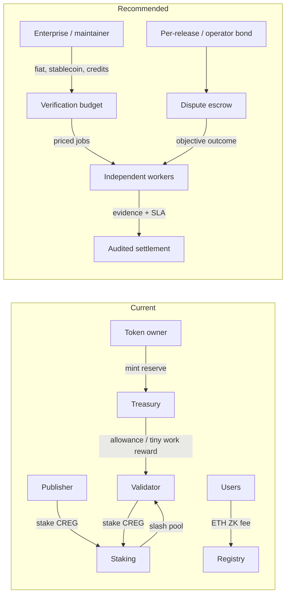

- **Components:** current mint/stake/reward/slash paths contrasted with a customer-funded job and bond model.
- **Data flow:** current rewards originate from treasury regardless of revenue; recommended compensation originates from priced demand.
- **Trust boundaries:** a token owner can dilute circulating supply; a budget/settlement operator must be audited but need not determine package truth.
- **Failure points:** volatile token price makes both affordability and security unpredictable; stable pricing separates work economics from speculation.
- **Security:** bonds cover objective misconduct and service obligations, not unknowable future vulnerabilities.

### 10.3 Validator profitability model

Let:

- `J` = assigned completed jobs/month,
- `r` = CREG earned/job (optimistic 0.000017),
- `P` = USD/CREG,
- `C` = monthly infrastructure and labor cost.

`profit = J × r × P − C` and `break-even P = C / (J × r)`.

| Scenario | Jobs/month | Cost/month | CREG/month at 0.000017 | Break-even token price |
|---|---:|---:|---:|---:|
| Small validator | 1,000 | $150 | 0.017 | **$8,824/CREG** |
| Active validator | 10,000 | $500 | 0.17 | **$2,941/CREG** |
| Industrial validator | 100,000 | $2,500 | 1.7 | **$1,471/CREG** |

These figures exclude labor, audit, egress, high-memory builds, and committee assignment dilution. The current reward is economically nonfunctional at ordinary token prices.

### 10.4 Improved economics

Price work by risk tier and measured resources:

`job_price = fixed_admission + cpu_min×rate + ram_gb_min×rate + storage_gb_month×rate + egress + tool_license + risk_premium`

Illustrative assumptions, to validate empirically:

| Tier | Evidence | Expected direct cost | Customer price target |
|---|---|---:|---:|
| Baseline | identity, provenance, static, SBOM/OSV | $0.05–$1 | $0–$2 sponsored/self-service |
| Sandboxed | baseline + isolated dynamic run | $1–$20 | $5–$50 |
| Reproducible | two hermetic builds + diff | $10–$500+ | Quoted / enterprise |
| Critical review | diverse builders + manual specialists | $500–$20,000+ | Contracted |

Best/expected/worst sustainability:

| Case | Demand and revenue | Cost behavior | Result |
|---|---|---|---|
| Best | Enterprise subscriptions sponsor popular OSS; high cache reuse | Baseline evidence amortized; critical jobs paid | Sustainable service and witness network |
| Expected | Moderate enterprise demand; public-good grants for OSS | Subsidy needed for long tail | Viable hybrid nonprofit/commercial model |
| Worst | Developers will not pay; speculative token is only funding | Validator/storage costs persist; sell pressure rises | Network centralizes or stops |

Treasury runway must be reported in fiat-equivalent committed cash and months of operating expense, not only token units. Reserve release needs a schedule, spend caps, conflict policy, and independent reporting. No public sale or liquidity program should occur before jurisdiction-specific counsel reviews MiCA, U.S. securities/commodities/money-transmission implications, tax, sanctions, consumer protection, and marketing claims.

---

## 11. Governance and disputes

### 11.1 Current governance

The active model is an M-of-N signer contract, not a DAO. That is appropriate for an alpha if stated plainly. It controls registry parameters, relay allowlists, staking, mint authority, emergency actions, and security-sensitive changes. The risk is not simply centralization; it is the combination of concentrated authority, incomplete timelocks, contract-call generality, and incomplete recovery semantics.

### Diagram 12 — Recommended governance workflow

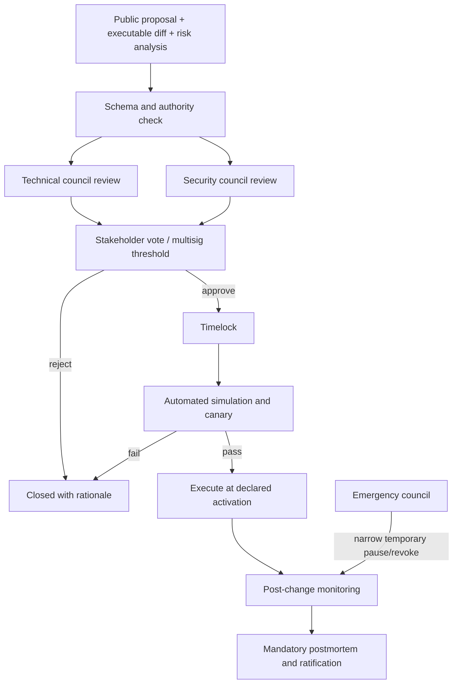

- **Components:** proposal authors, technical/security councils, voting authority, timelock, simulation, execution, and emergency council.
- **Data flow:** executable bytes and human rationale travel together; every change has an activation point and observed outcome.
- **Trust boundaries:** security council veto is scoped to safety, treasury authority is separate, and emergency power cannot mint or transfer funds.
- **Failure points:** voter apathy and deadlock are handled through bounded councils, quorum floors, expiry, and no-change defaults.
- **Security:** high-risk upgrades require independent audit hash and longer delay; emergency actions expire automatically and require retrospective ratification.

### 11.2 Safeguards

- Separate protocol, security, dispute, and treasury powers.
- Require unique, disclosed multisig signers in separate organizations and hardware-backed keys.
- Add 48-hour minimum timelock for normal changes and 7+ days for minting, verifier replacement, or consensus policy.
- Give a security council a time-bounded veto/pause, not arbitrary execution.
- Require quorum and supermajority for treasury, mint, slashing policy, validator rules, and ownership adjudication.
- Publish conflicts of interest and recusal.
- Use delegation caps or quadratic/identity-aware mechanisms only after simulation; token weight alone is unacceptable.
- While paused, allow only narrowly defined revoke, unpause-proposal, evidence preservation, and key-rotation actions.

### Diagram 13 — Dispute-resolution workflow

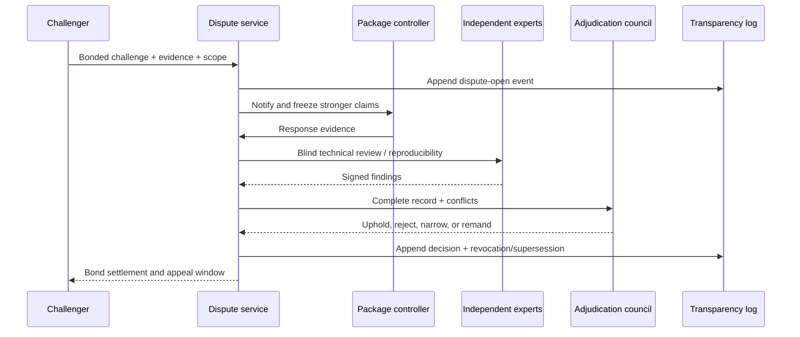

- **Components:** challenger, package controller, independent experts, adjudication council, bond escrow, and log.
- **Data flow:** challenges and responses remain public at the digest/decision level; sensitive exploit details may be embargoed off-chain.
- **Trust boundaries:** experts provide evidence; the council applies policy; neither an LLM nor token plurality decides technical truth alone.
- **Failure points:** frivolous challenges, absent maintainers, conflicts, and security embargo needs are handled by bonds, default rules, recusal, and deadlines.
- **Security:** critical active exploitation can trigger temporary revocation first, followed by rapid due process; all emergency decisions expire or are ratified.

---

## 12. Security threat model

### 12.1 Assets, actors, entry points, and trust boundaries

**Assets:** package/source/artifact integrity; ownership and maintainer identity; signing, validator, bridge, governance, treasury, and encryption keys; evidence and policy bundles; canonical history/checkpoints; stake/treasury funds; proprietary source; personal data; service availability; and the meaning of qualification labels.

**Actors:** maintainers, package consumers, independent validators, observer nodes, build/verification workers, governance/security/dispute councils, infrastructure operators, external registries, identity providers, auditors, security researchers, attackers, and regulators.

**Entry points:** submission APIs, validator vote APIs, libp2p topics, chain-spec bootstrap, IPFS/gateways, package-manager shims, CI integrations, web wallets, L1 RPC/log sync, operator routes, governance calls, appeals, storage uploads, webhooks, and software updates.

### Diagram 14 — Threat-boundary diagram

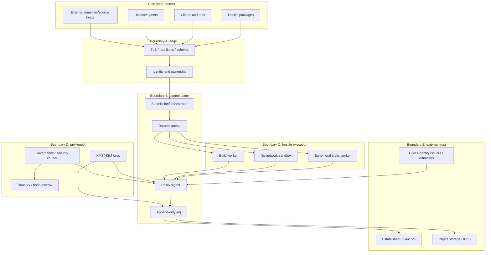

- **Components:** five explicit trust zones separate hostile inputs, edge validation, orchestration, code execution, privileged control, and external dependencies.
- **Data flow:** workers receive immutable read-only jobs and return signed evidence; they do not receive governance or treasury credentials.
- **Trust boundaries:** package execution is assumed hostile even after static checks; external intelligence is untrusted input until pinned and validated.
- **Failure points:** credential leakage, sandbox escape, policy compromise, log split view, storage loss, or L2/RPC outage each has an independent recovery playbook.
- **Security:** use one-way job capabilities, disposable workers, network-deny default, read-only roots, resource quotas, egress capture, and no shared tenant caches without verification.

### 12.2 STRIDE and operational risk table

Likelihood and impact use Low/Medium/High. Residual risk assumes recommended controls.

| Threat (STRIDE) | Attack | L | I | Severity | Detect | Prevent | Recover | Residual |
|---|---|---:|---:|---|---|---|---|---|
| Publisher spoofing (S) | Claim another staked EVM address with attacker's Ed25519 key | High | High | **Critical** | Compare dual-proof identities; anomaly on new key/address pairs | EIP-712 EVM proof + Ed25519 proof over same domain/nonce; Sigstore identity | Reject/tombstone affected records, rotate identity policy | Low |
| Namespace takeover (S/T) | First attacker publishes later version under existing name | High | High | **Critical** | Ownership-chain inconsistency | Upstream proof and explicit delegation | Emergency dispute/revoke and controller recovery | Medium |
| ZK false qualification (T/E) | Prove self-declared passing flags for malicious bytes | High | High | **Critical** | Reproduce proof with arbitrary package fixture | Disable path; formal audited statement only | Revoke all ZK-only records and rotate verifier/policy | Low if removed |
| Invalid checkpoint (T) | Governance anchors arbitrary root with vacuous proof | Medium | High | **Critical** | Independent log/checkpoint comparison | Bind arguments and prove transition+DA, or use simple witnessed checkpoint | Reject checkpoint, rotate key, publish corrected tree head | Medium |
| Validator cartel (S/T/D) | Quorum approves malware or censors safe package | Medium | High | **Critical** | Cross-committee disagreement, canaries, monitors | Operator caps, random assignment, evidence, bonds, appeals | Revoke, slash objective fraud, rotate set | Medium |
| Consensus split (T/D) | View-change/set-sync flaws produce divergent committed history | Medium | High | **Critical** | Conflicting signed tree heads/block hashes | Replace custom PBFT; formal safety tests | Halt, weak-subjectivity checkpoint, forensic restart | Low–Med |
| Sandbox escape (E/T/I) | Package reaches host/network/secrets | Medium | High | **Critical** | Kernel/runtime alerts, egress, canaries | MicroVM/gVisor/nsjail hardening, no credentials, disposable hosts | Destroy pool, rotate all reachable credentials, incident response | Medium |
| Evidence fabrication (R/T) | Validator signs evidence never produced | Medium | High | **High** | Evidence retrieval, worker attestation, randomized replay | Signed worker identity and evidence Merkle root | Invalidate evidence, suspend validator, objective slash | Low–Med |
| Log split view (T/R) | Operator shows inconsistent histories | Medium | High | **High** | Witness gossip and consistency proofs | Multi-witness signed tree heads and L2 checkpoints | Publish equivocation proof, failover log operator | Low |
| Key compromise (S/E) | Validator/governance/bridge key stolen | Medium | High | **Critical** | KMS audit, unusual signing, impossible travel/control domain | HSM/KMS, thresholds, short-lived certs, role separation | Emergency revoke/rotate, freeze scoped functions | Medium |
| Storage withholding (D) | Evidence/artifact unavailable after qualification | Medium | Medium | **High** | Retrieval probes and replication SLO | Multi-domain replicas, prepaid retention, size limits | Mark evidence unavailable and downgrade qualification | Low–Med |
| Vulnerability-feed poisoning (T) | Malicious or stale advisory changes verdict | Low–Med | Medium | **Medium** | Signed snapshot diff and source comparison | Pin epochs, multiple sources, advisory default | Roll back snapshot and supersede evaluation | Low |
| API resource exhaustion (D) | Many costly submissions or 512 MiB artifacts | High | High | **High** | Queue depth, cost/job, tenant rate metrics | Auth quotas, deposits, smaller limits, streaming, backpressure | Shed load, quarantine tenant, autoscale | Medium |
| Client rollback/freeze (T) | Serve stale “qualified” result after revocation | Medium | High | **Critical** | Freshness and checkpoint monitors | TUF-style expiry/snapshot/timestamp metadata | Force client trust-root update and block stale epoch | Low |
| Governance theft (E/T) | Signers mint/transfer reserve or alter verifier | Medium | High | **Critical** | Public timelock monitors and spend alerts | Separate treasury, timelocks, caps, independent signers | Pause, rotate, legal/contract recovery where possible | Medium |
| Privacy disclosure (I) | Immutable metadata links identities or private packages | Medium | High | **High** | Data mapping/DPIA and content scanning | Off-chain encrypted data, minimization, selective disclosure | Delete off-chain ciphertext/keys where lawful; tombstone link | Medium |
| Malicious update client (S/T) | Compromised CREG binary bypasses verification | Medium | High | **Critical** | Reproducible release, signatures, transparency monitor | Signed reproducible releases, TUF/Sigstore, independent builders | Revoke release, rotate keys, force update | Low–Med |

### 12.3 Risk matrix

| Impact \ Likelihood | Low | Medium | High |
|---|---|---|---|
| High | Invalid checkpoint under protected governance | Cartel, consensus split, sandbox escape, key compromise, governance theft | Publisher spoof, namespace takeover, ZK false qualification, API cost DoS |
| Medium | Feed poisoning | Storage withholding, scanner false result, privacy metadata | Queue/backpressure failure |
| Low | Cosmetic explorer error | Minor telemetry drift | Documentation mismatch |

---

## 13. Privacy, data protection, and legal/compliance

### 13.1 Privacy design

Public artifact digests, package names, versions, policy versions, and organization-level controller identifiers can usually be public. Personal names, email addresses, wallet-to-person mappings, IP addresses, private source, exploit details, identity documents, sanctions records, and proprietary build logs should remain off-chain with documented retention and access controls.

Pseudonymity is acceptable for low-assurance public participation but not a substitute for accountability where validators receive confidential code or carry economic/legal duties. Offer multiple assurance tiers: pseudonymous public witness, organization-verified validator, and contractually bound enterprise reviewer.

For private enterprise packages:

- run dedicated tenant-isolated workers;
- encrypt source/evidence with per-job keys in tenant-controlled KMS where possible;
- store only commitments and selective disclosures in the shared log;
- support customer-managed retention/deletion and regional storage;
- disclose which validators can decrypt and prevent plaintext from entering public IPFS;
- use zero knowledge only for narrowly formalized claims, not generalized malware safety.

The EDPB's 2025 blockchain guidance emphasizes architecture choice and GDPR compliance, while GDPR Article 17 creates erasure obligations in applicable cases. The safe design is data minimization and off-chain personal data, not the assumption that a hash is automatically anonymous. See [EDPB blockchain guidance announcement](https://www.edpb.europa.eu/news/edpb-adopts-guidelines-on-processing-personal-data-through-blockchains-and-is-ready-to_en) and [GDPR Article 17](https://eur-lex.europa.eu/legal-content/FR-EN/TXT/?uri=CELEX%3A32016R0679).

### 13.2 Legal review areas

This section identifies counsel questions, not conclusions.

| Area | Required review / product control |
|---|---|
| Open-source licenses | Validate redistribution rights before mirroring artifacts; preserve notices; generate real license evidence; process takedowns |
| Copyright | Source and binaries contain protectable expression; IPFS/object replication and cross-border distribution need authority. See [U.S. Copyright Office computer-program guidance](https://www.copyright.gov/register/tx-programs.html) |
| Trademark/name disputes | A package name and CREG qualification do not establish trademark ownership; formal notice/counter-notice and jurisdiction rules needed |
| Malware liability | Terms must define review scope, no-guarantee language, reporting, cooperation, and gross-negligence/willful-misconduct treatment |
| False verification claims | Replace `safe`/`fully verified` with bounded profile claims; retain evidence and evaluation time |
| Consumer protection | Disclose fees, overrides, token risk, service availability, and limits clearly; avoid security guarantees |
| Data protection | Define controller/processor roles, lawful basis, DPIA, retention, data-subject requests, breach response, and international transfers |
| Private code | NDAs, tenant isolation, subprocessors, data location, training-use prohibition, deletion verification |
| Token | Before issuance/offering/trading, review each jurisdiction. EU MiCA includes disclosure, issuer/service-provider, governance, and holder-protection rules ([EUR-Lex MiCA summary](https://eur-lex.europa.eu/EN/legal-content/summary/european-crypto-assets-regulation-mica.html)); current U.S. analysis is facts-and-circumstances based ([SEC 2026 overview](https://www.sec.gov/resources-small-businesses/capital-raising-building-blocks/transactions-involving-crypto-assets)) |
| CRA / product security | EU Cyber Resilience Act obligations and vulnerability-handling requirements may affect CREG software or enterprise customers; phased dates extend through 2027. Review the [consolidated CRA text](https://eur-lex.europa.eu/legal-content/EN/TXT/?uri=CELEX%3A02024R2847-20241120) |
| Validator responsibility | Contracts should define duty, evidence standard, confidentiality, service level, dispute venue, and limits; do not imply validators insure safety |
| Sanctions/AML/tax | Required if token sales, custodial payment, rewards, or treasury programs trigger relevant regimes |
| Jurisdiction | Terms need governing law, venue/arbitration, emergency relief, and rules for global contributors and enterprise customers |

---

## 14. Scalability, performance, and cost

### 14.1 Dominant bottlenecks

CREG is not transaction-throughput bound. It is **hostile-workload compute, storage, and human-review bound**. The limiting resources are sandbox/build minutes, large artifact transfer, isolated worker startup, evidence storage, validator diversity, and dispute capacity.

Current code-specific bottlenecks include:

- 512 MiB artifact fetches and five-minute IPFS timeout;
- all eligible validators running the full pipeline at sets of 50 or fewer;
- inconsistent committee sampling above 50;
- exact evidence-profile/digest quorum;
- a 1,000-transaction in-memory buffer that evicts finalized work;
- no explicit consensus block-byte limit;
- whole pending-pool JSON persistence;
- local sandbox-result cache used for version diff;
- O(history) or bounded-history API scans for some views;
- L1 reward arrays and RPC availability;
- IPFS pinning and gateway egress.

### 14.2 Capacity assumptions

Assumptions: average compressed artifact 5 MiB; baseline scan 2 worker-minutes; sandboxed scan 10 worker-minutes; 5% of versions receive a 60-worker-minute reproducible build; two artifact replicas plus one evidence replica; figures exclude source/dependency caches and human review.

| Stage | Versions/day | Peak submit/s | Worker-min/day | Raw artifact/year | Suggested topology |
|---|---:|---:|---:|---:|---|
| MVP | 100 | 0.05 | 500 | 0.18 TiB | 3–5 workers, single log + 2 witnesses, managed DB/storage |
| Coordinated testnet | 1,000 | 0.5 | 5,000 | 1.8 TiB | 20–40 workers, 4 independent witnesses, 7 evidence validators |
| Early production | 10,000 | 5 | 50,000 | 18 TiB | Regional queue, 200+ worker equivalents, 7–15 validators |
| Medium adoption | 100,000 | 50 | 500,000 | 178 TiB | Multi-region workers, cache/dedup, risk-tier scheduling, 15–31 witnesses |
| Large scale | 1,000,000 | 500 | 5,000,000 | 1.78 PiB | Registry partnerships, heavy dedup, sponsored popular set, sampled deep analysis |

These are workload illustrations, not performance claims. They show why 10,000 validators are neither required nor desirable for each package.

### 14.3 Latency objectives

| Operation | MVP target | Production target |
|---|---:|---:|
| Cached package lookup | <300 ms p95 | <150 ms p95 regional |
| Log inclusion receipt | <5 s | <2 s |
| Baseline evidence | <5 min p90 | <3 min p90 |
| Sandboxed profile | <30 min p90 | <15 min p90 |
| Reproducible profile | <24 h | Tier-specific SLO |
| Emergency revocation publication | <15 min | <5 min plus client freshness |
| Witness checkpoint | <10 min | <2 min for critical events |

### 14.4 Scaling strategies

- Risk-tier jobs; do not sandbox or rebuild every version identically.
- Content-digest deduplication across registries and versions.
- Durable queues with per-tenant quotas, cost budgets, dead-letter handling, and exactly-once result keys.
- Ephemeral worker pools by ecosystem/profile and separate build from sandbox pools.
- Signed cached evidence reusable only when subject and profile digest match.
- Streaming fetch/hash/unpack with much smaller default artifact cap and exception review.
- Append-only event/log storage plus materialized query views and dedicated dependency graph store.
- Batch L2 checkpoints; never post full reports on-chain.
- Independent witness count in the tens, analysis committees normally 3–9, not thousands.
- Load, soak, and chaos evidence before publishing any TPS or validator-scale claim.

### 14.5 Cost categories and controls

| Cost | Main driver | Cost control without weakening security |
|---|---|---|
| Verification compute | sandbox/build minutes and image startup | risk tiers, dedup, warm verified images, spot only for restartable jobs |
| Storage | artifacts, source, evidence, logs | compression, content dedup, retention classes; never discard evidence backing active claims |
| Egress/IPFS | artifact replication and downloads | regional caches, registry partnerships, direct verified object URLs plus IPFS |
| Nodes/witnesses | uptime and independent operation | small fixed witness set; do not equate node count with security work count |
| Databases/search | indexes and dependency graphs | partitioning, lifecycle policies, rebuildable derived data |
| Monitoring | metric cardinality/log volume | security-focused SLOs, sampling of debug logs, immutable audit events |
| Security audits | protocol, contracts, sandbox, client | reduce scope first; audit minimal critical path repeatedly |
| Development/maintenance | feature breadth | remove cross-chain, insurance, generalized ZK, and private-chain complexity from near-term scope |
| Legal/compliance | token, distribution, privacy, enterprise | postpone token; minimize personal/private data; clear regional product boundaries |
| Rewards/grants | public-good verification | sponsor popular OSS transparently; charge enterprise-specific deep work |

---

## 15. Workflows, API, integrations, and user experience

### 15.1 Workflow control table

| Workflow | Required authoritative events and controls |
|---|---|
| Maintainer registration | Identity issuer, key binding, organization, recovery, expiry, audit consent |
| Package registration | Namespace proof/delegation, conflict search, signed ownership event |
| Version/source submission | Immutable source/artifact/provenance subjects, nonce, timestamp, upstream receipt |
| Build verification | Hermetic recipe, toolchain/base image, network transcript, independent builders, output diff |
| Validator assignment | Epoch snapshot, randomness, capability/diversity constraints, assignment proof |
| Evaluation | Typed evidence, tool/profile versions, fail/incomplete/pass separation |
| Consensus | One committee definition, unique identities, eligibility snapshot, policy-result threshold |
| Approval/qualification | Named profile and timestamp; witness-signed log inclusion |
| Rejection | Objective reasons/evidence and appeal deadline; no package-name seizure |
| Publication/install | Log freshness, ownership, qualification, revocation, artifact hash, policy receipt |
| Update | Same ownership chain, diff against prior qualified release, anti-rollback metadata |
| Vulnerability discovery | Advisory ingest, affected-range validation, rescan, notification, VEX/decision |
| Revocation | Emergency and normal authorities, scoped reason/evidence, immediate client freshness |
| Maintainer/validator dispute | Bond, evidence, recusal, expert review, decision, appeal |
| Ownership transfer | Old+new signature or adjudicated recovery; effective epoch; rollback protection |
| Deprecation | Controller event, successor link, policy warning, no deletion |
| Emergency response | Temporary scoped action, public status, evidence preservation, postmortem |
| Governance proposal | Executable diff, simulation, review, vote, timelock, activation, monitor |
| Protocol upgrade | Compatibility matrix, migration, signed release, canary, halt/rollback boundary |

### Diagram 15 — Package installation and verification

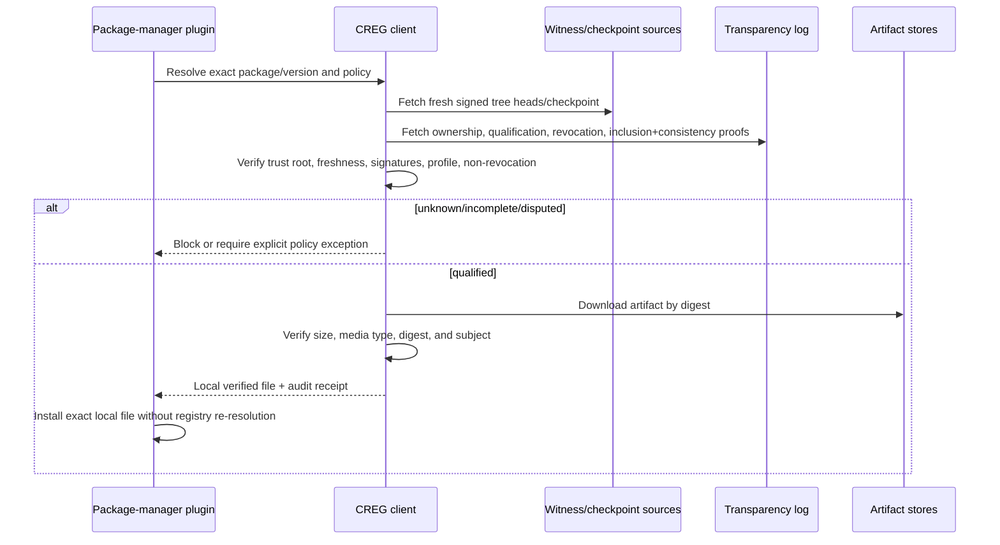

- **Components:** native package-manager integration, CREG verifier, witnesses/log, and artifact stores.
- **Data flow:** policy resolves an exact version before verification; the package manager installs the exact checked bytes, not a name that can resolve again.
- **Trust boundaries:** DNS/TLS and storage are not trust roots; signed metadata, freshness, inclusion, identity policy, and digest are.
- **Failure points:** stale client cache, `latest` ambiguity, upstream re-resolution, or unavailable evidence cause bounded failure modes.
- **Security:** use TUF-style root/snapshot/timestamp roles and expiry to prevent rollback/freeze; retain an auditable exception mechanism for emergency operations.

### 15.2 API model

Use versioned resources rather than action-heavy paths:

- `POST /v1/submissions` — idempotency key, signed DSSE envelope, ownership proof
- `GET /v1/jobs/{id}` — state and deadlines
- `GET /v1/packages/{ecosystem}/{name}` and `/versions/{version}`
- `GET /v1/artifacts/{algorithm}/{digest}`
- `GET /v1/evidence/{digest}`
- `POST /v1/validator-results` — mTLS/workload identity and assignment proof
- `GET /v1/log/entries`, `/inclusion`, `/consistency`, `/tree-head`
- `POST /v1/disputes`, `/responses`, `/appeals`
- `GET /v1/policies/{id}`, `/profiles/{id}`
- `POST /v1/webhooks` with signed delivery and replay protection
- separate operator/admin endpoints on a private network, never just a shared header on public ingress.

Every response must state data source, checkpoint/tree size, evaluation/profile version, freshness, and whether data is canonical or derived. Use cursor pagination, ETags, content negotiation, structured errors, and OpenAPI conformance tests.

### 15.3 Integration phases

| Phase | Integrations | Reason |
|---|---|---|
| 1 | GitHub/GitLab OIDC, Sigstore, in-toto/SLSA, OSV, npm and PyPI read-only lookup | Highest adoption and provenance leverage |
| 2 | Native npm/pip policy plugins, Cargo, CycloneDX/SPDX, CI status/check APIs | Strong developer workflows and real BOM evidence |
| 3 | Maven Central, NuGet, Go modules, RubyGems, container/OCI registries | More ecosystems after normalization model stabilizes |
| 4 | Enterprise SSO, private artifact repositories, VEX/SCA tools, SIEM/webhooks | Revenue and policy integration |
| Later | Additional source hosts and specialized build systems | Only with ecosystem-specific maintainers and test corpus |

Do not promise replacement of upstream registries. Integrate their ownership and download semantics and produce portable evidence.

### 15.4 User-experience changes

- Remove blockchain language from the default developer path.
- Do not require a wallet or volatile token for free/public verification lookup.
- Replace `Verified` with named profile plus freshness/confidence.
- Make exact-version resolution mandatory; prohibit silent `latest` trust decisions.
- Show “why blocked,” missing evidence, last evaluation, revocation freshness, and an organization-policy explanation.
- Provide CI-native signing through OIDC rather than long-lived local keys.
- Preserve a strict noninteractive mode for builds; interactive install prompts are unsuitable for automation.
- Make policy exceptions signed, expiring, scoped, and logged.
- Provide one CLI and one primary web console until the trust model stabilizes.

---

## 16. Repository and system structure

### 16.1 Monorepo decision

Keep a monorepo through protocol stabilization because schemas, clients, workers, policy, and conformance fixtures must change atomically. Split deployment/security access through permissions and release boundaries, not repositories. Independent auditors and external integrations can live separately later.

Recommended tree:

```text
creg/
├── specs/
│   ├── protocol/              # normative event, identity, ownership, state specs
│   ├── threat-model/
│   ├── economics/
│   └── adr/
├── schemas/
│   ├── submission/
│   ├── evidence/
│   ├── policy/
│   └── log/
├── services/
│   ├── gateway/
│   ├── ownership/
│   ├── orchestrator/
│   ├── transparency-log/
│   ├── witness/
│   ├── policy-engine/
│   ├── indexer/
│   └── dispute/
├── workers/
│   ├── static/
│   ├── sandbox/
│   ├── provenance/
│   ├── sbom-license-secrets/
│   ├── reproducible-build/
│   └── intelligence/
├── clients/
│   ├── cli/
│   ├── rust-sdk/
│   ├── js-sdk/
│   ├── python-sdk/
│   └── package-manager-plugins/
├── contracts/
│   ├── checkpoint/
│   ├── bond-escrow/
│   └── governance/
├── web/
│   ├── console/
│   └── docs/
├── infra/
│   ├── local/
│   ├── kubernetes/
│   ├── terraform/
│   ├── observability/
│   └── disaster-recovery/
├── tests/
│   ├── conformance/
│   ├── malicious-corpus/
│   ├── reproducibility/
│   ├── adversarial-network/
│   ├── economic-sim/
│   └── load/
├── research/
├── docs/
└── security/
    ├── audits/
    ├── advisories/
    ├── incident-playbooks/
    └── disclosure-policy/
```

Required ownership boundaries: consensus/log maintainers cannot unilaterally change policy; worker images have separate approvals; contracts require security review; schemas use compatibility tests; infrastructure and secrets use least privilege.

---

## 17. Competitive and positive analysis

### 17.1 Comparison

| System/approach | What it does better than CREG today | CREG opportunity |
|---|---|---|
| Traditional registries | Namespace ownership, ecosystem-native UX, scale, mirrors | Cross-registry overlay and independent evidence |
| Sigstore/Rekor | OIDC identity, short-lived signing, mature transparency semantics | Add multi-tool security evidence and policy decisions; integrate, do not replace |
| in-toto | Signed supply-chain step model and authorized functionaries | Aggregate in-toto evidence across ecosystems |
| SLSA | Clear build provenance requirements and levels | Qualify packages against SLSA predicates plus other evidence |
| TUF | Key roles, threshold trust, rollback/freeze/mix-and-match defenses | Use for CREG client/update metadata and registry mirrors |
| Reproducible Builds | Deep deterministic-build methods | Orchestrate independent rebuild evidence for critical packages |
| OpenSSF Scorecard | Mature project-practice signals | Include as advisory maintainer/project posture |
| SPDX/CycloneDX | Rich, interoperable BOM/license/dependency models | Validate, sign, version, and distribute real BOMs |
| Enterprise SCA | Vulnerability databases, reachability, policy, enterprise workflow | Open, portable, multi-party evidence and public-good coverage |
| Transparency log | Simpler, auditable append-only history | CREG should become a witnessed evidence log rather than a generalized L1 |

CREG has no defensible cryptographic moat today. Its potential moat is operational: normalized cross-registry identity, a high-quality malicious/reproducibility corpus, independent reviewer network, evidence-policy interoperability, enterprise integrations, and trusted incident history.

### 17.2 Benefits by audience

| Audience | Realistic benefit |
|---|---|
| Developers | Exact-byte verification, portable policy, visible provenance and revocation |
| Maintainers | Stronger release evidence, identity transparency, explainable disputes |
| Enterprises | Cross-ecosystem policy and auditable evidence receipts |
| Open-source communities | Sponsored verification, reproducibility support, incident history |
| Security teams | Typed evidence, rescans, webhooks, threat-intelligence correlation |
| Auditors | Immutable decision history and retrievable evidence |
| Regulators/procurers | Machine-readable claims without pretending they replace compliance assessment |
| Validators/reviewers | Compensated specialized security work with accountable evidence |
| End users | Reduced risk of artifact substitution and stale/revoked installs |
| Registries | Independent assurance layer without replacing namespace/distribution operations |

---

## 18. Consolidated weaknesses and risk register

| ID | Severity | Weakness / root cause | Impact | Likelihood | Affected | Correction | Priority |
|---|---|---|---|---|---|---|---|
| CR-01 | **Critical** | Staked EVM address not ownership-bound to Ed25519 publisher key | Stake bypass and unaccountable publication | High | Admission, slashing | Dual-domain proof over chain/service/nonce/expiry | Immediate |
| CR-02 | **Critical** | ZK package proof constrains caller claims, not scanner computation | Arbitrary package can be ZK-qualified | High if enabled | Circuit, Registry | Disable qualification fast path; formal statement/audit before reuse | Immediate |
| CR-03 | **Critical** | Batch circuit proves no transition; contract does not bind args to inputs | False “validity rollup” checkpoint | Medium | Circuit, bridge, Registry | Remove claim/path or implement full transition+DA proof | Immediate |
| CR-04 | **Critical** | Committee and analyzer selection use different algorithms above 50 | Large-set quorum becomes statistically unreachable | High at scale | Validator pipeline | One canonical assignment proof and tests at 51/100/10k | Immediate |
| CR-05 | **Critical** | Current spec has one validator and no bootnodes | No BFT, decentralization, or public bootstrap | High/current | Network | Coordinated research label; independent operators before testnet claim | Immediate |
| CR-06 | **Critical** | Publisher can unstake immediately; no per-package lock | Malicious publisher evades slash; unlimited liability per 1 CREG | High | Staking/economics | Per-release bond and challenge-period liability | Immediate |
| CR-07 | **Critical** | No namespace ownership across versions | Package takeover/impersonation | High | Admission/registry | Upstream proof and delegation chain | Immediate |
| CR-08 | **Critical** | Pause blocks registry revocation and creation of unpause proposal | Emergency can block response or permanently deadlock governance | Medium | Governance/Registry | Scoped paused-state operations and tested recovery invariant | Immediate |
| CR-09 | **Critical** | Local timeout view change lacks certificate gating; proposer seed ignores view | Consensus split or repeated failed proposer | Medium | PBFT/P2P | Replace engine or formally implement prepared certificates/new-view | Pre-testnet |
| CR-10 | **Critical** | Client freshness/anti-rollback semantics incomplete | Serve stale qualified record after revocation | Medium | CLI/API/log | TUF-style root/snapshot/timestamp and witnessed checkpoints | Pre-testnet |
| HI-11 | **High** | Historical validator-set verification incomplete | Long-range sync can accept wrong signer set | Medium | Sync/light client | Authenticated set transitions and weak-subjectivity checkpoint | Pre-testnet |
| HI-12 | **High** | Evidence quorum demands identical digest including local reputation/environment results | Honest diverse validators fail to agree; common-mode bias | High | Evidence consensus | Agree on typed policy result; preserve distinct evidence | Immediate |
| HI-13 | **High** | Finalized transaction buffer evicts at 1,000 and is memory-only | Accepted decisions disappear under load/failure | Medium | Block producer | Durable queue, no-drop invariant, backpressure | Pre-testnet |
| HI-14 | **High** | Solidity validator signature lacks chain/contract/epoch/expiry domain | Cross-deployment replay | Medium | Registry | EIP-712 typed signed set/round data | Pre-testnet |
| HI-15 | **High** | Rust local chain vs Solidity registry/checkpoint authority is ambiguous | Split verdicts and unsafe client trust | High | Whole system | One canonical log; contracts checkpoint only | Immediate |
| HI-16 | **High** | No explicit block bytes/gas/tx limit and expensive state fields | DoS, oversized blocks, unbounded growth | Medium | Consensus/storage | Consensus resource limits and fees/quotas | Pre-testnet |
| HI-17 | **High** | Contract dependencies/tests absent from clean CI | Security regressions escape | High | Contracts/release | Pin dependencies/toolchains; invariant/fuzz/static CI | Immediate |
| HI-18 | **High** | Governance concentrated and cancellation/recovery semantics weak | Capture, sabotage, unsafe upgrade | Medium | Governance/treasury | Unique signers, separation, timelock, councils, simulation | Pre-testnet |
| HI-19 | **High** | Generated “SBOM” contains only top package and no dependency inventory | Misleading compliance/security evidence | High | CLI/evidence | Use ecosystem-native generators; validate SPDX 3/CycloneDX 1.7 and completeness | Immediate |
| HI-20 | **High** | No package-level provenance/reproducible build gate | Cannot detect build compromise or source/artifact mismatch | High | Verification | SLSA/in-toto first; risk-based independent builds | Pre-production |
| HI-21 | **High** | Rewards are orders of magnitude below validation cost | Validator attrition/centralization or hidden subsidy | High | Tokenomics | Customer-funded priced work; postpone token | Immediate |
| ME-22 | **Medium** | IPFS content availability and legal replication not guaranteed | Qualified artifact/evidence unavailable or unlawfully mirrored | Medium | Storage/client | Multi-domain retention, probes, rights policy | Pre-production |
| ME-23 | **Medium** | Shielded path is single-node X25519 and threshold feature disabled | Central confidentiality boundary and misleading privacy expectations | Medium | Private packages | Keep disabled; tenant KMS architecture before revival | Post-MVP |
| ME-24 | **Medium** | Governance API is a deliberate 501 stub | UI/operations inconsistent with contract state | High | API/explorer | Index L1/log governance or remove surface | Pre-production |
| ME-25 | **Medium** | Web unit tests and contract CI missing | UX/security regressions | High | Hub/explorer/contracts | Unit/component/e2e/accessibility CI | Pre-testnet |
| ME-26 | **Medium** | Feature sprawl: cross-chain, insurance, ZK, private paths, two consensus layers | Audit surface, delayed core, contradictory docs | High | Program | Remove/postpone features per Section 21 | Immediate |
| ME-27 | **Medium** | DDC script passes with no targets | Compliance theater if presented as DDC | High | Release assurance | Report “not applicable/no targets”; execute only on real compiler-like targets | Immediate |
| ME-28 | **Medium** | Documentation statuses conflict with source and one another | Unsafe operator assumptions and investor/user misunderstanding | High | Governance/ops | Generated capability matrix tied to tests/config | Immediate |
| LO-29 | **Low** | Publisher policy receives empty publisher in install path | Allow/deny publisher rules do not work | High | CLI policy | Include authenticated publisher identity in verdict | MVP |
| LO-30 | **Low** | Derived APIs scan bounded history and local caches | Incomplete results and inconsistent nodes | Medium | Explorer/index | Dedicated derived indexes with completeness/freshness | Production |

No Critical or High item may be accepted merely through documentation. Each needs code/specification correction, adversarial tests, and evidence; security-critical items also need independent review.

---

## 19. Recommended improved architecture

### Diagram 16 — Improved architecture

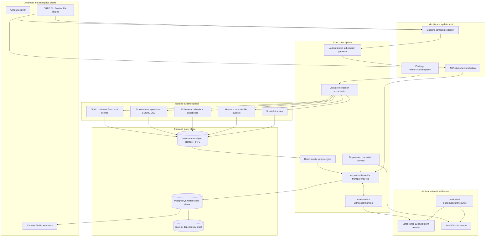

- **Components:** identity/ownership, durable orchestration, isolated evidence workers, deterministic policy, witnessed log, derived query systems, disputes, and minimal L2 settlement.
- **Data flow:** clients sign exact subjects; workers emit evidence to immutable storage; policy emits bounded decisions to the log; witnesses and L2 checkpoints prevent rewrite/split-view attacks.
- **Trust boundaries:** no worker can alter the log or treasury; no log operator can fabricate tool evidence; no L2 contract claims to know package safety.
- **Failure points:** any one worker, storage region, log operator, witness, or L2 RPC may fail without losing the complete trust chain; quorum/freshness policy defines degraded operation.
- **Security:** the smallest auditable core is identity→ownership→evidence→policy→log→client. Everything else is derived or optional.

### 19.1 Component technology recommendations

| Layer | Recommended technology/approach | On/off chain |
|---|---|---|
| Submission/identity | OIDC workload identity, Sigstore-compatible certificates/bundles, DSSE | Off-chain; identity/log proofs referenced |
| Ownership | Ecosystem adapters plus signed delegation/recovery events | Transparency log |
| Orchestration | Durable cloud queue/NATS/Kafka-class system, idempotent jobs, tenant budgets | Off-chain |
| Workers | Kubernetes with gVisor/Kata/Firecracker-class isolation; signed OCI images; no ambient credentials | Off-chain |
| Evidence | in-toto Attestation Framework predicates, SLSA provenance, SPDX 3.0/CycloneDX 1.7 | Content-addressed off-chain |
| Policy | Deterministic versioned engine with conformance vectors; advisory scores separate | Off-chain signed decision |
| Transparency | Rekor/Trillian-class verifiable Merkle log or equivalent with inclusion/consistency proofs | Independent replicated log |
| Witnesses | Multiple organizations gossip/check signed tree heads | Off-chain; roots anchored |
| Artifact/evidence storage | S3-compatible immutable object lock in two domains + IPFS distribution | Off-chain |
| Query | PostgreSQL, search index, and graph database/materialized graph | Off-chain, rebuildable |
| Settlement | Minimal Solidity checkpoint and stablecoin bond escrow on established L2 | On-chain |
| Governance | Safe-style threshold wallet, timelock, scoped security council | L2 plus public process |
| Observability | OpenTelemetry, Prometheus/Grafana, immutable audit sink, public status | Off-chain |
| Secrets | Cloud KMS/HSM, workload identity, short-lived certificates | Off-chain privileged |

### 19.2 Framework recommendation if an appchain is later required

If measured demand eventually requires independent replicated state beyond a witnessed log, use **CometBFT plus a small application-specific state machine, preferably through Cosmos SDK modules**. CometBFT already handles BFT consensus, networking, mempool, proposer rounds, validator updates, and deterministic finality, separating these from application logic through ABCI. Do not migrate until the log protocol and economic model are stable; otherwise the team will merely move unresolved semantics into a new framework.

Polkadot SDK is technically viable and fits the Rust skill base, but a parachain/runtime adds ecosystem and upgrade complexity not justified by CREG's low-throughput evidence log. A rollup is appropriate only if CREG publishes enough ordered state to require inherited L2 execution and supplies real data availability plus fraud/validity proofs. A periodic L2 checkpoint is not a rollup and should not be marketed as one.

### 19.3 Architectural decision records

| ADR | Decision | Status | Revisit trigger |
|---|---|---|---|
| ADR-001 | Verification evidence, not blockchain consensus, is the product trust primitive | Adopt | Strong evidence that ordering disputes require an appchain |
| ADR-002 | Use a witnessed Merkle log and established-L2 checkpoints | Adopt | Checkpoint cost or regulatory constraint changes |
| ADR-003 | No native tradable token through early production | Adopt | Independent validator market and stable demand demonstrated |
| ADR-004 | Disable package-safety and batch ZK qualification | Immediate | Formal statement, audited circuit, setup, verifier, and integration exist |
| ADR-005 | Use standard provenance/BOM/identity formats | Adopt | Standards incompatibility documented through conformance tests |
| ADR-006 | Risk-tier verification; reproducible builds for high-risk profiles | Adopt | Measured costs support broader coverage |
| ADR-007 | One canonical ownership and committee algorithm | Immediate | Never; changes require versioned migration |
| ADR-008 | Keep personal/private data off public immutable state | Adopt | Privacy counsel approves a narrowly formalized disclosure |

---

## 20. Implementation roadmap

No calendar estimate is reliable until Phase 0 freezes the protocol. Complexity uses S/M/L/XL and assumes a core team with protocol/distributed-systems, supply-chain security, Rust/backend, platform/SRE, product/SDK, security, and legal support.

| Phase | Objectives and deliverables | Dependencies | Main risks | Exit criteria | Team / complexity | Security requirements |
|---|---|---|---|---|---|---|
| **0 — Research and specification** | Normative identity, ownership, event, evidence, profile, freshness, dispute, threat, data, and economic specs; remove misleading claims; architecture ADRs; test corpus plan | Maintainer decisions and counsel | Preserving too much legacy design | Specs have test vectors; all CR-01–CR-10 have decisions; audit scope frozen | Protocol, AppSec, supply-chain, legal, product / **L** | Independent design review; abuse cases; data protection impact assessment |
| **1 — Centralized proof of concept** | Authenticated submission, durable queue, content hashing, real static/sandbox evidence, real SBOM/provenance ingestion, policy report, CLI/API, append-only log operated centrally | Phase 0 schemas and worker images | False confidence and hostile-workload escape | 1,000-fixture corpus; no critical sandbox escape; exact-byte install; evidence/log proofs reproducible | Backend/Rust, platform, security, SDK / **L** | Disposable workers; KMS; signed releases; no token/ZK/custom consensus |
| **2 — Permissioned witness network** | 4+ independent witnesses, 7 evidence validators, one committee algorithm, signed tree heads, disputes, stablecoin/test credits, monitoring | Stable log and operator agreements | Common infrastructure and governance capture | Split-view tests pass; three non-core operators; partition recovery; challenge drill | Distributed systems, SRE, governance, security / **XL** | External architecture and sandbox review; key ceremonies; incident on-call |
| **3 — Public testnet** | Open read APIs, controlled validator onboarding, L2 checkpoint/bond test contracts, native package-manager integrations, governance simulations, incentivized adversarial testing | Phase 2 evidence and counsel | Abuse cost, token distraction, public misinterpretation | No open Critical/High; contract audit complete; 90-day SLO/soak; client freshness/revocation drill | Full cross-functional / **XL** | Bug bounty, audits, DDoS controls, public status, disaster recovery |
| **4 — Production/mainnet-equivalent service** | Stable APIs, enterprise/private profiles, audited settlement, independent witnesses, support/SLA, transparent treasury/budget | Paying demand, legal structure, audit closure | Liability, economics, operator attrition | Mainnet readiness criteria in Section 22 satisfied; go/no-go signed by independent reviewers | Product, support, compliance, protocol, SRE / **XL** | Continuous audit, HSM, regional DR, annual exercises, safe governance |
| **5 — Ecosystem expansion** | More registries, private verification, advanced intelligence, automated incident integrations; appchain research only if demanded | Stable economics and standards | Feature sprawl returns | Each integration has owner, corpus, SLO, threat model, and usage | Ecosystem teams / **L per ecosystem** | Per-integration security review; no shared trust shortcuts |

### Diagram 17 — Phased deployment architecture

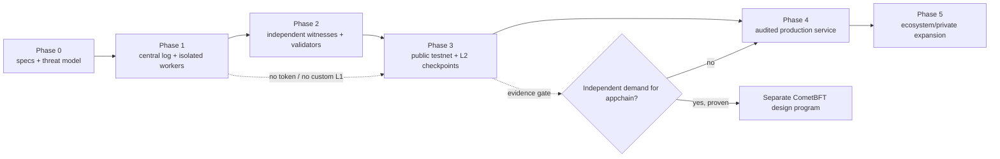

- **Components:** each phase adds one trust property: specification, evidence production, independent witnessing, public operation, audited production, then breadth.
- **Data flow:** schemas and evidence remain compatible across phases; production does not require migrating package records through speculative chains.
- **Trust boundaries:** decentralization is introduced only after centralized correctness and evidence quality are measurable.
- **Failure points:** every phase has an exit gate; failure means remain at the prior assurance level, not relabel the same deployment.
- **Security:** custom-chain research is a separate gated program and cannot block the useful verification service.

---

## 21. Testing and validation strategy

### 21.1 Required test layers

| Test type | Required coverage |
|---|---|
| Unit | canonicalization, signature domains, ownership transitions, policy, evidence digests, freshness, pricing, parsing |
| Integration | identity→submission→workers→evidence→policy→log→client; storage and registry adapters |
| Contract | unit, fuzz, invariant, differential, gas, fork, deployment, pause/recovery, signer rotation, escrow |
| Runtime/consensus | Only if appchain retained: state transitions, deterministic execution, validator epochs, view change, evidence availability |
| Adversarial | publisher spoof, replay, namespace takeover, forged evidence, split log, stale client, malicious gateway, compromised worker |
| Network partition | 1/3 and >1/3 partitions, asymmetric links, clock skew, RPC divergence, witness outage |
| Load/soak | queue backpressure, 512 MiB rejection, millions of lookups, 90-day state growth, worker autoscale, no dropped accepted jobs |
| Fuzz/property | archive extraction, manifests, canonical JSON/DSSE, APIs, P2P if retained, Solidity, Merkle proofs, SBOM parsers |
| Economic simulation | price/cost distributions, collusion/bribery, operator concentration, bond adequacy, treasury runway |
| Governance simulation | signer loss, malicious proposal, pause/unpause, timelock monitor failure, treasury attack, council conflict |
| Reproducible-build | deterministic and nondeterministic corpus, toolchain drift, mismatch triage, compiler-like DDC targets |
| Detection efficacy | labeled benign/malicious corpus by ecosystem; precision/recall by threat class, not one aggregate score |
| Disaster recovery | region loss, log-key compromise, object corruption, DB rebuild, checkpoint mismatch, total control-plane restore |
| Upgrade | old/new client compatibility, schema evolution, canary, activation, rollback boundary, trust-root rotation |

### 21.2 Mainnet/production acceptance criteria

- Zero unresolved Critical/High findings in the production trust path; accepted Medium risks have named owners and expiry.
- Independent audits cover identity/ownership, client freshness, log/witness, worker isolation, minimal contracts, governance, and release process.
- Every prior audit Critical/High fix is retested by the auditor or an independent party.
- At least four witness organizations and seven evidence-validator organizations, with no operator/control domain above one-third.
- 90 days of published SLO evidence; no loss of accepted jobs or signed log entries.
- Partition, split-view, key compromise, malicious qualification, revocation, pause/unpause, and region-loss exercises pass.
- Detection corpus reports per-ecosystem precision/recall and explicitly documented blind spots.
- Package installation verifies exact bytes and rejects stale/revoked metadata without network trust.
- Stable business revenue/budget covers at least 18 months of base operations without assumed token appreciation.
- Legal reviews are complete for launch jurisdictions, data roles, terms, redistribution, token/payment model, and validator contracts.
- Reproducible signed client releases and TUF/Sigstore-style update verification are mandatory.
- Public documentation is generated from schemas/config and matches deployed capability flags.

---

## 22. Monitoring, incident response, and operations

### 22.1 Service-level indicators

Monitor chain/log health, witness consistency, tree-head age, submission success, queue delay, worker isolation profile, sandbox escapes/denials, artifact/evidence retrieval, policy evaluation, validator participation/diversity, false-positive appeals, revocation propagation, client freshness, storage replication, database/index lag, L2 checkpoint lag, bond/treasury movements, governance proposals, key use, deployment drift, and cost per profile.

Alerts need runbook, owner, severity, customer impact, and automated containment. Metrics without a tested response are not controls.

### Diagram 18 — Incident-response workflow

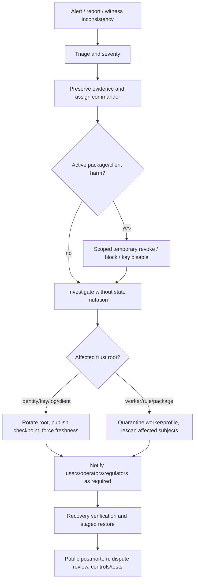

- **Components:** detection, commander, evidence preservation, scoped containment, trust-root recovery, rescan, communication, and postmortem.
- **Data flow:** evidence is preserved before mutation; containment events are logged and later ratified or reversed.
- **Trust boundaries:** key/log/client compromise requires trust-root recovery, while a scanner/package incident requires profile quarantine and rescan.
- **Failure points:** unclear authority, stale clients, unavailable signers, and incomplete subject inventory are exercised before launch.
- **Security:** emergency revocation must bypass normal pause restrictions but be narrow, expiring, multi-party, and publicly auditable.

### 22.2 Minimum runbooks

- malicious package qualification and downstream notification;
- false-positive mass rejection;
- validator evidence fraud/collusion;
- governance, validator, worker, bridge/checkpoint, and client-release key compromise;
- log split view or checkpoint mismatch;
- chain/consensus halt if legacy network remains;
- L1/L2 RPC outage and reorganization;
- IPFS/object-store unavailability and content corruption;
- sandbox escape and worker-fleet rebuild;
- database/index corruption and complete rebuild;
- privacy breach/private source exposure;
- treasury/bond anomaly;
- emergency revocation and subsequent appeal;
- status-page and coordinated public security communication.

---

## 23. Final recommendations

### 23.1 Preserve, remove, simplify, redesign, prioritize, postpone

| Action | Features |
|---|---|
| **Preserve** | content-addressed exact-byte install; deterministic/advisory split; typed evidence digests; sandbox fail-closed intent; revocation history; CLI policy; cross-registry normalization; observability/runbooks |
| **Remove from trust path now** | package-safety ZK qualification; batch validity/rollup claim; AI-final appeal; `safe`/`fully verified` language |
| **Simplify** | one canonical record/log; one primary UI; one validator identity model; minimal L2 contracts; fewer deployment topologies |
| **Redesign immediately** | publisher identity/stake binding; namespace ownership; qualification states; committee assignment; client freshness; publisher bonds; paused-state recovery; governance separation |
| **Prioritize** | Sigstore/in-toto/SLSA integration; real SBOM/provenance; witnessed log; malicious corpus; exact package-manager integration; independent operators; contract/log/client audits |
| **Postpone** | native tradable token, custom L1 mainnet, cross-chain, insurance, shielded/private shared network, generalized ZK, 10k-validator claims |

### 23.2 Recommended MVP

The MVP should accept npm and PyPI artifacts; authenticate CI/maintainers through OIDC/Sigstore-compatible identity; prove namespace authority; hash exact source and artifact; ingest SLSA/in-toto provenance; generate a real CycloneDX/SPDX BOM; run static, secrets, license, OSV, and one real sandbox profile; append evidence and decisions to a centrally operated Merkle log with two independent witnesses; expose CLI/API policy and exact-byte installation; and support revocation/rescan.

The MVP should have **no native token, custom public consensus, ZK safety proof, cross-chain path, insurance, or private-package promise**.

### 23.3 Recommended testnet

The testnet should test decentralization mechanisms, not repeat the MVP behind more nodes: 4+ witness organizations, 7 evidence-validator organizations, one audited committee selector, split-view and partition exercises, stablecoin/test-credit work accounting, public malicious corpus, dispute drills, L2 checkpoint contract, and package-manager plugins. It must remain explicitly nonproduction.

### 23.4 Prioritized action plan

**Immediate actions**

1. Disable `zkValidationEnabled` and any ZK-only qualification in deployed/test configurations.
2. Stop calling checkpointing a rollup or validity proof.
3. Fix CR-01 publisher dual-key identity binding and CR-07 ownership before accepting new security-significant submissions.
4. Prevent publisher withdrawal while release liabilities exist.
5. Remove `safe to install` semantics and version all qualification profiles.
6. Resolve the committee/analyzer mismatch; cap the supported validator set at 50 until replaced.
7. Add a safe unpause and emergency-revocation path.
8. Publish a generated capability matrix showing current validator count, enabled features, audit state, and known gaps.

**Pre-prototype actions**

1. Approve ADR-001–ADR-008.
2. Write normative schemas and test vectors for identity, ownership, evidence, policy, log, and freshness.
3. Build the labeled malicious/benign/nonreproducible corpus and efficacy metrics.
4. Pin clean-build dependencies and add contract/web/security CI.
5. Obtain independent design review before more contract or chain feature work.

**Pre-testnet actions**

1. Implement witnessed log, durable queue, hermetic workers, and exact client verification.
2. Onboard genuinely independent operators and publish control-domain disclosures.
3. Complete external audits and close all Critical/High findings.
4. Run partition, split-view, load, key-compromise, sandbox-escape, and revocation exercises.
5. Demonstrate customer-funded or budgeted work economics without token-price assumptions.

**Pre-production/mainnet actions**

1. Meet every acceptance criterion in Section 21.2.
2. Complete jurisdiction-specific legal and privacy review.
3. Establish 24/7 incident ownership, public status, bug bounty, and regional DR.
4. Lock governance separation, timelocks, signer diversity, treasury controls, and recovery.
5. Publish audit reports, residual risks, detection efficacy, SLO history, and cost model.

**Post-production improvements**

1. Expand ecosystems one at a time with dedicated conformance corpora.
2. Add enterprise/private profiles with tenant-controlled encryption and deletion.
3. Improve reproducible-build coverage and independent builder diversity.
4. Research an appchain only if the witnessed log demonstrably cannot meet ordering/governance needs.
5. Reconsider a native asset only after a real validator market, audited slashing, regulatory review, and stable non-speculative demand exist.

### 23.5 Final go/no-go judgment

- **Go:** continue CREG as a software supply-chain evidence, policy, and transparency project.
- **Conditional go:** operate the current implementation only as a controlled research alpha with all critical paths disabled or clearly bounded.
- **No-go:** custom-L1 mainnet, production safety claims, public token launch, ZK-fast-path qualification, validity-rollup claims, or high-scale validator claims in the current design.

The strongest path is gradual: prove that developers and enterprises value the evidence service, make its records independently auditable, make its clients resistant to rollback and substitution, and decentralize only the roles whose independence measurably improves security.

---

## Appendix A — Deliverable coverage

| Requested deliverable | Location |
|---|---|
| Executive summary and scores | Sections 1 and 23 |
| Project overview / problem analysis / mapping | Sections 1, 3 |
| Full architecture and Layer 1 analysis | Sections 4–6, Diagrams 1–3 |
| Blockchain/data design | Section 6, Diagram 9 |
| Package verification / DDC | Sections 6–7, Diagrams 4–8 |
| Validator system | Section 8, Diagram 6 |
| Smart contracts/runtime | Section 9, Diagram 10 |
| Tokenomics and scenarios | Section 10, Diagram 11 |
| Governance and disputes | Section 11, Diagrams 12–13 |
| Threat model / risk matrix | Section 12, Diagram 14 |
| Privacy and legal | Section 13 |
| Scalability and capacity | Section 14 |
| Workflows, APIs, integrations, DX | Section 15, Diagram 15 |
| Repository/system structure | Section 16 |
| Competitive analysis / benefits | Section 17 |
| Weaknesses and risk register | Section 18 |
| Improved architecture | Section 19, Diagram 16 |
| Implementation roadmap / phased architecture | Section 20, Diagram 17 |
| Testing and mainnet criteria | Section 21 |
| Monitoring / incident response | Section 22, Diagram 18 |
| Cost and sustainability | Sections 10 and 14 |
| Final recommendations/action plan | Section 23 |

## Appendix B — Important assumptions to validate

1. Upstream registries will expose enough ownership/provenance data for reliable adapters.
2. Maintainers will accept OIDC/Sigstore or another identity-binding workflow.
3. Enterprises will pay for deep verification or sponsor public packages.
4. Sandbox/build evidence can be normalized without forcing byte-identical environment-specific results.
5. Independent organizations will operate witnesses/reviewers under transparent control-domain rules.
6. Artifact redistribution rights permit the chosen storage model.
7. A small L2 checkpoint/bond contract provides enough economic finality; a custom chain is not required.
8. Detection efficacy and false-positive burden are acceptable on real ecosystem corpora.
9. Revocation freshness can be enforced by native package-manager integrations.
10. The project can narrow scope long enough to complete independent audits and operational evidence.

## Appendix C — Evidence interpretation

Cryptographic proof establishes only the formal statement encoded by its verifier. A validator signature establishes that a key signed a message. A scanner result establishes what that tool reported under a named configuration. A reproducible build establishes matching outputs from specified inputs/environments. Maintainer identity establishes control of an identity under an issuer's policy. Provenance establishes a claimed chain of subjects and build steps when its signatures and builder are trusted. None of these, alone or together, proves that software is absolutely safe.
