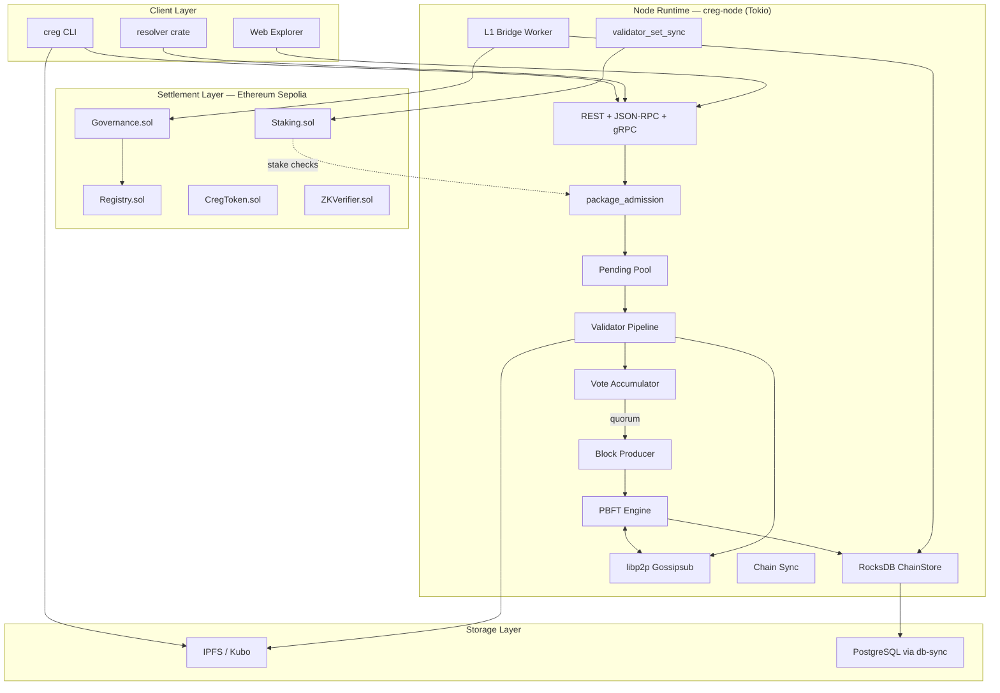
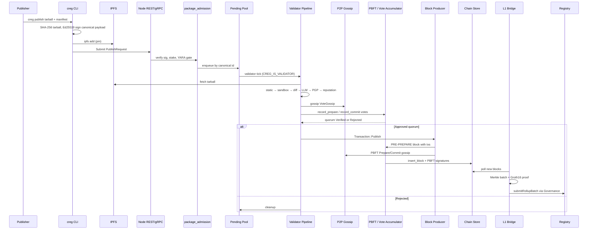
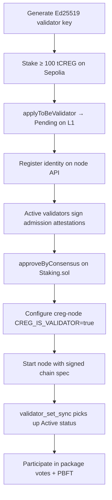
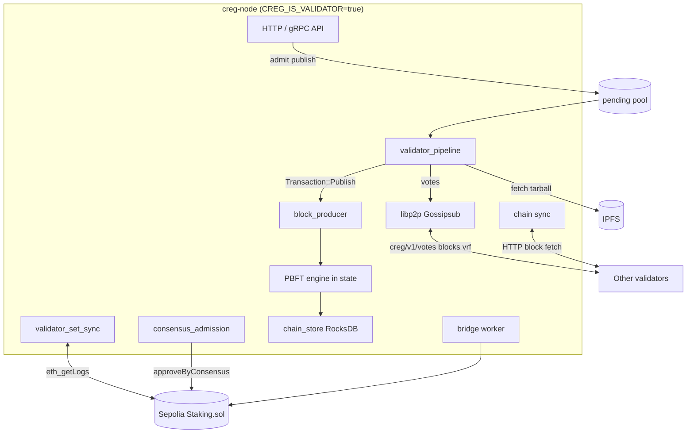
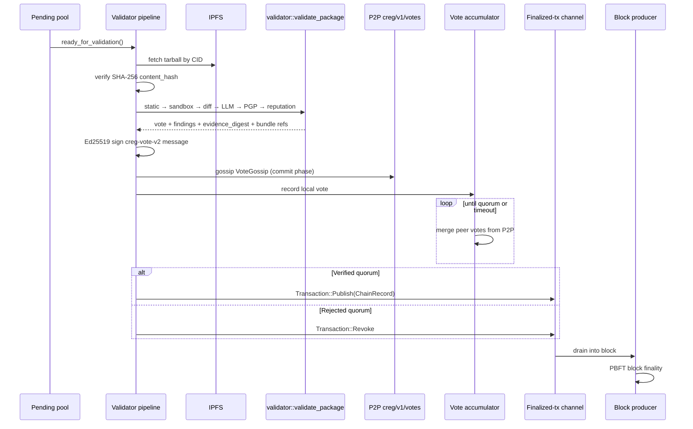

# CREG System Workflow Documentation

> **Chain Registry (CREG)** — Technical system workflow reference  
> **Version:** Public alpha (`creg-testnet-1`)  
> **Network:** Ethereum Sepolia (L1 chain id `11155111`)  
> **Status:** Public alpha testnet — not mainnet  
> **Last updated:** 2026-07-06 (§1.7 whitepaper version, §9.11 alpha implementation note)

This document describes the complete system workflow of the Chain Registry blockchain: architecture, components, consensus, networking, storage, security, operations, and developer onboarding. It is scoped to the **core blockchain project** (`chain-registry/` workspace, contracts, circuits, testnet) and excludes the waitlist application and contribution arena.

---

## Table of Contents

1. [System Overview](#1-system-overview)
2. [Architecture and Layers](#2-architecture-and-layers)
3. [Core Components](#3-core-components)
4. [Blockchain Workflow](#4-blockchain-workflow)
5. [Smart Contracts and On-Chain Logic](#5-smart-contracts-and-on-chain-logic)
6. [Networking and Peer-to-Peer Communication](#6-networking-and-peer-to-peer-communication)
7. [Storage and Database Design](#7-storage-and-database-design)
8. [Key Workflows](#8-key-workflows)
9. [Validator Node System Flow](#9-validator-node-system-flow)
10. [Security Considerations](#10-security-considerations)
11. [Performance, Scalability, and Monitoring](#11-performance-scalability-and-monitoring)
12. [Testing Strategy and Quality Assurance](#12-testing-strategy-and-quality-assurance)
13. [Deployment and Operational Considerations](#13-deployment-and-operational-considerations)
14. [Developer Onboarding Guidelines](#14-developer-onboarding-guidelines)

---

## 1. System Overview

### 1.1 What CREG Is

Chain Registry (CREG) is a **decentralized package-integrity network** for software supply chains. It replaces single-authority registry trust (npm, PyPI, Cargo, and similar) with **independent validator consensus**. Publishers submit content-addressed packages; economically staked validators run a multi-stage security pipeline; two-layer consensus (package votes + PBFT blocks) finalizes records on a local CREG chain; state can be anchored to Ethereum Sepolia via contracts and a rollup bridge.

CREG is **not a general-purpose EVM smart-contract chain**. It is a specialized BFT chain whose blocks primarily contain **package verdict transactions**, not arbitrary contract execution. See [§1.2 CREG vs EVM L2](#12-creg-vs-evm-l2) for a side-by-side comparison.

### 1.2 CREG vs EVM L2

When people say "Layer 2 blockchain," they often mean an **EVM-compatible chain** that settles to Ethereum and runs the same class of applications (DeFi, NFTs, DAOs) via arbitrary Solidity contracts. CREG is a different category: a **specialized BFT ledger** for package trust verdicts, with Ethereum used for staking, governance, and optional checkpoints.

| | General-purpose EVM L2 | CREG |
|--|------------------------|------|
| **Primary purpose** | Run arbitrary smart contracts | Record package verdicts and registry governance |
| **Block contents** | `eth_sendTransaction` calls to any contract | Typed transactions: `Publish`, `Revoke`, `Slash`, `ValidatorJoin`, etc. |
| **Execution model** | EVM runs user-deployed bytecode | Validators run a fixed security pipeline; no user bytecode on the local chain |
| **JSON-RPC** | Standard `eth_*` methods (`eth_call`, `eth_sendRawTransaction`, …) | CREG-specific methods (`creg_chainId`, `creg_blockNumber`, `creg_getBlockByNumber`) |
| **Typical client** | MetaMask, Hardhat, Foundry against L2 RPC | `creg` CLI, REST API, explorer |
| **Smart contracts** | Deployed and executed on the L2 itself | Deployed on **Sepolia (L1)** for staking, registry mirror, governance — not general dApp hosting |
| **Analogy** | Shared computer | Specialized notary ledger for software artifacts |

CREG has two cooperating layers:

1. **Local CREG chain** (Rust, RocksDB, PBFT) — fast finality for package records.
2. **Ethereum Sepolia** (Solidity) — economic security (staking, slashing) and optional L1 anchoring via `submitRollupBatch` / `finalizePackage`.

You cannot point standard Ethereum tooling at a CREG node RPC and deploy arbitrary contracts. Public endpoints deliberately separate **CREG RPC** (`creg_*`) from **Sepolia RPC** (`eth_*` for wallets and staking). That split is intentional: CREG optimizes for auditable package verdicts, not general-purpose on-chain computation.

### 1.3 Problem Statement

Supply-chain attacks exploit compromised maintainer accounts, stolen API tokens, malicious dependency updates, and typosquatting. Traditional registries make one organization or one publisher credential the effective root of trust. CREG addresses this by:

- Requiring package signatures, on-chain publisher stake, and validator verification before **verified** status
- Binding verdicts to exact artifact bytes (content hash, IPFS CID, manifest hash)
- Attaching scanner profile digests, evidence digests, and findings to validator votes
- Requiring quorum from staked validators for package approval
- Making package approval an auditable, economically accountable network decision

### 1.4 Design Principles

| Principle | Description |
|-----------|-------------|
| Evidence before reputation | Package approval is grounded in evidence about a specific artifact, not publisher reputation alone |
| Determinism for consensus | Consensus-grade evidence uses pinned local snapshots and reproducible scanners; live lookups and LLM analysis are advisory |
| Defense in depth | Static analysis, sandbox behavior, diffing, vulnerability signals, reputation, revocation, and appeals |
| Transparent trust assumptions | Public docs state where CREG is strong, where it is alpha, and where external controls apply |
| Progressive decentralization | Public alpha starts coordinated; mainnet-class decentralization requires larger validator sets, closed audits, and governance maturity |

### 1.5 Network Roles

| Role | Responsibility |
|------|----------------|
| **Publisher** | Signs and submits package artifacts; stakes tCREG before publishing |
| **Validator** | Runs the analysis pipeline, signs votes, participates in PBFT finality |
| **Observer** | Syncs state and serves read APIs without voting |
| **Developer / consumer** | Queries package status, installs with `creg`, verifies proofs |
| **Governance signer** | Controls emergency and protocol parameters through contracts |
| **Pinning operator** | Keeps content-addressed package bytes retrievable via IPFS |

### 1.6 Package State Machine

| State | Meaning |
|-------|---------|
| `UNKNOWN` | No record and no pending submission on the queried node |
| `pending` | Admitted to the node's pending pool; awaiting validator finality |
| `verified` | Record on the node's chain store after validator pipeline + block finality |
| `revoked` | Rejected or revoked on chain |

On the public alpha, **verified** means the queried node's chain store has accepted the package after validator workflow. Users should set `CREG_NODE_URL` to a public or operator endpoint they trust.

### 1.7 Repository Layout

```
chain-registry/                    # Root repository
├── README.md                      # Project overview
├── docs/                          # Public documentation
│   ├── WHITEPAPER.md              # Technical whitepaper v0.3.0-public-alpha
│   ├── PUBLIC_TESTNET_QUICKSTART.md
│   ├── TESTNET_PHASE_SCOPE.md
│   └── CREG_SYSTEM_WORKFLOW.md    # This document
├── circuits/                      # Circom Groth16 ZK circuits
└── chain-registry/                # Core protocol workspace (Rust)
    ├── Cargo.toml                 # 17-crate workspace
    ├── crates/                    # Node, consensus, validator, CLI, etc.
    ├── contracts/                 # Solidity on Sepolia
    ├── testnet/                   # Chain spec, compose, operator scripts
    ├── explorer/                  # React block/package explorer
    ├── k8s/                       # Kubernetes manifests
    ├── migrations/                # PostgreSQL schema
    ├── observability/             # Prometheus, Grafana, Loki, Tempo
    └── tests/                     # Workspace integration tests
```

---

## 2. Architecture and Layers

### 2.1 Layer Diagram



### 2.2 Layer Descriptions

| Layer | Technology | Role |
|-------|------------|------|
| **Settlement (L1)** | Solidity on Sepolia | Staking, on-chain registry mirror, governance, ZK verifier, token economics |
| **CREG chain (L2-local)** | Rust + RocksDB | Fast package finality, PBFT blocks, package index |
| **Consensus** | PBFT + vote accumulator + VRF | Package approval quorum + block finality |
| **Networking** | libp2p (Gossipsub, Kademlia, identify) | Votes, blocks, submissions, VRF proofs, validator registrations |
| **Security pipeline** | validator + ml-validator + wasm-sandbox | Static → sandbox → diff → optional LLM/PGP/reputation |
| **Content** | IPFS CIDs + SHA-256 | Content-addressed package artifacts |
| **Indexing** | db-sync → PostgreSQL | Explorer and search without hitting RocksDB |
| **Client** | `creg` CLI + resolver | Publish, install, verify, stake |

### 2.3 Node Subsystems at Startup

The `creg-node` binary (`crates/node/src/main.rs`) spawns these background tasks:

1. **P2P** — libp2p swarm with seed redial loop
2. **Validator registry gossip** — restore and broadcast Ed25519↔EVM identity bindings
3. **PostgreSQL sync** (optional, or dedicated `creg-indexer`)
4. **Chain sync** — peer height polling, linear block fetch
5. **Validator pipeline** — only when `CREG_IS_VALIDATOR=true`
6. **Block producer** — drains finalized-transaction channel
7. **L1 bridge** — periodic rollup checkpoints to Sepolia
8. **Validator registration sync** — L1 staking state polling
9. **Consensus admission** — on-chain admission attestations
10. **Validator set sync** — chain-authoritative membership from `Staking.sol`
11. **HTTP/gRPC servers** — API surface on port 8080 (default)

---

## 3. Core Components

### 3.1 Rust Workspace Crates

The workspace (`chain-registry/Cargo.toml`) contains 17 crates:

| Crate | Purpose |
|-------|---------|
| `common` | Shared types: `Block`, `Transaction`, `PackageId`, `ChainRecord` (with embedded `AnalysisCommittee` + `member_performance_at_finalization` snapshot), chain spec |
| `node` | `creg-node` binary: API, P2P, storage, pipeline orchestration |
| `consensus` | PBFT engine, vote accumulator, VRF, forced inclusion |
| `validator` | Three-stage security pipeline (static, sandbox, diff, LLM, PGP) |
| `cli` | `creg` CLI (publish, install, stake, verify, doctor) |
| `resolver` | Package trust resolution (cache + node API) |
| `zk-validator` | Groth16 proof generation/verification (arkworks) |
| `ml-validator` | YARA-X deep scan, threat intel |
| `wasm-sandbox` | WASM fallback sandbox |
| `db-sync` | RocksDB chain → PostgreSQL indexer ETL |
| `relayer` | Gasless staking via EIP-712 sponsored intents |
| `faucet` | tCREG testnet faucet |
| `ipfs-pinner` | IPFS pinning verification |
| `cross-chain` | Cross-chain scaffolding (disabled on testnet) |
| `insurance` | Package insurance (disabled on testnet) |
| `threshold-encryption` | Shamir/shielded publish (disabled on testnet) |
| `secrets` | Hot-key and environment secret helpers |

### 3.2 Data Structures

#### Package Identity

Packages are identified by canonical string:

```text
<ecosystem>:<name>@<version>
```

Examples: `npm:example@1.2.3`, `pypi:example@1.2.3`, `cargo:example@1.2.3`

The `PackageId` struct (`crates/common/src/package.rs`) holds `ecosystem`, `name`, and `version`.

#### Publish Request

Submitted by publishers to enter the pending pool:

| Field | Purpose |
|-------|---------|
| `id` | `PackageId` |
| `content_hash` | SHA-256 of tarball bytes |
| `ipfs_cid` | IPFS CID where tarball is pinned |
| `publisher_address` | Staked EVM address (0x-prefixed) |
| `publisher_pubkey` | Ed25519 public key (hex) |
| `signature` | Ed25519 signature over `canonical(id) + content_hash + publisher_address` |
| `manifest` | Declared behaviors (network hosts, FS writes, process spawns) |
| `shielded` | Whether tarball is encrypted (feature disabled on testnet) |

#### Chain Record

A finalized package record written to the chain after validator quorum approval. Includes content hash, IPFS CID, publisher metadata, validator signatures, findings, scanner profile digest, and evidence digest.

#### Block

```rust
Block {
    header: BlockHeader {
        height, prev_hash, merkle_root, proposer_id,
        timestamp, validator_set_hash, vrf_output, vrf_proof
    },
    transactions: Vec<Transaction>,
    pbft_signatures: Vec<BlockSignature>
}
```

Genesis block: height 0, empty transactions, `prev_hash` = 64 zeros.

#### Transaction Types

| Variant | Purpose |
|---------|---------|
| `Publish(ChainRecord)` | Verified package record (contains full `analysis_committee` object with `member_performance_at_finalization` snapshot taken at the moment of finalization) |
| `Revoke { ... }` | Governance or publisher revocation |
| `Slash { ... }` | Validator slashing event |
| `ValidatorJoin` / `ValidatorLeave` | Validator set changes |
| `RotatePublisherKey { ... }` | Ed25519 key rotation with nonce anti-replay |

### 3.3 Validator Security Pipeline

The pipeline (`crates/validator/src/lib.rs`, orchestrated by `crates/node/src/validator_pipeline.rs`) runs these stages:

```mermaid
flowchart LR
    Start([Pending package]) --> Fetch[Fetch IPFS tarball]
    Fetch --> Validate[validator::validate_package]
    Validate --> S1[Static Analysis]
    S1 --> S2[Behavioral Sandbox]
    S2 --> S3[Differential Analysis]
    S3 --> S4[LLM optional advisory]
    S4 --> S5[PGP optional]
    S5 --> S6[Reputation HTTP]
    S6 --> Decision{Deterministic risk + vote}
    Decision -->|Approve| SignVote[Ed25519 sign ValidatorVote]
    Decision -->|Reject| SignReject[Sign reject vote]
    SignVote --> Gossip[Gossip VoteGossip]
    SignReject --> Gossip
    Gossip --> Quorum{Vote accumulator quorum?}
    Quorum -->|yes| FinalTx[Transaction::Publish]
    Quorum -->|no| Cleanup[Remove from pending]
```



| Stage | Module | Description |
|-------|--------|-------------|
| **Admission** | `package_admission.rs` | Signature, stake, YARA pre-scan, rate limits |
| **Static analysis** | `validator/static_analysis.rs` | Regex, entropy, typosquat, YARA-X, pattern files |
| **Behavioral sandbox** | `validator/sandbox.rs` | nsjail → gVisor → Docker → WASM → fail-closed |
| **Differential analysis** | `validator/diff.rs` | Compare against prior verified version behavior |
| **ML deep scan** | `ml-validator/deep_scan.rs` | YARA-X rules, threat-intel hashes |
| **LLM review** | `validator/llm.rs` | Advisory only — never sole trust root |
| **PGP** | `validator/pgp.rs` | Optional detached signature verification |
| **Reputation** | HTTP API | Context signal, not replacement for evidence |

**Consensus-grade votes** require complete `AnalysisBundleRefs`, non-degraded scanner profile, and non-empty evidence digest. Degraded votes (mock ML, incomplete bundles) are stored for transparency but excluded from quorum.

### 3.4 Consensus Components

| Component | Module | Role |
|-----------|--------|------|
| Vote accumulator | `consensus/vote_accumulator.rs` | Per-package vote quorum, domain `creg-vote-v2` |
| PBFT engine | `consensus/pbft.rs` | PRE-PREPARE → PREPARE → COMMIT, domain `creg-pbft-v1` |
| VRF proposer | `consensus/vrf.rs` | Ed25519 sign(seed) → SHA-256 as VRF output |
| Forced inclusion | `consensus/forced_inclusion.rs` | Censorship resistance for omitted transactions |
| Validator set | `consensus/validator_set.rs` | Active validator membership |

### 3.5 Supporting Services

| Service | Crate / Path | Role |
|---------|--------------|------|
| Chain store | `node/chain_store.rs` | RocksDB persistence |
| Pending pool | `node/pending_pool.rs` | Pre-consensus mempool (`pending_pool.json`) |
| Block producer | `node/block_producer.rs` | VRF proposer gate, block assembly, PBFT round start |
| L1 bridge | `node/bridge.rs` | Rollup batch submission via `submitRollupBatch` |
| Chain sync | `node/sync.rs` | Linear block sync from peers (HTTP) |
| Explorer | `explorer/` | React UI for blocks, packages, validators |
| Faucet | `crates/faucet` | tCREG distribution on Sepolia |
| Relayer | `crates/relayer` | Sponsored staking transactions |

---

## 4. Blockchain Workflow

### 4.1 End-to-End Publish-to-Finality Flow



### 4.2 Two Consensus Layers

CREG uses two related consensus surfaces:

| Layer | Decides | Signature domain | Threshold |
|-------|---------|------------------|-----------|
| **Package vote accumulator** | Whether a package becomes verified | `creg-vote-v2` | `floor(2n/3) + 1` |
| **Block PBFT engine** | Whether a CREG block is finalized | `creg-pbft-v1` | `floor(2n/3) + 1` |

Package vote message format:

```text
creg-vote-v2|<canonical>|<content_hash>|<approved>|<validator_pubkey>|<scanner_profile_digest>|<evidence_digest>
```

PBFT phase signature format:

```text
creg-pbft-v1:<phase>:<block_hash>
```

Small three-validator testnet clusters may opt into 2-of-3 via `CREG_PBFT_ALLOW_SMALL_CLUSTER_QUORUM=true` (not a production assumption).

### 4.3 Block Creation

1. **Finalized transaction** — On package approval quorum, `Transaction::Publish(ChainRecord)` (with embedded `AnalysisCommittee` + at-finalization performance snapshot) enters the block producer channel.
2. **Proposer selection** — VRF-selected proposer (with deterministic fallback if VRF proofs are incomplete) builds a block every `CREG_BLOCK_INTERVAL` seconds (default 5).
3. **Block assembly** — Transactions are hashed; Merkle root computed; block header includes `validator_set_hash`, `vrf_output`, `vrf_proof`.
4. **PRE-PREPARE** — Proposer broadcasts candidate block on `creg/v1/blocks`.
5. **PREPARE** — Validators verify and sign block hash.
6. **COMMIT** — Validators commit; quorum inserts block into RocksDB with `pbft_signatures`.

### 4.4 Block Validation

- `prev_hash` must match tip block hash
- Merkle root must match transaction hashes
- Proposer must match VRF/deterministic selection for the epoch
- PBFT signatures must verify under `creg-pbft-v1` domain
- Unknown validators are rejected on P2P ingress

### 4.5 Propagation

- **P2P Gossipsub** — Votes, PBFT phases, submissions, VRF proofs, validator registrations
- **HTTP sync** — Peers queried via `/v1/chain/stats` and block fetch APIs
- **Chain sync** — Every 10 seconds, lagging nodes fetch missing blocks linearly

### 4.6 Finality

**Local finality:** A block is final when PBFT COMMIT quorum is reached and the block is inserted into RocksDB. Package records in that block are **verified** on that node.

**L1 anchoring (optional):** The bridge worker batches verified blocks, computes Merkle data roots, generates Groth16 proofs, and submits `submitRollupBatch` through Governance to Registry.sol. Current proof mode is `checkpoint-attestation` — Groth16 batch proves non-empty batch, not full state transition validity.

### 4.7 Reorganization Handling

Chain sync (`sync.rs`) supports automatic recovery from forks up to `MAX_REORG_DEPTH` (64 blocks). Deeper forks require operator intervention.

### 4.8 Censorship Resistance

`ForcedInclusionTracker` (`consensus/forced_inclusion.rs`) tracks transactions omitted for N blocks (default 5, configurable via `CREG_FORCED_INCLUSION_DELAY`). Proposers who skip forced transactions can be flagged for griefing evidence.

---

## 5. Smart Contracts and On-Chain Logic

### 5.1 Contract Suite (Sepolia)

Deployed addresses are published in `testnet/chain-spec.sepolia.json`:

| Contract | Role |
|----------|------|
| `CregToken.sol` | ERC-20 tCREG with hard cap (42M) and permit support |
| `Staking.sol` | Publisher/validator stakes, lifecycle, unbonding, slashing |
| `Registry.sol` | L1 package lifecycle, finalize/revoke, ZK proof entry points |
| `Governance.sol` | M-of-N governance, emergency pause, bridge batch proposals |
| `Reputation.sol` | Validator/publisher scoring signals |
| `Appeal.sol` | On-chain appeal mechanics |
| `ZKVerifier.sol` / `Groth16Verifier.sol` | Groth16 verification path |
| `VRF.sol` | On-chain VRF (partial integration) |
| `ValidatorRewards.sol` | Validator reward distribution |
| `SlashingEvidence.sol` | Double-sign and evidence slashing |
| `PinningRewards.sol` | Pinning incentive scaffolding |
| `BatchOperations.sol` | Batch contract operations |

**Planned but not active:** `CrossChainRegistry.sol` (`cross_chain: false`), `PrivateRegistry` (not in tree).

### 5.2 Four Consensus Surfaces on L1

| Surface | Contract path | Threshold |
|---------|---------------|-----------|
| Validator admission | `Staking.approveByConsensus` | ≥ 2/3 active validators |
| Package evidence | CREG vote accumulator (off-chain) | `floor(2n/3) + 1` |
| Block PBFT | PBFT engine (off-chain) | `floor(2n/3) + 1` |
| L1 package finalization | `Registry.finalizePackage` | `quorumPct` (default 67%) + 1 |

### 5.3 Staking Economics

| Role | Minimum stake | Contract path |
|------|---------------|---------------|
| Publisher | 1 tCREG | `stakeAsPublisher` |
| Validator | 100 tCREG | `applyToBeValidator` |

**Validator lifecycle states:** `None` → `Pending` → `Active` → `Unbonding` → `Withdrawn` (or `Rejected` / `Expired`).

**Slashing tiers:**

| Severity | Slash percentage |
|----------|------------------|
| Low | 2% |
| Medium | 10% |
| Critical | 30% |

Slashed tokens enter a `slashPool` redistributable to honest active validators weighted by reputation.

### 5.4 Feature Flags (Testnet)

From `chain-spec.sepolia.json`:

| Flag | Status |
|------|--------|
| `zk_validation` | enabled |
| `ml_validation` | enabled |
| `wasm_sandbox` | enabled |
| `private_registries` | enabled |
| `cross_chain` | **disabled** |
| `insurance` | **disabled** |
| `threshold_encryption` | **disabled** |

### 5.5 ZK Circuits

Located in `circuits/`:

| Circuit | Purpose |
|---------|---------|
| `PackageValidator.circom` | Package validation attestations |
| `DoubleSignProof.circom` | Conflicting validator vote evidence for slashing |

Built with Circom; verified on-chain via `ZKVerifier.sol`. ZK is active infrastructure in alpha, not a substitute for external audit.

---

## 6. Networking and Peer-to-Peer Communication

### 6.1 libp2p Stack

- **Transports:** TCP
- **Security:** Noise protocol
- **Multiplexing:** Yamux
- **Discovery:** Kademlia DHT, identify protocol
- **Pub/sub:** Gossipsub

### 6.2 Gossip Topics

| Topic | Content |
|-------|---------|
| `creg/v1/votes` | Validator package votes |
| `creg/v1/blocks` | PBFT PRE-PREPARE / PREPARE / COMMIT |
| `creg/v1/submissions` | Publish gossip |
| `creg/v1/vrf-proofs` | Proposer VRF proofs |
| `creg/v1/validators` | Identity registrations (Ed25519↔EVM bindings) |

### 6.3 Ingress Validation

P2P messages are validated before acceptance:

- Unknown validators rejected
- Ed25519 signature verification on votes and PBFT phases
- Consensus-grade vote metadata required (evidence digest, bundle refs)
- Rate limiting via `p2p_rate_limit.rs`

### 6.4 HTTP API Surfaces

| Surface | Port | Purpose |
|---------|------|---------|
| REST API | 8080 | `/v1/public/*`, publisher, validator, operator routes. Key committee endpoints: `GET /v1/packages/:canonical` and `GET /v1/packages/:canonical/committee` now return per-member `performance_score_at_finalization` (from the immutable snapshot) + live score. |
| JSON-RPC | 8080 | `creg_chainId`, `creg_blockNumber`, `creg_getBlockByNumber` |
| gRPC | configurable | Protobuf-defined node API (`common/proto/node.proto`) |
| Metrics | 8080 | `/metrics` (Prometheus) |

### 6.5 Chain Sync (HTTP Complement)

Linear sync polls peer URLs every 10 seconds:

1. Query `/v1/chain/stats` for tip height
2. Fetch missing blocks in order
3. Validate `prev_hash` linkage
4. Apply to publisher index
5. Stall detection logs after 3 polls without progress

### 6.6 Key Environment Variables

| Variable | Purpose |
|----------|---------|
| `CREG_P2P_LISTEN` | P2P listen multiaddr |
| `CREG_P2P_SEEDS` | Bootstrap peer addresses |
| `CREG_NODE_ID` | Node identity in validator set |
| `CREG_IS_VALIDATOR` | Enable validator pipeline |
| `CREG_VALIDATOR_KEY` | Ed25519 validator key path |

---

## 7. Storage and Database Design

### 7.1 RocksDB Chain Store (Source of Truth)

Path: `{CREG_DATA_DIR}/chain.rocksdb`

| Column Family | Contents |
|---------------|----------|
| `blocks_by_hash` | Block data keyed by block hash |
| `blocks_by_height` | Block hash keyed by height |
| `packages` | Package records keyed by canonical id |

Tuned for write-heavy workload (64 MB memtables, background compaction). Legacy sled migration supported.

### 7.2 Pending Pool

Pre-consensus submissions stored in `pending_pool.json` (not yet on chain). Observer nodes maintain pending entries until consensus resolution.

### 7.3 PostgreSQL Indexer (Mirror)

Applied by `db-sync` / `creg-indexer` on startup (`crates/db-sync/src/schema.rs`):

| Table | Purpose |
|-------|---------|
| `sync_state` | Last mirrored block height |
| `packages` | Package records (PK: `canonical`) |
| `validator_votes` | Per-package validator votes |
| `blocks` | Block headers (PK: `height`) |
| `publisher_stats` | Aggregated publisher metrics |

The validator node serves REST from **RocksDB**, not PostgreSQL. PostgreSQL is a mirror for analytics and explorer indexing.

### 7.4 Resolver Cache

The `resolver` crate uses sled for TTL-cached trust verdicts.

### 7.5 IPFS Content Store

Package tarballs stored by CID. Public testnet gateway: `https://ipfs.testnet.cregnet.dev`. Operators run pinning checks (`ipfs-pin-check.py`) for availability.

### 7.6 Chain Spec

Canonical network parameters in signed `testnet/chain-spec.sepolia.json`:

- Network id: `creg-testnet-1`
- Consensus params (block time 5s, quorum 67%, stake minimums)
- Contract addresses
- Validator set bootstrap
- Feature flags
- Service URLs

Verified at boot via Ed25519 detached signature (`chain_spec_boot.rs`).

---

## 8. Key Workflows

### 8.1 Publisher Onboarding

1. Install `creg` CLI (release binary or `cargo build -p cli`)
2. Generate Ed25519 publish key: `creg keygen publisher --out ~/.creg/publisher.key`
3. Fund Sepolia EOA with ETH and acquire tCREG (faucet)
4. Stake as publisher: `creg stake --amount 1 --role publisher`
5. Set `CREG_NODE_URL` and `CREG_IPFS_URL` to fleet endpoints
6. Publish: `creg publish ./package.tgz --ecosystem npm`
7. Track status: `creg status npm:package@1.0.0`

### 8.2 Transaction Lifecycle

```mermaid
stateDiagram-v2
    [*] --> Submitted: creg publish
    Submitted --> Pending: admission passes
    Pending --> Analyzing: validator pipeline picks up
    Analyzing --> Voting: analysis complete
    Voting --> Approved: vote quorum reached
    Voting --> Rejected: reject quorum or timeout
    Approved --> BlockQueued: Transaction::Publish
    BlockQueued --> Finalized: PBFT block committed
    Finalized --> Verified: in chain store
    Rejected --> [*]: removed from pending
    Verified --> Revoked: governance revoke tx
```

### 8.3 Validator Onboarding

See **§9 Validator Node System Flow** for the full runtime architecture and per-package processing path. Summary steps:

1. Linux host with Docker or release `creg-node` binary
2. Generate Ed25519 consensus key: `creg keygen validator`
3. Prepare secp256k1 EOA with ≥ 100 tCREG
4. Stake: `creg stake --amount 100 --role validator`
5. Register identity: `POST /v1/validators/register` (dual signature)
6. Obtain consensus admission via `approveByConsensus` (2/3 active validators)
7. Configure node: `CREG_IS_VALIDATOR=true`, real sandbox (`CREG_DEV_SANDBOX=false`)
8. Verify health: `creg doctor`, `/v1/runtime/config`

See `docs/VALIDATOR_ONBOARDING_CHECKLIST.md` for the complete checklist.

### 8.4 Developer Install and Verify

```bash
export CREG_NODE_URL=https://api.testnet.cregnet.dev
creg status npm:package@1.0.0
creg install npm:package@1.0.0
creg verify npm:package@1.0.0
```

The resolver checks verified status before delegating to package-manager shims.

### 8.5 Block Synchronization

1. Node starts, opens RocksDB (or creates genesis)
2. Chain sync queries configured peer URLs
3. If behind, fetches blocks height-by-height
4. Validates linkage and applies to store
5. db-sync mirrors new blocks to PostgreSQL
6. Explorer reflects updated state

### 8.6 L1 Bridge Checkpoint

1. Bridge worker polls chain store for new finalized blocks
2. Builds Merkle batch of state transitions
3. Generates Groth16 proof via `zk-validator`
4. Submits `submitRollupBatch` through Governance
5. Registry.sol records checkpoint on Sepolia

---

## 9. Validator Node System Flow

This section describes how a **validator node** (`creg-node` with `CREG_IS_VALIDATOR=true`) works: onboarding, runtime subsystems, per-package processing, voting, block production, and how it differs from an **observer** node.

### 9.1 Validator vs Observer

Both node types run the same `creg-node` binary. The role is controlled by configuration:

| | **Validator** | **Observer** |
|--|---------------|--------------|
| `CREG_IS_VALIDATOR` | `true` | `false` (default) |
| Pending pool | Admits publishes; **drains** pool for analysis | Admits publishes; **does not** drain pool |
| Security pipeline | Runs full analysis and signs votes | Skipped — no local votes |
| PBFT | Participates in block PREPARE/COMMIT | Syncs blocks from peers; no voting |
| Public fleet role | `creg-node-1`, `creg-node-2` (validators) | `creg-node-3` (observer — public API reads) |

Observer nodes keep packages in **pending** until validators reach consensus. If an observer drained the pending pool, packages would disappear from the API without a chain record.

### 9.2 Validator Lifecycle (Before Runtime)



| Step | Action | Where |
|------|--------|-------|
| 1 | `creg keygen validator` | Ed25519 consensus key (local) |
| 2 | `creg stake --amount 100 --role validator` | Sepolia `Staking.sol` via CLI |
| 3 | `POST /v1/validators/register` | Binds EVM address, node ID, Ed25519 pubkey |
| 4 | Consensus admission | Active validators submit `approveByConsensus` bundle |
| 5 | Deploy node | `CREG_IS_VALIDATOR=true`, `CREG_VALIDATOR_KEY`, fleet scanner profile |

Admission requirements (VAL-001): ≥ 100 tCREG stake, dual-signed identity, real sandbox (`nsjail`/`gVisor`/`Docker` — not `CREG_DEV_SANDBOX`), scanner profile matching the fleet digest. Votes from degraded or dev-sandbox nodes do **not** count toward public quorum.

See `docs/VALIDATOR_ONBOARDING_CHECKLIST.md` for the operator checklist.

### 9.3 Validator Node Runtime Architecture

When `creg-node` starts, these background tasks support validator operation:



| Subsystem | Module | Validator role |
|-----------|--------|----------------|
| **Validator set sync** | `validator_set_sync.rs` | Polls `Staking.sol` events; updates in-memory active set after L1 finality lag |
| **Consensus admission** | `consensus_admission.rs` | Signs EIP-712 attestations for pending validator applicants |
| **Validator pipeline** | `validator_pipeline.rs` | Drains pending pool every 1s; analyzes packages; gossips votes |
| **Block producer** | `block_producer.rs` | Every `CREG_BLOCK_INTERVAL` (default 5s); builds blocks from finalized txs |
| **PBFT engine** | `consensus/pbft.rs` | PRE-PREPARE → PREPARE → COMMIT; stores `pbft_signatures` on block |
| **P2P** | `p2p.rs` | Ingress validation on votes and PBFT messages from known validators |
| **Chain sync** | `sync.rs` | Catches up from peers if behind; reorg recovery up to depth 64 |

The **block producer** runs on all nodes (validators and observers) so finalized transactions are not dropped when one node is not the VRF proposer.

### 9.4 Per-Package Validator Flow

The validator pipeline (`validator_pipeline.rs`) polls the pending pool every **1 second**. For each admitted package:



**Step-by-step:**

1. **Fetch** — Download exact tarball bytes from IPFS (`CREG_IPFS_URL`). Empty or failed fetch → reject and remove from pending.
2. **Hash check** — Recompute SHA-256; mismatch → `Transaction::Revoke` (tampering) and cleanup.
3. **Analyze** — `validator::validate_package()` runs the security pipeline (see §3.3). Requires `CREG_VALIDATOR_KEY` (Ed25519).
4. **Sign vote** — Domain-separated message:
   ```text
   creg-vote-v2|<canonical>|<content_hash>|<approved>|<validator_pubkey>|<scanner_profile_digest>|<evidence_digest>
   ```
5. **Gossip** — Broadcast `VoteGossip` on `creg/v1/votes`; store own vote locally.
6. **Wait for quorum** — Poll vote accumulator every 500ms until `floor(2n/3)+1` consensus-grade votes agree (timeout: `vote_timeout_ms` from chain spec, default 10s).
7. **Emit finalized tx** — On **Verified**: `Transaction::Publish(ChainRecord)` (now containing the full `analysis_committee` object with the `member_performance_at_finalization` snapshot taken at this moment) with all quorum signatures. On **Rejected**: `Transaction::Revoke`. Send to block producer channel.
8. **Cleanup** — Remove package from pending pool.

Votes missing evidence metadata, incomplete bundle refs, or degraded scanner profiles (`ml_model_version` prefixed with `degraded`) are excluded from quorum tallies.

### 9.5 Block Production and PBFT (Validator Participation)

After the pipeline emits a finalized transaction:

1. **Block producer** buffers txs from the finalized-tx channel (never drops because this node is not proposer).
2. **VRF proposer gate** — Selected proposer builds block with Merkle tx root; broadcasts PRE-PREPARE on `creg/v1/blocks`.
3. **PBFT phases** — All validators verify block hash and sign:
   - PREPARE → `creg-pbft-v1:prepare:<block_hash>`
   - COMMIT → `creg-pbft-v1:commit:<block_hash>`
4. **Insert block** — Quorum reached → `chain_store` persists block + package index + `pbft_signatures`.
5. **Proposer fallback** — If tip stalls for `CREG_PROPOSER_FALLBACK_SECS` (default 2× block interval), next-ranked proposer may step in.

Package status becomes **`verified`** on nodes that have applied the block.

### 9.6 P2P Responsibilities

Validators both **publish** and **validate** gossip:

| Topic | Validator sends | Validator validates on receive |
|-------|-----------------|------------------------------|
| `creg/v1/votes` | Own package votes | Peer votes: known validator, Ed25519 sig, consensus evidence |
| `creg/v1/blocks` | PBFT PRE-PREPARE / PREPARE / COMMIT | Proposer identity, phase signatures |
| `creg/v1/vrf-proofs` | Proposer VRF proof | VRF output vs deterministic fallback |
| `creg/v1/validators` | Identity registration | EVM + Ed25519 binding |
| `creg/v1/submissions` | Optional publish gossip | Admission already via HTTP |

Rate limiting (`p2p_rate_limit.rs`) applies on ingress.

### 9.7 L1 Integration (Validator-Specific)

| Mechanism | Purpose |
|-----------|---------|
| **`validator_set_sync`** | Keeps runtime validator set aligned with `Staking.sol` (Active / Unbonding / Ejected) |
| **`consensus_admission`** | Active validators sign and submit admission bundles for new applicants |
| **`CREG_ETH_RPC`** | Archive-capable Sepolia RPC (Infura/Alchemy recommended; internal Geth on GCP fleet) |
| **`CREG_VALIDATOR_SET_FINALITY_LAG`** | L1 blocks to wait before applying staking events (default 2 on testnet) |
| **`CREG_ETH_RPC_FALLBACKS`** | Multi-RPC quorum so one bad RPC cannot skew membership |
| **Bridge worker** | Optional — batches finalized blocks to L1 via governance (not validator-vote path) |

### 9.8 Required Validator Configuration

| Variable | Purpose |
|----------|---------|
| `CREG_IS_VALIDATOR` | `true` — enables pipeline vote path |
| `CREG_VALIDATOR_KEY` | Ed25519 private key (hex) for votes and PBFT signatures |
| `CREG_NODE_ID` | Must match registered identity |
| `CREG_DEV_SANDBOX` | Must be **unset or `false`** on public validators (MAL-001) |
| `CREG_CHAIN_SPEC_URL` | Signed chain spec (boot trust root) |
| `CREG_ETH_RPC` | Sepolia RPC for staking sync |
| `CREG_IPFS_URL` | IPFS API to fetch publisher tarballs |
| `CREG_P2P_LISTEN` / `CREG_P2P_SEEDS` | libp2p connectivity to peer validators |

Public fleet validators use `Dockerfile.secure` (nsjail sandbox). Verify at runtime:

```bash
curl -s "$CREG_NODE_URL/v1/runtime/config" | jq '{sandbox_engine, sandbox_dev_bypass}'
creg doctor --node-url "$CREG_NODE_URL"
```

### 9.9 Health and Operational Signals

| Signal | Healthy indicator |
|--------|-------------------|
| `GET /v1/public/health` or `/healthz` | HTTP 200 |
| `/v1/chain/stats` | `tip_height` advancing; `active_validators` matches fleet |
| `validator_set_sync_state` | Not `degraded` (fix: archive Sepolia RPC) |
| P2P peer count | > 0 connected validators |
| Vote participation | Node appears in `validator_votes` for new packages |
| Sandbox | `sandbox_engine` = nsjail/gvisor/docker; `sandbox_dev_bypass` = false |

### 9.10 Public Fleet Layout (Reference)

On the GCP testnet fleet (`creg-validator-vm`):

| Container | Role | Host API port |
|-----------|------|---------------|
| `creg-node-1` | Validator (bootstrap) | 28180 |
| `creg-node-2` | Validator | 28181 |
| `creg-node-3` | Observer (public reads) | 28182 |

Edge Caddy on `creg-testnet-vm` proxies `https://api.testnet.cregnet.dev` to the observer (28182). Validators reach each other over VPC P2P ports 29100–29102.

### 9.11 Analysis Committee Selection (Stake Weighting + Caps)

For public testnets with 10k+ validators, full redundant analysis is replaced by the **hybrid mandatory + voluntary** model.

- **Mandatory core** (target M=100 for large sets, or all for ≤50): Deterministically selected at admission time using `compute_analysis_committee_at_admission`.
- **Selection algorithm** (VRF-seeded for the next iteration):
  1. Snapshot active `ValidatorSet` (with `stake` and `eth_address` from L1).
  2. Get recent VRF output from tip block header (falls back to tip_hash).
  3. Seed = SHA256( "hybrid:" + canonical + content_hash + vrf_or_tip ).
  4. For each validator: compute `score = u128 from hex( SHA256(seed + id) )`; `weighted = score / stake` (high stake → smaller weighted).
  5. Sort ascending by (weighted, -stake) for ties.
  6. Build ordered `members` list while enforcing **per-eth_address cap** (MAX_PER_ETH=4) to prevent concentration by large operators. If cap leaves the list short, continue without cap (or expand later).
  - The VRF output from recent finalized block (see block header `vrf_output`) makes selection unpredictable in advance, similar to proposer selection, while remaining verifiable by all nodes.
- Only the primary M run the expensive pipeline (sandbox etc.).
- Voluntary analysts may contribute for liveness, reputation, and extra evidence.
- Quorum anchored to mandatory core (`floor(2M/3)+1` mandatory consensus-grade approvals required). Volunteers supplement.
- On timeout: expand effective size from the pre-computed ordered list (e.g., +32 steps, capped at ~256).
- At finalization (after `update_performance_scores` credits the package's contributions), the full `AnalysisCommittee` object — including `performance_bias` and a `member_performance_at_finalization` map (validator_id → performance_score at that exact moment) — is captured and stored inside `ChainRecord.analysis_committee`.
- The legacy scalar fields (`analysis_committee_size`, `analysis_selection_seed`, etc.) are still written for compatibility. `ChainRecord.get_analysis_committee()` reconstructs a (partial) object from scalars for old records.
- **Stake + Reputation + Performance weighting**: `score / stake / reputation / performance_score`. Higher observed success/timeliness/evidence quality (i.e. nodes with sufficient resources) produce smaller weighted values → earlier position in the mandatory list.
  - `performance_score` is updated on every verified package (simple moving average + small bonus for mandatory work + timeliness + quality).
  - Old contributions decay (×0.985 after >5 contributions) so recent behavior dominates.
  - Successful L1 reward emission gives an additional small boost.
- **Cap** limits any single eth_address to at most 4 slots in the mandatory list.

This keeps resource usage bounded while preserving Byzantine resistance, openness (voluntary path), and economic alignment with staking.

**Public alpha implementation note (DOC-303):** Admission still computes and stores `AnalysisCommittee` metadata (VRF-seeded ordering, stake/reputation/performance bias, per-eth cap) in the pending entry and final `ChainRecord`. In the current node build, **who runs the expensive pipeline** is additionally gated by `should_perform_full_analysis` — a deterministic hash sample when the active validator set exceeds 50 nodes — which is **not yet identical** to the stored committee membership list. The `is_mandatory` flag on emitted votes currently follows the sampling gate, not committee membership alone. Integrators should treat committee API data as the **target** selection model; full alignment is tracked in [REMEDIATION_BACKLOG.md](./REMEDIATION_BACKLOG.md) DOC-303.

See `package_admission::compute_analysis_committee_at_admission`, `validator_pipeline::should_perform_full_analysis`, `aggregate_evidence_votes`, `update_performance_scores`, and the reward emission hook in `validator_pipeline`.

**L1 Reward Distribution Hook**: When a package reaches Verified on CREG, the pipeline submits the actual `distributeWorkRewards(..., bool[] isMandatory)` tx to L1 ValidatorRewards contract. Rewards use extremely low constants (base 0.00001 CREG) so the 42M supply lasts across enormous verification volume. `isMandatory` ensures mandatory committee members receive the higher points base. Successful L1 emission also gives a small boost to the participants' `performance_score`. This closes the loop from CREG verification to L1 rewards and reputation.

**CLI & API surface**: `creg chain-record <canonical>` dumps the full raw `ChainRecord` (including the complete committee with at-finalization performance scores). The REST endpoints `/v1/packages/:canonical` and `/v1/packages/:canonical/committee` return per-member `performance_score_at_finalization` (from the snapshot) together with the live current score.

**VRF-seeded Selection**: Committee uses recent block `vrf_output` (from PBFT proposer VRF) as randomness source for the seed, falling back to tip hash. This re-uses existing VRF infrastructure for unpredictable, verifiable subset assignment (see consensus/vrf.rs).

**Operator Caps + Reputation Feedback**: Per-eth_address cap of 4 in mandatory list; reputation from L1/state biases the weighted score (higher rep -> smaller weighted -> earlier slot).

**Incentives**: Token rewards use extremely low per-package amounts (base 0.00001 CREG, correct-vote bonus 0.000005 CREG) so the 42M max supply can sustain the network across a very long time horizon (millions to hundreds of millions of packages). 
Points (for reputation + selection bias) use base (10 voluntary / 25 mandatory) * quality * agreement factor. Paid only on success + quorum via L1 `distributeWorkRewards` (with `isMandatory` flags). Higher reputation improves future committee slot probability and multipliers. The goal is scarce, high-value CREG issuance tied strictly to real verification work.

**Operator tools**: `creg chain-record <canonical>` fetches and pretty-prints the full raw `ChainRecord` (all fields) together with an explicit committee section that lists every member with its `performance_score_at_finalization` (captured in the record) and the live current score. This is the primary way to inspect exactly what committee + scores were recorded for any verified package.

---

### 9.12 Reward and Incentive Systems (Complete Analysis)

CREG uses **work-based incentives only** (no block rewards, no time-based issuance). Two independent but complementary systems:

1. **ValidatorRewards.sol** — "Proof of Verification": tiny per-package payments to validators who contribute to finalization (mandatory committee + voluntary participants that reach quorum).
2. **PinningRewards.sol** — "Proof of Pinning": ongoing storage rewards to IPFS pinners for durable package byte availability.

All token value is preserved by **extremely low per-unit rewards** against the **hard-capped 42M supply**.

#### 9.12.1 Core Design Principles

- Rewards paid **only on success** (Verified finalization for analysis; successful verification sampling for pinning).
- `isMandatory` flag differentiates base points (mandatory work is higher-value).
- Feedback loops: rewards + points → reputation/performance → better future committee selection probability + bonus multipliers.
- `member_performance_at_finalization` snapshot (captured in `ChainRecord.analysis_committee`) makes the exact economic state at reward time auditable forever.
- Supply safety: BASE_PACKAGE_REWARD = 0.00001 CREG (and friends) so even millions of packages per day remain negligible against 42M cap.
- Treasury-funded (governance-controlled mint of reserve portion of the 42M).

#### 9.12.1.1 Full Reward & Incentive Loop (Mermaid Diagram)

```mermaid
flowchart TD
    subgraph "CREG Off-Chain"
        direction TB
        Submit[Publisher: submitPackage] --> Admit[Admission<br/>compute_analysis_committee_at_admission]
        Admit --> Select[VRF-seeded selection<br/>weighted = hash / stake / rep / perf<br/>M=100 mandatory + voluntary path]
        Select --> Analyze[Mandatory + Voluntary Validators<br/>full pipeline: IPFS + sandbox + ML]
        Analyze --> Vote[Sign vote + evidence<br/>is_mandatory flag set for selected]
        Vote --> Quorum[Quorum reached → Verified]
    end

    subgraph "Performance + Snapshot"
        Quorum --> Update[update_performance_scores<br/>base delta + correct bonus + mand bonus<br/>+ timeliness + quality]
        Update --> Decay{contrib_count > 5?}
        Decay -->|yes| PerfDecay[performance_score × 0.985]
        Decay -->|no| PerfAvg[moving avg with count]
        PerfAvg --> Snap[Snapshot member_performance_at_finalization<br/>into AnalysisCommittee]
        PerfDecay --> Snap
        Snap --> Record[ChainRecord with analysis_committee<br/>(immutable audit record)]
    end

    subgraph "L1 Emission"
        Record --> Hook[try_emit_l1_rewards<br/>pass is_mand_flags from final_sigs]
        Hook --> L1Call[ValidatorRewards.distributeWorkRewards<br/>canonical, addrs, approvs, wasGood, reps, isMand[]]
        L1Call --> CalcL1[_calculateWorkReward + _calculatePoints]
        CalcL1 --> Credit[pendingRewards += reward<br/>packagesVerified++, correct/incorrect]
        Credit --> Events[Emit WorkReward<br/>AnalysisContribution points<br/>AnalysisCommitteeFinalized]
    end

    subgraph "Feedback & Claim"
        Events --> Claim[Validator: claimRewards → transfer]
        L1Call -->|success| Boost[+3 perf for mandatory participants]
        Boost --> Select
        PerfAvg --> Select
        Claim --> Treasury[Treasury / rewards pool]
    end

    subgraph "Pinning Rewards (parallel)"
        PReg[registerPinner 1000 CREG + registerPin] --> PReport[reportAccess + periodic submitVerification]
        PReport --> PCalc[calculateRewards<br/>size_bytes × days × rate/1e9<br/>× popularity(2× if >1000) × reliability]
        PCalc --> PClaim[claimRewards from rewardsPool]
        PReport -->|fail| Slash[1% stake slashed → pool]
    end
```

**Legend / Flow highlights**:
- Blue path = analysis work rewards (tied to Verified).
- Green path = pinning/storage rewards (independent).
- Dashed feedback = performance/reputation affecting future selection and reward multipliers.
- Every Verified package freezes the exact `member_performance_at_finalization` for that committee.

#### 9.12.2 Analysis / Verification Rewards — Full Flow (ValidatorRewards + Rust)

**L1 Constants** (ValidatorRewards.sol:32):
```solidity
uint256 public constant BASE_PACKAGE_REWARD     = 0.00001 ether;   // 1e-5 CREG
uint256 public constant CORRECT_VOTE_BONUS      = 0.000005 ether;  // +50% for correct
uint256 public constant INCORRECT_VOTE_PENALTY  = 0.000001 ether;
uint256 public constant MIN_PACKAGE_REWARD      = 0.000001 ether;
```

**Points formula** (for `AnalysisContribution` event + reputation/selection feedback, _calculatePoints:199):
```solidity
uint256 base = isMand ? 25 : 10;
if (votedCorrectly) base = base * 12 / 10;   // 1.2x
return base * (rep > 100 ? 100 : rep) / 100;
```
Mandatory get 2.5x the voluntary base before correctness and rep factors.

**Single-validator reward calc** (_calculateWorkReward:240):
```solidity
reward = BASE_PACKAGE_REWARD;
if (votedCorrectly) {
    reward += CORRECT_VOTE_BONUS;
    reward += (BASE_PACKAGE_REWARD * reputationScore) / 500;  // up to +20%
} else {
    if (reward > INCORRECT_VOTE_PENALTY) reward -= INCORRECT_VOTE_PENALTY;
    else reward = MIN_PACKAGE_REWARD;
}
```

**Current small example (rep=80, correct, mandatory):**  
0.00001 + 0.000005 + (0.00001 × 80 / 500) = 0.00001 + 0.000005 + 0.0000016 = **0.0000166 CREG** (~1.66e-5 CREG per package).

#### Expanded Numerical Examples (added detail)

**Example 1: Points calculation (AnalysisContribution event)**

- Mandatory (isMand=true), correct vote, rep=75:
  base = 25 × 1.2 = 30
  points = 30 × 75 / 100 = **22.5 points**

- Voluntary (isMand=false), correct vote, rep=40:
  base = 10 × 1.2 = 12
  points = 12 × 40 / 100 = **4.8 points**

Mandatory work is worth ~4–5× the points of a low-rep voluntary contribution before other factors.

**Example 2: Reward comparison across scenarios (same package)**

| Role          | Rep | Vote     | Reward calc                                      | Approx. CREG |
|---------------|-----|----------|--------------------------------------------------|--------------|
| Mandatory     | 90  | Correct  | 0.00001 + 0.000005 + (0.00001×90/500)            | 0.0000178    |
| Mandatory     | 50  | Correct  | 0.00001 + 0.000005 + (0.00001×50/500)            | 0.0000160    |
| Voluntary     | 90  | Correct  | 0.00001 + 0.000005 + (0.00001×90/500)            | 0.0000178    |
| Mandatory     | 70  | Incorrect| 0.00001 - 0.000001 = 0.000009 (still > min)      | 0.0000090    |
| Any           | 10  | Incorrect| 0.00001 - 0.000001 = floor to MIN                | 0.0000010    |

Even at high volume, individual payouts stay tiny.

**Example 3: Performance score evolution (simplified)**

Validator starts at performance_score = 120, contribution_count = 4.

Next package: mand + correct + timely (<30s) + good evidence.
delta = 5 + 15 + 10 + 8 + 5 = **43**

New score = (120 × 4 + 43 × 10) / 5 = (480 + 430) / 5 = **182**

Next package (contrib_count now 5): same delta=43.
score = (182 × 5 + 43 × 10) / 6 ≈ **183.5**

After 10 contributions, decay kicks in on the 6th+ update:
Before decay: suppose score=250 → 250 × 0.985 ≈ **246.25** (clamped ≥50).

Decay slowly pulls old high scores down unless the node keeps performing.

**Example 4: Simplified committee selection weighting**

3 validators, seed produces raw score ≈ 2^128 / N for illustration.

- V1: stake=5000, rep=80, perf=300 → weighted ≈ S / 5000 / 80 / 300   → very small → selected first
- V2: stake=1200, rep=60, perf=150 → larger weighted
- V3: stake=8000, rep=95, perf=80  → medium (high stake helps but low perf hurts)

Higher perf (recent successful work) gives strong advantage in the ordering for mandatory slots.

**Example 5: Pinning reward (detailed)**

Pinner has one active pin:
- size = 2 GiB = 2 × 1024³ ≈ 2.147e9 bytes
- days since last claim = 30
- rewardPerGBPerDay = 0.01 CREG
- accessCount = 2450 (>1000)
- successfulVerifs=47, failed=3 → reliability = 47/50 = 94%

Base = (2.147e9 × 30 × 0.01) / 1e9 ≈ 0.644 CREG
Popularity = × 2.00 → 1.288 CREG
Reliability = × 0.94 → **≈ 1.211 CREG** for this pin over 30 days.

At 1000 such packages and good uptime, a pinner can earn meaningful (but still supply-respecting) amounts while providing real availability.

**Example 6: Rough validator annual estimate (high volume)**

Assume a validator in the mandatory set for 25% of packages and 800 packages/day network-wide average for that validator's participation.

- Avg reward per participation (rep≈65, 80% correct): ~0.000016 CREG
- Participations per day: 200
- Daily ≈ 0.0032 CREG
- Yearly ≈ 1.17 CREG (at current low rates)

Scaling the network to millions of packages only increases the number of tiny payouts, not the per-token value, thanks to the 0.00001 base + 42 M cap.

These numbers are intentionally small so that real verification work remains sustainable without inflating the token supply.

**End-to-end emission** (validator_pipeline.rs + package_admission.rs):
1. Admission: `compute_analysis_committee_at_admission` builds ordered mandatory list (target 100) using VRF seed + weighted scoring (see 9.11). Stored in pending + package_committees. `is_mandatory` flag set on the vote signatures produced by selected nodes.
2. Analysis + voting: only (or preferentially) mandatory nodes + volunteers run full pipeline and emit votes.
3. Quorum (Verified): 
   - `update_performance_scores(...)` (package_admission:191) — for every final sig:
     - delta = 5 (participation) + (correct ? +15 : -10) + (mand ? +10 : 0) + timeliness (+8/3/-5) + quality (+5)
     - if contrib_count > 5: `performance_score = (score * 0.985).max(50)`
     - moving average: `new = (old*count + delta*10) / (count+1)`, clamp 1..1000
   - Snapshot: for each committee member copy the (now-updated) `performance_score` into `committee_for_record.member_performance_at_finalization`
   - `ChainRecord { ..., analysis_committee: Some(committee_for_record), ... }` is written (immutable).
4. **L1 hook**: `try_emit_l1_rewards` (pipeline:675) — if `validator_rewards_addr` and bridge key configured:
   - Maps validator_ids → eth addresses from validator_set
   - Collects `approvs`, `is_mand_flags` from final_sigs
   - Calls `IValidatorRewards.distributeWorkRewards(canonical, validators, approvs, true, reps, mand)`
   - On success: +3 performance_score for every mandatory participant (closes L1→CREG performance feedback).
5. On L1: `distributeWorkRewards` loops participants, calls `_processValidatorReward`, emits `WorkReward` + `AnalysisContribution` (with the points computed above) and `AnalysisCommitteeFinalized`.
6. Claim: validators call `claimRewards()` to pull from `pendingRewards` (transfers from the contract's allowance on treasury).

Rewards only go to **active validators** (`staking.isActiveValidator`). Non-participants or non-finalized packages get nothing.

**Voluntary vs Mandatory**:
- Mandatory: higher points base (25 vs 10), preferred selection for future work, +10 delta in perf update, L1 success +3 boost.
- Voluntary: lower points, still earn base+correct+rep reward if their signature made it into the final quorum set. Helps liveness/expansion.

#### 9.12.3 Pinning / Storage Rewards — Full Flow (PinningRewards.sol)

Dedicated system for keeping package tarballs available on IPFS (separate from verification work).

**Key constants** (PinningRewards.sol):
- `MIN_STAKE = 1000e18` CREG (slashed on failed verifications).
- `rewardPerGBPerDay` (default 0.01 CREG/GB/day, admin tunable).
- `popularContentMultiplier = 200` (2x if accessCount > 1000).
- Verification by oracles (`VERIFIER_ROLE`) via `submitVerification` (cooldown, success/fail recorded; fail → 1% stake slash to pool).

**register / report flow**:
- `registerPinner(stake)` → lock stake.
- `registerPin(cid, size)` → track per-pinner.
- Serving nodes call `reportAccess(cid)` (increments counter, used for popularity).
- `unregisterPin` / `unregisterPinner` (must have no pins to exit).

**Reward calculation** (`calculateRewards`:266):
```solidity
for each active cid of pinner:
    days = (now - lastClaim) / 1 days
    base = (size_bytes * days * rewardPerGBPerDay) / 1e9
    if (accessCount > 1000) base = base * 200 / 100
    if (totalVerifs > 0) base *= (successful / total)
    total += base
```
Reliability and popularity are **multipliers applied after** the time/size linear term.

**Pinning numerical example** (2 GiB, 30 days, rewardPerGBPerDay=0.01, 2450 accesses, 94% reliability):

Base = (2.147e9 bytes × 30 × 0.01) / 1e9 ≈ 0.644 CREG  
After popularity ×2 → 1.288 CREG  
After reliability ×0.94 → **≈ 1.211 CREG** total for the period.

Claim: `claimRewards()` transfers from `rewardsPool` (funded by governance via `fundRewardsPool` or slash proceeds). Updates `lastRewardClaim` atomically.

No direct coupling to ValidatorRewards — pinning is pure availability incentive.

#### 9.12.3.1 Additional Numerical Examples

See the rich worked examples (points, reward tables, performance evolution with decay, selection weighting, pinning full calc, and annual earnings estimate) embedded earlier in §9.12.2 right after the reward formula.

**One additional yearly scale example**

Network does 50 000 packages per day on average.  
A consistently selected mandatory validator participates in ~12 500 of them (25% hit rate) with average reward 0.000016 CREG:

- Daily earnings ≈ 0.20 CREG  
- Monthly ≈ 6 CREG  
- Yearly ≈ **73 CREG**

At 10× higher volume the same validator would still earn only ~730 CREG/year because the base rate is fixed so low. This is intentional to protect long-term token scarcity.

#### 9.12.4 Reputation, Performance, Selection Feedback ("Sensitivity")

The "sensitive system" is the tight coupling that makes small differences matter:

- **Selection weighting** (package_admission:110):
  ```rust
  let score = hash(seed + id);
  let stake_w = score / stake;
  let rep_w   = stake_w / rep;
  let weighted = (perf > 0 ? rep_w / perf : rep_w);
  sort by weighted asc (then stake desc, rep, perf)
  ```
  High stake/rep/perf → smaller weight → appears earlier → higher probability of mandatory slot (the economically valuable work).

- Performance score is the "demonstrated capability" signal (recent + decayed). It is deliberately sensitive: decay (0.985) + moving average + timeliness/quality deltas + L1 confirmation boost.
- Reputation (from L1 `Reputation.sol` + on-chain history) additionally biases both selection and the Solidity reward/points multiplier.
- Result: a validator that consistently does correct, timely, high-quality mandatory work (and whose pins stay up) pulls ahead in future committees and earns slightly higher per-package CREG + points. The system is intentionally responsive ("sensitive") to recent performance so stale high-stake nodes do not permanently dominate.

#### 9.12.5 Penalties, Slashing, and Risk

- Incorrect vote on analysis: tiny CREG penalty on that package's reward (still receive floor).
- Pinning verification fail: 1% of stake slashed into rewardsPool.
- Double-sign / malice: full stake slash via `SlashingEvidence.sol` + `reputation.penalizeFalseApproval` (whistleblower share possible).
- Unstaked / inactive: filtered out of rewards.
- No rewards on non-finalized or revoked packages.

#### 9.12.6 Treasury, Supply & Issuance

From CregToken.sol:
- `MAX_SUPPLY = 42_000_000 * 1e18` (hard cap; `mint` only by owner/governance).
- Initial: 20M split (team/investors/community/treasury).
- Remaining 22M released gradually via governance for rewards/ecosystem (never exceeds cap).
- ValidatorRewards pulls via `transferFrom(treasury, ...)` inside `distributeWorkRewards`.
- Pinning uses separate `rewardsPool` funded by governance transfers or slashes.
- Comment in CregToken explicitly calls out the low per-package amounts as the mechanism that lets the fixed supply last "even at massive verification volume".

This design keeps CREG scarce and high-value even if the registry indexes tens or hundreds of millions of packages.

#### 9.12.7 Claiming, Accounting, Observability

- Per-validator: `pendingRewards[addr]`, `packagesVerified`, `correctVotes`, `incorrectVotes`, `getValidatorStats`.
- View earnings estimator in contract.
- On-chain: `WorkReward`, `AnalysisContribution`, `AnalysisCommitteeFinalized`, `RewardsClaimed`.
- CREG side: performance snapshots live in every verified `ChainRecord`.
- CLI: `creg chain-record <id>` (and dashboard) surface the exact at-finalization committee + scores.
- API: `/v1/packages/:id` and `/v1/packages/:id/committee` expose `member_performance_at_finalization`.

#### 9.12.8 Why This Model (vs alternatives)

- All-validators-analyze-everything fails at scale (timeout, cost).
- Pure stake-weighted (no perf) would favor whales who do not run real infra.
- Time-based or block rewards would inflate supply without tying to verified work.
- The hybrid + performance-biased + low-base + L1 hook + immutable snapshot gives:
  - Bounded work per package
  - Evidence-based selection (you must actually succeed to keep high score)
  - Transparent, fork-resistant audit trail of who earned what and why
  - Sustainability for 42M supply

See source:
- `contracts/ValidatorRewards.sol` (full math + events)
- `contracts/PinningRewards.sol` (calculateRewards loop)
- `crates/node/src/validator_pipeline.rs:468` (update + snapshot + hook)
- `crates/node/src/package_admission.rs:91` (compute) and `:191` (update perf)
- `crates/common/src/package.rs:410` (AnalysisCommittee with snapshot map)
- `crates/cli/src/main.rs` (ChainRecord command)

---

## 10. Security Considerations

### 10.1 Threats in Scope and Mitigations

| Threat | Mitigation |
|--------|------------|
| Unstaked publisher submits package | On-chain publisher stake check in admission |
| Package bytes differ from reviewed bytes | Content hash and CID binding in vote messages |
| Fake validator vote | Active validator set + Ed25519 signature verification |
| Degraded scanner in quorum | Consensus-grade vote filter excludes mock/degraded votes |
| LLM false positive/negative | LLM output stays advisory only |
| Malicious package update | Static, sandbox, diff, and revocation workflows |
| Validator double-signing | Evidence and slashing design (`SlashingEvidence.sol`) |
| Public API abuse | Rate limits, operator ACLs, monitoring |
| Chain-spec substitution | Signed chain spec with pinned public key at boot |
| IPFS content loss | Operator pinning, availability checks |

### 10.2 Threats Not Fully Solved (Alpha)

| Threat | Current status |
|--------|----------------|
| Validator cartel above quorum | Reduced by staking and transparency; not eliminated |
| Novel malware missed by scanners | Defense in depth reduces risk; not eliminated |
| L1 contract bug | External audit (SEC-401) is open |
| ZK circuit or trusted setup flaw | Requires dedicated ZK audit |
| Long-range sync attacks | Historical validator-set verification is a hardening item |
| IPFS unavailability | Requires redundant pinning and monitoring |

### 10.3 Cryptographic Primitives

| Use case | Algorithm |
|----------|-----------|
| Package signatures, votes, PBFT | Ed25519 (domain-separated messages) |
| Ethereum contracts, staking | secp256k1 ECDSA |
| Content hashing | SHA-256 |
| ZK proofs | Groth16 on BN254 curve |

### 10.4 Sandbox Security Profiles

| Profile | Image | `CREG_DEV_SANDBOX` | Use case |
|---------|-------|-------------------|----------|
| Windows dev | `Dockerfile.windows` | optional `true` | Local development |
| Credible testnet | `Dockerfile.secure` (nsjail) | `false` | Production validators |
| GCP fleet | `Dockerfile.secure` | `false` (forced) | Public testnet |

Public validators must never run `CREG_DEV_SANDBOX=true`.

### 10.5 PBFT Safety Assumptions

Safety depends on fewer than one-third of validator voting power being Byzantine, plus network assumptions for timely view changes. View-change certificates require `floor(n/3) + 1` participants.

### 10.6 Known Implementation Gaps (Alpha)

Documented in `DEEP_DIVE_ANALYSIS.md`:

- ZK circuits document content-hash binding but do not constrain hashes in R1CS
- Simplified VRF (not full RFC 9381)
- Bridge proof mode is checkpoint-attestation, not full state transition validity
- Some Solidity auxiliary contracts incomplete for production

Operators should treat testnet deployments as **alpha** until audit closure and hardening.

---

## 11. Performance, Scalability, and Monitoring

### 11.1 Performance Characteristics

| Parameter | Default | Notes |
|-----------|---------|-------|
| Block interval | 5 seconds | `CREG_BLOCK_INTERVAL` |
| Vote timeout | 10 seconds | From chain spec |
| Sync interval | 10 seconds | HTTP peer polling |
| Max reorg depth | 64 blocks | Automatic recovery limit |
| Quorum | 67% | `floor(2n/3) + 1` |

Linear block sync is adequate for a registry where each block contains a handful of package transactions. State-snapshot sync is noted as a future optimization for very long chains.

### 11.2 Scalability Considerations

- Validator set capped at 50 (`max_validators` in chain spec)
- PBFT complexity scales with validator count; epoch pull distribution for slash pool on large sets
- PostgreSQL indexer offloads read queries from RocksDB
- IPFS content addressing scales independently of chain height

### 11.3 Observability Stack

Located in `observability/`:

| Component | Role |
|-----------|------|
| Prometheus | Metrics collection (`/metrics` endpoint) |
| Grafana | Dashboards |
| Loki | Log aggregation |
| Promtail | Log shipping |
| Tempo | Distributed tracing |
| OpenTelemetry Collector | Trace/metric pipeline |

Alert rules: `testnet/monitoring/creg-alerts.yml`. SLO definitions: `observability/latency-slo.json`.

### 11.4 Health Endpoints

```bash
curl https://api.testnet.cregnet.dev/v1/public/health
curl https://api.testnet.cregnet.dev/v1/public/chain/stats
curl https://api.testnet.cregnet.dev/metrics
creg doctor --node-url https://api.testnet.cregnet.dev
```

### 11.5 Incident Response

Runbooks in `docs/`:

- `INCIDENT_RESPONSE_RUNBOOK.md`
- `SECURITY_OPS_RUNBOOK.md`
- `OPS_HARDENING_RUNBOOK.md`

---

## 12. Testing Strategy and Quality Assurance

### 12.1 Test Layers

| Type | Location | Command |
|------|----------|---------|
| Workspace unit/integration | `chain-registry/crates/**` | `cargo test --workspace` |
| Node E2E | `crates/node/tests/e2e.rs` | In-process node, publish → verified |
| Malicious fixtures | `crates/validator/tests/malicious_fixtures.rs`, `testnet/malicious-fixtures/` | Adversarial package testing |
| Contract tests | `contracts/test/` | `cd contracts && forge test` |
| ZK/ML/WASM | `tests/zk_validation_tests.rs`, `ml_validation_tests.rs`, `wasm_sandbox_tests.rs` | Feature-specific integration |
| Integration scripts | `tests/integration_tests.ps1` | End-to-end script validation |
| Load / incentive soak | `testnet/SOAK_TEST.md`, `testnet/soak-test/` | Multi-validator stability at scale |
| Sandbox verification | `testnet/sandbox-301-verify.ps1` | nsjail profile validation |

### 12.2 CI Pipelines

| Workflow | Trigger | Gates |
|----------|---------|-------|
| `rust-ci.yml` | push/PR to main, daily cron | `cargo fmt`, `clippy -D warnings`, `cargo test --workspace` |
| `consensus-evidence.yml` | consensus changes | Evidence bundle validation |
| `release-binaries.yml` | version tags | Binary builds for Linux/Windows/macOS |
| `release-assurance-smoke.yml` | releases | Post-release smoke tests |

Toolchain pinned to Rust 1.93.0 for deterministic fmt/clippy gates.

### 12.3 Quality Policies

- Node binary denies `clippy::unwrap_used` in production paths
- Malicious fixture corpus for regression testing
- NET-301 acceptance: ≥2 validators, PBFT quorum, publish reaches verified
- SANDBOX-301: real sandbox engine required for public validators
- IPFS-001/002: pinning and availability checks

### 12.4 Readiness Gates

Documented in `TESTNET_READINESS_REPORT.md` and `L2_PUBLIC_ALPHA_GATE_STATUS.md`. External security audit (SEC-401) remains open.

---

## 13. Deployment and Operational Considerations

### 13.1 Deployment Topologies

| Profile | Files | Use case |
|---------|-------|----------|
| Sepolia stack | `docker-compose.yml` | IPFS, spec-server, node, postgres, indexer, faucet, relayer, explorer |
| Sepolia bootstrap | `docker-compose.testnet.yml` | Local bootstrap host (Sepolia L1) |
| Scale testnet | [TESTNET_SCALE_ARCHITECTURE.md](./TESTNET_SCALE_ARCHITECTURE.md) | 10k+ external validators; optional maintainer seed fleet |
| Per-host validator | `docker-compose.validator.yml` | Multi-machine fleet |
| GCP fleet | `testnet/gcp/*.ps1`, `docker-compose.validator-fleet.yml` | Public `api.testnet.cregnet.dev` |
| Kubernetes | `k8s/` | Postgres, IPFS, validators, ingress, monitoring |
| Secure sandbox | `Dockerfile.secure`, `docker-compose.fleet-sandbox.yml` | Production sandbox (nsjail) |

### 13.2 NET-301 Lab Topology

| Node | Role | `CREG_NODE_ID` |
|------|------|----------------|
| node1 | Validator (bootstrap) | `core-1` |
| node2 | Validator | `validator-2` |
| node3 | Observer | `observer-1` |

Shared: IPFS, chain-spec nginx, P2P ports 29100–29102.

### 13.3 Public Testnet Endpoints

| Service | URL |
|---------|-----|
| API | `https://api.testnet.cregnet.dev` |
| IPFS | `https://ipfs.testnet.cregnet.dev` |
| Explorer | `https://explorer.testnet.cregnet.dev` |
| Chain spec | `https://spec.testnet.cregnet.dev/chain-spec.json` |
| Faucet | `https://faucet.testnet.cregnet.dev` |

### 13.4 Key Environment Variables

| Variable | Purpose |
|----------|---------|
| `CREG_DATA_DIR` | Data directory for RocksDB and pending pool |
| `CREG_CHAIN_SPEC_URL` | Signed chain spec URL |
| `CREG_SPEC_SIGNATURE_URL` | Detached signature URL |
| `CREG_ETH_RPC` | Sepolia RPC endpoint |
| `CREG_EXPECTED_L1_CHAIN_ID` | `11155111` |
| `CREG_REGISTRY_ADDR`, `CREG_STAKING_ADDR`, etc. | Contract addresses |
| `CREG_BLOCK_INTERVAL` | Block production interval (default 5s) |
| `CREG_PBFT_ALLOW_SMALL_CLUSTER_QUORUM` | 2-of-3 testnet shortcut (dev only) |
| `CREG_PROPOSER_FALLBACK_SECS` | Proposer stall fallback rotation |
| `CREG_BRIDGE_KEY` | Hot key for L1 bridge submissions |

### 13.5 Distribution

Release binaries published on GitHub tags (e.g., `v0.1.2-testnet`):

```bash
git tag v0.1.0-testnet
git push origin v0.1.0-testnet
```

Install script: `chain-registry/scripts/install-creg.sh`

### 13.6 Operator Runbooks

| Document | Purpose |
|----------|---------|
| `testnet/OPERATOR.md` | NET-301 operator runbook |
| `docs/TESTNET_SEPOLIA_RUNBOOK.md` | Sepolia deploy and chain-spec |
| `docs/GCP-VALIDATOR-FLEET.md` | GCP fleet deployment |
| `docs/VALIDATOR_ONBOARDING_CHECKLIST.md` | External validator admission |

---

## 14. Developer Onboarding Guidelines

### 14.1 Prerequisites

| Requirement | Notes |
|-------------|-------|
| Rust toolchain | 1.93.0+ (matches CI) |
| Docker | For local testnet and sandbox |
| Foundry | For contract development (`forge test`) |
| Sepolia RPC | For staking and L1 interactions |
| IPFS | Kubo for local publishes |

### 14.2 Build from Source

```bash
cd chain-registry
cargo build --release -p cli      # creg CLI
cargo build --release -p node     # creg-node
```

### 14.3 Run Tests

```bash
cargo test --workspace
cd contracts && forge test
```

### 14.4 Local Development Flow

1. Start local stack: `docker-compose.testnet.yml` (Sepolia) or join public testnet per `VALIDATOR_ONBOARDING_CHECKLIST.md`
2. Set `CREG_NODE_URL=http://localhost:8080`
3. Run `creg doctor` to verify connectivity
4. Publish a test package and observe pending → verified transition

### 14.5 Key Source Files to Read

| File | Why |
|------|-----|
| `docs/WHITEPAPER.md` | Authoritative protocol description |
| `DEEP_DIVE_ANALYSIS.md` | Implementation architecture and issue registry |
| `crates/node/src/main.rs` | Node startup and subsystem wiring |
| `crates/common/src/block.rs` | Block and transaction types |
| `crates/common/src/package.rs` | Package identity and publish request |
| `crates/consensus/src/pbft.rs` | PBFT three-phase protocol |
| `crates/node/src/validator_pipeline.rs` | Security pipeline orchestration |
| `crates/node/src/p2p.rs` | libp2p gossip and validation |
| `testnet/chain-spec.sepolia.json` | Network parameters |

### 14.6 Contributing

1. Read `DEEP_DIVE_ANALYSIS.md` issue registry
2. Reference issue IDs in pull requests
3. Run `cargo fmt`, `cargo clippy`, `cargo test --workspace` before submitting
4. For contract changes: `forge test` in `contracts/`
5. Follow existing code conventions in surrounding modules

### 14.7 Documentation Index

| Document | Audience |
|----------|----------|
| `docs/PUBLIC.md` | Curated public documentation index |
| `docs/PUBLIC_TESTNET_QUICKSTART.md` | Publishers and developers |
| `docs/TESTNET_PHASE_SCOPE.md` | Testnet expectations and limits |
| `docs/VALIDATOR_ONBOARDING_CHECKLIST.md` | Validator operators |
| `docs/WHITEPAPER.md` | Auditors and researchers |
| `DEEP_DIVE_ANALYSIS.md` | Deep technical analysis |

### 14.8 Mental Model for New Contributors

CREG is best understood as three cooperating systems:

1. A **specialized BFT chain** whose blocks contain package verdict transactions
2. A **validator-operated security pipeline** replacing centralized registry trust
3. An **Ethereum-anchored economic layer** (staking, slashing, optional L1 registry mirror) on Sepolia

The canonical implementation surface is `chain-registry/crates/` (especially `node`, `consensus`, `validator`, `common`) plus `contracts/` and `testnet/chain-spec.sepolia.json`.

---

## 15. Architecture Improvement Roadmap & Iterative Execution

This section captures the ongoing effort (starting 2026-06) to use this workflow document + `DEEP_DIVE_ANALYSIS.md` + code/runtime analysis to systematically improve and enhance CREG's architecture. We work **iteratively**: analyze a focused area, implement targeted enhancements (code, configs, tests, observability), update this document (progress, status, new findings, adjusted priorities), and repeat.

### Core Goals
- Strengthen security, correctness, and economic alignment.
- Improve scalability and operational maturity while keeping the system simple and auditable.
- Preserve and amplify existing strengths (see below).
- Keep this living document as the authoritative record of architecture decisions and evolution.

### 15.1 Strengths to Preserve & Enhance
- Hybrid mandatory+voluntary committees with performance/stake/rep weighting and immutable `member_performance_at_finalization` snapshots in ChainRecords (§9.11).
- Pure work-based incentives with deliberately low base rates (0.00001 CREG range) tied to 42M supply cap (§9.12).
- Evidence-driven deterministic core in the validator pipeline with clear advisory vs. consensus-grade separation.
- Clean two-layer model (specialized Rust PBFT chain + Ethereum Sepolia settlement) and explicit documentation of trust assumptions.
- Strong operator tooling (CLI `chain-record`, API committee exposure) and transparency in docs.
- Defense-in-depth pipeline and content-addressing.

### 15.2 Prioritized Areas to Improve
**Tier 1 – Critical Security & Soundness**
- ZK circuit binding and bridge validity (DEEP_DIVE ISSUE-001 and related).
- Gossip/P2P signature handling and fallbacks (ISSUES-002,006,007).
- L1 contract gating and identity (finalizePackage, BatchOperations publisher flow – ISSUE-003/008).
- Strict degraded/mock vote exclusion and config robustness (ISSUES-004,005,012,013).

**Tier 2 – Incentives & Economics Operationalization**
- Full integration and visibility for the reward systems documented in §9.12 (PinningRewards wiring, metrics, treasury flows, CLI/API exposure for pending rewards/performance/earnings).
- Governance and tuning surface for incentive parameters.
- Production observability for the "sensitive" feedback loop (selection, decay, L1 boosts).

**Tier 3 – Consensus, Pipeline, & Scaling**
- VRF completeness and proposer selection.
- Sync/reorg/historical validator set verification.
- Resource isolation (sandbox/WASM) and high-volume pipeline behavior.
- Indexing, explorer, and pinning redundancy at scale.

**Tier 4 – Features, DevEx, Testing, & Governance**
- Path for disabled features or explicit deprecation.
- Governance for parameters/upgrades.
- Expanded tests + audit readiness.
- Enhanced tooling building on recent committee/reward work.

Full details and line-specific references live in `chain-registry/DEEP_DIVE_ANALYSIS.md` (Issue Registry, Strengths, Roadmap). This section in the workflow is the "actionable living version".

### 15.3 Execution Model (Iterative)
1. Select 1–3 focused items for the iteration (tie back to workflow sections + deep dive issues).
2. Deep-dive relevant code + docs.
3. Design minimal, safe enhancement(s).
4. Implement (code/config/tests), verify.
5. Update this document: add iteration log entry, update status of areas, enhance related sections (e.g., §9.12, §10, §11), note new gaps discovered.
6. Commit + repeat.

We avoid big-bang refactors. Changes must not regress BFT safety, determinism, or the low-reward sustainability model.

### 15.4 Iteration Log

**Iteration 0 – Baseline (Rewards Deep-Dive + Documentation)**
- Performed full analysis of reward/incentive systems (ValidatorRewards, PinningRewards, pipeline L1 hook, performance update/decay/snapshot, committee weighting, points formulas, supply).
- Added §9.12 with complete flows, math, Mermaid reward loop diagram, and multiple concrete numerical examples.
- Confirmed and documented current state of M=100 committees, 42M supply, work-only incentives.
- Produced this initial roadmap based on workflow + DEEP_DIVE cross-reference.
- Outcome: Strong documentation baseline for incentives and architecture. No breaking code changes.

**Iteration 1 – Incentives Operationalization (Tier 2, started 2026-06-26)**
- Goal: Make the reward/incentive systems (§9.12) first-class in runtime visibility and operator tooling. Tie L1 economics + performance feedback loop into the node/CLI surface.
- Sub-iteration 1.1 (completed this step):
  - Enhanced `GET /v1/validators/:address` response (crates/node/src/api.rs) to include an `incentives` object exposing the configured `validator_rewards_contract`, performance_score, contribution_count, and reference to §9.12.
  - Updated CLI `Performance` command (and related profile printing) in crates/cli/src/main.rs to nicely display the new incentives data.
  - This improves architecture observability: operators using `creg performance <id>` or direct API now see direct linkage between on-node performance metrics and the L1 reward emission mechanism without needing custom queries.
- Next planned sub-steps for Iter 1:
  - Review PinningRewards integration (update docker-compose references, add basic pinner status if feasible).
  - Consider adding a lightweight `/v1/incentives/status` or extend runtime config.
  - Add basic reward emission logs/metrics in the validator pipeline when the L1 hook fires.
- Success criteria for Iter 1: `creg performance` and profile API surface incentive context; doc updated with findings.
- Status: 1.1 done. Doc updated here.

- Sub-iteration 1.2 (completed):
  - Added `validator_rewards_contract` (using non_zero_address helper) to `RuntimeConfigResponse` in `crates/node/src/api.rs`. Now consistently exposed in `/v1/runtime/config` (and legacy paths) alongside staking/token/registry contracts.
  - Updated `docker-compose.yml` with a dedicated incentives comment block under L1 contracts, documenting `CREG_VALIDATOR_REWARDS_ADDR` and explaining that PinningRewards uses the separate `ipfs-pinner` sidecar process (with reference to the crate).
  - This is an architectural improvement: both analysis and pinning incentive systems are now more visible in the primary operator configuration and runtime surfaces used by CLI, explorers, and health checks.

  Findings from 1.2:
  - ValidatorRewards was already wired in pipeline and config; the gap was observability in the "public" runtime config.
  - Pinning remains intentionally decoupled (good for specialized pinner nodes), but default stacks will benefit from explicit docs/compose guidance to achieve full incentive coverage.
  - Complements the 1.1 profile/CLI changes – now incentives are visible in both per-validator profiles and global runtime config.

- Sub-iteration 1.3 (completed):
  - Enhanced `try_emit_l1_rewards` and its call site in `crates/node/src/validator_pipeline.rs`:
    - Caller now properly matches on Result instead of `let _ = ` (fire-and-forget ignoring errors).
    - On failure: `tracing::warn!` with the error (previously swallowed).
    - On success: additional `tracing::info!` for completion.
    - In the function: tracked and logged the exact number of mandatory validators that received the +3 performance_score L1 feedback boost.
  - This directly improves observability of the core "L1 reward emission hook" (the bridge between off-chain verification and on-chain incentives documented in §9.12).
  - Architecture note: The emission path was under-instrumented; failures (e.g. RPC issues, key problems, contract reverts) would have been silent except for internal debug. Now operators can monitor via logs (target "reward_emission") whether rewards are actually being distributed and whether the performance feedback loop is activating.

  Findings:
  - The hook runs only on Verified (after snapshot), only if `validator_rewards_addr` + bridge_privkey are configured and non-zero.
  - The perf boost happens only for is_mandatory participants.
  - Still async fire-and-forget from the finalization path (good for not blocking block production), but now failures are visible.
  - Ties nicely to the runtime config and profile visibility added in 1.1/1.2.

- Overall Iter 1 status (after pinning sidecar work): Incentives now have significantly better visibility and instrumentation across:
  - Per-validator profile API + CLI (1.1)
  - Global runtime config + compose documentation (1.2)
  - Emission path logging and feedback observability (1.3)
  - Pinning sidecar (ipfs-pinner) improvements for basic status exposure and compose support (this step)
  Core reward loop (documented in §9.12) is now better surfaced in the running system. Good progress on making the economic architecture (both analysis and pinning) observable and operable.

**Pinning sidecar work (this step):**
- Added `start_status_server` to `PinningManager` in `crates/ipfs-pinner/src/lib.rs`. Provides a basic lightweight HTTP /status endpoint returning PinnerStats, active pins, CIDs, and reference to the workflow docs. Usable by any binary that holds the Arc<Manager>.
- Updated PinningConfig with `status_server_addr: Option<String>` (and default).
- Updated `docker-compose.yml` with a detailed commented optional `pinner` service example, env mapping for PinningConfig, status port, and health notes. Emphasizes sidecar nature.
- Added public docs/comments in the pinner crate for how binaries should use the status server.
- Architecture improvement: The previously "scaffolding / not wired" PinningRewards now has practical sidecar deployment guidance + observability hook, making the full incentive system (analysis + pinning) more first-class in ops without embedding it in the core node (preserves separation).

Findings:
- ipfs-pinner is a pure lib today (no built-in binary in the crate src); users/builds are expected to provide the entrypoint (as with other side services).
- Status server is intentionally basic (raw TCP + JSON) to avoid new deps; can be upgraded to axum later if needed.
- Ties directly to the incentive formulas in §9.12 (size*days*rate * popularity * reliability, stake, registerPin/reportAccess, etc.).

- Next: Wrapping up Iter 1 with emission counter, then moving to Tier 1 security (gossip fallbacks).

**Wrap-up of Iter 1 (basic emission counter):**
- Added `reward_emissions_succeeded` / `reward_emissions_failed` to `NodeState`.
- Pipeline now increments them on hook result.
- Exposed in runtime config response (so `/v1/runtime/config` surfaces the counters).
- Complements the logging from 1.3. Simple observability for how often the incentive hook actually fires (success vs failure).

Iter 1 complete. Focus: making §9.12 incentives observable and sidecar-deployable.

**Micro-step (more on incentives thread):**
- Added `last_incentives_refresh: Option<u64>` to NodeState (set in refresh).
- Updated refresh_incentives_status to always set the timestamp.
- Exposed additional views in RuntimeConfigResponse, /metrics (creg_total_rewards_distributed, creg_rewards_pool_balance, creg_last_incentives_refresh), and profile incentives object.
- Background task (60s) now refreshes treasury balance, total distributed (ValidatorRewards), and pool (Pinning if configured) + timestamp.
- This completes background/cached queries and querying more views (total, pool, balance, pending est).
- On-demand in runtime_config also refreshes.
- Ties to full §9.12 (L1 hook, points, isMandatory, treasury funding, separate pinning incentives).

Incentives monitoring is now more complete and observable.

**New dedicated plan created:** `docs/WEAKNESSES_GAPS_REMEDIATION_PLAN.md` (2026-06-26) covering the five main gaps from the system rating:
- External audit acceleration
- Remaining DEEP_DIVE code items (gossip, BatchOperations, finalize relays)
- Bridge + ZK + cross-layer hardening
- Validator set decentralization
- End-to-end incentive soak testing

This plan follows the same iterative model as §15 and should be updated after every iteration. See that file for detailed tasks, verification steps, and phasing.

(Full log will be extended in future steps.)

---

**New Iteration started: Tier 1 - Gossip vote signature fallbacks (DEEP_DIVE ISSUE-002 + related)**

**Changes in this step (gossip hardening polish continued - Prepare paths):**
- Extracted `sign_pbft_phase` helper in p2p.rs to centralize Ed25519 signing for "prepare"/"commit" phases using `consensus::pbft::pbft_signature_message`.
- Updated Prepare and Commit broadcast paths (in PbftPrePrepare and PbftPrepare handlers) to use the helper.
- Added explicit else branches with `tracing::warn!` on key hex decode or parse failures (instead of silent nested if-let Ok skips). This polishes the Prepare/Commit gossip paths against potential fallbacks or silent failures when our own key is bad.
- The incoming Prepare still uses full `validate_pbft_phase_message` + engine.prepare.

**Rationale:**
- Reduces duplication in signing logic for Prepare/Commit.
- Improves observability and robustness in the PBFT gossip layer for block consensus (which underpins finality after package votes).
- Builds on prior vote gossip guard; addresses "simplified" or fallback concerns from DEEP_DIVE for Prepare paths.

Tests exist in pbft.rs for receive_prepare; gossip roundtrip covered indirectly via vote tests. No new test added this micro-step to keep iterative.

**Follow-on Tier 1: ZK binding (DEEP_DIVE ISSUE-001, bridge etc.)**

**Changes for ZK binding polish/fix:**
- Updated `Registry.sol` `_assertPackageProofBinding` and added `_contentHashToLimbs` helper.
- Now explicitly binds/verifies the submitted contentHash limbs against the proof's public inputs (addressing the core of "circuit does not bind content hashes" and mismatch between on-chain binding (keccak tuple) and circuit's content/manifest limbs).
- The binding now prioritizes the actual content hash the circuit commits to (publicInputs[0,1] per current circuit).
- Added comment explaining the fix for ISSUE-001; manifest binding can be extended when manifest is passed in ZK submit.
- This ensures ZK proofs used for package verification are bound to the exact content (and by extension the package record).

**Rationale:**
- Even with circuit updates for bind_hash32_limbs, the on-chain check was using a derived binding that didn't align with the proof's hash public inputs, allowing potential misuse of proofs for wrong content.
- Ties to architecture: ZK is part of the validation surface for fast-path or additional trust; must be sound for package integrity.
- No circuit change needed this step (circuit already binds); on-chain enforcement strengthened.
- Bridge (submitRollupBatch) still uses separate validity; this focuses on per-package ZK.

This completes the Tier 1 gossip + ZK polish for this cycle.

**Tier 1 items worked on (bridge, finalizePackage, BatchOperations context, ZK):**

**Bridge panics/robustness (ISSUE-004 and related):**
- Reviewed bridge.rs: parse errors now handled with retry loop and logging (no top-level panic on bad CREG_ETH_RPC).
- Made the internal array last() safe with if let (removed .expect).
- Added comments on L1 RPC resilience.
- Ties to reliability of reward emission (L1 hook uses similar RPC) and anchoring.

**Permissionless finalizePackage (ISSUE-008):**
- In constructor, set enforceFinalizeRelays = true by default (safer; only allowlisted relays can call unless governance disables).
- Updated function docs.
- This reduces risk of griefing via stale sigs or unauthorized callers while keeping trustless relay path when enabled.

**BatchOperations (ISSUE-003 context):**
- Verified current code uses submitPackageFor(msg.sender, ...) which correctly passes the publisher identity for stake checks.
- No further change needed; issue appears addressed in current implementation.
- Added note in workflow for completeness.

**Remaining ZK circuit alignment:**
- Circuit now properly binds content and manifest hashes via bind_hash32_limbs and exposes as public inputs.
- On-chain assert updated to verify against actual contentHash limbs from the proof.
- Issue largely resolved in current code (deep dive was based on older version).

**Rationale for Tier 1:**
- These were flagged as critical/high in DEEP_DIVE for production safety, bridge reliability, and preventing misuse of L1 surfaces that back the off-chain consensus and incentives.
- Small, targeted improvements without breaking existing flows.

(Full log will be extended in future steps.)

**Back to incentives (e.g. actual treasury monitoring) - this micro-step**

**Changes for treasury monitoring:**
- Added `treasury_addr: Option<String>` to NodeConfig (env CREG_TREASURY_ADDR).
- Exposed in RuntimeConfigResponse (runtime config now surfaces `treasury_addr` + validator_rewards_contract + emission counters).
- Updated parsing, defaults, test config.
- This provides actual visibility into the treasury source used to fund rewards (see CregToken treasury, ValidatorRewards treasury/ fundTreasury/ transferFrom).
- Combined with counters, enables monitoring "treasury draw" via successful emissions.

**Rationale:**
- Builds directly on Iter 1 counters and previous visibility work.
- Treasury is the funding mechanism for the low-base incentive model in §9.12.
- Operators can now see configured treasury in standard config surface without extra tools.
- Future micro-steps could add L1 balance queries or pool monitoring.

This micro-step advances real treasury monitoring.

**Micro-step (background/cached L1 queries + more views):**
- Added `refresh_incentives_status` (queries treasury balance, totalRewardsDistributed from ValidatorRewards, rewardsPool from Pinning if addr set).
- Spawned periodic background task (60s) in main.rs to keep state fresh (no per-scrape cost).
- Extended NodeState with total_rewards_distributed, rewards_pool_balance.
- Updated runtime config + metrics to use cached live values.
- Added `pinning_rewards_addr` optional to config for pool queries.
- Gauges now include `creg_total_rewards_distributed`, `creg_rewards_pool_balance`.
- This fulfills background/cached + querying more views (total, pool, balance).

Update log will reflect.

**Iteration 6 – BatchOperations + Finalize Relays (2026-06-26)**

- **Goal:** Close DEEP_DIVE ISSUE-003 and ISSUE-008 with forge tests and operator docs (remediation plan Phase 1.2 + 1.3).
- **Changes:**
  - `contracts/test/Registry.t.sol`: batch submit relay tests (authorized / unstaked / no allowlist); finalize relay enforcement tests; `setUp` disables `enforceFinalizeRelays` for legacy tests unless a test re-enables it.
  - `contracts/README.md`: BatchOperations stake/relay requirements; finalize relay model (`enforceFinalizeRelays`, `packageFinalizeRelays`, `validatorSignedForPackage`).
  - ZK test helper `_zkInputs` aligned with `Registry._contentHashToLimbs` (content-hash limb binding).
- **Verification:** `forge test` — 30/30 RegistryTest, 37/37 contracts total.
- **DEEP_DIVE:** ISSUE-003 → fixed; ISSUE-008 → mitigated (allowlist default, replay guards).
- **Deferred:** Per-package nonce in `_sigDigest` (optional; allowlist model is documented default for testnet).

Subsequent iterations will be logged here with links to changes.

For the authoritative long-term view, also consult `DEEP_DIVE_ANALYSIS.md` §5 (Improvement Roadmap) and §6 (Strengths & Positive Observations).

---

## Appendix A: Glossary

| Term | Definition |
|------|------------|
| **CREG** | Chain Registry — the protocol and network |
| **tCREG** | Testnet CREG token on Sepolia |
| **PBFT** | Practical Byzantine Fault Tolerance — three-phase block finality |
| **Canonical id** | `ecosystem:name@version` package identifier |
| **Consensus-grade vote** | Vote with complete evidence metadata eligible for quorum |
| **Chain spec** | Signed JSON network parameters verified at node boot |
| **Mechanical consensus** | Deterministic, machine-checkable agreement over package status |
| **Pending pool** | Pre-consensus mempool for admitted packages |
| **Forced inclusion** | Censorship-resistance for transactions omitted N blocks |

## Appendix B: Public Alpha Limitations

This is a **public alpha testnet**, not mainnet. Key limitations:

- Coordinated validator set (expanding)
- External security audit open (SEC-401)
- ZK proofs are experimental infrastructure
- Cross-chain, insurance, and threshold encryption disabled
- Checkpoint-attestation bridge mode (not full state validity proof)
- Pending pool persistence varies by node restart behavior
- No economic guarantees or mainnet token commitments

See `docs/TESTNET_PHASE_SCOPE.md` for participant expectations.

---

*This document is derived from the CREG codebase, whitepaper, and operator documentation as of June 2026. For protocol authority, refer to `docs/WHITEPAPER.md`. For implementation gaps, refer to `chain-registry/DEEP_DIVE_ANALYSIS.md`.*
