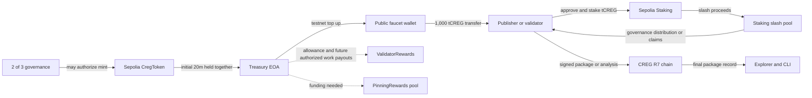

# Chain Registry tokenomics: design, deployed state, and gaps

**As of:** 2026-09-28 21:59 UTC (Sepolia block 11,803,367). **Scope:** the public R7 CREG testnet and its fresh Ethereum Sepolia contracts. This is an engineering and economic design review, not a token valuation or a mainnet promise. No transactions were sent for this review.

## Executive assessment

**Testnet supply decision after this audit (2026-09-28):** The intended R7 target is 42,000,000 **total outstanding** tCREG, with a separate governance-approved faucet allocation. The live figures below are the pre-issuance snapshot. The faucet allocation amount has not been set. See the [testnet supply and faucet decision](CREG_TESTNET_SUPPLY_AND_FAUCET_POLICY_2026-09-28.md).

Chain Registry has two ledgers with different jobs. The R7 CREG chain finalizes package records through four validators; Sepolia holds the ERC-20 tCREG token and the staking, governance, and incentive contracts. The public R7 chain was at height 20 with eight packages when queried. The token contract reports **20,000,000 tCREG outstanding**, **42,000,000 maximum outstanding**, and **22,000,000 currently unminted headroom**. These are real Sepolia contract reads, not projected figures. The public faucet holds **8,000 tCREG**, transfers **1,000 tCREG per successful token claim**, and currently sends **0 Sepolia ETH** per claim. At that fixed amount, its present balance can fund eight more full token drips without a top up.

The whitepaper allocates the initial 20 million among team (4m), investors (3m), community (5m), and treasury (8m). The **fresh Phase C deployment actually passed the same deployer address for all four constructor recipients**, so the entire initial 20m started in one address. No on-chain segregation, lockup, or vesting for those named buckets is established by that deployment. As of the snapshot, the treasury/deployer address held 19,989,590 tCREG. The separate 10,000 tCREG faucet seed was a reviewed testnet transfer, not a fixed faucet allocation in the token contract. [Token constructor](../chain-registry/contracts/CregToken.sol#L38); [fresh deployment script](../chain-registry/contracts/script/DeploySepolia.s.sol#L61); [deployment wrapper](../chain-registry/testnet/phase-c/deploy-fresh-sepolia.ps1#L48); [whitepaper allocation](WHITEPAPER.md#L645); [faucet transfer receipt](testnet-heal-evidence/2026-09-27-production-pipeline-cutover/faucet-funding-receipt.json).

The work reward and pinning contracts exist on Sepolia, but **actual validator and pinning token payouts are currently zero**: `ValidatorRewards.totalPackagesVerified = 0`, `totalRewardsDistributed = 0`, `PinningRewards.rewardsPool = 0`, and `PinningRewards.totalRewardsDistributed = 0`. The node intentionally skips L1 reward dispatch until a durable dispatcher can prove canonical finality and use a governance-authorized call. The whitepaper's language about a live emission hook is ahead of the current implementation. [Node reward gate](../chain-registry/crates/node/src/validator_pipeline.rs#L665); [whitepaper claim](WHITEPAPER.md#L53); [reward contract](../chain-registry/contracts/ValidatorRewards.sol#L143).

## 1. System boundary and token flow

The Sepolia ERC-20 is **not the gas token** for either chain. Sepolia transactions need Sepolia ETH; CREG finality is run by the CREG validator network. tCREG is testnet participation and incentive inventory, and has no verified fiat value in this review. The R7 signed spec pins the fresh token, staking, governance, and validator-reward addresses; its contract map does **not** pin the separate pinning-reward address. The root `testnet/chain-spec.sepolia.json` and parts of the whitepaper still show *older* addresses and must not be used as the R7 deployment source. [Architecture](CREG_SYSTEM_WORKFLOW.md#L47); [R7 spec](../chain-registry/testnet/phase-c/r7/chain-spec.json); [fresh manifest](../chain-registry/testnet/phase-c/deployment-manifest.json); [older whitepaper contract table](WHITEPAPER.md#L581).

### Current R7 Sepolia addresses

| Component | Address | What it holds or controls |
| --- | --- | --- |
| tCREG token | `0xbC2a72107C6765364D0A822a88A6e6C61f30EAa6` | Supply, balances, permit, mint/burn |
| Governance | `0x0AB4Db22A9902B8Ef678aBd408889af22277d24E` | Token owner; 2 of 3 signer threshold |
| Treasury/deployer | `0x3A3206D683441AA91cCA7CD5757B1F0ca463213A` | Initial 20m recipient; reward source; current token balance 19,989,590 |
| Staking | `0x61c00EBe7C46f0bcE63942F7E15Bcc434DFC9B7C` | Publisher and validator bonds; 410 tCREG held |
| ValidatorRewards | `0xf616699ff68E2a310549fa4280475589B0EB0E49` | Future work reward escrow; zero funded/paid |
| PinningRewards | `0xC35C52315492e5A062f3280829Ba714442216B46` | Storage incentive pool; zero funded/paid |
| Public faucet wallet | `0x721C8dBD8208CA9dBdcC12AE9339225458608B81` | 8,000 tCREG plus ~0.0787646 Sepolia ETH for transaction gas |

Addresses are from the [Phase C manifest](../chain-registry/testnet/phase-c/deployment-manifest.json), the [funding receipt](testnet-heal-evidence/2026-09-27-production-pipeline-cutover/faucet-funding-receipt.json), and the live read-only calls described in §7.

## 2. Supply, issuance, and allocation

### 2.1 Supply rules in code

`CregToken` has 18 decimals and ERC-20 style `transfer`, `approve`, `transferFrom`, `balanceOf`, `allowance`, `permit`, `mint`, and `burn`. The constructor mints exactly 20m: 4m team, 3m investors, 5m community, 8m treasury. `mint(to, amount)` requires the **owner** and checks `totalSupply + amount <= 42m`. Ownership has been transferred to the 2-of-3 governance contract on R7. `burn` destroys a holder's balance and reduces `totalSupply`; ordinary slashing and faucet payments move existing tokens rather than minting or burning them. [Token source](../chain-registry/contracts/CregToken.sol#L4); [constructor](../chain-registry/contracts/CregToken.sol#L38); [mint and burn](../chain-registry/contracts/CregToken.sol#L86); [governance source](../chain-registry/contracts/Governance.sol#L126).

| Whitepaper bucket | Constructor amount | Share of 42m cap | R7 disposition |
| --- | ---: | ---: | --- |
| Team | 4,000,000 | 9.52% | Minted to treasury/deployer address |
| Investors | 3,000,000 | 7.14% | Minted to treasury/deployer address |
| Community | 5,000,000 | 11.90% | Minted to treasury/deployer address |
| Treasury | 8,000,000 | 19.05% | Minted to treasury/deployer address |
| Unminted headroom | 22,000,000 | 52.38% | No token balance exists until a governance mint |
| **Maximum outstanding** | **42,000,000** | **100%** | Enforced by token code |

The bucket labels are **an intended initial distribution**, not a demonstrated distribution to four beneficiary wallets on R7. The deployment script contains a conditional path that would transfer **all 20m** to `FAUCET_ADDRESS`; the fresh deployment wrapper explicitly clears that variable, so this path was not used for R7. It should not be mistaken for a policy that the faucet is supposed to receive 20m. [Deployment lines](../chain-registry/contracts/script/DeploySepolia.s.sol#L61); [wrapper](../chain-registry/testnet/phase-c/deploy-fresh-sepolia.ps1#L48).

**Cap nuance:** the code caps *current outstanding supply*, not cumulative lifetime issuance. Burning reduces `totalSupply`, which makes room under the check for a later governance mint. Thus “42m can ever be minted in total” would be too strong. No scheduled inflation, automatic block reward, automatic vesting, or immutable annual issuance curve is present in the token. The whitepaper explicitly leaves a formal reserve-release and vesting policy for later. [Mint check](../chain-registry/contracts/CregToken.sol#L124); [burn](../chain-registry/contracts/CregToken.sol#L130); [mainnet gaps](WHITEPAPER.md#L821).

### 2.2 Observed balances and accounting

At block 11,803,367, live `eth_call` values were: total supply 20m, treasury 19,989,590, faucet 8,000, Staking contract 410, ValidatorRewards 0, PinningRewards 0 tCREG. These named balances total **19,998,000**, leaving 2,000 tCREG in other addresses. That 2,000 is consistent with two 1,000-token faucet transfers, but this snapshot alone does not prove the full transfer history. Contract-level balances are more authoritative than the faucet process's counters. The public faucet API reported only one drip and 1,000 total distributed even though its on-chain wallet had fallen from the documented 10,000 funding transfer to 8,000. Reconcile that operational counter against transfer logs; do not use it as a lifetime accounting ledger. [Funding receipt](testnet-heal-evidence/2026-09-27-production-pipeline-cutover/faucet-funding-receipt.json); [first real drip receipt](testnet-heal-evidence/2026-09-27-production-pipeline-cutover/faucet-real-drip.json); [faucet stats implementation](../chain-registry/crates/faucet/src/main.rs#L1027).

## 3. How incentives are held and paid

| Incentive | Where tokens sit before payout | Trigger and beneficiary | R7 state |
| --- | --- | --- | --- |
| Validator analysis | Treasury EOA, then ValidatorRewards contract on successful `transferFrom` | Active validator with a processed package vote; later `claimRewards` | Dispatcher skipped; 0 packages and 0 tokens reported by contract |
| Publisher/validator bonds | Staking contract | User deposits token; withdrawal under contract rules | 410 tCREG held; 4 active validators |
| Slash redistribution | `Staking.slashPool` inside Staking | Governance distribution or reputation weighted claim epoch for active validators | Pool 0 |
| IPFS pinning | PinningRewards `rewardsPool` and contract balance | Registered pinner with active pins, elapsed days, and available pool | Pool 0; no payouts |
| Faucet grants | Dedicated EOA wallet | Public testnet claim passing controls | 8,000 tCREG remaining |

Validator rewards use treasury **allowance**, not a continuously filled emissions pool. The treasury approved a very large allowance to the reward contract during deployment; allowance is permission, not a reserve transfer. On a successful reward call, the contract pulls each calculated amount into itself and increments `pendingRewards`; the validator claims it later. `totalRewardsDistributed` is therefore a liability/accrual counter in that path, not necessarily a count of tokens already withdrawn by validators. [Deploy approval](../chain-registry/contracts/script/DeploySepolia.s.sol#L92); [reward accrual and pull](../chain-registry/contracts/ValidatorRewards.sol#L223); [claim](../chain-registry/contracts/ValidatorRewards.sol#L343).

### 3.1 Validator work rewards: formula versus current operation

The principal contract path requires a call from Governance or Staking and iterates reported validators. It ignores inactive validators. For one active validator and one recorded vote:

- Correct vote: `0.000010 + 0.000005 + (0.000010 × reputationScore / 500)` tCREG. At reputation 100, **0.000017** tCREG. This payout function does not itself cap the supplied reputation score at 100, despite its documentation saying 0–100; the caller can increase the payout if that input is not validated elsewhere.
- Incorrect vote: `0.000010 - 0.000001 = 0.000009` tCREG.
- The code declares a 0.000001 minimum, but this principal incorrect-vote branch does not reach that floor with its current constants.
- Mandatory versus voluntary committee status affects **points**, not this token payout amount. At reputation 100, an approved vote is awarded 30 mandatory points or 12 voluntary points; the points are not ERC-20 tokens.

The contract also has a simplified payout entry point with different math. It must be treated as a separate implementation path, not as proof that the principal formula is active. The whitepaper's claim that every Verified package already emits an L1 payout is superseded by the node's current explicit skip. The skipped dispatcher is a sensible safety hold: rewards should attach only to canonically finalized records, survive crashes, be idempotent, and be sent by an authorized caller. The contract itself has no per-package replay guard or signed vote verification; an authorized caller can submit the same canonical package repeatedly or supply arbitrary vote/reputation arrays. The present direct-call authorization accepts Governance or Staking, not an ordinary bridge EOA. [Reward formulas](../chain-registry/contracts/ValidatorRewards.sol#L254); [points](../chain-registry/contracts/ValidatorRewards.sol#L216); [authorization](../chain-registry/contracts/ValidatorRewards.sol#L143); [node gate](../chain-registry/crates/node/src/validator_pipeline.rs#L665).

There is an additional correctness issue before reward activation: `_processOne` passes `item.approved` as `votedCorrectly` into `_calculatePoints`, while token payout correctness compares the vote with `packageWasGood`. A correct *reject* vote can therefore lose its points bonus; an incorrect *approve* vote can receive one. `AnalysisCommitteeFinalized` also emits zero sizes/seed placeholders in this function, so that event does not currently represent a complete committee snapshot. The simplified path funds `base/validatorCount` per validator, then may accrue a correct-vote bonus beyond what it pulled, creating a possible underfunded claim liability. These paths need review, repair, and independent audit before activation. [Points call](../chain-registry/contracts/ValidatorRewards.sol#L179); [payout correctness](../chain-registry/contracts/ValidatorRewards.sol#L223); [committee event](../chain-registry/contracts/ValidatorRewards.sol#L167); [simple path](../chain-registry/contracts/ValidatorRewards.sol#L283).

### 3.2 Staking, penalties, and admission

Current base minima are **1 tCREG publisher** and **100 tCREG validator**. Namespace tier defaults are 1 / 3 / 10 tCREG for Standard / Infrastructure / RootCritical, and an owner can tune tier minima; governance can tune the basic publisher and validator minima. The 50 tCREG light-validator constant is present but is not the normal validator-application threshold. Validator applications time out after 7 days; unbonding takes 14 days; slash-ejected validators have a 7-day restake cooldown. The standard severity slash percentages are 2%, 10%, and 30%. Slashed stake stays in the Staking contract and accumulates in `slashPool`; it is not a token burn. Governance can distribute it by active-validator reputation weights, or commit a claim epoch. [Staking parameters](../chain-registry/contracts/Staking.sol#L40); [tier controls](../chain-registry/contracts/Staking.sol#L195); [application](../chain-registry/contracts/Staking.sol#L402); [slashing](../chain-registry/contracts/Staking.sol#L640); [pool](../chain-registry/contracts/Staking.sol#L771).

Publisher liability can be reserved against a package and held for a **30-day** challenge window. Governance or Registry resolves it; a slash moves the reserved amount to the slash pool. R7's staking contract still reports the deployer EOA as its `owner`, while `governance` is the 2-of-3 contract and emergency governance admission remains enabled. Some economic configuration is therefore still controlled by the owner EOA rather than solely by the multisig. [Publisher liabilities](../chain-registry/contracts/Staking.sol#L299); [ownership and tier setters](../chain-registry/contracts/Staking.sol#L195).

### 3.3 Pinning incentives

The separate PinningRewards contract requires **1,000 tCREG** pinner stake. Its default rate is **0.01 tCREG per decimal GB per whole day**. It sums active CID sizes times whole days since the pinner's last claim, applies a 2× multiplier after more than 1,000 reported accesses for a pin, then multiplies by successful-verification ratio if any verifications exist. A failed verification debits 1% of the current pinner stake to the same contract's reward pool. `fundRewardsPool` transfers existing tokens into that pool. This is a time-scaled storage incentive, despite the whitepaper's broad “work-based only” wording. It is **not live as a payable program** while the pool is zero. [Pinning constants](../chain-registry/contracts/PinningRewards.sol#L61); [verification](../chain-registry/contracts/PinningRewards.sol#L224); [calculation](../chain-registry/contracts/PinningRewards.sol#L266); [funding and claim](../chain-registry/contracts/PinningRewards.sol#L305).

Code review exposes material issues to resolve before funding this pool: `reportAccess` is callable by anyone, so the popularity factor can be gamed; `pins` is keyed only by CID while the surrounding lists allow multiple pinners, creating overwrite/accounting risk; a pin registered after an earlier `lastRewardClaim` can accrue days before that pin existed; and `unregisterPinner` calls `_claimRewards` unconditionally, while `_claimRewards` reverts when no reward is due. A pinner with no active pins and no earned reward can therefore be unable to withdraw its stake. The live deployment's rewards admin and verifier roles both include the deployer EOA. [Registration/unregistration](../chain-registry/contracts/PinningRewards.sol#L118); [CID map and access](../chain-registry/contracts/PinningRewards.sol#L169); [reward claim](../chain-registry/contracts/PinningRewards.sol#L305).

## 4. Faucet: exact intended and available supply

**There is no fixed faucet supply in `CregToken.sol`, the R7 signed chain spec, or the whitepaper allocation table.** The intended public R7 operating profile is a **prefunded wallet**, not an independent mint. The exact reviewed seed was **10,000 tCREG from the treasury**, confirmed in Sepolia transaction `0x39894f356780e065fd9f3d676a458a6d639b8e69a8d7a71b48de860cc530537f`. A real 1,000-token claim was confirmed in transaction `0x02e62d21637b4dbcf4b10522550b09eb367c88447fb6c321ed6ab656f3ca1a0b`. The wallet now has 8,000 tCREG. The separate script comment about *20m for a faucet* describes an unused conditional deployment route, not the amount approved or transferred. [Funding proposal](testnet-heal-evidence/2026-09-27-production-pipeline-cutover/faucet-funding-proposal.json); [receipt](testnet-heal-evidence/2026-09-27-production-pipeline-cutover/faucet-funding-receipt.json); [real claim](testnet-heal-evidence/2026-09-27-production-pipeline-cutover/faucet-real-drip.json); [deployment script](../chain-registry/contracts/script/DeploySepolia.s.sol#L64).

| Faucet parameter | Public service on 2026-09-28 | Meaning |
| --- | ---: | --- |
| Token transfer | 1,000 tCREG | Fixed amount per successful token request |
| Wallet reserve | 8,000 tCREG | Eight nominal further full drips without replenishment |
| Address cooldown | 60 seconds | Durable PostgreSQL key; IP cooldown also defaults to 60 seconds |
| Address balance threshold | 10,000 tCREG | Claim skipped when pre-claim balance is already at/above threshold |
| Native ETH drip | 0 ETH | Faucet wallet's ~0.0788 ETH pays its own transaction gas; users must obtain Sepolia ETH elsewhere |
| Native balance threshold | 1 ETH | Irrelevant while native drip is zero |
| Proof of work | 20 leading zero bits, 120-second challenge | Browser anti-abuse control, unless operator disables it |

Values come from the live [faucet stats API](https://faucet.testnet.cregnet.dev/api/stats) and [faucet implementation](../chain-registry/crates/faucet/src/main.rs#L83). The wallet must also have enough Sepolia ETH to *send* its ERC-20 transfer; the nominal eight-claim capacity is conditional on gas and service health. There is no permanent per-address distribution cap: spending or moving tokens below the 10k threshold permits another claim after cooldown. The code checks `balance < max_balance` **before** adding 1,000, so a wallet below 10k could finish above 10k. The public interface should accurately say token-only claims while native gas drip is zero. [Eligibility](../chain-registry/crates/faucet/src/main.rs#L864); [transfer](../chain-registry/crates/faucet/src/main.rs#L1009); [health](../chain-registry/crates/faucet/src/main.rs#L1212).

The cooldown table is durable and atomically claims address and IP keys before a transfer; if its database is unavailable, the faucet fails closed. The `stats` totals, however, are in process memory and do not reconstruct on-chain distribution history after restart. Client IP is read from forwarded headers, which requires a trusted proxy boundary; otherwise IP-based throttling can be spoofed. These are operational controls, not supply constraints. [PostgreSQL limiter](../chain-registry/crates/faucet/src/main.rs#L124); [client IP parsing](../chain-registry/crates/faucet/src/main.rs#L852); [stats update](../chain-registry/crates/faucet/src/main.rs#L1027).

## 5. Fees, governance, and demand assumptions

CREG does not currently charge a general per-block or per-package token fee in the public R7 protocol. The legacy `zkValidationFee` is configured as zero and its qualification path is disabled. Appeal bonds are denominated in Sepolia ETH (0.1 ETH for an appeal, 0.01 ETH per panelist vote), not tCREG. The current token demand is mainly testnet staking plus prospective validator/pinner rewards; a market demand, fee capture, buyback, or treasury revenue model is **not established** by the current whitepaper. Gas costs are external Sepolia ETH costs. [Whitepaper fee table](WHITEPAPER.md#L771); [R7 feature flags](../chain-registry/testnet/phase-c/r7/chain-spec.json).

Governance is a 2-of-3 Sepolia multisig contract. It owns the token and can propose mint transactions up to the cap. The treasury EOA separately controls the existing 20m balance, and the deployment grants ValidatorRewards a near-unlimited treasury allowance. The multisig's mint control therefore does **not** alone govern transfers out of the already-minted treasury. Staking owner powers and pinning admin/verifier powers also remain with the deployer EOA on R7. These are significant concentration and custody facts for the testnet design. [Governance](../chain-registry/contracts/Governance.sol#L126); [deployment wiring](../chain-registry/contracts/script/DeploySepolia.s.sol#L61); [staking owner controls](../chain-registry/contracts/Staking.sol#L219); [pinning roles](../chain-registry/contracts/PinningRewards.sol#L110).

### Sustainability example, with limits

If four active validators each earned **0.000017** tCREG at reputation 100 for one finalized package, the contract would move **0.000068** tCREG from treasury per package. One million such packages would use **68 tCREG**. This is an arithmetic illustration of the *formula*, **not a forecast, payout cap, or current payout rate**: the reputation input is not capped inside the reward calculation, live emissions are zero, and package volumes, gas, operator expenses, future parameters, and token value are unknown. A small token payout does not itself prove that validation is economically attractive or that the token will have a high market price. [Formula](../chain-registry/contracts/ValidatorRewards.sol#L254); [whitepaper open modeling need](WHITEPAPER.md#L821).

## 6. Ranked gaps and decisions

1. **Publish a real allocation and custody policy.** Decide whether team, investor, community, treasury, and faucet inventories are separate wallets/contracts; set vesting, lockups, replenishment, signers, spending limits, public reporting, and reserve mint schedule. R7 currently holds the 20m constructor allocation together in one EOA. Remove or cap the latent `FAUCET_ADDRESS` deployment path that would transfer the full 20m.
2. **Keep validator payouts disabled until finality-safe dispatch is designed and audited.** Bind one reward event to one canonical finalized package and final vote set; require authorization that the real dispatcher can use; persist intent, receipt, and retry state; prevent replay on-chain; fix points correctness and the simplified-path funding mismatch. Do not infer that Verified package records mean L1 rewards were paid.
3. **Do not fund the pinning pool yet.** Repair stake withdrawal when rewards are zero, CID ownership/accounting, access-report authorization, and time accrual; then define verifier evidence and governance control before putting tokens into the pool.
4. **Set an explicit testnet faucet budget.** The current approved seed is 10k and remaining reserve 8k. State a total program allocation, per-day and lifetime spend caps, replenishment authority, and a gas policy. Reconcile public counters from ERC-20 transfers and show the native drip as disabled while set to zero. Harden trusted-proxy client-IP handling and post-claim balance enforcement.
5. **Align public documentation and signed spec.** Update the whitepaper's old Sepolia address table and reward-hook assertions for R7; pin the pinning contract in the appropriate signed spec if it is part of the intended public interface; distinguish designed incentives from actual distributions.
6. **Before mainnet economics:** obtain external contract/security review; formalize mint/burn semantics and any cumulative issuance constraint; model security budgets, validator operating costs, real package demand, treasury runway, and adverse cases. No current file supplies a defensible APY, release calendar, token price, or fiat value.

## 7. Evidence and reproducibility

The live figures above came from **read-only** `eth_call`, `eth_getCode`, and `eth_getBalance` via `https://ethereum-sepolia-rpc.publicnode.com` at block 11,803,367, cross-checked with the public faucet `/api/stats` endpoint and the R7 API `/v1/public/chain/stats`. The token's live bytecode hash was `0xee4ee60af45e022c2673e37e21781b5d88d97164e768ad1d65293122aa1d2b16`, matching the hash recorded in the approved faucet funding proposal. No independent source-to-bytecode compiler reproduction was completed for every deployed contract, so code findings describe repository source and should be confirmed against verified deployed artifacts before a mainnet decision. Public block-explorer entry: [R7 Sepolia token](https://sepolia.etherscan.io/address/0xbC2a72107C6765364D0A822a88A6e6C61f30EAa6). ERC-20 `balanceOf`, `totalSupply`, `approve`, and `transferFrom` semantics are also described by [Ethereum's ERC-20 standard documentation](https://ethereum.org/developers/docs/standards/tokens/erc-20/).

**Source precedence:** live contract values and transactions for current balances; R7 manifest and signed spec for current addresses; repository contract/runtime code for mechanics; whitepaper/workflow for intent. These sources disagree in places. The whitepaper itself labels current tokenomics as alpha parameters and calls for formal emission, vesting, and audit work. [Whitepaper caveats](WHITEPAPER.md#L821).
