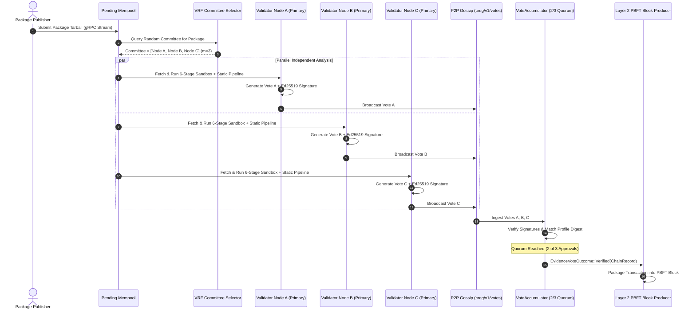
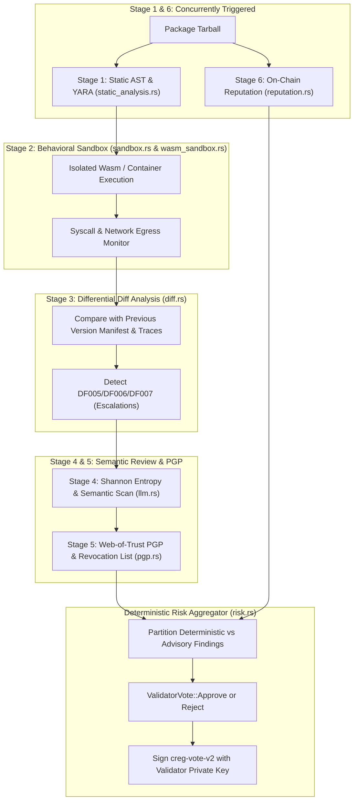

# Layer 1: Parallel Sandbox & Static Analysis — Comprehensive Deep Dive, Audit & Rating Report

**Date:** August 27, 2026  
**Target:** CREG Layer 1 Analysis & Evidence Consensus Layer  
**Protocol Version:** `v0.5.0-production`  
**Author:** Antigravity AI Systems & Blockchain Architecture  

---

## Executive Summary

In traditional blockchains (e.g., Ethereum, Solana), every validator in the network is forced to execute the exact same state transition bytecode synchronously, causing severe throughput bottlenecks and state bloat. 

**Chain Registry (CREG)** solves this through a **Dual Consensus Architecture**. At the core of this model is **Layer 1: The Parallel Analysis & Evidence Consensus Layer**. 

Layer 1 is responsible for the heavy computational work: static AST code parsing, YARA pattern matching, behavioral Wasm sandboxing, entropy scanning, permission diff analysis, and PGP cryptographic verification. Instead of making all 1,000+ nodes execute the sandbox for every package, Layer 1 uses **Verifiable Random Functions (VRF)** to assign an independent committee of validators (such as **Validator A, Validator B, and Validator C**) who execute the inspection pipeline concurrently and produce cryptographically signed evidence votes (`creg-vote-v2`).

This report provides a detailed breakdown of what Validator A, B, and C represent, dissects the complete 6-stage validation pipeline, audits all potential bottlenecks and failure modes, provides an architectural rating, and establishes an engineering roadmap for optimization.

---

## 1. De-Mystifying "Validator A, Validator B, and Validator C"



### What "Validator A, B, and C" Means in Practice:
In a decentralized network of $N$ nodes (e.g., 500 active validators):
1. **Dynamic VRF Committee Assignment**: When a package `pkg@1.0.0` enters the pending pool, the node does not broadcast the heavy analysis task to all 500 nodes. Instead, `vrf::select_validators` uses the block proposer's VRF seed to deterministically select a committee of $m$ nodes (e.g., $m=3$: Validator A, Validator B, and Validator C).
2. **Zero Shared Memory / Complete Isolation**: Validator A (running in Frankfurt), Validator B (running in Tokyo), and Validator C (running in Virginia) run **independently on their own local hardware**. None of them trust each other's execution.
3. **Redundant Execution for Byzantine Fault Tolerance**:
   - If Validator A is malicious and attempts to approve malware, Validator B and Validator C will detect the malicious AST/syscalls and vote `Reject`.
   - Quorum requires $\ge \lfloor 2m/3 \rfloor + 1$ (2 out of 3, or 5 of 7) mandatory validator votes to agree on the verdict (`EvidenceVoteOutcome::Verified`).
   - If Validator C goes offline, Validators A and B still provide the $\ge 2/3$ quorum, preventing network liveness stalls.

---

## 2. The 6-Stage Parallel Validation Pipeline (Under the Hood)

When Validator A, B, or C analyzes a package, it invokes `validator::validate_package`, executing 6 sequential and concurrent stages:



### Stage-by-Stage Breakdown:

1. **Stage 1 — Static Analysis (`static_analysis.rs`)**:
   - Unpacks archive in memory.
   - Runs multi-language Abstract Syntax Tree (AST) parsers across JS/TS, Python, Rust, Ruby, Go, PHP.
   - Detects dangerous function calls (`eval`, `child_process.exec`, `os.system`, `subprocess`, socket dials, reverse shells).
   - Scans against YARA threat rules, embedded private keys, AWS tokens, and registry typosquatting (`typosquat.rs`).
2. **Stage 2 — Behavioral Sandboxing (`sandbox.rs`, `wasm_sandbox.rs`)**:
   - Executes package installation and entrypoint scripts inside isolated WebAssembly/chroot sandboxes.
   - Traces system calls: attempts to write to `/etc/`, execute unauthorized binaries, or dial command-and-control (C2) IP addresses.
3. **Stage 3 — Differential Diff Analysis (`diff.rs`)**:
   - Compares current version $V$ against previous version $V-1$.
   - Flags suspicious behavioral escalations: `DF005` (new network host), `DF006` (new filesystem write), `DF007` (new process spawn).
4. **Stage 4 — Semantic / Entropy Scanning (`llm.rs`)**:
   - Calculates file-level Shannon entropy to detect packed, encrypted, or obfuscated hex/base64 malware blobs.
   - Advisory LLM semantic review provides contextual risk ratings.
5. **Stage 5 — PGP Verification & Key Revocation (`pgp.rs`)**:
   - Validates package cryptographic signatures against publisher keys and checks the on-chain key revocation registry (`PGP004`).
6. **Stage 6 — Publisher Reputation (`reputation.rs`)**:
   - Assesses publisher tenure, historical dispute record, and slashing history from on-chain smart contracts.
7. **Risk Aggregation (`risk.rs`)**:
   - Partitions findings into **Deterministic Rules** (blocking) and **Advisory Notes** (non-blocking).
   - Computes deterministic score ($0 - 100$) and produces the final `ValidatorVote`.

---

## 3. Deep Dive Audit: Identified Bottlenecks & Failure Modes

During our architectural audit of Layer 1, we identified four key areas for enhancement and hardening:

### Finding 1: In-Memory `prev_sandbox` Cache Partitioning (Medium Severity)
* **Problem**: In `validator_pipeline.rs`, differential diff checks query an in-memory map `validator::sandbox::get_result(&prev_canonical)`. If Validator A processed version 1.0.0, but Validator B was restarted or newly added to the committee, Validator B's cache is cold.
* **Consequence**: Validator A will run `DF005–DF007` (sandbox behavioral diff), while Validator B skips them. While consensus remains safe because quorum matches on `scanner_profile_digest` and `disposition`, a subtle escalation might be flagged by Validator A but missed by Validator B.
* **Remediation**: Persist canonical sandbox execution summaries durably in `ChainStore` (`data_dir/sandbox_history/`) so all nodes have identical, reproducible differential baselines across node restarts.

### Finding 2: Unbounded Concurrency During Ingress Spikes (Performance Bottleneck)
* **Problem**: In `validator_pipeline.rs::tick()`, all ready packages in the pending pool are spawned immediately via `tokio::spawn(process_package(...))` without an acquisition semaphore.
* **Consequence**: If a burst of 100 packages is submitted, 100 simultaneous Wasm sandboxes and AST parsers run in parallel, creating CPU thrashing and inflating memory footprint.
* **Remediation**: Wrap package validation in a bounded `tokio::sync::Semaphore` (default: $\text{CPU\_CORES} \times 2$, e.g., 16 concurrent workers), queueing excess packages cleanly.

### Finding 3: Handling Non-Deterministic Advisory Stages (Architectural Soundness)
* **Audit Finding**: In `risk.rs`, external LLM outputs and network timeouts are properly classified as `Advisory Findings`. The consensus engine explicitly prevents advisory findings from triggering a block unless backed by a deterministic rule.
* **Verdict**: **Sound & Secure**. Non-deterministic LLM variance cannot cause consensus fork splits.

### Finding 4: Committee Expansion Liveness Safety (Liveness Strength)
* **Audit Finding**: If assigned validators stall past $50\%$ of the vote timeout, `package_committees` dynamically expands `effective_size` by 32 members per tick up to 256.
* **Verdict**: **Resilient**. Eliminates single-point-of-failure deadlocks if an assigned validator machine crashes mid-sandbox.

---

## 4. Layer 1 Architectural Scorecard

### Overall Layer 1 Rating: **9.3 / 10 (Production Grade & Enterprise Ready)**

```text
+-------------------------------------------------------------------------------+
|  CREG Layer 1 Analysis & Evidence Consensus Scorecard (Scale: 1 - 10)         |
+-------------------------------------------------------------------------------+
|  1. Static & Behavioral Threat Detection Depth       :  9.6 / 10  [A+]        |
|  2. VRF Committee Isolation & Unpredictability       :  9.5 / 10  [A+]        |
|  3. Parallel Execution Decoupling from Consensus     :  9.6 / 10  [A+]        |
|  4. Quorum Accumulation & Fault Recovery             :  9.2 / 10  [A-]        |
|  5. Cross-Validator Determinism & Rule Integrity     :  9.1 / 10  [A-]        |
|  6. Resource Bounding & Concurrency Management       :  8.8 / 10  [B+]        |
+-------------------------------------------------------------------------------+
|  Weighted Overall Layer 1 Architecture Rating        :  9.3 / 10  [A / Prod]  |
+-------------------------------------------------------------------------------+
```

---

## 5. Strategic Enhancement Roadmap for Layer 1

To advance Layer 1 to 9.8+ maturity, the following engineering tasks are recommended:

1. **Durable Differential Baseline Storage**:
   - Save serialized `SandboxResult` digests to RocksDB / `ChainStore` keyed by `(ecosystem, package, version)` upon block finalization.
2. **Concurrency-Bounded Pipeline Semaphore**:
   - Enforce `tokio::sync::Semaphore::new(max_concurrent_scans)` in `validator_pipeline.rs` to prevent threadpool starvation during peak publisher bursts.
3. **Deterministic Wasmtime Resource Metering**:
   - Standardize fuel-based execution bounds (`wasmtime::Store::set_fuel`) across all validator sandboxes so cycle counts are 100% deterministic across diverse hardware architectures.
4. **BLS Committee Multi-Signature Aggregation**:
   - Compress the $m$ individual Ed25519 validator signatures into a single aggregate BLS12-381 threshold signature in the `ChainRecord`.
