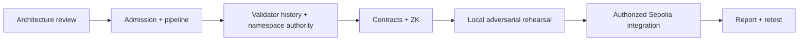

# SEC-401 — External security audit scope

**Status:** Draft for vendor RFP / internal red-team scheduling; vendor and
independent reviewer not yet selected
**Parent:** [archive/SECURITY_AND_REMEDIATION_IMPLEMENTATION_PLAN.md](./archive/SECURITY_AND_REMEDIATION_IMPLEMENTATION_PLAN.md) Epic 3.5  
**Target network:** Sepolia testnet (`creg-testnet-1`) — not mainnet

---

## 1. Objectives

1. Validate that **package admission** and **validator pipeline** cannot be bypassed to land malicious or unstaked packages on the verified set.
2. Review **L1 staking and registry** contracts for fund safety, role abuse, and event/log assumptions used by off-chain sync.
3. Confirm **operational controls** (spec signing, hot keys, rate limits, operator API) match documented threat model.
4. Review **authenticated validator-set history, weak-subjectivity bootstrap,
   committee assignment, and reorg behavior** across new and rebuilt nodes.
5. Review **npm/PyPI namespace authority** end to end: upstream evidence,
   verifier isolation, policy/trust pins, signed activation, validator quorum,
   archive pressure, lifecycle replay, and recovery.
6. Review the **ZK circuit and contract integration** sufficiently to validate
   the repository's narrow claim that current public inputs bind
   content/manifest limbs. ZK qualification remains retired regardless of the
   review outcome.
7. Produce a **prioritized finding list** (P0–P3) with reproduction steps suitable for [REMEDIATION_BACKLOG.md](./REMEDIATION_BACKLOG.md).

**Out of scope (this engagement):** Mainnet deployment, revival of
`PrivateRegistry`, production enablement of cross-chain features
(`cross_chain: false`), governance UI, and frontend wallet UX beyond
relayer/sponsor paths. A full formal proof of the Circom/Groth16 construction
may be separately quoted, but circuit constraints, public-input order,
verifier-key provenance, trusted-setup/key handling, and Solidity binding are
in scope.

---

## 2. In-scope components

### 2.1 Off-chain — admission and validation

| Component | Path | Focus |
|-----------|------|--------|
| Package admission | `chain-registry/crates/node/src/package_admission.rs` | Stake checks, YARA gate, shielded path (`CREG_SHIELDED_PUBLISH_ENABLED`), rate limits |
| Pre-mempool scan | `chain-registry/crates/node/src/admission_scan.rs` | IPFS fetch, malware rules, shielded skip semantics |
| Validator pipeline | `chain-registry/crates/node/src/validator_pipeline.rs` | ML/ZK stages, vote aggregation, evidence digests |
| Publish / submit API | `chain-registry/crates/node/src/api.rs` (publisher routes) | AuthN on publish, signature message, gRPC + REST parity |
| Validator set sync | `chain-registry/crates/node/src/validator_set_sync.rs` | `eth_getLogs` chunking, cursor, reorg handling |
| Certified validator history | `chain-registry/crates/node/src/validator_set_history.rs`, `sync.rs`, `p2p.rs`, `api.rs` | Prior-set quorum, transition continuity, dedicated gossip, checkpoint ancestry, canonical anchors, reorg truncation, rebuilt/late node behavior |
| Committee assignment | `chain-registry/crates/node/src/package_admission.rs`, `validator_pipeline.rs` | One snapshot-bound assignment, public randomness derivation, assignment-proof verification, mandatory-mode migration |
| Namespace authority | `chain-registry/crates/node/src/authority_adapter.rs`, `authority_archive.rs`, `namespace_consensus.rs`, `api.rs` | Exact npm/PyPI evidence/artifact binding, external-process isolation, executable/policy/trust pins, quorum statements, archive quota/retention/GC, authenticated routes |
| Ownership lifecycle | `chain-registry/crates/common/src/ownership.rs`, `node/src/chain_store.rs`, `pending_pool.rs` | Claim/delegate/transfer/recover domains, durable nonce/replay, restart/rebuild/reorg, conflicting controllers |
| P2P gossip validation | `chain-registry/crates/node/src/p2p.rs` | Vote, PBFT, and validator-transition domain separation; independently checked gossipsub acceptance; bounds and rejection metrics |
| Node config / key gate | `chain-registry/crates/node/src/config.rs`, `main.rs` | Fatal on bad/missing `CREG_VALIDATOR_KEY` when `CREG_IS_VALIDATOR=true` |
| Chain spec boot | `chain-registry/crates/node/src/chain_spec_boot.rs`, `main.rs` | Signature verify, pinning, cache fallback |
| CLI publish | `chain-registry/crates/cli/src/publish.rs` | Signing, IPFS pin, shielded wire format |
| Shared wire | `chain-registry/crates/common/src/shielded_wire.rs` | Encrypt/decrypt round-trip, canonical hashes |
| Authority sidecars | `chain-registry/tools/authority-adapters/` | Strict framing, cryptographic verification, archive parsing, self-contained release artifact, fail-closed npm authentication-mode gate |
| Activation/checkpoint gates | `chain-registry/scripts/validate-cr07-activation.mjs`, `verify-weak-subjectivity-checkpoint.mjs` | Canonicalization, signatures, mirror consistency, rollback/replay/fork/long-range rejection, ceremony assumptions |

### 2.2 Smart contracts (Sepolia deployment)

| Contract | Path | Focus |
|----------|------|--------|
| **Staking.sol** | `chain-registry/contracts/Staking.sol` | `stakeAsPublisher`, `joinAsValidator`, slash/withdraw, permit path |
| **Registry.sol** | `chain-registry/contracts/Registry.sol` | Package lifecycle, validator-signature domain/decision/set/expiry binding, replay, pause/revocation, appeals linkage |
| **ZKVerifier.sol and circuits** | `chain-registry/contracts/ZKVerifier.sol`, `circuits/` | Constraint completeness, public-input ordering, content/manifest binding, verifier-key/setup provenance, Solidity pairing integration; qualification stays retired |
| **CregToken.sol** | `chain-registry/contracts/CregToken.sol` | Mint/transfer assumptions for stake |
| **Governance.sol** | `chain-registry/contracts/Governance.sol` | Low priority (UI disabled); admin paths |
| **Reputation.sol**, **Appeal.sol** | respective files | Secondary; time-boxed |

**Addresses:** From `chain-registry/testnet/chain-spec.sepolia.json` (`contracts.*`).

### 2.3 Supporting services

| Service | Path | Focus |
|---------|------|--------|
| Secrets loader | `chain-registry/crates/secrets/` | Env vs Vault, prod gate |
| Faucet / relayer | `chain-registry/crates/faucet/`, `relayer/` | Hot-key warnings, sponsorship abuse |
| Bridge worker | `chain-registry/crates/node/src/bridge.rs` | `CREG_BRIDGE_KEY` usage |
| Rate limiting | `chain-registry/crates/node/src/rate_limit.rs` | `/v1/publisher/*`, `/v1/validator/*` buckets |

### 2.4 Infrastructure (light touch)

| Artifact | Path | Focus |
|----------|------|--------|
| Network partition test | `chain-registry/k8s/55-network-partition-test.yaml` | Complement to SEC-402; auditors may review manifest |
| Prod compose / K8s | `docker-compose.prod.yml`, `k8s/` | Unsafe env flags, TLS, operator API key |
| Contract CI/release inputs | `.github/workflows/contract-ci.yml`, `chain-registry/scripts/bootstrap-foundry-dependencies.sh`, `foundry.toml` | Immutable revisions, toolchain provenance, clean-checkout reproducibility |
| Authority deployment inputs | signed chain spec, activation manifest, verifier/policy/trust artifacts | Exact bytes and signatures, read-only mounts, sandbox/network denial, SBOM/provenance, rollback |

---

## 3. Threat model (summary)

| Threat | Mitigation under review |
|--------|-------------------------|
| Unstaked publisher submits package | On-chain stake read in admission |
| Malware in tarball | YARA pre-mempool + pipeline ML/hash stages |
| Shielded publish bypass (wrong hash) | SEC-305 wire format + admission skip rules |
| Fake validator votes | Ed25519 + validator set from L1 logs |
| Spec substitution attack | Ed25519 spec signature + pinned pubkey |
| Hot key exfiltration | Runbook + fingerprints; Vault ADR |
| DoS on public API | Rate limits; cluster limit ADR deferred (SEC-307) |
| PBFT partition | SEC-402 chaos test (separate deliverable) |
| Long-range or conflicting validator history | Prior-set quorum certificates plus independently verified weak-subjectivity checkpoint |
| Committee selected from unauthenticated authority | Snapshot-bound assignment proof and mandatory certified mode |
| First-submitter namespace takeover | Signed-spec-pinned npm/PyPI authority observation plus prior-set validator quorum |
| Forged recovery or lifecycle replay | Chain/genesis/controller domain, durable nonce, expiry, prior-event hash, authority certificate |
| Sidecar or policy substitution | Complete verifier artifact, policy, trust-root hashes in the signed chain spec |
| Archive exhaustion or corrupt evidence | Pairwise admission quota, minimum retention, pressure GC, corruption/symlink rejection; shared-filesystem coordination remains a review item |
| npm provenance misrepresented as trusted publishing | Unconditional fail-closed authentication-mode gate until npm supplies an official signed signal |

---

## 4. Test environment

Auditors receive:

1. This repo at commit: _______________
2. [TESTNET_SEPOLIA_RUNBOOK.md](./TESTNET_SEPOLIA_RUNBOOK.md) and [../chain-registry/testnet/OPERATOR.md](../chain-registry/testnet/OPERATOR.md)
3. Sepolia RPC (operator-provided key or shared read-only endpoint)
4. Exact test-result inventory and remediation tracker for the selected commit
5. Exact candidate verifier, policy, trust, SBOM, provenance, signed chain
   spec, detached signature, checkpoint evidence, and deployment hashes; if
   any item is absent, the corresponding feature remains disabled
6. A local multi-node environment for destructive tests and, only after
   authorization, separately controlled testnet operators

**Deliverable environment:** local destructive lab plus Sepolia where
explicitly authorized. No mainnet keys. The currently recorded four-validator,
zero-bootnode Sepolia topology is coordinated research alpha and cannot supply
Byzantine fault-tolerance evidence. The public GCP fleet is paused.

---

## 5. Deliverables

| # | Deliverable | Due |
|---|-------------|-----|
| 1 | Kickoff + architecture walkthrough (2h) | Week 1 |
| 2 | Threat model alignment memo | Week 1 |
| 3 | Draft findings (rolling) | Weeks 2–3 |
| 4 | Final report (PDF/Markdown) with severity, PoC, recommendation | Week 4 |
| 5 | Retest window for P0/P1 fixes (optional) | Week 5–6 |

---

## 6. Acceptance criteria (SEC-401 done)

- [ ] Scope document approved by engineering lead
- [ ] Vendor or internal red-team **scheduled** with start date
- [ ] In-scope file list matches Section 2 (or written delta)
- [ ] Findings tracked in backlog with IDs
- [ ] Exact reviewed commit, toolchain, binaries, policies, trust roots,
      chain spec, checkpoint, and deployment hashes recorded
- [ ] Critical/high findings retested or explicitly accepted by the authorized
      risk owner
- [ ] Final report and retest report independently signed or otherwise
      authenticity-verifiable

---

## 7. Suggested audit phases

---

## 8. References

- [SECURITY_OPS_RUNBOOK.md](./SECURITY_OPS_RUNBOOK.md)
- [REMEDIATION_BACKLOG.md](./REMEDIATION_BACKLOG.md) (SEC-303c cross-chain deferral)
- [WALLET_KEY_DERIVATION.md](./WALLET_KEY_DERIVATION.md)
- [adr/ADR-KMS-HOT-KEYS.md](./adr/ADR-KMS-HOT-KEYS.md)

---

## 9. Vendor outreach

Email template and checklist: [SEC-401-VENDOR-OUTREACH.md](./SEC-401-VENDOR-OUTREACH.md)

Generate send-ready copy (pinned tag + SHA): from `chain-registry/`, run `.\testnet\prepare-sec-401-outreach.ps1 -Tag v0.4.3-testnet` → [archive/SEC-401-outreach-ready.md](./archive/SEC-401-outreach-ready.md).

When a vendor confirms, update [NEXT_WORK.md](./NEXT_WORK.md) SEC-401 booking table with vendor name and start date.

---

_Update status in [REMEDIATION_BACKLOG.md](./REMEDIATION_BACKLOG.md) when vendor is selected._
