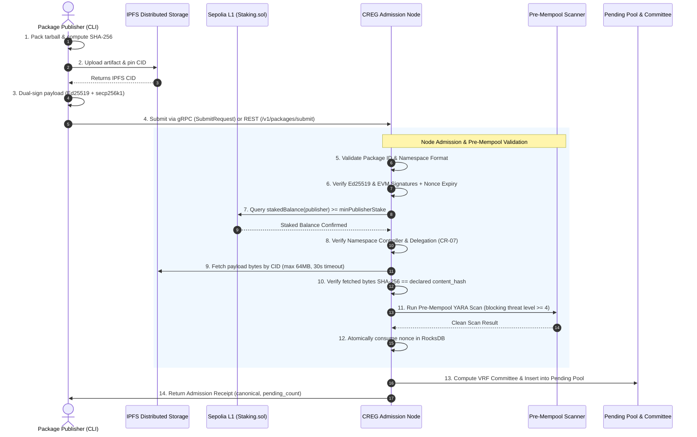
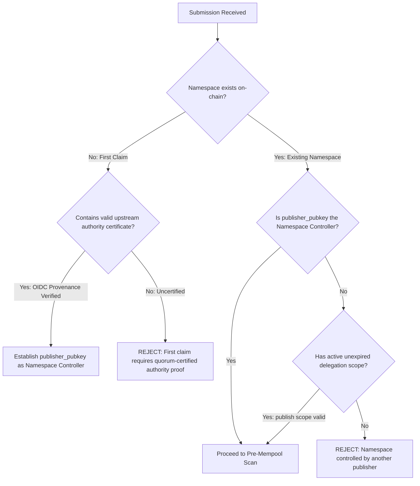

# CREG Submission Layer — In-Depth Technical Report

**Date:** August 27, 2026  
**Protocol Version:** `v0.4.4-testnet` (Public Alpha)  
**Layer Focus:** Submission, Admission Control, Publisher Dual-Key Authentication & Pre-Mempool Gates  
**Primary Implementations:** `crates/cli/src/publish.rs`, `crates/node/src/package_admission.rs`, `crates/node/src/admission_scan.rs`, `contracts/Staking.sol`

---

## Executive Summary

The **Submission Layer** is the first security perimeter and entry gate of the Chain Registry (CREG) network. Its primary objective is to prevent malicious, spam, or forged package payloads from entering the validator consensus mempool while providing cryptographically non-repudiable package provenance.

Unlike Web2 registries (npm, PyPI) that rely purely on centralized bearer tokens or single account credentials, CREG combines:
1. **Decentralized Content-Addressing (IPFS + SHA-256)**
2. **Dual-Key Identity Binding (Ed25519 CLI Key + EVM EIP-191 Address)**
3. **On-Chain Economic Staking & Liability Locks (`Staking.sol` on Sepolia)**
4. **Authoritative Namespace Ownership & Delegations (CR-07)**
5. **Pre-Mempool Byte Verification & YARA Malware Gating**
6. **Deterministic Committee Assignment at Ingestion**

---

## 1. End-to-End Submission Pipeline Architecture



---

## 2. Component-by-Component Deep Dive

### 2.1 Artifact Preparation & Content Addressing
* **Canonical Identity:** Every package is assigned a canonical identifier following the format `<ecosystem>:<name>@<version>` (e.g., `npm:lodash@4.17.21`, `pypi:requests@2.31.0`, `cargo:serde@1.0.197`).
* **Content Addressing:** The CLI reads the archive (`.tar.gz`, `.tgz`, `.whl`) and computes:
  $$\text{content\_hash} = \text{SHA-256}(\text{tarball\_bytes})$$
* **Decentralized Storage:** The payload is uploaded to IPFS using `pin_to_ipfs_with_progress` and pinned (`/api/v0/pin/add`), returning a canonical IPFS Content Identifier (CID).
* **Optional Confidentiality (Shielded Mode):** If the `--shield` flag is passed, the CLI encrypts the artifact with AES-256-GCM, splits the key using Shamir secret sharing among validator keys, and uploads the ciphertext CID.

---

### 2.2 Dual-Key Cryptographic Identity (Publisher Authorization v4)

CREG enforces a strict **Dual-Identity Proof** linking off-chain package signing keys with on-chain economic accounts:

```text
                           +-------------------------------------+
                           |      Publisher Dual Identity        |
                           +------------------+------------------+
                                              |
                     +------------------------+------------------------+
                     |                                                 |
                     v                                                 v
        +-------------------------+                       +-------------------------+
        |   Ed25519 Signing Key   |                       |    EVM secp256k1 Key    |
        |  (Protocol Signature)   |                       |  (Economic Staking Key) |
        +------------+------------+                       +------------+------------+
                     |                                                 |
                     v                                                 v
        +---------------------------------------------------------------------------+
        |                  Publisher Authorization v4 Payload                       |
        |                                                                           |
        | - chain_id & network_genesis_hash                                         |
        | - staking_contract address                                                |
        | - canonical package_id & content_hash                                     |
        | - source_hash & manifest_hash                                             |
        | - ipfs_cid & shielded flag                                                |
        | - publisher_pubkey (Ed25519) & publisher_address (0x EVM)                 |
        | - ownership_claim & cryptographic nonce                                   |
        | - submitted_at & publisher_expires_at (max 24h)                           |
        | - threshold & multi-sig keyset (if M-of-N configured)                     |
        | - authority_proof_digest & certificate_digest (CR-07)                     |
        +---------------------------------------------------------------------------+
```

1. **Ed25519 Key:** Provides high-speed, deterministic cryptographic non-repudiation over the package payload.
2. **EVM Key (EIP-191):** The publisher signs the same structured message using personal sign (`\x19Ethereum Signed Message:\n32...`) with their Ethereum private key (`CREG_PUBLISHER_EVM_KEY`).
3. **Multi-Signature Policy:** Supports enterprise publishing where $M$-of-$N$ threshold keys must sign before the payload is submitted.
4. **Anti-Replay & Freshness Controls:**
   - Monotonic 16-byte random hexadecimal nonce.
   - Strict timestamp window: `submitted_at` must not drift $>300\text{s}$ into the future, and `publisher_expires_at` has a hard 24-hour limit.

---

### 2.3 On-Chain Staking & Economic Liability (`Staking.sol`)

Before any package is admitted into the validation pipeline, the node performs an on-chain RPC query against the Sepolia `Staking.sol` contract:

```solidity
interface IPublisherStakingRead {
    function stakedBalance(address publisher) external view returns (uint256);
}
```

* **Minimum Staking Gate:** Requires `stakedBalance(publisher) >= minPublisherStake` (default: $1.0\text{ }tCREG$).
* **Liability Period:** When a package is finalized, a publisher liability bond is reserved for `PUBLISHER_LIABILITY_PERIOD` (30 days). If the package is subsequently proven to contain malicious payloads or backdoor exploits, the publisher's stake is slashed via `Registry.sol` and distributed to honest validators and affected parties.
* **Fail-Closed RPC Requirement:** If the Ethereum RPC node is unreachable or `CREG_STAKING_ADDR` is unconfigured, the node rejects the submission (`PublisherAdmissionError::Unavailable`).

---

### 2.4 Authoritative Namespace Ownership & Delegations (CR-07)

CREG eliminates first-come, first-served namespace squatting through cryptographic ownership verification:



* **First Claims:** Establishing a new top-level namespace (e.g. `npm:@react`) requires a `CertifiedNamespaceAuthority` proof confirming upstream OIDC trusted-publisher provenance.
* **Namespace Delegations:** The root controller can sign an expiring delegation (`POST /v1/publisher/namespaces/lifecycle/delegate`) granting specific publisher keys temporary rights to release subversions without exposing the root key.
* **Key Rotations & Transfers:** Cryptographically executed via `/transfer` and `/recover` endpoints.

---

### 2.5 Pre-Mempool YARA Scan Gate (`admission_scan.rs`)

To protect validator nodes from denial-of-service and obvious malware floods, the receiving node executes an upfront scan prior to mempool insertion:

1. **Streaming IPFS Retrieval:**
   - Fetches artifact bytes directly from the IPFS gateway.
   - Enforces a hard **64 MiB maximum payload size** and a **30-second connection timeout**.
2. **Digest Verification:**
   - Re-computes $\text{SHA-256}(\text{downloaded\_bytes})$ and asserts exact equality with the declared `content_hash`.
3. **YARA Pattern Matching:**
   - Extracts archive in-memory and scans all files against compiled YARA threat-intel rules (`CREG_YARA_RULES_DIR`).
   - Any threat rule matching $\text{threat\_level} \ge 4$ (blocking threat level) causes immediate rejection (`AdmissionError::Scanner`).
4. **Ciphertext Exemption:** Shielded (encrypted) submissions bypass pre-mempool YARA scanning and are analyzed only after validator decryption.

---

### 2.6 Deterministic Committee Assignment at Admission

Once all validation checks succeed, the admitting node computes the **Hybrid Analysis Committee** before persisting the package:

```rust
pub fn compute_analysis_committee_at_admission(
    validator_set: &common::ValidatorSet,
    canonical: &str,
    content_hash: &str,
    tip_hash: String,
    recent_vrf_output: Option<String>,
) -> common::AnalysisCommittee
```

1. **Seed Generation:** Combines recent block VRF randomness, canonical package ID, and content hash:
   $$\text{Seed} = \text{SHA-256}(\text{"hybrid:"} \parallel \text{canonical} \parallel \text{content\_hash} \parallel \text{VRF\_output})$$
2. **Deterministic Scoring:** Each active validator receives a deterministic score biased by on-chain stake, historical reputation, and empirical reliability (`performance_score`).
3. **Anti-Concentration Cap:** Limits any single operator entity to a maximum of 4 committee seats.
4. **Durable Persistence:** The package request and its bound `AnalysisCommittee` are written atomically into RocksDB (`PendingPool::insert_durable`), and the assigned committee metadata is broadcast via P2P Gossipsub.

---

## 3. Ingestion Transport Channels

CREG supports two high-performance ingestion channels:

| Channel | Protocol | Endpoint | Typical Use Case |
| :--- | :--- | :--- | :--- |
| **gRPC Tunnel** | HTTP/2 Protobuf | `RegistryServiceClient::SubmitPackage` | Automated CI/CD pipelines, high-throughput publishers, CLI default. |
| **REST API** | HTTP/1.1 JSON | `POST /v1/packages/submit` / `/v1/publisher/packages` | Web explorers, custom SDKs, external integrators. |

Both channels route through the identical internal `admit_publish_request` state engine, ensuring strict parity in signature checking, stake validation, and scanning rules.

---

## 4. Summary of Submission Layer Security Invariants

| Invariant | Enforcement Mechanism | Failure Outcome |
| :--- | :--- | :--- |
| **Payload Integrity** | SHA-256 content hash vs IPFS downloaded bytes | `ContentHashMismatch` (HTTP 400) |
| **Identity Authenticity** | Ed25519 cryptographic signature verification | `InvalidPublisherSignature` (HTTP 401) |
| **Economic Bonding** | On-chain EVM `stakedBalance >= minPublisherStake` | `Publisher(Unstaked)` (HTTP 403) |
| **Anti-Squatting / Ownership**| Upstream OIDC certificate + namespace controller check | `NamespaceOwned` (HTTP 409) |
| **Anti-Replay Protection** | Cryptographic nonce stored in RocksDB | `InvalidPublisherSignature("Nonce used")` |
| **Pre-Mempool Malware Defense**| In-memory YARA scan ($\ge \text{Level 4}$) | `Scanner(Rejected)` (HTTP 422) |
| **Spam & Payload Limits** | Maximum 64 MiB payload + 30s timeout | `PayloadTooLarge` / `IpfsFetch` (HTTP 413) |
