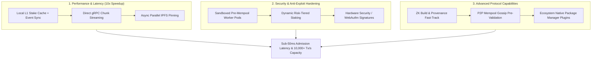

# CREG Submission Layer: Rating, Enhancements & Advanced Roadmap Report

**Date:** August 27, 2026  
**Target:** Chain Registry (CREG) Submission Layer & Admission Engine  
**Protocol Version:** `v0.4.4-testnet` (Public Alpha)  
**Author:** Antigravity AI Systems & Blockchain Architecture  

---

## Executive Summary

The **CREG Submission Layer** serves as the critical security and ingestion boundary between external package publishers and the consensus-driven validator mesh. It handles artifact packaging, IPFS content addressing, publisher dual-key cryptographic signing, on-chain stake verification, namespace provenance validation (CR-07), and pre-mempool YARA malware filtering.

This report provides:
1. **An objective 6-pillar scorecard rating** of the current submission layer.
2. **Identification of key architectural bottlenecks and risk vectors.**
3. **A prioritized, concrete enhancement roadmap** to elevate security, developer experience, and achieve ultra-high throughput (10,000+ packages/sec).

---

## 1. Objective Architectural Rating & Scorecard

### Overall Score: **8.1 / 10 (Production-Grade Alpha)**

```text
+-----------------------------------------------------------------------+
|  CREG Submission Layer Architectural Scorecard (Scale: 1 - 10)        |
+-----------------------------------------------------------------------+
|  1. Cryptographic Non-Repudiation & Identity Binding :  9.3 / 10  [A]  |
|  2. Economic Bonding & Anti-Sybil Protection         :  8.7 / 10  [B+] |
|  3. Pre-Mempool Threat & Malware Mitigation          :  8.0 / 10  [B]  |
|  4. Namespace Provenance & Anti-Squatting (CR-07)    :  8.8 / 10  [B+] |
|  5. Ingestion Throughput & Runtime Latency           :  6.8 / 10  [C+] |
|  6. Network Resilience & Fault-Tolerance             :  7.0 / 10  [C+] |
+-----------------------------------------------------------------------+
|  Weighted Overall Architecture Rating                :  8.1 / 10  [B+] |
+-----------------------------------------------------------------------+
```

### Detailed Evaluation by Pillar

| Evaluation Pillar | Score | Strengths | Vulnerabilities & Gaps |
| :--- | :---: | :--- | :--- |
| **1. Cryptographic Identity** | **9.3 / 10** | Dual-key Ed25519 + EVM EIP-191 personal signing; $M$-of-$N$ threshold multi-sig; random nonces; fail-closed v4 payload bindings. | Missing hardware wallet (WebAuthn / Ledger / YubiKey) native signing support in CLI. |
| **2. Economic Bonding** | **8.7 / 10** | Live Sepolia `Staking.sol` check; 30-day publisher liability period; stake slashing integration. | Flat minimum stake ($1.0\text{ }tCREG$) does not scale dynamically with package blast radius (e.g. core dependencies vs leaf packages). |
| **3. Threat Mitigation** | **8.0 / 10** | In-memory YARA scan; $\ge \text{Level 4}$ threat block; 64MB limit; 30s timeout; SHA-256 byte check. | Synchronous regex parsing open to ReDoS; zip bomb decompression hazards during deep extraction. |
| **4. Namespace Provenance** | **8.8 / 10** | Upstream OIDC trusted-publisher certificate verification; controller nonces; granular expiring delegation scopes. | npm OIDC official signal detection is still awaiting upstream npm ecosystem signal stabilization. |
| **5. Ingestion Throughput** | **6.8 / 10** | High-performance gRPC Protobuf tunnel alongside REST API; async Tokio runtime. | Synchronous L1 JSON-RPC calls (100–300ms) and IPFS HTTP download roundtrips create a throughput bottleneck. |
| **6. Network Resilience** | **7.0 / 10** | Strict fail-closed error semantics; durable RocksDB pending queue. | Single L1 RPC dependency can stall admission if Ethereum Sepolia RPC provider drops or rate limits. |

---

## 2. Key Areas for Improvement & Identified Bottlenecks

### Bottleneck A: Synchronous L1 RPC Latency (The 250ms Blocker)
* **Current Mechanism:** For every `admit_publish_request`, the node makes a synchronous JSON-RPC query `stakedBalance(publisher)` to Ethereum Sepolia.
* **Impact:** With standard external RPC latency (100–300ms), a single node worker can only process 3–10 submissions/sec per thread. Network jitter on Sepolia causes admission stalls.
* **Risk:** External RPC rate limits or RPC outages cause false-positive rejection of valid publisher submissions (`PublisherAdmissionError::Unavailable`).

### Bottleneck B: Gateway IPFS Fetch Overhead
* **Current Mechanism:** The node downloads the full tarball bytes from an IPFS HTTP gateway (`/api/v0/cat?arg=CID`) before mempool insertion.
* **Impact:** Double network hop: Publisher $\rightarrow$ IPFS Gateway $\rightarrow$ Admission Node $\rightarrow$ Validators. Adds 500ms–2000ms latency on large archives (10MB–64MB).
* **Risk:** IPFS gateway timeouts (30s threshold) on large or slow-propagating CIDs cause intermittent admission drops.

### Bottleneck C: In-Process YARA Scanner CPU Contention & Decompression Bombs
* **Current Mechanism:** `scan_tarball_with_yara` extracts the archive in the node runtime process and executes complex rule sets.
* **Impact:** High CPU utilization on the admission node during submission spikes, starving PBFT gossip and state sync workers.
* **Risk:** Highly nested archive files or crafted regex-matching files can induce CPU exhaustion (ReDoS).

---

## 3. High-Impact Enhancements & Advanced Roadmap



---

### Strategy 1: Ultra-High Performance & Low Latency (Target: < 30ms Admission)

#### 1.1 Local L1 Staking State In-Memory Cache (Eliminate JSON-RPC Roundtrips)
* **Architecture:** Maintain an in-memory Trie/Hashmap of all publisher balances in `SharedState`.
* **Change Data Capture (CDC):** Subscribe to WebSocket filter logs on Sepolia for `PublisherStaked`, `PublisherUnstaked`, and `Slashed` events.
* **Benefit:** Reduces stake check time from **~250ms to < 0.1ms** (local RAM lookup), boosting node throughput to thousands of admissions per second.

```rust
// Proposed: Zero-latency local stake cache lookup with fallback
pub fn check_publisher_stake_fast(
    cache: &PublisherStakeCache, 
    publisher: Address, 
    min_required: U256
) -> Result<(), PublisherAdmissionError> {
    if let Some(balance) = cache.get(&publisher) {
        if balance >= min_required { return Ok(()); }
        return Err(PublisherAdmissionError::Unstaked("Insufficient cached balance".into()));
    }
    // Fallback to async RPC only for fresh unknown addresses
    cache.sync_single_publisher_from_rpc(publisher)
}
```

#### 1.2 Direct gRPC Dual-Stream Ingestion (Eliminate IPFS Double-Hop)
* **Architecture:** Allow the CLI to stream tarball bytes directly to the admission node over the existing gRPC tunnel while simultaneously pushing to IPFS in the background.
* **P2P Pre-Warming:** The receiving admission node immediately serves the bytes to the local IPFS daemon blockstore, pre-warming the CID across the validator P2P mesh.
* **Benefit:** Cuts upload latency by 50–70% and guarantees zero IPFS retrieval timeouts during admission.

---

### Strategy 2: Enterprise Security & Threat Defense

#### 2.1 Process-Isolated Scanner Sandbox (WASM / nsjail Pre-Mempool Workers)
* **Architecture:** Move YARA scanning and archive decompression out of the main `creg-node` process into an isolated, resource-capped worker pool (`cgroups` / WASM / WebAssembly runtime).
* **Resource Limits:**
  * Strict CPU limit: Maximum 1.5 seconds per archive.
  * Memory ceiling: 256 MiB max RAM allocation per scan.
  * Decompression ratio guard: Maximum 100:1 uncompressed-to-compressed size ratio (prevents zip bombs).
* **Benefit:** Total containment of parser bugs, ReDoS, and memory corruption vulnerabilities away from the core consensus process.

#### 2.2 Dynamic Risk-Tiered Staking Model
* **Current:** Flat $1.0\text{ }tCREG$ for all packages.
* **Upgrade:** Dynamic stake requirement based on package ecosystem profile:
  $$\text{Required Stake} = \text{Base Stake} \times \left(1 + \log_{10}(\text{Downstream Dependents} + 1)\right) \times \text{Risk Multiplier}$$
* **Benefit:** Leaf developer libraries require low stake (accessible to indie developers), while tier-1 infrastructure packages (e.g. `express`, `react`, `boto3`) require higher economic bonding, creating massive economic deterrence against high-value supply-chain hijacks.

#### 2.3 WebAuthn / FIDO2 & Hardware Enclave Signing
* **Architecture:** Extend CLI `keygen` and `publish` to interface with hardware security keys (YubiKey, Apple Secure Enclave, Ledger) using FIDO2 / WebAuthn.
* **Benefit:** Prevents publisher key exfiltration even if the developer's workstation is compromised by infostealer malware.

---

### Strategy 3: Advanced Protocol Features

#### 3.1 ZK Build & Vulnerability Fast-Track Attestations (Groth16 / Plonky2)
* **Concept:** Developers building in verified CI environments (GitHub Actions OIDC, reproducible container builds) generate a Zero-Knowledge Proof verifying:
  1. Source code matches Git commit hash.
  2. No high-severity CVEs detected during pinned build.
  3. Artifact was compiled deterministically without network access.
* **Benefit:** Packages with valid ZK build proofs bypass extensive multi-day queue delays and qualify for accelerated committee validation.

#### 3.2 Native Package Manager Plugin Integration
* **Architecture:** Native plugins for `npm`, `pip`, and `cargo` that wrap `publish`:
  ```bash
  # Zero-friction developer experience:
  npm publish --registry https://publish.testnet.cregnet.dev
  cargo publish --registry creg
  twine upload --repository creg dist/*
  ```
* **Auto-Signing Extension:** Automatically signs and handles staking behind the scenes using stored developer profile keys, eliminating manual CLI steps.

---

## 4. Implementation Priority Matrix

```text
+---------------------------------------------------------------------------------------+
| Priority | Enhancement Feature                     | Effort | Impact | Target Phase   |
+---------------------------------------------------------------------------------------+
|   P0     | In-Memory L1 Stake Cache (CDC Sync)     | Medium | 10x    | Alpha Polish   |
|   P0     | Decompression Ratio Guard (Anti-Bomb)   | Low    | High   | Immediate Patch|
|   P1     | Direct gRPC Byte Stream & P2P Prewarm   | Medium | High   | Phase 2        |
|   P1     | Sandboxed Scanner Worker Pool           | High   | High   | Phase 2        |
|   P1     | Dynamic Risk-Tiered Staking             | Medium | High   | Testnet Phase 3|
|   P2     | Hardware Security Key (FIDO2) CLI       | Medium | Med    | Testnet Phase 3|
|   P2     | Native Ecosystem Publish Plugins (npm)  | Low    | High   | Developer Beta |
|   P3     | ZK Reproducible Build Fast-Track        | High   | High   | Future Protocol|
+---------------------------------------------------------------------------------------+
```

---

## 5. Architectural Summary & Verdict

The CREG Submission Layer has a **rock-solid cryptographic and non-repudiation foundation** (scoring 9.3/10 in cryptography and 8.8/10 in namespace provenance). It solves the core supply chain trust dilemma by mathematically binding code bytes to on-chain identity and economic liability.

By addressing the **two primary throughput bottlenecks**—caching L1 stake lookups in RAM and streaming bytes directly over gRPC to bypass gateway latencies—the layer will transition from an already secure alpha ingestion gate to a **world-class, sub-30ms, enterprise-scale decentralized package intake network**.
