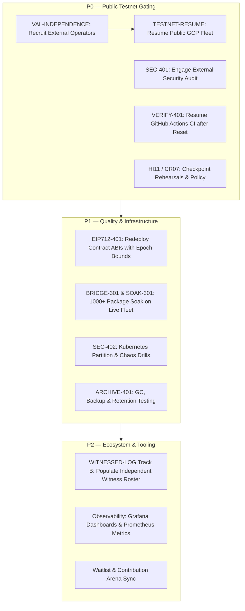

# CREG Testnet Readiness, Recent Protocol Changes & Next Work Report

**Date:** August 27, 2026  
**Repository HEAD:** `af602ee` (PR #55)  
**Binary Release Pin:** `v0.4.4-testnet` (Windows amd64) / `v0.4.3-testnet` (Linux/macOS)  
**Spec Genesis:** `chain-spec.sepolia.json` (Genesis Hash: `0x4f5492623f277888cc534c2c65ffd8f020baa9b8b1d9ad3a392cbde39792ed24`)  

---

## Executive Summary

| Dimension | Current Status | Meaning / Reality |
| :--- | :--- | :--- |
| **Project Stage** | **Public Alpha (Pre-Public Live Testnet)** | Protocol codebase has matured past lab phase into hardened alpha software. Waitlist is live. |
| **Local / Operator Node** | **100% Ready (Verified Locally)** | Maintainers and self-hosted operators can build and run `creg-node` / `creg` against the signed Sepolia spec. |
| **Public Live Testnet** | **Paused (Cost Optimization)** | Public GCP fleet (`api.testnet.cregnet.dev`) is temporarily halted to prevent idle cloud costs until external validators join. |
| **Decentralization / BFT** | **Not Live BFT** | Spec contains 4 coordinated bootstrap validators and empty bootnodes. Independent operator cohort is being recruited. |
| **External Security Audit** | **Open (Pending Vendor)** | Scoped under `SEC-401-AUDIT-SCOPE.md` with candidate freeze at `v0.4.3-testnet` / `v0.4.4-testnet`. |

---

## 1. Current Project Stage

The **CREG (Chain Registry)** project is currently in the **Public Alpha & Operator Preparation Stage**.

1. **Protocol Core Status:**
   - The Rust workspace (node, CLI, common, resolver, crypto crates) and Solidity contracts on Sepolia are architecturally complete for public-alpha operation.
   - Fail-closed security mechanisms, anti-rollback journals, supply-chain checks, and tamper-resistant shims are fully implemented on `main`.
   - Advanced features requiring external ceremonies (ZK qualification, mandatory certified committees, threshold encryption, and production namespace authority) remain deliberately disabled until operational requirements are met.

2. **Infrastructure & Network Posture:**
   - **GCP Fleet Paused:** Public REST API endpoints (`https://api.testnet.cregnet.dev`) are kept offline to conserve cloud budgets.
   - **Waitlist Live:** Public registration and interest capture are active on Firebase (`Creg-waitlist`).
   - **Contribution Arena:** Running as a standalone educational/simulation tool (independent of the core protocol workstream).

---

## 2. Recent Protocol & Testnet Changes (PRs #25 to #55)

Over the recent development cycles, major hardening, verification, and tooling upgrades landed on `main`:

### A. CLI & User Experience Enhancements
- **Console TUI (`creg console`, PR #54):** Interactive terminal explorer featuring multiple themes/palettes, tabbed navigation, clipboard copying (yank), responsive resizing, and confirm-quit prompts.
- **Binary Releases (PR #55):** Windows amd64 pinned to `v0.4.4-testnet`, integrating the latest TUI and witness tooling.

### B. Transparency Log & Witness Daemon (WITNESSED-LOG, PRs #52 & #53)
- **`creg witness run`:** Lightweight standalone daemon for independent witnesses to poll `/v1/public/transparency/:log_id/signed-head`.
- **Tamper & Rollback Resistance:** Node refuses unsigned tree heads; witnesses persist state locally and fail closed if a split-view or history regression is detected.
- **Operator Keygen:** Introduced `creg keygen witness` and `creg keygen log-signer` with strict safety checks preventing accidental key creation inside the git worktree.
- **Track B Recruitment:** Created transparent operator onboarding playbooks (`WITNESS_OPERATOR_ONBOARDING.md`) with an empty pubkey roster (`roster.json`).

### C. Supply Chain Security & CI Tooling (PR #50)
- **Workspace SBOM:** `creg sbom --workspace` generates SPDX 2.3 and CycloneDX 1.5 dependency bills from `Cargo.lock`.
- **Policy Enforcement:** `creg supply-chain check` detects missing checksums, unapproved git sources, untrusted registries, and denied crates.
- **Provenance Lock:** Cryptographically binds local builds to `Cargo.lock` SHA-256 digests.

### D. Client Anti-Rollback & Freshness (CLIENT-FRESHNESS, PR #49)
- **Anti-Rollback Journal:** Local clients maintain persistent version state to prevent rollback attacks and freeze/skew exploits.
- **Witnessed Verification:** Added `verify_witnessed_inclusion` enforcement when witness endpoints are provided via `CREG_WITNESS_HEAD_URLS`.

### E. Package Manager Gating & Install Shims (SHIM-301, PRs #47 & #48)
- **Fail-Closed Execution:** PATH shims share `creg install` fail-closed verification with 5-minute local cache validation.
- **Direct-Dep Inspection:** Bare `npm install` and `npm ci` commands gate up to 200 direct dependencies against the registry before execution.

### F. Governance & Spec Honesty (PRs #44, #45, #46)
- **Operator Governance Writes:** `/v1/operator/governance/...` endpoints require operator signature + `CREG_GOVERNANCE_KEY`; public POST remains rejected (`405 Method Not Allowed`).
- **Fail-Closed Spec Enforcement:** Nodes fail startup immediately if local environment variables contradict contract addresses defined in the signed Sepolia specification.

### G. Protocol Hardening & Mathematical Guards (PRs #25 to #40)
- **Epoch-Bound Signatures (EIP712-401):** Admission signatures bind the live `validatorSetEpoch`, aborting on mid-tick epoch transitions or RPC disconnects.
- **Sandbox Safety:** Advanced sandbox bypass restricted strictly to `CREG_TESTNET` profiles; production profiles fail closed.
- **Cryptographic Guards:** Shamir secret sharing protects against zero divisors (`gf_div`) and duplicate index shares; Double-sign evidence encodes Ed25519 `R || S` without leaking secret material.

---

## 3. Testnet Readiness Assessment

| Verification Area | Status | Evidence / Notes |
| :--- | :--- | :--- |
| **Rust Unit & Lib Tests** | **PASS (225/225)** | `chain-registry-node` library test suite is 100% green. |
| **Node Binary Tests** | **PASS (227/227)** | `creg-node` binary tests pass. |
| **CLI Test Suite** | **PASS (49/49)** | `chain-registry-cli` passes all functional tests. |
| **Node E2E Suite** | **PASS (8/8)** | Health, admission, verification, duplicate rejection, SSE, metrics, and signature rejection pass. |
| **Integration Suite** | **PASS (11/11)** | Inter-module integration checks pass. |
| **Smart Contracts** | **PASS (129/129)** | Pinned Foundry v1.7.1 `forge test` passes completely on Sepolia contracts. |
| **Code Quality & Formatting** | **PASS** | `cargo fmt --all -- --check` clean across all workspace targets. |
| **Remote GitHub Actions CI** | **DEFERRED** | Deferred due to account monthly spending limit. Local verification serves as temporary gate. |
| **Public Multi-Operator Fleet** | **BLOCKED ON OPERATORS** | Requires recruiting independent third-party validators before unpausing GCP services. |

---

## 4. What We Need to Work on Next (Prioritized Action Plan)



### Phase 1: P0 — Critical Gating Work (Required for Public Launch)
1. **VAL-INDEPENDENCE (Operator Recruitment & Cohort Building):**
   - Recruit independent node runners using [VALIDATOR_ONBOARDING_CHECKLIST.md](./VALIDATOR_ONBOARDING_CHECKLIST.md) and [GENESIS_ALPHA_COHORT_PLAYBOOK.md](./GENESIS_ALPHA_COHORT_PLAYBOOK.md).
   - Expand beyond the 4 coordinated bootstrap keys to establish decentralized BFT consensus.
2. **TESTNET-RESUME (Unpausing Public Cloud Services):**
   - Execute `testnet/gcp/resume-testnet-hosting.ps1` and verify with `hosting-301-verify.ps1`.
   - Restore `https://api.testnet.cregnet.dev` once external operators are ready.
3. **SEC-401 (External Security Audit):**
   - Finalize vendor engagement based on [SEC-401-AUDIT-SCOPE.md](./SEC-401-AUDIT-SCOPE.md) using candidate release `v0.4.3-testnet` / `v0.4.4-testnet`.
4. **VERIFY-401 (Remote CI Resumption):**
   - Resume GitHub Actions CI workflows once the billing cycle resets (do not raise spending limits).
5. **HI11-ACTIVATE & CR07-ACTIVATE (Operational Activation):**
   - Conduct multi-operator rehearsals for validator history recovery and namespace authority before enabling runtime flags.

### Phase 2: P1 — Quality & Resilience (Next 2–4 Weeks)
1. **EIP712-401 Contract Upgrades:**
   - Deploy updated Solidity contracts to Sepolia with epoch-bound signature validation.
2. **SOAK-301 & BRIDGE-301 (Load and Bridge Soak):**
   - Run prolonged throughput testing (1,000+ packages submitted over multiple days) on the live fleet to verify reward distributions and gas dynamics.
3. **SEC-402 (Network Partition Chaos Drills):**
   - Execute `k8s/55-network-partition-test.yaml` to simulate validator partition and recovery.
4. **ARCHIVE-401 (Evidence Retention Controls):**
   - Test disk pressure garbage collection, snapshot backups, and legal-hold mechanisms.

### Phase 3: P2 — Ecosystem & Observability
1. **WITNESSED-LOG Track B (Witness Expansion):**
   - Onboard at least 2 independent witness operators to populate `chain-registry/testnet/witnesses/roster.json`.
2. **REM-211+ (Observability & Dashboards):**
   - Finalize Prometheus alerts and Grafana dashboards for validator memory, network gossip, and scanner queues.
3. **Waitlist Cohort Management:**
   - Export Wave 1 validator cohorts from Firebase for scheduled onboarding batches.

---

## 5. Summary Commands for Maintainers

```powershell
# 1. Run local verification suite
cd chain-registry
cargo fmt --all -- --check
cargo test --locked --workspace --all-targets -j1
cd contracts; forge test; cd ..

# 2. Key generation for witness operators (writes outside worktree)
cargo run --bin creg -- keygen witness --out C:\secure\witness.key

# 3. Run witness daemon against testnet node
cargo run --bin creg -- witness run --node-url https://api.testnet.cregnet.dev --log-id transparency-1 --key-file C:\secure\witness.key

# 4. Resume public testnet hosting (when operators are ready)
cd testnet\gcp
.\resume-testnet-hosting.ps1
.\hosting-301-verify.ps1 -BaseDomain testnet.cregnet.dev
```
