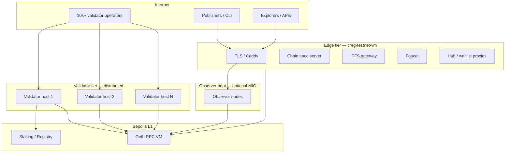

# Future testnet scale architecture (not a deployment claim)

**Updated:** 2026-06-26  
**Network:** `creg-testnet-1` on Sepolia  
**Audience:** Maintainers, operators, and external validator candidates

This is a future-state design document, not a record of deployed topology or
performance. The checked-in Sepolia specification records one validator and no
bootnodes; it is a coordinated research alpha with no Byzantine-tolerance or
decentralization claim. Independent control-domain attestations, conformance
tests, and public deployment evidence are required before this design can be
called a testnet topology.

---

## Design goals

| Goal | How CREG achieves it |
|------|----------------------|
| Thousands of validators | One validator per operator host; L1 staking + off-chain identity registration; P2P mesh via bootnodes |
| Practical analysis cost | **Hybrid committees** — mandatory core (~100, VRF + stake + cap) per package; voluntary contributions recorded |
| PBFT safety at scale | Standard `⌊2n/3⌋+1` quorum on block finality; no small-cluster shortcuts in production paths |
| Public reads | Observer pool + edge TLS (`api.testnet.cregnet.dev`) decoupled from validator compute |
| Operator bootstrap | Maintainer **edge + observer + optional seed validators** on GCP; cohort joins independently |

---

## Tier model

| Tier | Role | Who runs it | Scale |
|------|------|-------------|-------|
| **L1** | Stake, registry, governance | Ethereum Sepolia | Global |
| **Edge** | TLS, spec, IPFS, faucet, marketing surfaces | Maintainer GCP | 1–2 VMs |
| **Observer pool** | Sync L1 set, serve public API, hold pending | Maintainer GCP (MIG) | 1–N replicas |
| **Validators** | Analysis, votes, PBFT | **Each external operator** | Target **10,000+** |
| **Bootstrap validators** | Seed P2P + early quorum | Maintainer (optional, small) | 2–10, not a cap |

---

## Validator operator model (external)

Every validator is **one operator, one host** (VM or bare metal). There is no shared 3-node compose for production onboarding.

**Onboarding path:**

1. Genesis Alpha / Vanguard cohort invite — [GENESIS_ALPHA_COHORT_PLAYBOOK.md](./GENESIS_ALPHA_COHORT_PLAYBOOK.md)
2. Full checklist — [VALIDATOR_ONBOARDING_CHECKLIST.md](./VALIDATOR_ONBOARDING_CHECKLIST.md)
3. Deploy with `docker-compose.validator.yml` or release `creg-node` binary
4. Register identity + stake on Sepolia; request `approveByConsensus`

**Required capabilities per host:**

- Linux, 4 vCPU / 8 GB RAM / 50 GB SSD minimum
- Real sandbox (`CREG_DEV_SANDBOX=false`, nsjail secure image)
- Archive-capable Sepolia RPC
- Fleet scanner profile (`testnet/scanner-fleet.env`)

---

## Consensus and committees at scale

| Layer | Participants | Quorum / rule |
|-------|----------------|---------------|
| Package admission | Mandatory committee + voluntary validators | Consensus-grade evidence from mandatory core; see `/v1/packages/:id/committee` |
| PBFT blocks | All active validators in L1 set | `⌊2n/3⌋+1` prepares/commits |
| L1 finalize | Staked validator ECDSA sigs | Registry `quorumPct` (default 67%) |

Small-cluster flags such as `CREG_PBFT_ALLOW_SMALL_CLUSTER_QUORUM` are **deprecated** (formerly used by archived Anvil labs under `archive/anvil-lab/`). They must **not** be set on public Sepolia validators.

---

## Maintainer infrastructure (GCP)

Production layout is documented in:

- [GCP-VALIDATOR-FLEET.md](./GCP-VALIDATOR-FLEET.md) — optional seed validators on private VM
- [GCP-RPC-ARCHITECTURE.md](./GCP-RPC-ARCHITECTURE.md) — public API / JSON-RPC
- [GCP_PHASE2_RUNBOOK.md](./GCP_PHASE2_RUNBOOK.md) — observer pool + hub
- [testnet/gcp/README.md](../chain-registry/testnet/gcp/README.md) — resume/stop scripts

**Cost-conscious phase:** Edge + waitlist can run without validator VMs — [WAITLIST-ONLY-HOSTING.md](./WAITLIST-ONLY-HOSTING.md). Resume full testnet when cohort onboarding starts.

---

## Local development (not production topology)

| Use case | Path |
|----------|------|
| Single dev node | [testnet/QUICKSTART.md](../chain-registry/testnet/QUICKSTART.md) Path A |
| Bootstrap services | Path B — `docker-compose.testnet.yml` |
| Sepolia bootstrap (local) | `docker-compose.testnet.yml` + `.env.testnet` |
| ~~Sepolia 3-node lab~~ | **Retired** — see [testnet/archive/3node-lab/README.md](../chain-registry/testnet/archive/3node-lab/README.md) |

---

## Verification checklist (scale readiness)

Before opening Wave 1 validator batches at scale:

- [ ] `hosting-301-verify.ps1` green on `testnet.cregnet.dev`
- [ ] Chain spec bootnodes and `CREG_P2P_SEEDS` documented for external operators
- [ ] [TESTNET_PHASE_SCOPE.md](./TESTNET_PHASE_SCOPE.md) linked in all invites
- [ ] Faucet + stake path tested end-to-end
- [ ] Observer pool `active_validators` reflects L1 staking set
- [ ] No maintainer docs reference 3-node Sepolia lab as default
- [ ] Pilot batch (5–10 wallets) per Genesis Alpha playbook

---

## Related documents

| Document | Purpose |
|----------|---------|
| [GENESIS_ALPHA_COHORT_PLAYBOOK.md](./GENESIS_ALPHA_COHORT_PLAYBOOK.md) | 10k cohort waves |
| [VALIDATOR_ONBOARDING_CHECKLIST.md](./VALIDATOR_ONBOARDING_CHECKLIST.md) | Per-operator steps |
| [TESTNET_PHASE_SCOPE.md](./TESTNET_PHASE_SCOPE.md) | Alpha limits and semantics |
| [WHAT_TO_DO_NEXT.md](./WHAT_TO_DO_NEXT.md) | Maintainer planning hub |
| [CREG_SYSTEM_WORKFLOW.md](./CREG_SYSTEM_WORKFLOW.md) | Full protocol workflow |

---

_Retired: Sepolia `docker-compose.3node.yml` lab. Do not use for new operator or cohort work._
