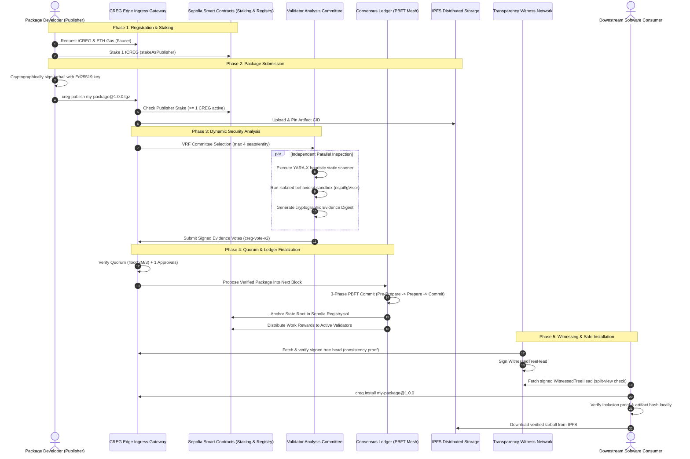
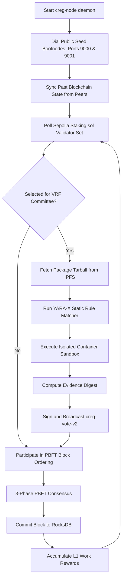
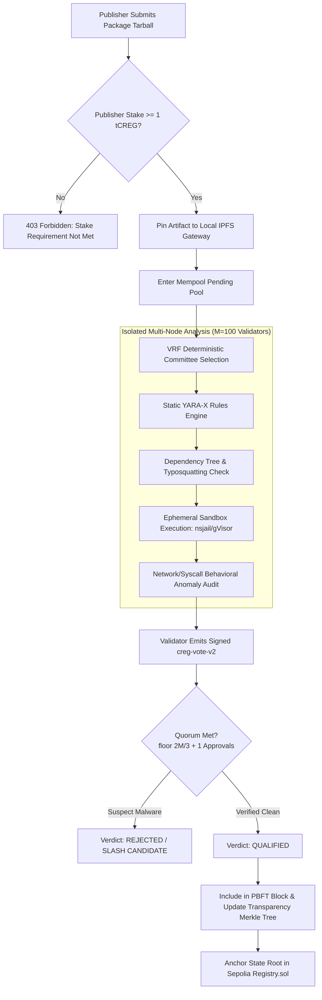
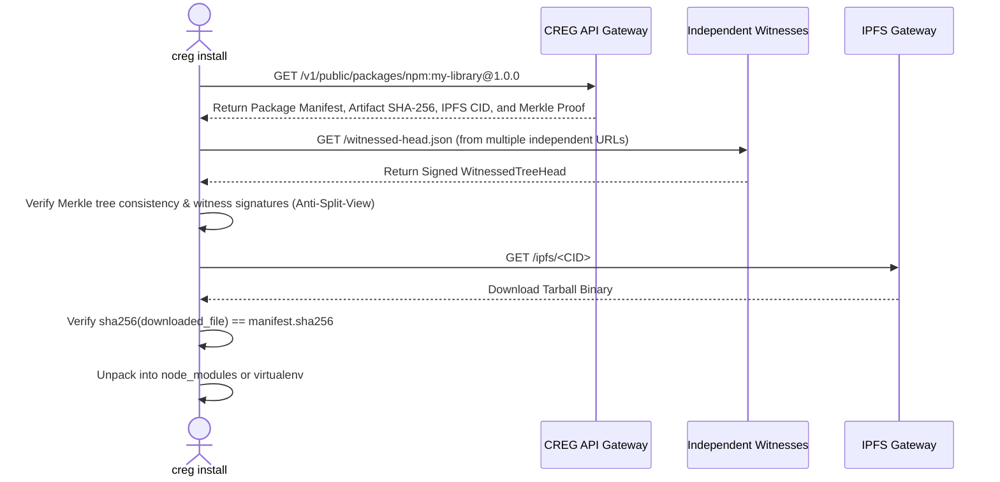

# Chain Registry (CREG): Comprehensive User & System Workflow Guide

> **Status notice (2026-11-14):** This guide was written for the earlier `creg-testnet-1` network and has not been updated for R7 (`creg-phase-c-testnet-2026-09-26-r7`). Known out-of-date items: the contract addresses in §6 (retired network; current addresses are in [CREG-COMPLETE-DOCUMENTATION.md](./CREG-COMPLETE-DOCUMENTATION.md) Appendix C), `creg stake --amount …` (the amount is positional: `creg stake 1 --role publisher`), `creg keygen … --key-path`, `creg validator register` (identity registration is `POST /v1/validators/register` or `testnet/register-validator-identity.sh`), the claim that state roots are anchored to Sepolia's `Registry.sol` (retired; `submitRollupBatch` reverts), and the claim that validators currently receive work rewards (reward dispatch is not live). For a current, status-tagged description use the complete documentation: publisher flow §9, validator flow §10, consumer flow §11, current status §17.

**Network:** `creg-testnet-1` (Ethereum Sepolia Anchor)  
**Target Audience:** Software Developers, Node Operators, Security Engineers, and Stakeholders  
**Scope:** Technical and Non-Technical workflows for running a Validator Node and Publishing Packages

---

## Table of Contents

1. [Executive Overview & Core Philosophy](#1-executive-overview--core-philosophy)
2. [High-Level System Workflow Diagram](#2-high-level-system-workflow-diagram)
3. [Persona 1: Running a Validator Node](#3-persona-1-running-a-validator-node)
   - [3.1 Non-Technical Overview (The "Why" & The "Economics")](#31-non-technical-overview)
   - [3.2 Technical Deep Dive (Step-by-Step Operator Journey)](#32-technical-deep-dive)
   - [3.3 Behind the Scenes: What the Validator System Does](#33-behind-the-scenes-what-the-validator-system-does)
4. [Persona 2: Publishing Packages on Chain Registry](#4-persona-2-publishing-packages-on-chain-registry)
   - [4.1 Non-Technical Overview (Supply Chain Defense Explained)](#41-non-technical-overview)
   - [4.2 Technical Deep Dive (Step-by-Step Developer Journey)](#42-technical-deep-dive)
   - [4.3 Behind the Scenes: The Security Inspection Pipeline](#43-behind-the-scenes-the-security-inspection-pipeline)
5. [Downstream Package Consumer Installation Workflow](#5-downstream-package-consumer-installation-workflow)
6. [Dual-Consensus Engine & On-Chain Settlement Mechanics](#6-dual-consensus-engine--on-chain-settlement-mechanics)
7. [Governance & Decentralization Safeguards](#7-governance--decentralization-safeguards)
8. [Summary Workflow Reference Table](#8-summary-workflow-reference-table)

---

## 1. Executive Overview & Core Philosophy

Modern software engineering relies on centralized package repositories (npm, PyPI, Crates.io). While convenient, they represent a **critical single point of failure**:
- **Account Compromise:** Attackers steal developer API tokens and release malicious updates.
- **Dependency Confusion & Typosquatting:** Malicious packages mimic popular libraries.
- **Silent Tampering:** Package registries can silently alter published tarballs without public detection (split-view attacks).

### The Chain Registry Solution

**Chain Registry (CREG)** is an evidence-backed, multi-validator decentralized package registry. Instead of trusting a single centralized database:
1. **Software Authors (Publishers)** bond economic stake on Ethereum Sepolia and cryptographically sign every tarball.
2. **Distributed Validators** independently execute the package in isolated sandboxes and scan with automated heuristic engines before any package can be approved.
3. **Decentralized Quorum:** Only packages that achieve a $\lfloor \frac{2M}{3} \rfloor + 1$ cryptographic supermajority from an independently selected committee are finalized into the blockchain ledger.
4. **Independent Witnesses:** Separate third-party daemons continuously monitor Merkle tree heads, mathematically proving that no client receives an altered or split view of the chain.

---

## 2. High-Level System Workflow Diagram

The diagram below illustrates the end-to-end interaction between **Publishers**, **Validators**, **The Consensus Ledger**, and **Downstream Developers**:



---

## 3. Persona 1: Running a Validator Node

### 3.1 Non-Technical Overview

#### What is a Validator?
Think of a validator as an **independent digital customs agent and notary**. When a developer attempts to import new software into the global registry, your validator node automatically inspects the software in a secure isolation room (the sandbox). If the package is clean, your validator signs an approval ticket. If it contains malware, keyloggers, or hidden scripts, your validator sounds the alarm and votes to reject it.

#### Why Run a Validator?
- **Network Security:** You actively protect millions of developers and open-source applications from catastrophic software supply chain compromises.
- **Economic Incentives:** Validators earn **CREG block rewards** for ordering blocks and **performance work rewards** for successfully executing sandbox security evaluations.
- **Zero-Admin Mechanical Participation:** Anyone with the required stake can join. You do not need foundation approval; the network admits honest nodes automatically via cryptographic consensus.

#### Minimum Requirements
- **Hardware:** 4 vCPU, 8 GB RAM, 50 GB SSD storage, Linux OS (Ubuntu 22.04+ or Debian 12 recommended).
- **Network:** Reliable broadband connection, public port 9000 reachable.
- **Staking:** 100 tCREG tokens bonded on Ethereum Sepolia (available via the testnet faucet).

---

### 3.2 Technical Deep Dive (Step-by-Step Operator Journey)

```
[ Step 1: Install Tools ] ──> [ Step 2: Generate Keys ] ──> [ Step 3: Fund & Stake ] ──> [ Step 4: Register Identity ] ──> [ Step 5: Launch Node ]
```

#### Step 1: Install the CREG Operator Suite
On your remote server or workstation (see [REMOTE_INSTALLATION_GUIDE.md](./REMOTE_INSTALLATION_GUIDE.md) for full details):

**Linux / macOS (One-Liner):**
```bash
curl -fsSL https://spec.testnet.cregnet.dev/install.sh | bash
```

**Windows (PowerShell One-Liner):**
```powershell
irm https://spec.testnet.cregnet.dev/install.ps1 | iex
```

**From Source (Optional, if Rust is installed):**
```bash
git clone https://github.com/samuel-1-avson/chain-registry-blockchain-CREG-.git
cd chain-registry-blockchain-CREG-/chain-registry
./scripts/install-creg.sh --build
```

#### Step 2: Generate Dual Cryptographic Keys
Validators operate with **two distinct cryptographic keypairs**:
1. **EVM Key (secp256k1):** Ethereum wallet holding tCREG stake and signing L1 transactions.
2. **Consensus Key (Ed25519):** High-speed identity key signing PBFT blocks, committee votes, and peer discovery.

```bash
# Generate the Ed25519 consensus key (stored outside repo for security)
creg keygen validator --key-path ~/.creg/validator.key

# View your public validator identity
creg keygen inspect ~/.creg/validator.key
```

#### Step 3: Acquire Testnet Gas & Stake 100 tCREG
1. Visit the public faucet at [https://faucet.testnet.cregnet.dev](https://faucet.testnet.cregnet.dev) or use the CLI:
   ```bash
   creg testnet drip --address 0xYourEthAddress
   ```
2. Stake 100 tCREG into the canonical `Staking.sol` contract on Sepolia:
   ```bash
   creg stake --amount 100 --role validator \
     --key ~/.creg/validator-eoa.key \
     --rpc-url "https://ethereum-sepolia-rpc.publicnode.com"
   ```

#### Step 4: Register Dual-Signed Identity on L1 & P2P Mesh
To prevent Sybil attacks and identity spoofing, the node registers an attestation linking its EVM address with its Ed25519 public key:
```bash
creg validator register \
  --evm-key ~/.creg/validator-eoa.key \
  --consensus-key ~/.creg/validator.key \
  --endpoint "http://your-node-ip:8080"
```

#### Step 5: Launch the Validator Node
Use the turnkey startup script which automatically pulls the latest Docker image, configures P2P dialers to the public multi-bootnodes, and starts the background daemon:

**On Linux / macOS:**
```bash
./testnet/start-external-validator.sh
```

**On Windows (PowerShell):**
```powershell
.\testnet\start-external-validator.ps1
```

#### Step 6: Monitor Live Participation
Open the interactive validator terminal dashboard (TUI):
```bash
creg console
```
Or check real-time block finalization and peer count via the local REST API:
```bash
curl -s http://localhost:8080/v1/chain/stats | jq
```

---

### 3.3 Behind the Scenes: What the Validator System Does

Once online, the validator daemon executes the following autonomous loop:



1. **P2P Discovery:** The node dials `bootnode-gcp-1` (`35.225.225.20:9000`) and `bootnode-gcp-2` (`35.225.225.20:9001`) via libp2p GossipSub.
2. **State Synchronization:** It verifies the cryptographic genesis hash (`0x9d9e86...`) and synchronizes block headers sequentially.
3. **L1 Event Tracking:** An internal background worker (`validator_set_sync`) polls Ethereum Sepolia blocks every 30 seconds to track stakes, slashings, and new validator admissions.
4. **Autonomous Package Evaluation:** When a new package appears in the mempool:
   - The VRF committee selector computes `hash(prev_vrf_output || package_id)`. If the validator’s slot is chosen (capped at 4 seats per operator entity to prevent Sybil takeover), it downloads the package artifact.
   - It runs static detection using the compiled YARA ruleset.
   - It executes the install lifecycle scripts (`preinstall`, `install`, `postinstall`) inside an unprivileged `nsjail` or gVisor sandbox container without network access.
   - It signs and broadcasts a `creg-vote-v2` payload with its findings.
5. **PBFT Block Ordering:** Once quorum is achieved, validators take turns proposing blocks in 5-second rounds, executing Pre-Prepare, Prepare, and Commit stages to append the transaction to RocksDB.

---

## 4. Persona 2: Publishing Packages on Chain Registry

### 4.1 Non-Technical Overview

#### What is a Package Publisher?
A publisher is an open-source software author or organization (e.g., maintaining `lodash`, `express`, or custom internal libraries) who wants to guarantee that their users only receive authentic, tamper-proof, and security-verified software.

#### The Problem CREG Solves for Publishers
On standard registries, if a hacker phishes your password or steals your laptop's npm session token, they can immediately push a malicious version `1.0.1` that steals crypto wallets or customer data.  
On **Chain Registry**:
- Every release must be signed by your private Ed25519 publisher key.
- You post a refundable **1 tCREG security bond**.
- Your package is subjected to automated multi-validator behavioral analysis before the public can download it.
- Your users have mathematical certainty that what they download matches what you published.

---

### 4.2 Technical Deep Dive (Step-by-Step Developer Journey)

```
[ Step 0: Install CLI ] ──> [ Step 1: Connect Wallet (creg login) ] ──> [ Step 2: Bond 1 tCREG ] ──> [ Step 3: Package Tarball ] ──> [ Step 4: Publish ] ──> [ Step 5: Verify Status ]
```

#### Step 0: Install the CREG CLI
Install the standalone CLI tool on your development workstation (Linux, macOS, or Windows):
```bash
# Linux / macOS:
curl -fsSL https://spec.testnet.cregnet.dev/install.sh | bash

# Windows (PowerShell):
irm https://spec.testnet.cregnet.dev/install.ps1 | iex
```

#### Step 1: Connect Your Ethereum Wallet (`creg login`)
Thanks to CREG's **Dual-Key Architecture (DKA)**, you don't need to generate or back up isolated cryptographic keys manually. Your existing MetaMask or EVM wallet acts as your single master identity:

```bash
# Interactive Browser Flow (Opens MetaMask bridge):
creg login

# Or Headless / CI Flow (For automated build servers):
creg login --private-key 0xYourEthereumPrivateKey
```

When running `creg login`:
1. The CLI spins up a local loopback server (`127.0.0.1:18888`) and opens the secure Web3 bridge at `https://spec.testnet.cregnet.dev/auth.html`.
2. MetaMask prompts you for a standard **EIP-712 structured signature** ("Derive CREG Consensus Key").
3. The CLI deterministically derives your high-speed Ed25519 identity key via `HKDF-SHA512` and activates your profile:
   ```text
   ✓ Authentication successful!
   Active CREG Authenticated Profile
   EVM Staking Wallet:  0x3060...37331
   Ed25519 Pubkey:      78aa...18d3
   Consensus Key File:  ~/.creg/publisher.key
   Network RPC URL:     https://api.testnet.cregnet.dev
   ```
4. You can check your profile anytime with `creg profile` or log out with `creg logout`.

#### Step 2: Stake Publisher Bond (1 tCREG)
A 1 tCREG bond (~$0.01 on testnet) is required to prevent denial-of-service spam on the validator network:
1. Drip tokens from the faucet:
   ```bash
   creg testnet drip --address 0xYourEthAddress
   ```
2. Stake as a publisher on `Staking.sol`:
   ```bash
   creg stake --amount 1 --role publisher
   ```

#### Step 3: Prepare Your Software Tarball
Package your library using standard tooling:
```bash
# For npm / Node.js
npm pack

# For Python
python -m build --sdist

# For Rust / Cargo
cargo package
```

#### Step 4: Publish to Chain Registry (Zero-Flag Publishing)
With your authenticated profile active, publishing requires **zero extra flags**:

```bash
# Standard 1-click publish:
creg publish ./my-library-1.0.0.tgz
```

*(Note: Advanced users and CI scripts can still override explicitly via `--key-file <path>` and `--publisher-address <0x...>` if desired).*

The CLI executes the following automated pipeline:
1. Resolves publisher consensus keys and bonded staking address from `~/.creg/profile.json`.
2. Computes the SHA-256 digest of the archive.
3. Embeds package metadata (name, version, dependencies, license).
4. Signs the entire manifest with your derived Ed25519 key.
5. Uploads the payload to the CREG API Gateway.

#### Step 5: Track Verification on the Web Explorer
Open [https://explorer.testnet.cregnet.dev](https://explorer.testnet.cregnet.dev) to watch your package progress in real time:
- **Pending Analysis:** VRF committee assigned.
- **In Sandbox:** Validators running dynamic tracing.
- **Approved & Finalized:** Block committed, Merkle inclusion proof generated.

---

### 4.3 Behind the Scenes: The Security Inspection Pipeline

When a package submission is received by the network, it goes through a multi-stage security pipeline:



#### Behavioral Sandbox Checks
During container execution, the node monitors for malicious behaviors:
- **Reverse Shells:** Attempts to spawn `/bin/sh` or `/bin/bash` during install scripts.
- **Credential Harvesting:** Unauthorized reads from `~/.ssh`, `~/.aws/credentials`, or environment variable exfiltration.
- **Network Egress:** Outbound socket connections to dynamic DNS or unknown IP addresses.
- **Obfuscation:** High-entropy string unpacking or `eval()` payload execution.

If any suspicious activity is confirmed by the committee, the package is quarantined, and the publisher's bond is flagged for slashing.

---

## 5. Downstream Package Consumer Installation Workflow

Developers installing software protect their workstations and CI/CD pipelines using the CREG resolver:

```bash
# Install package with zero-trust verification
creg install my-library@1.0.0
```

### What Happens During `creg install`?



If an adversary has hacked the API gateway and tries to serve an altered file, the **Merkle proof verification fails locally** and installation terminates immediately with an alert.

---

## 6. Dual-Consensus Engine & On-Chain Settlement Mechanics

CREG is built on a **decoupled dual-consensus architecture** to solve the scalability and state-bloat problems inherent in general-purpose blockchains:

```text
+----------------------------------------------------------------------------------------------------+
|                                    CREG DUAL CONSENSUS ENGINE                                      |
+----------------------------------------------------------------------------------------------------+
|  1. EVIDENCE CONSENSUS (creg-vote-v2)             |  2. BLOCK FINALITY CONSENSUS (creg-pbft-v1)    |
|  - Operates on individual packages                |  - Operates on 5-second block rounds           |
|  - Heavy compute (YARA + Sandboxes)               |  - Lightweight state transitions               |
|  - Dynamic VRF committees (M=100 slots)           |  - Full validator mesh (n active nodes)        |
|  - Quorum: floor(2M / 3) + 1 approvals            |  - Quorum: floor(2n / 3) + 1 commit signatures |
+---------------------------------------------------+------------------------------------------------+
```

### Layer-1 Ethereum Sepolia Anchoring
While high-frequency consensus runs natively on the CREG Layer-1 PBFT network, economic settlement and security are anchored to Ethereum Sepolia via 10 audited smart contracts:

| Contract | Address on Sepolia | Role in System Workflow |
|:---|:---|:---|
| **`Governance.sol`** | `0x122Bc2C704B966C74004506F98F13bf7b5F75b9D` | **2-of-3 Multi-Sig DAO** controlling upgrades, parameter tuning, and emergency pauses. |
| **`Staking.sol`** | `0x30604Aa6f763fbde6aDCffbd8960af3031037331` | Holds validator & publisher token bonds; executes zero-admin `approveByConsensus`. |
| **`Registry.sol`** | `0xD0F465ca185a99E268be0C4FF5A135Bdf89FAF3B` | On-chain mirror of verified package anchors and Merkle state roots. |
| **`CREGToken.sol`** | `0x167Ab975dc95b79727Ed76BD8AAb70463F6499E2` | ERC-20 utility token for staking, bonding, and fee distribution. |
| **`ValidatorRewards.sol`** | `0x11eb80abA89fb3fAB63d39900c2c644B5893a604` | Autonomous work reward pool distributed to active committee participants. |

---

## 7. Governance & Decentralization Safeguards

To prevent central authority takeover, CREG enforces four structural decentralization barriers:

1. **2-of-3 Multi-Sig Governance:**
   - Contract calls and protocol parameter changes cannot be executed by any single maintainer key.
   - At least **2 of the 3 independent cryptographic co-signers** must review and co-sign every proposal.
2. **Autonomous Mechanical Admission (`approveByConsensus`):**
   - New validators are admitted onto L1 using threshold signatures ($\ge \frac{2}{3}$) collected from current active validators via EIP-712 structured hashing.
   - No human foundation administrator has the power to veto or censor an eligible validator.
3. **Sybil Resistance Committee Capping:**
   - Regardless of how many nodes or tokens an organization owns, the VRF selector enforces a **hard cap of 4 seats per entity** in any package evaluation committee.
4. **Transparency Witness Daemon (Anti-Split-View):**
   - Independent external organizations run `creg witness run`. If an operator attempts to serve different package states to different users, the witnesses detect non-monotonic Merkle roots and publish an immediate cryptographic alert.

---

## 8. Summary Workflow Reference Table

| Workflow Dimension | Package Publisher | Validator Node Operator | Downstream Consumer |
|:---|:---|:---|:---|
| **Primary Goal** | Securely release verified software libraries | Secure the network, validate code, and earn rewards | Install authentic, malware-free dependencies |
| **Identity Used** | Ed25519 Publisher Key (`publisher.key`) | Ed25519 Consensus Key + EVM Staking Wallet | Ephemeral or anonymous client |
| **Token Commitment** | 1 tCREG bond (refundable) | 100 tCREG bond (unbonding: 14 days) | Zero tokens required |
| **CLI Commands** | `creg publish <tarball> --key ...` | `creg-node` / `creg console` | `creg install <package>` |
| **L1 Contract** | `Staking.stakeAsPublisher` | `Staking.applyToBeValidator` & `approveByConsensus` | Read-only verification |
| **Off-Chain Engine** | Package packaging (`npm pack`, etc.) | YARA-X + `nsjail`/gVisor sandbox execution | Merkle proof & SHA-256 verifier |
| **Network Role** | Data producer | Consensus participant & security auditor | Data consumer |
| **Security Guarantee** | Protection from credential theft & hijacking | Byzantine fault tolerance & fair work rewards | Cryptographic guarantee against malware & split-view |

---

### Quick Links & Resources
- **Live Public Web Explorer:** [https://explorer.testnet.cregnet.dev](https://explorer.testnet.cregnet.dev)
- **Token & Gas Faucet:** [https://faucet.testnet.cregnet.dev](https://faucet.testnet.cregnet.dev)
- **Cryptographic Genesis Spec:** [https://spec.testnet.cregnet.dev/chain-spec.json](https://spec.testnet.cregnet.dev/chain-spec.json)
- **CREG Native JSON-RPC:** `https://api.testnet.cregnet.dev/rpc`
- **Sepolia L1 Ingress Proxy:** `https://api.testnet.cregnet.dev/sepolia`
- **Onboarding Runbook:** [docs/VALIDATOR_ONBOARDING_CHECKLIST.md](./VALIDATOR_ONBOARDING_CHECKLIST.md)
