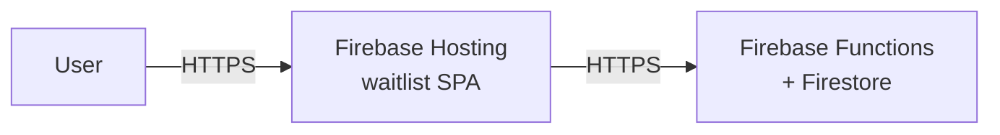

# Waitlist-only hosting runbook

> **Phase:** Marketing waitlist live; public testnet stack paused to reduce GCP spend.

## Where the waitlist runs (two GCP surfaces)

The waitlist is **not** all on one VM. It is split on purpose:

| Layer | Where it runs | GCP project | Needed for waitlist? |
|-------|----------------|-------------|----------------------|
| **Website** (`https://waitlist.cregnet.dev`) | **Firebase Hosting** (static SPA) | `gen-lang-client-0098858574` | **Yes** (no Compute Engine VM) |
| **Registration API** (`registerWaitlist`, stats) | **Firebase Cloud Functions** + Firestore | `gen-lang-client-0098858574` | **Yes** (serverless) |

**Target architecture (post-migration):** no edge VM required for the waitlist. `creg-testnet-vm` can be stopped after DNS cutover to Firebase Hosting.

Legacy (pre-migration): website was Docker on **`creg-testnet-vm`** in project `gen-lang-client-0022105784`.

Everything else in `gen-lang-client-0022105784` (optional Geth VM, observer pool,
explorer/faucet/hub containers, hub Cloud Run, API load balancer) is
**testnet/hub** and can stay off during the waitlist phase. Validators and
bootnodes are independent operator infrastructure, not GCP resources.



## What stays on

| Resource | Project | Purpose |
|----------|---------|---------|
| Firebase Hosting + Functions + Firestore | `gen-lang-client-0098858574` | Static SPA + registration API (no VM) |
| DNS `waitlist.cregnet.dev` | Cloudflare | CNAME → `gen-lang-client-0098858574.web.app` (DNS only) |

**Monthly floor (target):** ~$5–25 (Firebase only), plus disks on stopped testnet VMs if not yet deleted.

**Legacy floor (edge VM still running):** ~$98 (edge VM) + Firebase — see [GCP-BUDGET-ARCHITECTURE.md](./GCP-BUDGET-ARCHITECTURE.md) for NAT/disk savings.

## What stops

| Resource | Est. savings/mo |
|----------|-----------------|
| `creg-sepolia-geth-vm` | ~$49 |
| `creg-observer-pool` MIG (scale to 0) | ~$25 |
| Edge containers: explorer, faucet, IPFS, spec, hub, prometheus | RAM/egress on same VM |
| `creg-hub-api` Cloud Run (`ingress=internal`) | Blocks public hub API during waitlist |
| `creg-api-https-fr` + `creg-api-lb-ip` | Removed via `teardown-gcp-public-lb.ps1 -Yes` (~$18/mo LB + IP) |

## Trim edge to waitlist-only

On the edge VM (or via automation):

```bash
cd ~/creg-hosting/<repo>/chain-registry/testnet
./gcp/start-waitlist-edge-only.sh
```

Compose file: `docker-compose.waitlist-edge.yml`  
Caddy: `caddy/Caddyfile.waitlist-only`

Expected containers: **`creg-cloud-caddy`**, **`creg-cloud-waitlist`** only.

## Windows operator: stop testnet

From repo root (requires `hosting.env` + gcloud auth):

```powershell
cd chain-registry\testnet\gcp
.\stop-testnet-hosting.ps1          # prompts for YES
.\stop-testnet-hosting.ps1 -Yes     # non-interactive
.\stop-testnet-hosting.ps1 -WhatIf   # dry run
.\stop-testnet-hosting.ps1 -Yes -SkipEdgeTrim   # VMs + hub pause only
.\stop-testnet-hosting.ps1 -Yes -SkipHubPause   # keep hub Cloud Run warm
```

## Verify waitlist

```bash
curl -fsS -o /dev/null -w "%{http_code}\n" https://waitlist.cregnet.dev/
curl -fsS https://us-central1-gen-lang-client-0098858574.cloudfunctions.net/waitlistPublicStats
```

Expect HTTP `200` and JSON with enrollment count.

## Relaunch testnet checklist

1. `.\resume-testnet-hosting.ps1 -Yes` — start optional Geth and scale the observer MIG
2. Fill external `CREG_VALIDATOR_P2P_SEEDS`/`CREG_VALIDATOR_HTTP_PEERS`, then run `.\gcp\verify-public-services-profile.ps1 -Target observer`
3. `.\deploy-observer-pool.ps1 -Confirm` — start observers from the approved image digest
4. Add the observer ILB address, then run `.\gcp\verify-public-services-profile.ps1` and refresh edge env
5. On edge VM: `./testnet/start-cloud-edge-gcp.sh` (full stack, **not** waitlist-only)
6. Verify external validator health independently and verify the public observer `/v1/health`

## Do not

- Run `start-cloud-edge-gcp.sh` when you only want waitlist (it starts the full edge stack)
- Delete VM disks or instances without snapshots (stop only until Hosting is verified)
- Point waitlist DNS at the edge VM after Firebase Hosting cutover

## Migrate static hosting to Firebase

```powershell
cd chain-registry\testnet\gcp
.\deploy-waitlist-hosting.ps1
# Add custom domain in Firebase console, then:
.\set-waitlist-dns-firebase.ps1
# Verify https://waitlist.cregnet.dev/ then:
.\stop-testnet-hosting.ps1 -Yes
```

Optional further savings: delete Cloud NAT `creg-nat` on `creg-nat-router`, snapshot + delete stopped VM disks — see [GCP-BUDGET-ARCHITECTURE.md](./GCP-BUDGET-ARCHITECTURE.md).

## References

- [GCP-BUDGET-ARCHITECTURE.md](./GCP-BUDGET-ARCHITECTURE.md)
- [WAITLIST_FIREBASE_DEPLOY.md](./WAITLIST_FIREBASE_DEPLOY.md)
- `chain-registry/testnet/gcp/hosting.env.example`
