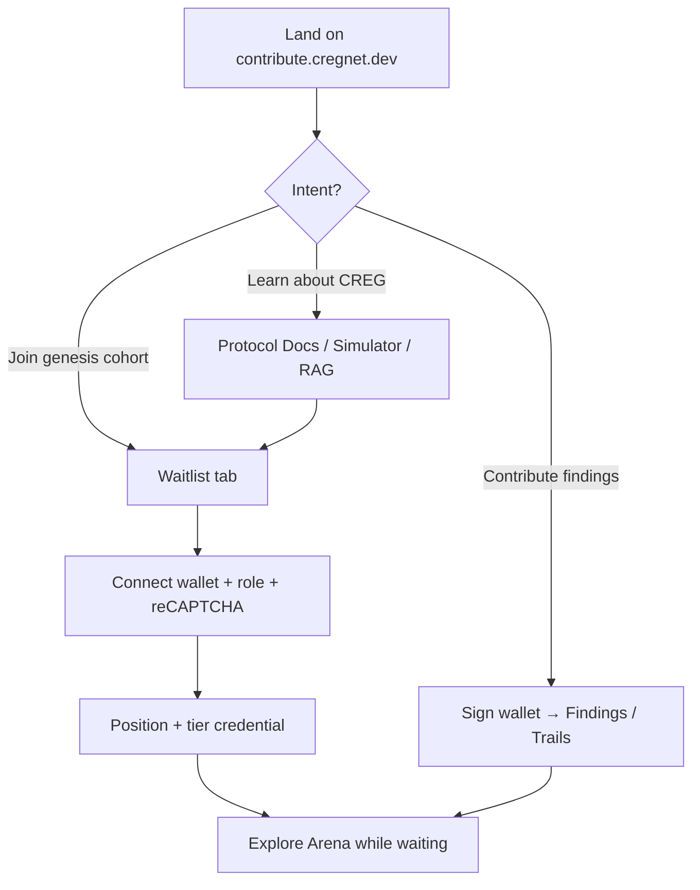

# Waitlist × Contribution Arena — Merge Audit

**Date:** 2026-07-05  
**Audience:** Product and engineering — deciding how to unify `waitlist.cregnet.dev` and `contribute.cregnet.dev`  
**Scope:** Full content and feature audit of both web apps, with a recommended merge path

---

## Executive summary

Today you operate **two separate product surfaces** on the same Firebase GCP project (`gen-lang-client-0098858574`):

| App | URL | Purpose today |
|-----|-----|----------------|
| **Creg-waitlist** | [waitlist.cregnet.dev](https://waitlist.cregnet.dev) | Marketing landing page + wallet waitlist registration |
| **CREG Contribution Arena** | [contribute.cregnet.dev](https://contribute.cregnet.dev) | Deep protocol learning, whitepaper, simulator, findings, contributor reputation |

**The merge goal is correct:** the waitlist should shrink to **registration only**. Everything that explains CREG — protocol, architecture, tokenomics, roadmap, FAQs — already lives in Arena (and goes deeper).

Arena **does not** implement waitlist registration today. It uses wallet connect for **contributor identity** (EIP-191 signature → Firebase custom token), not cohort enrollment.

### Recommended end state

1. **Contribution Arena** becomes the single public product surface at `contribute.cregnet.dev` (and optionally absorbs `waitlist.cregnet.dev` via redirect).
2. **Waitlist** becomes a **tab or section inside Arena** — not a standalone 12-section marketing site.
3. **`waitlist.cregnet.dev`** redirects to `contribute.cregnet.dev/waitlist` (or `?tab=waitlist`) after merge.

### What to remove from the waitlist app (high confidence)

Roughly **70% of the waitlist SPA** is educational/marketing content that Arena already covers better:

- About, pipeline, technology stack, persona paths, features modals, roadmap, tokenomics, full FAQ
- Long-form hero copy beyond enrollment count + CTA
- Parallel scroll-spy nav across 12 sections

### What to keep from the waitlist app (must preserve)

- Wallet connect + role selection + `registerWaitlist` callable
- Alpha/Beta tier logic (`ALPHA_CAP = 10_000`, position-based assignment)
- reCAPTCHA Enterprise on registration
- Firestore data model (`waitlist-prod` DB: `registrations`, `wallet_claims`, `stats/waitlist`)
- Live enrollment count, capacity meter, recent registration ticker
- Success credential UI (`AccessCredential`)
- Compact alpha disclaimer (waitlist ≠ testnet access)

---

## 1. App comparison at a glance

| Dimension | Creg-waitlist | CREG Contribution Arena |
|-----------|---------------|-------------------------|
| **Framework** | React 19 + Vite 6 + Tailwind 4 | React 19 + Vite 6 + Tailwind 4 |
| **Routing** | Single page, hash anchors (`#hero`, `#waitlist`, …) | Single page, **tab state** (no URL router) |
| **Hosting** | Firebase Hosting (waitlist target) | Firebase Hosting (`arena` target) |
| **Firestore DB** | `waitlist-prod` (isolated) | `arena-prod` (isolated) |
| **Functions codebase** | `registerWaitlist`, stats, trackView | `arena*` callables (20+ endpoints) |
| **Wallet purpose** | Connect address → register (no signature) | Connect → sign message → Firebase session |
| **Bot protection** | reCAPTCHA on registration | App Check + reCAPTCHA (configurable) |
| **Auth** | None (address-only identity) | Firebase Auth via wallet custom token |
| **Educational depth** | Marketing summaries | Whitepaper v0.3, workflow doc, RAG, simulator |
| **User progression** | Position + tier credential | XP, reputation, badges, trails, leaderboard |
| **Tests** | 3 static tests | 40+ unit tests + rules + emulator smokes |

Both apps share visual DNA (retro/paper design, `Background3D`, Motion animations, EIP-6963 + WalletConnect) but serve different jobs in the funnel.

---

## 2. Creg-waitlist — full inventory

### 2.1 Page structure (12 scroll sections)

| Section ID | Component | Category | Merge verdict |
|------------|-----------|----------|---------------|
| `#hero` | `Hero` | Marketing + live count | **Trim** — keep count + CTA; drop long pitch |
| `#about` | `CregAbout` | Education | **Remove** — Arena whitepaper + workflow |
| `#pipeline` | `CregPipeline` | Education | **Remove** — Arena simulator + workflow §4 |
| `#technology` | `TechnologyStack` | Education | **Remove** — Arena architecture explorer |
| `#paths` | `PersonaPaths` | Marketing | **Remove** — Arena contribution trails by role |
| `#how-it-works` | `HowItWorks` | Registration help | **Relocate** — short copy inside waitlist panel |
| `#access-tiers` | `WaitlistTierLadder` | Tier marketing | **Partial keep** — tier benefits → link to genesis playbook doc |
| `#waitlist` | `Waitlist` | **Core registration** | **Keep** — primary merge target |
| `#features` | `Features` + modals | Education | **Remove** — Arena findings + whitepaper |
| `#roadmap` | `Roadmap` | Education | **Remove** — Arena `docs/ROADMAP.md` + workflow |
| `#faq` | `FaqSection` (11 items) | Education | **Remove** — Arena RAG + whitepaper FAQ sections |
| `#tokenomics` | `Tokenomics` | Education | **Remove** — Arena workflow tokenomics + simulator |

**Chrome:** `NavBar`, `ParallelNav`, `Footer`, `Background3D`, `AlphaDisclaimer` — mostly removable except compact disclaimer and minimal footer links.

### 2.2 Core registration flow

```
Land → Connect wallet (EIP-6963 / WalletConnect)
     → Select role (Validator Node | Publisher | Security Audits)
     → Preview projected tier from live count + 1
     → Submit + reCAPTCHA Enterprise
     → Callable registerWaitlist (Firestore transaction)
     → Success: position, tier, AccessCredential card
```

**Not required today:** message signing, Sepolia ETH, Firebase login, on-chain proof.

### 2.3 Backend (Firebase Functions)

| Function | Used by SPA? | Merge notes |
|----------|--------------|-------------|
| `registerWaitlist` | Yes | **Must port** to Arena functions codebase or shared module |
| `waitlistPublicStats` | No | Optional — Arena could use instead of direct Firestore reads |
| `waitlistAdminStats` | No | Keep for operators |
| `waitlistTrackView` | No | Wire up in merged app or drop |

### 2.4 Data model (`waitlist-prod`)

| Collection | Purpose |
|------------|---------|
| `stats/waitlist` | `count`, `roleCounts.{validators,publishers,securityAudits}` |
| `registrations/{checksumAddress}` | `walletAddress`, `role`, `tier`, `position`, `timestamp` |
| `wallet_claims/{lowercaseAddress}` | Duplicate-prevention index |
| `stats/traffic` | Page views (unused by SPA) |

### 2.5 Config / content files

| File | Contents | Merge verdict |
|------|----------|---------------|
| `src/config/cregContent.ts` | Tagline, risks, pillars, pipeline, tech highlights, differentiators | **Delete from waitlist** — superseded by Arena canonical docs |
| `src/config/tiers.ts` | Alpha cap, tier definitions, projection helpers | **Port** to shared package or Arena `src/config/` |
| `src/config/links.ts` | GitHub, README, PUBLIC.md only | **Merge** with Arena `securityLinks.ts` policy |

### 2.6 Tests

Only 3 static tests in `tests/waitlist-db.test.ts`. Registration smoke script exists for emulator. **Port registration tests into Arena** during merge.

---

## 3. CREG Contribution Arena — full inventory

### 3.1 Navigation (7 tabs)

| Tab | Component | What it covers |
|-----|-----------|----------------|
| 1. Protocol Docs | `WhitepaperLibrary` | Canonical whitepaper + system workflow (v0.3.0-public-alpha), PDF/MD, section critiques |
| 2. Advisory RAG | `AIHelper` | Grounded Q&A over whitepaper + workflow (feature-flagged) |
| 3. Contribution Trails | `ContributionTrails` | Evidence-based quests by contributor type |
| 4. Audit Critiques | `FindingsBoard` | Public findings registry, votes, comments, appeals |
| 5. Merit Portfolio | `UserDashboard` | XP, reputation, badges, leaderboard |
| 6. Workflow Lab | `ProjectInfoCenter` | Architecture explorer + **CREG Workflow Simulator** |
| 7. Security Intel | `AdminPanel` | Admin-only moderation (requires `arenaAdmin` claim) |

**Gateway overlay:** `GatewayLanding` — wallet sign-in before full access; "Explore public" bypass for read-only browsing.

### 3.2 Educational content (already deeper than waitlist)

| Waitlist section | Arena equivalent | Depth comparison |
|------------------|------------------|------------------|
| CregAbout | Whitepaper §1–2, workflow intro | Arena: full spec with citations |
| CregPipeline | Workflow doc + simulator steps | Arena: interactive simulation |
| TechnologyStack | Whitepaper tech sections | Arena: searchable, section-linked |
| Features modals | Findings + workflow sections | Arena: community-reviewed |
| Roadmap | `docs/ROADMAP.md`, workflow phases | Arena: versioned documents |
| Tokenomics | Workflow §9, simulator tokenomics | Arena: formulas + presets |
| FAQ (11 items) | RAG chat + whitepaper | Arena: dynamic, cited answers |
| PersonaPaths | Contribution trails (5 tracks) | Arena: evidence-based progression |

**Conclusion:** Arena is the authoritative explainer. Waitlist duplicate content creates drift risk (two copies of protocol narrative).

### 3.3 Wallet in Arena (different from waitlist)

| Step | Arena | Waitlist |
|------|-------|----------|
| Connect | EIP-6963 + WalletConnect | Same |
| Verify ownership | EIP-191 signed challenge | **None** — connect only |
| Session | Firebase custom token | None |
| Purpose | Contributor identity for writes | One-time registration record |

**Merge decision required:** Should waitlist registration require signature verification (stronger) or stay connect-only (faster)? Arena's pattern is strictly stronger.

### 3.4 Backend (`arena-prod` + 20+ callables)

Key groups: findings pipeline, wallet auth (`arenaWalletChallenge` / `arenaWalletVerify`), documents/RAG, glossary, appeals, leaderboard, testnet health proxy.

**No waitlist callables exist in Arena today.**

### 3.5 Waitlist references in Arena

Arena source code has **zero waitlist UI**. Waitlist collections appear only in:

- Shared `firestore.rules` (coexistence rules for `stats`, `registrations`, `wallet_claims`)
- Deployment docs (`waitlistTouched: false` guarantees)
- `.env.example` ("never reuse waitlist secrets")

---

## 4. Content overlap matrix

| Topic | Waitlist | Arena | Duplicate? | Action |
|-------|----------|-------|------------|--------|
| What is CREG? | `CregAbout` | Whitepaper | Yes | Remove from waitlist |
| Publish → Anchor flow | `CregPipeline` | Simulator + workflow | Yes | Remove from waitlist |
| Tech stack | `TechnologyStack` | Whitepaper + architecture | Yes | Remove from waitlist |
| Role-based paths | `PersonaPaths` | Contribution trails | Partial | Remove; trails are richer |
| How to join waitlist | `HowItWorks` | — | **Unique** | Move into waitlist tab |
| Alpha/Beta tiers | `WaitlistTierLadder` | Genesis playbook (docs) | Partial | Keep tier UI; link to playbook |
| Registration form | `Waitlist` | — | **Unique** | Port to Arena |
| Live enrollment stats | Hero, meter, ticker | — | **Unique** | Port to Arena |
| Feature deep-dives | `Features` modals | Findings + docs | Yes | Remove from waitlist |
| Roadmap | `Roadmap` | `docs/ROADMAP.md` | Yes | Remove from waitlist |
| FAQ | `FaqSection` | RAG + whitepaper | Yes | Remove from waitlist |
| Tokenomics | `Tokenomics` | Simulator + workflow §9 | Yes | Remove from waitlist |
| Alpha disclaimers | `AlphaDisclaimer` | `PrivateSecurityDisclosureNotice` | Partial | Keep compact waitlist disclaimer |
| Wallet connect | `useWaitlistWallet` | `useWeb3Wallet` | Similar code | Unify into shared module |
| Contributor reputation | — | XP, badges, leaderboard | Arena-only | Do not mix with waitlist tier |

---

## 5. What the merged product should look like

### 5.1 User journey (proposed)



### 5.2 Proposed Arena tab layout (8 tabs)

| # | Tab | Source |
|---|-----|--------|
| 1 | Protocol Docs | Existing |
| 2 | Advisory RAG | Existing |
| 3 | Contribution Trails | Existing |
| 4 | Audit Critiques | Existing |
| 5 | Merit Portfolio | Existing |
| 6 | Workflow Lab | Existing |
| 7 | **Genesis Waitlist** | **New — ported from waitlist `#waitlist` section** |
| 8 | Security Intel | Existing (admin) |

Alternative: add waitlist as a **gateway action** ("Join Genesis Cohort") that opens a dedicated panel without a full tab — but a tab is clearer for deep-linking and `waitlist.cregnet.dev` redirects.

### 5.3 Minimal waitlist panel contents

Keep only:

1. **Headline** — "Join the Genesis Alpha cohort" (1–2 sentences)
2. **Compact `AlphaDisclaimer`** — waitlist ≠ testnet access
3. **`TierCapacityMeter`** — alpha slots remaining
4. **Registration form** — wallet, role, submit
5. **`AccessCredential`** on success
6. **`LiveTicker`** — optional social proof
7. **Link** — "Learn how CREG works →" pointing to Protocol Docs tab

Remove everything else.

---

## 6. Technical merge plan (phased)

### Phase 0 — Decisions (before code)

| # | Decision | Options | Recommendation |
|---|----------|---------|----------------|
| D1 | Primary domain | `contribute.cregnet.dev` only vs keep both | **Single domain**; redirect waitlist |
| D2 | Firestore layout | Keep `waitlist-prod` DB vs merge collections into `arena-prod` | **Keep separate DB** initially — lowest risk |
| D3 | Registration auth | Connect-only vs EIP-191 signature | **Keep connect-only for waitlist** initially; add signature in Phase 2 |
| D4 | Wallet hook | Duplicate vs shared package | **Extract `packages/wallet/`** shared module |
| D5 | Functions | Copy `registerWaitlist` into arena codebase vs shared functions package | **Add to arena codebase** with `waitlist-` prefix exports |
| D6 | URL routing | Tab-only vs React Router | **Add lightweight router** for `/waitlist` deep link |

### Phase 1 — Port waitlist into Arena (MVP)

1. Create `src/components/waitlist/` in Arena with ported components:
   - `WaitlistPanel.tsx` (from `Waitlist` section)
   - `TierCapacityMeter.tsx`, `AccessCredential` (from `WaitlistTierLadder`)
   - `LiveTicker.tsx` (optional)
2. Port `src/config/tiers.ts`, `waitlistApi.ts`, `useWaitlistCount.ts`, `useWaitlistWallet.ts` (or unify with `useWeb3Wallet`)
3. Add `registerWaitlist` + shared waitlist function code to Arena `functions/` (still targeting `waitlist-prod` DB)
4. Add reCAPTCHA provider to Arena entry (registration only — not full-app wrapper)
5. Add tab **"Genesis Waitlist"** + route `/waitlist`
6. Enable Firebase client read access to `waitlist-prod` stats (already in rules)

**Acceptance criteria:**

- User can register from Arena and receive position + tier
- Duplicate wallet rejected
- Live count updates
- No duplicate protocol marketing on waitlist panel

### Phase 2 — Unify wallet layer

1. Extract shared wallet package (`injectedProviders`, `walletConnect`, `mobileWalletDeepLink`)
2. Decide: one connect flow for both identity and registration, or separate "Register for cohort" vs "Sign in to contribute"
3. Optional: require EIP-191 signature before `registerWaitlist` (align with Arena security model)

### Phase 3 — Decommission standalone waitlist ✅ (implemented 2026-07-05)

1. Deploy Arena with waitlist tab — `deploy-phase3-waitlist-merge.ps1 -Deploy`
2. Configure `waitlist.cregnet.dev` → 301 redirect to `contribute.cregnet.dev/waitlist` — `Creg-waitlist/firebase.json` + `deploy-waitlist-hosting.ps1`
3. Stop deploying `Creg-waitlist/dist` to waitlist hosting target
4. Archive `Creg-waitlist/` as redirect-only shell (`public/index.html` fallback)
5. Update root `README.md`, `WHAT_TO_DO_NEXT.md`, `WAITLIST-ONLY-HOSTING.md`, `WAITLIST_FIREBASE_DEPLOY.md`

Smoke: `scripts/smoke-arena-waitlist.mjs`, `scripts/smoke-waitlist-redirect.mjs`

### Phase 4 — Optional consolidation

- Merge Firestore databases if operational overhead is too high
- Unified admin dashboard (waitlist stats + arena metrics)
- Cross-link: registered waitlist wallets get a badge in Arena profile
- Cohort export for genesis alpha ([GENESIS_ALPHA_COHORT_PLAYBOOK.md](./GENESIS_ALPHA_COHORT_PLAYBOOK.md))

---

## 7. Files to delete from waitlist (post-merge)

When the standalone app is retired, these waitlist files become obsolete:

### Components (remove entirely)

- `src/components/CregAbout.tsx`
- `src/components/CregPipeline.tsx`
- `src/components/TechnologyStack.tsx`
- `src/components/FaqSection.tsx`
- `src/config/cregContent.ts`
- Inline in `App.tsx`: `PersonaPaths`, `Features`, `Roadmap`, `Tokenomics`, `ParallelNav`, most of `Hero`

### Components (port first, then delete from waitlist)

- `Waitlist` section → `WaitlistPanel.tsx`
- `TierCapacityMeter.tsx`
- `WaitlistTierLadder.tsx` (tier cards — optional shortened version)
- `HowItWorks.tsx` (shortened)
- `AlphaDisclaimer.tsx` (compact variant)
- `hooks/useWaitlistCount.ts`, `hooks/useWaitlistWallet.ts`
- `waitlistApi.ts`, `config/tiers.ts`

### Backend (port, don't delete until Arena deploy verified)

- `functions/src/registerWaitlist.ts`
- `functions/src/shared.ts` (waitlist-specific parts)
- `functions/src/stats.ts`

---

## 8. Risks and mitigations

| Risk | Impact | Mitigation |
|------|--------|------------|
| Content drift between apps | Conflicting protocol narrative | Remove waitlist education; Arena docs are canonical |
| Two wallet flows confuse users | Abandonment at gateway | Clear CTAs: "Explore" vs "Join cohort" vs "Sign in to contribute" |
| Separate Firestore DBs | Cross-feature queries harder | Keep separate initially; badge linking via wallet address |
| Waitlist connect-only weaker than Arena sign-in | Sybil registrations | reCAPTCHA + rate limits; optional signature in Phase 2 |
| Firestore rules regression | Data leak or write exposure | Run `npm run test:rules` in Arena after merge |
| Hosting redirect breaks bookmarks | 404 on old anchors | Map `#waitlist` → `/waitlist`; document in changelog |
| Function codebase collision | Deploy wipes wrong functions | Deploy with explicit `--only functions:registerWaitlist,...` prefixes |
| Visual inconsistency | Waitlist retro vs Arena themes | Restyle waitlist panel to match Arena theme tokens |

---

## 9. What NOT to merge

Keep these **separate by design**:

| Waitlist concept | Arena concept | Why separate |
|------------------|---------------|--------------|
| Position (#00042) | XP / level | Cohort ordering ≠ contribution merit |
| Alpha / Beta tier | Badges / reputation | Enrollment wave ≠ review quality |
| `registerWaitlist` | `arenaSubmitFinding` | Different data models and trust assumptions |
| `waitlist-prod` DB | `arena-prod` DB | Isolation already proven in production deploys |

Do **not** award Arena XP for waitlist registration. Do **not** gate waitlist on contributor profile completion.

---

## 10. Open questions for review

1. **Should waitlist registration require wallet signature** (like Arena auth) before we merge?
2. **Should `waitlist.cregnet.dev` redirect immediately** or show a thin landing page with one button?
3. **Do we keep tier marketing copy** (Genesis Alpha / Vanguard Beta benefits) in the waitlist panel, or only show position + link to [GENESIS_ALPHA_COHORT_PLAYBOOK.md](./GENESIS_ALPHA_COHORT_PLAYBOOK.md)?
4. **Should registered users see their waitlist position inside Merit Portfolio** when signed in with the same wallet?
5. **Timeline:** merge before or after Hub API migration ([HUB_INTEGRATION.md](../CREG-Contribution-Arena/docs/HUB_INTEGRATION.md))?

---

## 11. Suggested next steps

| Priority | Action | Owner |
|----------|--------|-------|
| P0 | Review this document; resolve open questions in §10 | Product |
| P0 | Approve Phase 1 scope (waitlist tab only, no education port) | Product + Eng |
| P1 | Implement `WaitlistPanel` + tab in Arena | Eng |
| P1 | Port `registerWaitlist` function to Arena codebase | Eng |
| P1 | Add `/waitlist` route + `waitlist.cregnet.dev` redirect plan | Eng + Ops |
| P2 | Extract shared wallet package | Eng |
| P2 | Update public docs and README links | Docs |
| P3 | Decommission `Creg-waitlist` hosting | Ops |

---

## Appendix A — Waitlist component file list

```
Creg-waitlist/src/
├── App.tsx                    # Monolith: nav, hero, all sections, Waitlist form
├── main.tsx                   # reCAPTCHA provider wrapper
├── firebase.ts                # waitlist-prod client init
├── waitlistApi.ts             # registerOnWaitlist callable
├── components/
│   ├── AlphaDisclaimer.tsx
│   ├── CregAbout.tsx          # REMOVE
│   ├── CregPipeline.tsx       # REMOVE
│   ├── TechnologyStack.tsx    # REMOVE
│   ├── HowItWorks.tsx         # SHORTEN → waitlist panel
│   ├── FaqSection.tsx         # REMOVE
│   ├── WaitlistTierLadder.tsx # PARTIAL
│   └── TierCapacityMeter.tsx  # KEEP
├── config/
│   ├── cregContent.ts         # REMOVE
│   ├── tiers.ts               # KEEP
│   └── links.ts               # MERGE
├── hooks/
│   ├── useWaitlistCount.ts    # KEEP
│   └── useWaitlistWallet.ts   # KEEP / unify
└── wallet/
    ├── injectedProviders.ts   # SHARE
    ├── walletConnect.ts       # SHARE
    └── mobileWalletDeepLink.ts # SHARE
```

## Appendix B — Arena component file list (relevant to merge)

```
CREG-Contribution-Arena/src/
├── App.tsx                    # Add waitlist tab + optional router
├── components/
│   ├── GatewayLanding.tsx     # Add "Join cohort" CTA
│   ├── WhitepaperLibrary.tsx  # Canonical education (replaces waitlist sections)
│   ├── ProjectInfoCenter.tsx  # Simulator (replaces pipeline/tech)
│   ├── ContributionTrails.tsx # Replaces PersonaPaths
│   └── [new] waitlist/        # Ported waitlist panel
├── hooks/
│   └── useWeb3Wallet.ts       # Unify with useWaitlistWallet
└── config/
    ├── arenaFeatures.ts       # Add VITE_WAITLIST_ENABLED flag
    └── securityLinks.ts       # Merge PUBLIC_LINKS policy
```

## Appendix C — Shared infrastructure

| Resource | Waitlist | Arena | Merge impact |
|----------|----------|-------|--------------|
| GCP project | `gen-lang-client-0098858574` | Same | No change |
| Firestore DB | `waitlist-prod` | `arena-prod` | Keep both initially |
| Hosting site | waitlist target | `creg-contribution-arena` | Redirect waitlist → arena |
| Functions | waitlist exports | `arena*` exports | Add waitlist exports to arena codebase |
| reCAPTCHA | Registration | App Check | Both may coexist |
| WalletConnect project | Shared possible | Shared possible | Use one project ID |

---

*This audit is based on repository state as of 2026-07-05. Live production config may differ slightly — verify Firebase console before decommissioning waitlist hosting.*