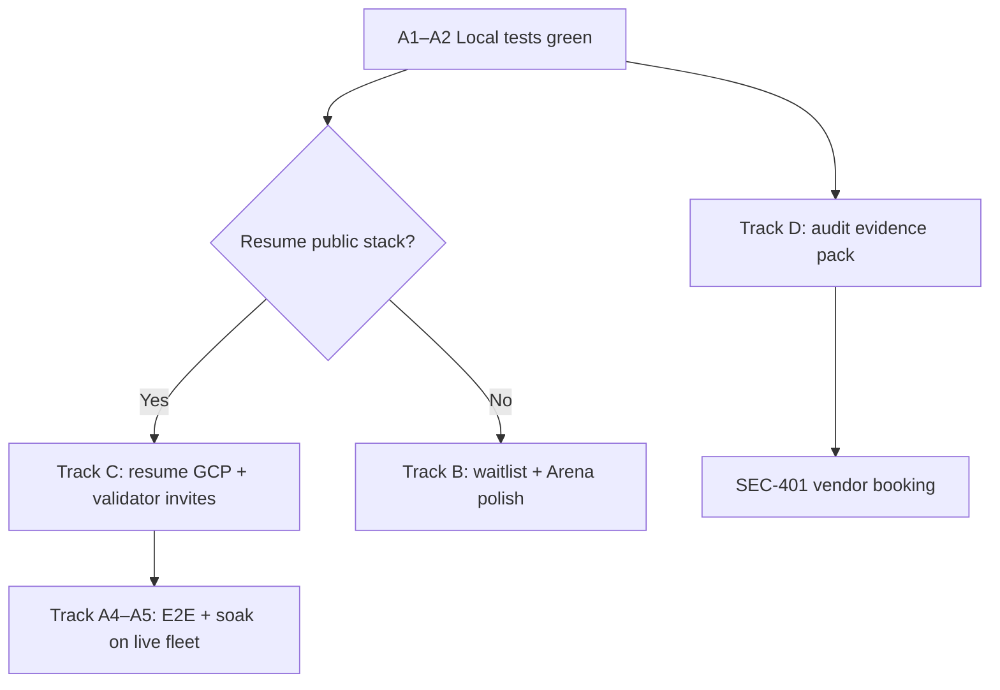

# What to do next

**Updated:** 2026-06-26  
**Audience:** Maintainers planning the next sprint after Iteration 6 (gossip + BatchOperations + finalize relays).

This is the **single planning entry point**. Use it to choose between full-system testing, product surfaces (waitlist / Contribution Arena), or testnet validator onboarding.

---

## Current snapshot

| Area | State | Notes |
|------|--------|-------|
| Core protocol | **Green** | `cargo test` gossip validation; `forge test` 37/37 contracts |
| Remediation | **Phase 1 largely closed** | ISSUE-002/003/006/007/008 mitigated or fixed — see [WEAKNESSES_GAPS_REMEDIATION_PLAN.md](./WEAKNESSES_GAPS_REMEDIATION_PLAN.md) §6 |
| Public testnet stack | **Paused (cost)** | See [TESTNET_STATUS.md](./TESTNET_STATUS.md); resume via [resume-testnet-hosting.ps1](../chain-registry/testnet/gcp/resume-testnet-hosting.ps1) |
| Waitlist | **Live** | Firebase — [WAITLIST-ONLY-HOSTING.md](./WAITLIST-ONLY-HOSTING.md) |
| Contribution Arena | **Live (alpha)** | Firebase + optional Hub API — [CREG-Contribution-Arena/README.md](../CREG-Contribution-Arena/README.md) |
| External audit | **Open** | [SEC-401-AUDIT-SCOPE.md](./SEC-401-AUDIT-SCOPE.md); evidence pack pending |

---

## Track A — Test the entire system

Run this before inviting external validators or resuming public hosting.

### A1. Local / CI verification (fast)

```powershell
cd chain-registry
cargo test --workspace
cd contracts
forge test
```

**Spot checks (Iteration 6):**

```powershell
cd chain-registry\crates\node
cargo test validate_
```

### A2. Local / fleet verification

| Step | Doc / script |
|------|----------------|
| Scale architecture | [TESTNET_SCALE_ARCHITECTURE.md](./TESTNET_SCALE_ARCHITECTURE.md) |
| Sepolia bootstrap smoke | `testnet.ps1 -RunSmokeTests`, `docker-compose.testnet.yml` |
| GCP observer/public services | `testnet/gcp/verify-public-services-profile.ps1`, `testnet/gcp/deploy-observer-pool.ps1`, `testnet/gcp/deploy-stack.ps1` |
| Real sandbox | `testnet/sandbox-301-verify.ps1` (`CREG_DEV_SANDBOX=false`) |
| Load / incentive soak | [testnet/SOAK_TEST.md](../chain-registry/testnet/SOAK_TEST.md) |

### A3. End-to-end publish → verified

| Step | Doc |
|------|-----|
| Sepolia smoke | [TESTNET_SEPOLIA_RUNBOOK.md](./TESTNET_SEPOLIA_RUNBOOK.md) § Publish smoke |
| Publisher flow | [PUBLIC_TESTNET_QUICKSTART.md](./PUBLIC_TESTNET_QUICKSTART.md) |
| Phase limits | [TESTNET_PHASE_SCOPE.md](./TESTNET_PHASE_SCOPE.md) |

### A4. Resume public fleet (when ready)

```powershell
cd chain-registry
.\testnet\gcp\resume-testnet-hosting.ps1
.\testnet\hosting-301-verify.ps1 -BaseDomain testnet.cregnet.dev
```

Runbook index: [testnet/gcp/README.md](../chain-registry/testnet/gcp/README.md).

### A5. Incentive soak (Phase 4 — not started)

Harness: [testnet/SOAK_TEST.md](../chain-registry/testnet/SOAK_TEST.md), `testnet/soak-test/`.  
Goal: ≥1000 packages over days; monitor `creg_total_rewards_distributed`, `creg_last_incentives_refresh` on `/metrics`.

---

## Track B — Improve waitlist & Contribution Arena

These are **separate product surfaces** from the Rust node. They do not block consensus work but matter for public alpha UX.

### B1. Waitlist

| Task | Doc |
|------|-----|
| Hosting model (Firebase-only) | [WAITLIST-ONLY-HOSTING.md](./WAITLIST-ONLY-HOSTING.md) |
| Deploy / DNS | [WAITLIST_FIREBASE_DEPLOY.md](./WAITLIST_FIREBASE_DEPLOY.md) |
| Owner metrics (private) | [WAITLIST-ADMIN-MONITORING.md](./WAITLIST-ADMIN-MONITORING.md) |
| SPA source | External repo [Creg-waitlist](https://github.com/samuel-1-avson/Creg-waitlist) |

**Suggested improvements:** cohort export for genesis alpha, rate-limit tuning, admin stats hardening, align copy with [TESTNET_PHASE_SCOPE.md](./TESTNET_PHASE_SCOPE.md).

### B2. Contribution Arena

| Task | Doc |
|------|-----|
| Product overview | [CREG-Contribution-Arena/README.md](../CREG-Contribution-Arena/README.md) |
| Implementation status | [CREG-Contribution-Arena/docs/IMPLEMENTATION_STATUS.md](../CREG-Contribution-Arena/docs/IMPLEMENTATION_STATUS.md) |
| Production readiness | [CREG-Contribution-Arena/docs/PRODUCTION_READINESS.md](../CREG-Contribution-Arena/docs/PRODUCTION_READINESS.md) |
| Hub API migration | [CREG-Contribution-Arena/docs/HUB_INTEGRATION.md](../CREG-Contribution-Arena/docs/HUB_INTEGRATION.md) |
| Hub SQL migration | `chain-registry/hub-api/migrations/002_contribution_arena.sql` |

**Suggested improvements:** finish Hub API adapter (replace standalone JSON routes), apply migration in staging, sync whitepaper bundle (`scripts/sync-whitepaper.mjs`), expand quest evidence tied to real testnet tasks.

### B3. Hub API (shared backend)

Design: [TESTNET-HUB-DESIGN.md](./TESTNET-HUB-DESIGN.md).  
Deploy: `testnet/gcp/deploy-hub-api-cloudrun.ps1`.

---

## Track C — Prepare testnet phase (validator onboarding)

Use when moving from waitlist-only hosting back to **open validator participation**.

### C1. Operator checklist (external validators)

**Primary:** [VALIDATOR_ONBOARDING_CHECKLIST.md](./VALIDATOR_ONBOARDING_CHECKLIST.md)

Covers stake, dual keys, sandbox policy, scanner profile, registration API, and health checks.

### C2. Maintainer infrastructure

| Doc | Purpose |
|-----|---------|
| [TESTNET_SCALE_ARCHITECTURE.md](./TESTNET_SCALE_ARCHITECTURE.md) | **10k+ validator target topology** |
| [GENESIS_ALPHA_COHORT_PLAYBOOK.md](./GENESIS_ALPHA_COHORT_PLAYBOOK.md) | Wave 1 cohort (slots 1–10,000) |
| [testnet/OPERATOR.md](../chain-registry/testnet/OPERATOR.md) | External validators + GCP public-services runbook |
| [GCP-VALIDATOR-FLEET.md](./GCP-VALIDATOR-FLEET.md) | Optional seed validators on GCP |
| [SECURITY_OPS_RUNBOOK.md](./SECURITY_OPS_RUNBOOK.md) | Key hygiene |

Legacy (do not use for new onboarding): [HYBRID-LOCAL-VALIDATORS.md](./HYBRID-LOCAL-VALIDATORS.md), [archive/3node-lab](../chain-registry/testnet/archive/3node-lab/README.md).

### C3. Resume hosting + DNS

1. `resume-testnet-hosting.ps1`  
2. `hosting-301-verify.ps1`  
3. Confirm `api.testnet.cregnet.dev` and explorer in chain spec  
4. Publish operator announcement with [TESTNET_PHASE_SCOPE.md](./TESTNET_PHASE_SCOPE.md) link

### C4. Scale decentralization (Phase 3 — medium term)

- Genesis Alpha target: **10,000+** registered validators (batched waves)  
- Pilot 5–10 → Batch A/B per [GENESIS_ALPHA_COHORT_PLAYBOOK.md](./GENESIS_ALPHA_COHORT_PLAYBOOK.md)  
- Criteria in [WEAKNESSES_GAPS_REMEDIATION_PLAN.md](./WEAKNESSES_GAPS_REMEDIATION_PLAN.md) Phase 3  
- Extend `creg doctor` decentralization checks (backlog)

---

## Track D — Security & audit (parallel)

| Priority | Item | Doc |
|----------|------|-----|
| P0 | Audit evidence pack | [WEAKNESSES_GAPS_REMEDIATION_PLAN.md](./WEAKNESSES_GAPS_REMEDIATION_PLAN.md) Phase 0 |
| P0 | Vendor outreach | [SEC-401-VENDOR-OUTREACH.md](./SEC-401-VENDOR-OUTREACH.md) |
| P1 | Bridge/ZK hardening | Phase 2 in remediation plan; [L1_L2_HARDENING.md](./L1_L2_HARDENING.md) |
| P1 | Bridge soak | `CREG_BRIDGE_KEY` on validator-1; metrics on `/metrics` |

**Iteration 7 suggestion:** Phase 0 evidence pack + Phase 2.1 bridge resilience review.

---

## Suggested order (June 2026)



**Practical default:** Run **Track A1–A2** now (cheap). In parallel, **Track D** evidence pack. Resume **Track C** when you are ready to onboard validators; keep **Track B** for marketing surfaces.

---

## Documentation map

| Need | Document |
|------|----------|
| Scale testnet topology | [TESTNET_SCALE_ARCHITECTURE.md](./TESTNET_SCALE_ARCHITECTURE.md) |
| Maintainer full index | [README.md](./README.md) |
| Public / external index | [PUBLIC.md](./PUBLIC.md) |
| Prioritized backlog | [NEXT_WORK.md](./NEXT_WORK.md) |
| Remediation phases | [WEAKNESSES_GAPS_REMEDIATION_PLAN.md](./WEAKNESSES_GAPS_REMEDIATION_PLAN.md) |
| Issue registry | [DEEP_DIVE_ANALYSIS.md](../chain-registry/DEEP_DIVE_ANALYSIS.md) |
| Alpha gate tracker | [L2_PUBLIC_ALPHA_GATE_STATUS.md](./L2_PUBLIC_ALPHA_GATE_STATUS.md) |
| Historical / superseded | [archive/README.md](./archive/README.md) |

---

_Update this file when a track ships or hosting phase changes._
