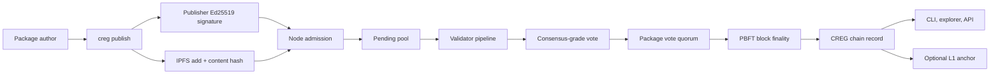
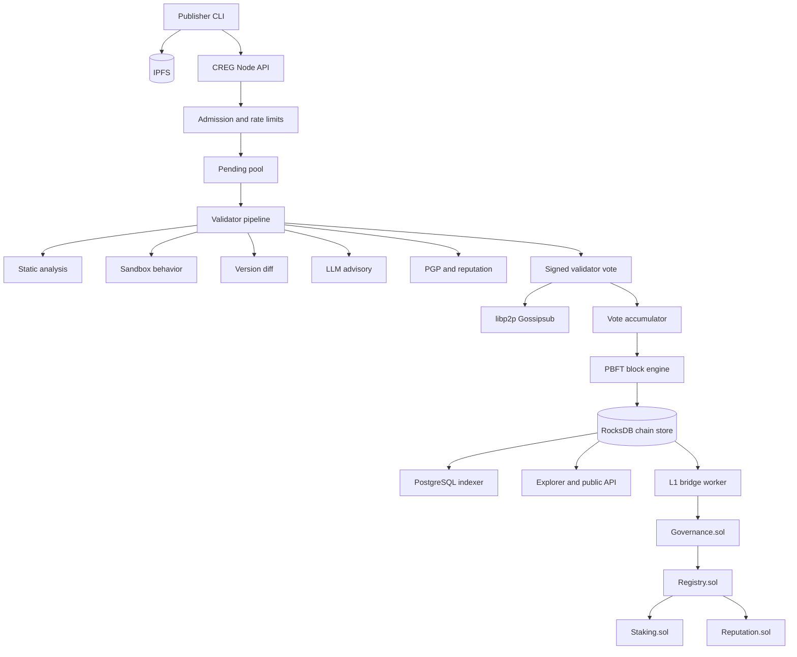

# Chain Registry (CREG) Technical Whitepaper

> Version: 0.4.0-public-testnet  
> Date: 2026-09-30
> Network: `creg-phase-c-testnet-2026-09-26-r7` on Ethereum Sepolia
> Status: Public R7 testnet; four active validators and finalized height 20 observed on 2026-09-30. Remaining economic and acceptance work is tracked in `CREG-TOKENOMICS-IMPLEMENTATION-PLAN.md` and `TESTNET-HEAL-STATUS.md`.
> Related resources: Public testnet quickstart, Phase scope definitions, Readiness gates status, CREG_SYSTEM_WORKFLOW.md, Contribution Arena
>
> Update 2026-09-30: Public explorer/API routing now serves R7. The R29 faucet has a reconciled ledger, bounded 100 tCREG claims, and 99,900 tCREG at the observed check. Outstanding token supply is 20,000,000 tCREG; the 42,000,000 target still requires the reviewed issuance work. Historical deployment addresses and observations below retain their stated dates; the signed R7 spec and tokenomics inventory identify the current deployment.
>
> Update 2026-09-21: Governance corrected to deployed `Governance.sol` (`0x122B...`); contract table completed (Appeal, VRF, PinningRewards); `zkValidationFee` corrected to 0 with a full fee table; verification counts updated to the 2026-08-23 snapshot; §8 numbering deduplicated; release pin updated to `v0.4.8-testnet`.
>
> Deployment note 2026-09-25: The next testnet acceptance target is four active validators on independent hosts plus four separate non-voting observer hosts. Validator acceptance requires real package analysis and 3-of-4 package and block quorum; simulated or degraded evidence is insufficient. The older four foundation identities mentioned below were described as observers, while the checked-in 2026-09-23 chain spec contains two active validators. See `docs/TESTNET-HEAL-STATUS.md` §14 for the proposed host layout and remaining live evidence.
>
> Update 2026-09-20: Status re-verified (empty chain, tip 0, no peers); release pin updated to `v0.4.7-testnet`; document links repaired after the 2026-09-19 docs archive pass.
>
> Update 2026-09-19: Active external validator onboarding enabled on Ethereum Sepolia. 2-of-3 multisig governance (`0x0fC1...`) approves staked applicants on Staking Hub (`0x3060...`). Dual cryptographic identity verification (`EVM EIP-191` + `Ed25519`) binds staker wallets to consensus nodes.

This whitepaper is technical documentation for the Chain Registry public testnet. It is not an offer to sell tokens, investment advice, or a claim of mainnet economic security. The external security audit track, SEC-401, remains open; production and mainnet claims require audit closure, operational hardening, and legal/compliance review.

For the most current architecture details, committee/reward formulas, performance snapshots, treasury monitoring, and iterative improvement log, see `docs/CREG_SYSTEM_WORKFLOW.md` (especially §9.11–9.12 and §15). This whitepaper provides the high-level protocol description; the workflow document tracks implementation evolution.

## Abstract

Modern software depends on package registries whose trust model is often centered on publisher accounts, centralized registry infrastructure, and local package-manager policy. Chain Registry (CREG) introduces an evidence-backed, validator-consensus package registry for open software ecosystems. Publishers submit signed, content-addressed packages; validators reproduce security analysis in isolated environments; consensus-grade votes bind the package identifier, content hash, scanner profile, and evidence digest; finalized records are written to a PBFT-backed local CREG chain. Sepolia hosts the live Staking Hub, token contracts, and `Governance.sol` M-of-N multisig governance. The legacy L1 batch checkpoint (`submitRollupBatch`) is retired and is not a settlement or anchoring path.

CREG is not a promise that malicious code can never pass a registry. It is a protocol for reducing single-party trust, making package risk evidence transparent, and turning package approval into an auditable, economically accountable network decision.

## 1. Executive Summary

Chain Registry is designed as a decentralized package-integrity network for
software supply chains. Its public testnet targets package publishers,
developers, validators, and security researchers who want a verifiable package
status layer across ecosystems such as npm, PyPI, Cargo, and similar
registries. The 2026-09-20 `creg-testnet-1` snapshot described four foundation observer identities (non-voting;
`validator-1`…`validator-4` in `chain-spec.sepolia.json`) and two bootnodes, and
external validator onboarding was enabled. At that check, no active validators
were observed on the public endpoint, which served a freshly rebooted empty
chain (tip 0, no peers, 2026-09-20). Independent operators
stake testnet tCREG tokens on Ethereum Sepolia (`Staking.sol` at
`0x30604Aa6f763fbde6aDCffbd8960af3031037331`), receive approval from the
multisig governance contract (`Governance.sol` at `0x122Bc2C704B966C74004506F98F13bf7b5F75b9D`),
and bind their consensus Ed25519 node key via dual cryptographic proofs
(`POST /v1/validators/register`) before actively participating in block production
and package verification committees.

At scale (thousands of validators), full redundant analysis would be impractical. CREG therefore uses a **hybrid mandatory + voluntary committee model**:

- A small **mandatory core** (target ~100 validators for large sets; the full set for ≤50) is selected at admission time.
- Selection is deterministic and VRF-seeded using a recent finalized block’s `vrf_output` (falling back to tip hash), combined with package identity.
- The ordered list is further biased by on-chain stake (from `Staking.sol`) and reputation, then capped (max 4 slots per `eth_address`) to limit concentration.
- Only the mandatory core runs the full security pipeline (fetch + sandbox + static + diff + evidence production). Their votes are required for the primary quorum (`floor(2M/3)+1` consensus-grade mandatory approvals).
- Any validator may voluntarily run the pipeline and contribute supplementary evidence. Voluntary votes are recorded, improve liveness during expansion, and earn reputation/rewards. **Public-alpha node today:** only the mandatory committee analyzes and votes; the live `validator_pipeline` does not produce voluntary votes.
- The committee metadata (size, ordered members, seed, effective size after any expansion) is stored in the `ChainRecord` and exposed via the public API (`GET /v1/packages/:canonical/committee`).
- On **Verified** finalization on the CREG chain, the validator pipeline emits `distributeWorkRewards` to the `ValidatorRewards` contract on Sepolia (when bridge key and contract address are configured), passing `isMandatory` flags so rewards and reputation reflect participation.

This design bounds CPU, memory, and IPFS load while preserving the core security property: package approval still requires a quorum of staked validators who produced reproducible, evidence-bound votes. The full validator set continues to provide PBFT block finality on the local CREG chain. Sepolia staking is the economic experiment for this research deployment, not production L1 security.

**Public alpha caveat:** Committee metadata is computed once at admission, persisted with the pending package, and reused by the expensive-analysis pipeline; validators no longer apply a second independent sampling predicate. Certified mode still requires a published checkpoint, a live multi-operator rehearsal, and external review before it can be represented as production-ready.

**Certified committee authority:** A new validator set is accepted only through a transition signed by a distinct prior-set quorum (`floor(2n/3)+1`). The certificate binds the effective height, prior block/fork anchor, both validator-set hashes, and the next set. Its stable logical transition ID excludes the replaceable signature list, so independently valid quorum subsets converge instead of creating false conflicts; every declared signature on ordinary transitions and descendants is verified and an exact witness digest remains available for audit. A pruned node uses its independently verified configured checkpoint object as the exact trust root and ignores, without peer penalty, a same-ID alternate witness it cannot verify without the preceding set. A committee assignment binds that transition ID, snapshot hash and height, selection randomness, seed, and ordered members; receivers derive the expected randomness from the exact anchor block's VRF output (or its hash fallback) and recompute the assignment rather than trusting the admitting node. Conflicting, replayed, expired, or fork-substituted authority records are rejected. Signed transition certificates propagate peer-to-peer, but every recipient validates the full witness, prior-set quorum, resource bounds, identity uniqueness, and local continuity before accepting ordinary gossip for propagation or persistence.

**Weak subjectivity:** A fresh or rebuilt node may be configured with a known-good signed validator-set checkpoint. Once configured, committee authority is accepted only from a cryptographically continuous certificate history containing that exact checkpoint. Nodes can retrieve certified history from peers, compare canonical block anchors, and persist only an eligible fully validated prefix. A supplied pre-checkpoint prefix is verified from explicit bootstrap authority; if retention has pruned it, the exact independently verified checkpoint is the trust root and all supplied descendants must verify from that set. Security-sensitive local reads repeat this authentication instead of trusting structurally valid disk content. Checkpoint installation validates its entire certified tail before one atomic replacement, removes unsigned compatibility remnants, and leaves the prior file untouched if any descendant is invalid. History writes are serialized, checkpoint ancestry is retained beyond the compatibility pruning cap, and reorg recovery truncates certificates anchored beyond the canonical ancestor. This is a deployment trust anchor, not a centralized validator role. `CREG_REQUIRE_CERTIFIED_COMMITTEES=true` enables fail-closed admission when no checkpoint-anchored authority exists. A repository publication/verification CLI, fail-closed anchor template, operator procedure, and CI gate now pass 11/11 adversarial/CLI tests over supplied quorum, anchor, freshness, evidence-signature, replay, rollback, and lineage inputs. The tool neither queries the chain nor creates a certificate, key, or canonical observation. The public alpha has not published a real independently verified checkpoint or completed the live multi-operator long-range/reorg rehearsal; no real checkpoint or key was fabricated for this evidence.

**Authoritative package namespace ownership (CR-07):** Post-activation first claims use a chain/genesis-bound v4 publisher authorization and a v2 npm/PyPI authority certificate rather than first-submitter ownership. The proposed controller signs a fresh, artifact-independent intent; each attesting validator separately fetches bounded official evidence and artifact bytes, verifies exact intent inclusion through a hash-pinned sidecar outside consensus, and signs a statement bound to the signed-spec policy and a recent canonical validator-set anchor. A preceding-set `floor(2n/3)+1` quorum certificate is retained with the transaction, so consensus, restart, rebuild, and reorg validation remain deterministic and perform no live registry request. Repository controls now include validator-local archive quotas/minimum retention/pressure-GC and an 11/11-tested signed activation-manifest gate whose checked-in state is deliberately disabled. The Rust boundary now validates payload digests in streaming form, removes stale private scratch directories, enforces a whole-invocation deadline, and contains child processes with Unix process groups or Windows Job Objects plus protected scratch DACL inheritance. Cryptographic npm and PyPI suites pass 20 and 29 tests respectively, each with one deliberately skipped external production fixture; refreshed npm SEA and PyInstaller one-file artifacts pass their private-environment smoke checks. These are not production verifier or rollout evidence: npm lacks an official trusted-publisher authentication-mode signal; both ecosystems still lack reviewed namespace-specific policy/trust approval and positive production fixtures, signed activation, operator rehearsal, and independent review.

Committee selection at admission uses VRF-seeded deterministic ordering further biased by on-chain stake, reputation, and **performance_score** (a moving-average signal of demonstrated analysis reliability, with decay after repeated contributions). The full `AnalysisCommittee` (including `member_performance_at_finalization` snapshot captured at package finalization) is stored immutably in the `ChainRecord` and exposed via CLI (`creg chain-record`) and API. On Verified finalization the pipeline emits `distributeWorkRewards(..., isMandatory[])` to `ValidatorRewards.sol`; successful emission also applies a small performance boost to mandatory participants, closing the incentive/selection feedback loop. Points awarded per contribution are 25 (mandatory) or 10 (voluntary) base, ×1.2 for correct vote, ×(rep/100). Base per-package reward is deliberately low (0.00001 CREG) with correct-vote bonus.

Pinning incentives are provided by the separate `PinningRewards.sol` contract (stake, registerPin/reportAccess, calculateRewards based on size×days×rate×popularity×reliability, verification, slashing). The ipfs-pinner sidecar can run alongside validators to earn availability rewards.

CREG combines:

- Content-addressed submission (IPFS CIDs + SHA-256) + publisher/validator staking on Sepolia.
- Multi-stage pipeline (fetch, static, sandbox, diff, evidence; optional PGP, reputation, advisory LLM) with deterministic consensus-grade evidence.
- Hybrid mandatory+voluntary committees (target M=100, VRF-seeded + stake/rep/performance bias, per-eth cap) with at-finalization performance snapshots stored in ChainRecord.
- PBFT block finality + package vote accumulator; Sepolia staking/governance
  experiments. The legacy L1 batch checkpoint and package-ZK qualification
  paths are retired.
- Work-based incentives: analysis rewards via L1 `distributeWorkRewards(..., isMandatory[])` (base 0.00001 CREG + bonuses, points 25/10×1.2, performance decay + L1 feedback) + separate PinningRewards (size×days×rate×popularity×reliability).
- Treasury-funded (governance mints), with emission counters, treasury addr, `last_incentives_refresh` timestamp, total distributed, pool balance, and pending estimate exposed in runtime config, profiles, /metrics, and refreshed by background task + on-demand.
- Public alpha with signed specs, documented limits, runbooks, and gates.

Targeted hardenings include retired ZK qualification with retained circuit
binding regression checks, bridge parsing/commitment fixes without a validity-
rollup claim, `enforceFinalizeRelays=true` by default, epoch-bound EIP-712
contract signatures under active verification, and gossip/vote guards. Full
status and residual gates are tracked in §15 of CREG_SYSTEM_WORKFLOW.md.

The design goal is practical: a developer should be able to ask, "Was this exact package artifact verified by a quorum of accountable validators, under which rules, with which evidence, and is the content still available?"

## 2. Problem Definition

Software supply-chain attacks frequently exploit gaps between identity, artifact integrity, package-manager behavior, and end-user trust. A compromised maintainer account, stolen API token, malicious dependency update, obfuscated install script, or typosquat can reach downstream developers quickly. Traditional registry trust models often make one organization or one publisher credential the effective root of trust for package availability and install decisions.

The core problems CREG addresses are:

| Problem | Why it matters | CREG response |
| --- | --- | --- |
| Publisher account compromise | A legitimate account can publish hostile artifacts | Require package signatures, on-chain publisher stake, and validator verification before "verified" status |
| Registry centralization | One registry policy or outage can control package trust | Store independent package verdicts on a validator chain with public proofs |
| Weak artifact reproducibility | Users may not know which exact bytes were reviewed | Bind verdicts to canonical package id, content hash, manifest hash, and IPFS CID |
| Non-transparent security review | Scanners may produce opaque or non-reproducible decisions | Attach scanner profile digests, evidence digests, and findings to validator votes |
| Validator or reviewer capture | A single reviewer can be wrong or malicious | Require quorum from staked validators and expose vote metadata |
| Content disappearance | Content-addressed hashes do not guarantee bytes remain retrievable | Use operator pinning, availability checks, and future pinning incentives |

CREG is a package verdict layer, not a replacement for source review, reproducible builds, dependency minimization, or secure runtime controls. It complements those practices by making package approval accountable and machine-verifiable.

## 3. Design Principles

### 3.1 Evidence Before Reputation

Publisher reputation matters, but package approval should be grounded in evidence about a specific artifact. CREG votes bind to the package canonical id, content hash, scanner profile digest, and evidence digest. A package with the same name and version but different bytes is a different trust object.

### 3.2 Determinism For Consensus

Consensus decisions must not depend on live, inconsistent external calls. CREG separates consensus-grade evidence from advisory evidence. Pinned local snapshots, deterministic scanners, and reproducible sandbox profiles can contribute to quorum; live lookups and LLM analysis are advisory unless converted into a pinned, reproducible evidence source.

### 3.3 Defense In Depth

No scanner catches all malware. CREG combines static analysis, sandbox behavior, diffing, ecosystem-specific rules, vulnerability signals, reputation, optional human/auditor workflows, revocation, and appeal mechanisms.

### 3.4 Transparent Trust Assumptions

The whitepaper and public docs must state where CREG is strong, where it is alpha, and where it depends on external controls such as validator diversity, IPFS pinning, Ethereum L1 availability, key management, and external audits.

### 3.5 Progressive Decentralization

The public alpha starts as a coordinated testnet with visible readiness gates. Mainnet-class decentralization requires a larger independent validator set, closed audit findings, governance operations, monitoring, and legal/compliance review.

## 4. Network Roles

| Role | Responsibility | Trust boundary |
| --- | --- | --- |
| Publisher | Signs and submits package artifacts; stakes tCREG before publishing | Must protect Ed25519 publish key and Ethereum EOA |
| Validator | Runs the analysis pipeline, signs votes, participates in PBFT finality | Must run the agreed scanner profile and sandbox configuration |
| Observer | Syncs state and serves read APIs without voting | Useful for public reads and indexers; not a trust root for package approval |
| Developer / consumer | Queries package status, installs with `creg`, verifies proofs | Chooses which CREG endpoint and policy to trust |
| Governance signer | Controls emergency and protocol parameters through contracts | Must protect multisig keys and avoid unilateral control |
| Auditor / researcher | Reviews contracts, circuits, protocol, and evidence | Not part of runtime consensus, but critical for confidence |
| Pinning operator | Keeps content-addressed package bytes retrievable | Availability depends on replication and pinning |

## 5. Protocol Overview

### 5.1 Lifecycle



The protocol moves package records through a small state machine:

| State | Meaning |
| --- | --- |
| `UNKNOWN` | The node has no package record and no pending submission |
| `pending` | The node admitted the package and it awaits validator finality |
| `verified` | A validator quorum accepted the package and the local CREG chain stored it |
| `revoked` | Governance or the publisher revoked the package, or consensus rejected it |

On the public alpha, "verified" means the queried CREG node's chain store has accepted the package after validator workflow. Users should set `CREG_NODE_URL` to a public or operator endpoint they trust and should read the Phase Scope documentation for current semantics.

### 5.2 Publish Path

1. The publisher prepares a package artifact and manifest.
2. The CLI computes a content hash and pins or uploads the artifact to IPFS.
3. The publisher signs the canonical payload with an Ed25519 key generated by `creg keygen`.
4. The publisher's Ethereum EOA must have publisher stake in `Staking.sol`.
5. The node verifies admission requirements, stores the package as pending, and exposes pending status.

### 5.2.1 Authoritative Namespace Ownership And Lifecycle

CR-07 separates upstream ecosystem verification from deterministic consensus:

1. The controller signs a fresh intent binding chain ID, genesis hash, `claim`
   or `recover` purpose, canonical npm/PyPI namespace, current and proposed
   Ed25519/EVM controllers, durable nonce, issuance time, and expiry. The
   intent excludes its enclosing artifact digest, avoiding a content-hash
   fixed point.
2. A new upstream release contains that exact intent. Protocol v2 receives an
   official `evidence_url` and `artifact_url`, fetches both independently with
   redirects disabled and separate size limits (16 MiB default and 64 MiB hard
   maximum for artifacts), hashes evidence with SHA-256, and computes the
   registry-native artifact identity: SHA-512 for npm or SHA-256 for PyPI.
3. A validator-local, hash-pinned sidecar outside consensus verifies registry
   signatures, signed-spec-pinned issuer/audience/workload policy and trust
   material, native artifact identity, and exact intent inclusion. For npm,
   provenance is not sufficient by itself: policy must require an official
   signal that trusted-publisher authentication mode was used.
   Its `verified_at` completion time is checked against the local validator
   clock but excluded from the shared proof/statement, so independently timed
   validators still sign byte-identical statement content.
4. Each validator retains accepted evidence as
   `creg-evidence:sha256:<digest>` and artifact bytes under
   `CREG_DATA_DIR/authority-artifacts/<sha256|sha512>/<prefix>/<digest>.bin`,
   then signs an authority statement bound to a recent canonical block and its
   authenticated validator-set hash. Repository code applies shared byte and
   entry quotas to the pair, protects it with one process-local mutation lock,
   collects only oldest retention-eligible content under pressure, and fails
   closed when capacity cannot be reclaimed. It does not coordinate multiple
   processes on a shared filesystem or provide deployment capacity alerts,
   backups/restore, disaster recovery, or legal-retention compliance.
5. A caller assembles matching signatures from the preceding validator set.
   The `floor(2n/3)+1` certificate is attached to the final v4 first claim or
   recovery authorization. Consensus verifies its policy pins, validity,
   controllers, native artifact digest, quorum, and fork anchor without
   contacting npm or PyPI.

Authority statements and certificates have a maximum 15-minute validity
window. Proof-retaining v4 publisher authorizations and v2 lifecycle events
have a maximum 24-hour issuance-to-expiry window.

The authority attestation and certificate-validation routes additionally
require a high-entropy `CREG_OPERATOR_API_KEY` through `X-Operator-Key` or
`Authorization: Bearer`. This service ACL does not replace controller or
validator/quorum signatures. Attestation has a dedicated 2-per-source-IP per
minute bucket; verifier concurrency defaults to 2 and has a hard maximum of 4.
The key remains server-side operator material and is never embedded in browser
code or injected by the public explorer proxy.
An operator public key is verification material, not a secret; it cannot
authenticate either private authority route.

After activation, legacy first-claim and rotation paths cannot silently
downgrade authority. `delegate` grants an expiring signed `publish` scope while
retaining the root controller; `transfer` requires current-root and successor
authorization; `recover` requires a fresh recovery-purpose v2 authority
certificate. Lifecycle and publisher authorization nonces are durable and
single-use. The same deterministic reducer runs during proposal, PBFT
pre-prepare, insertion, restart/rebuild, sync, and isolated reorg preflight, so
abandoned-branch controllers, delegations, certificates, and nonces do not
poison the adopted branch.

The node exposes a generic
`POST /v1/publisher/namespaces/lifecycle` endpoint plus action-specific
`/delegate`, `/transfer`, and `/recover` endpoints. Each action-specific route
requires the signed body to name the matching action.

Before activation, legacy CLI signing and legacy multisig are also fail-closed
by default. They require
`CREG_ALLOW_LEGACY_PUBLISHER_PROOF=true` on an explicitly non-production
network and remain unavailable when `CREG_PRODUCTION=true`.

The mechanism is implemented as a fail-closed protocol boundary, not a claim
of production upstream authority. The signed activation-manifest gate passes
11/11 while the checked-in manifest keeps every operational spec disabled.
Cryptographic npm and PyPI verifier candidates are now checked in: the npm
suite passes 20 tests with one external production fixture skipped, and the
PyPI suite passes 29 tests with one external production fixture skipped.
Same-target self-contained npm SEA and PyPI PyInstaller builds were reproduced
byte-for-byte locally. Those results do not supply production trust.

The npm verifier remains deliberately unable to return success because
official npm evidence does not distinguish OIDC trusted publishing from a
token-based publish that merely requested provenance. The frozen PyPI Windows
candidate requires a fresh private per-invocation temp directory; the current
cleared Rust child environment does not yet provide it. Reviewed production
policy/root material, live positive fixtures, target-platform artifacts, a
real production-signed activation manifest/spec, operator rehearsal, and
independent security review are still required.

Production deployment must also place each verifier in an unprivileged,
network-denied, resource-bounded OS sandbox with immutable executable, policy,
and trust mounts and close the hash-check-to-launch replacement window.
Repository archive quota/retention/pressure-GC controls are implemented.
Seven focused archive tests pass on Windows; the Unix-only symlink case was not
exercised on that platform. The 2026-08-23 workspace snapshot (commit `5868401`)
records CLI 49/49, node library 225/225, `creg-node` 227/227, node E2E 8/8,
node integration 11/11, workspace all-target exit 0 (including sidecar launch 2/2), and `cargo fmt --check` exit 0. Shared-filesystem coordination, capacity alerts,
backup/restore, disaster recovery, and legal-retention review remain external.

### 5.3 Validation Path

Validators fetch the exact artifact bytes by CID, verify hashes, execute the security pipeline, produce a deterministic risk summary, sign a vote, and gossip it to the validator set. A vote is consensus-grade only when it includes complete bundle refs, a non-degraded scanner profile, and a non-empty evidence digest.

### 5.4 Finality Path

CREG uses two related consensus layers:

| Layer | Purpose | Signature domain |
| --- | --- | --- |
| Package vote accumulator | Decides whether a package can become verified | `creg-vote-v2` |
| Block PBFT engine | Finalizes CREG chain blocks containing package records | `creg-pbft-v1` |

Notation: **n** is the active validator-set size. **M** is the mandatory analysis-committee size (`M = n` when `n ≤ 50`, capped at 100 above that; the four identities described in the 2026-09-20 snapshot were non-voting observers, not the committee). Package evidence uses **M**. Block PBFT and validator-set certificates use **n**.

For production-sized validator sets, **block PBFT** quorum is `floor(2n/3) + 1`. **Package evidence** quorum is `floor(2M/3) + 1` mandatory-committee approvals. Small coordinated testnet clusters use explicit configuration where documented; these testnet shortcuts are not mainnet assumptions.

### 5.5 Install And Verify Path

Developers use the `creg` CLI to query package status before installation. The CLI and resolver can use light-client proof paths where available, including package records, Merkle proofs, and PBFT signatures. Package-manager shims are available, but the public docs recommend direct `creg install` for stricter policy.

## 6. System Architecture



### 6.1 Implementation Stack

| Layer | Current implementation |
| --- | --- |
| Node runtime | Rust, Tokio, axum, tonic |
| Networking | libp2p Gossipsub and peer discovery |
| Chain storage | RocksDB with package indexes |
| Indexing | PostgreSQL via `db-sync` |
| Consensus | PBFT block finality and package vote accumulator |
| Signatures | Ed25519 for package/vote/PBFT paths; secp256k1 EOA for Ethereum contracts |
| Content addressing | IPFS CIDs and SHA-256 content hashes |
| Contracts | Solidity on Sepolia: Registry, Staking, Governance, Reputation, CREG token, ZK verifier |
| ZK | Groth16/Circom experiments for package attestations and double-sign evidence |
| Observability | Prometheus, Grafana, alerts, health endpoints |
| User tools | `creg` CLI, explorer, hub docs, testnet runbooks |

## 7. Package Record And Evidence Model

A CREG package record centers on a canonical package id:

```text
<ecosystem>:<name>@<version>
```

Examples:

```text
npm:example@1.2.3
pypi:example@1.2.3
cargo:example@1.2.3
```

The current implementation uses package ids, content hashes, IPFS CIDs, publisher metadata, validator signatures, scanner profile digests, evidence digests, and chain metadata. The key invariant is that validator decisions are bound to exact artifact bytes and the evidence profile used to evaluate them.

| Field | Purpose |
| --- | --- |
| Canonical id | Stable package key across API, contracts, CLI, and explorer |
| Content hash | Binds the verdict to exact artifact bytes |
| IPFS CID | Content-addressed retrieval path |
| Manifest hash | Binds declared package metadata where available |
| Publisher signature | Proves package submission authority under the publisher Ed25519 key |
| Publisher EOA | Binds submission to on-chain stake |
| Namespace authority certificate | Binds a v4 first claim or recovery to signed-spec-pinned npm/PyPI evidence, native artifact identity, controller intent, recent canonical anchor, and preceding-set quorum |
| Scanner profile digest | Commits to rule/model/profile versions used by the validator |
| Evidence digest | Commits to deterministic findings used in the vote |
| Validator signature | Commits a validator's approval or rejection vote |
| PBFT signatures | Commit finalized blocks to validator consensus |
| L1 references | Optional transaction hashes, contract addresses, and state roots |

## 8. Validator Security Pipeline

CREG's validator pipeline is designed to make package approval hard to fake and easy to audit. At large validator set sizes, the expensive parts of the pipeline (IPFS fetch + sandbox execution + full evidence production) are performed only by a small, publicly verifiable **mandatory analysis committee**.

### 8.1 Committee Selection (at admission time)
- Computed deterministically the moment a submission passes admission (see `package_admission::compute_analysis_committee_at_admission`).
- Base randomness comes from a recent finalized block’s `vrf_output` (VRF-seeded, re-using the same infrastructure used for block proposers) combined with package identity and chain tip.
- The resulting ordered list is stake-weighted (higher on-chain stake produces smaller effective score → earlier position) and reputation-biased.
- A hard per-`eth_address` cap (currently 4) prevents any single operator from dominating the mandatory core.
- The resulting `AnalysisCommittee` (size, ordered member list, selection seed, effective size after any expansion) is attached to the pending entry and later written into the `ChainRecord`.

### 8.2 Mandatory vs Voluntary
- Only the primary mandatory core is required to produce consensus-grade evidence for the package-level quorum.
- Any validator may voluntarily execute the full pipeline. Voluntary votes are recorded with `is_mandatory=false`, help during committee expansion on timeout, and are eligible for reputation/rewards. **Public-alpha node today:** only the mandatory committee analyzes and votes; `validator_pipeline` does not produce voluntary votes.
- This hybrid approach is the target-scale bound (classroom example: 10,000 validators). Public-alpha `max_validators` is 50; the four identities described in the 2026-09-20 snapshot were non-voting observers.

### 8.3 Admission
Validators fetch the exact artifact bytes by CID, verify hashes, execute the security pipeline, produce a deterministic risk summary, sign a vote, and gossip it to the validator set. A vote is consensus-grade only when it includes complete bundle refs, a non-degraded scanner profile, and a non-empty evidence digest. Only mandatory core members are obligated to do the heavy work; volunteers may participate freely.


Before a package enters consensus, admission checks include:

- Publisher signature verification.
- On-chain publisher stake check.
- Canonical id and content-hash validation.
- IPFS fetchability checks.
- Rate limits and operator API controls.
- Pre-mempool rule gates for high-risk patterns.

### 8.4 Static Analysis

Static analysis examines package contents for dangerous APIs, install hooks, obfuscation, credential exfiltration patterns, typosquatting signals, ecosystem-specific files, high-entropy blobs, pinned vulnerability advisories, and scanner rule matches. Consensus-relevant analysis uses pinned or local data where possible so different validators can reproduce results.

### 8.5 Behavioral Sandbox

The sandbox stage executes package behavior under controlled isolation. The preferred public profile uses `nsjail`; fallback engines include gVisor, Docker, and WASM where configured. The public alpha gate requires `CREG_DEV_SANDBOX=false` for public validators and health reporting of the active sandbox engine.

Sandbox evidence can include observed network hosts, filesystem writes, process spawns, timeouts, and manifest violations.

### 8.6 Differential Analysis

Validators compare a new version against prior verified behavior. A package update that adds a new network beacon, install script, filesystem write, or obfuscated code path can receive elevated risk even if each behavior is not independently conclusive.

### 8.7 Vulnerability And Malware Signals

The validator stack supports YARA-style rules, threat-intel hashes, and OSV advisory data. Live external lookups are kept out of the deterministic consensus path unless they are pinned or otherwise made reproducible. This aligns with the principle that consensus should not depend on inconsistent third-party responses.

### 8.8 PGP, Reputation, And Publisher Context

CREG can verify detached PGP signatures and track publisher/validator reputation. Reputation influences review context, but it does not replace package-specific evidence.

### 8.9 LLM-Assisted Review

LLM analysis can summarize semantic risk, explain suspicious files, and help human reviewers triage packages. It is advisory. LLM output is not the trust root for package approval, and public surfaces must label it separately from deterministic consensus findings.

## 9. Mechanical Consensus And Finality

CREG uses "mechanical consensus" to mean deterministic, machine-checkable agreement over package status and validator membership. The protocol does not ask a trusted operator to decide that a package is safe or that a validator should join. Instead, validators evaluate explicit rules, sign bounded messages, and allow contracts or nodes to verify threshold agreement.

CREG currently has four consensus surfaces:

| Surface | What it decides | Primary verifier | Threshold |
| --- | --- | --- | --- |
| Validator admission consensus | Whether a pending validator applicant joins the active set | `Staking.approveByConsensus` | At least two thirds of active validators |
| Package evidence consensus | Whether exact package bytes become verified or rejected | CREG vote accumulator | `floor(2M/3) + 1` mandatory-committee approvals |
| Block PBFT finality | Whether a CREG block is finalized into the local chain | PBFT engine | `floor(2n/3) + 1` of the validator set, with strict small-cluster handling |
| Optional L1 package finalization | Whether an L1 package record becomes verified | `Registry.finalizePackage` | Contract `quorumPct`, default 67% with a ceiling-derived quorum |

Every canonical CREG child block must have a timestamp strictly later than its
parent. Live PBFT proposals use whole Unix seconds and must be within 60 seconds
of the receiving node's clock. Historical replay, sync, and reorg validation
use deterministic parent-child monotonicity and do not reject a valid old block
merely because its timestamp is far from the current wall clock.

The key theme is evidence binding: consensus messages bind identities, package bytes, rule versions, scanner profiles, evidence digests, or block hashes so signatures cannot be reused in a different context.

### 9.1 Validator Admission Mechanical Consensus

Validator admission is a mechanical consensus process for admitting new operators without relying on one privileged key.

The lifecycle is:

1. An applicant stakes at least the validator minimum and enters `Pending`.
2. Active validators independently evaluate the applicant against a deterministic rule set: stake present, identity registered, cooldown respected, application not expired, and rule-set version current.
3. If the applicant passes, each active validator signs an EIP-712 admission attestation over `(applicant, stake, nonce, ruleSetVersion, validatorSetEpoch)`.
4. Attestations are broadcast between nodes.
5. Any node with at least two thirds of the active set can submit the sorted attestation bundle to `Staking.approveByConsensus`.
6. The contract verifies signer activity, sorted unique signers, signature recovery, nonce freshness, pending state, application timeout, and quorum before activating the validator.

On-chain invariants include:

| Invariant | Purpose |
| --- | --- |
| Applicant must be `Pending` | Prevents re-approving active, rejected, withdrawn, or nonexistent accounts |
| Applicant stake must meet `minValidatorStake` | Keeps validator admission economically bonded |
| Application must be inside `APPLICATION_TIMEOUT` | Prevents stale approvals from being replayed later |
| Nonce must be unused for the applicant | Prevents replay of an old quorum bundle |
| Signed validator-set epoch must equal the live epoch | Invalidates a bundle after any active membership change, including a remove/add sequence that restores the same count |
| Signers must be active validators | Prevents inactive or external accounts from counting |
| Signers must be strictly sorted | Prevents duplicate signers in an O(n) contract check |
| Each signature must recover to its declared signer | Prevents forged attestations |
| `signerCount * 3 >= activeValidatorCount * 2` | Enforces at least two-thirds admission quorum |

This admission path is intentionally "mechanical": the off-chain predicate is versioned by `RULE_SET_VERSION`, and the on-chain contract verifies the threshold. Governance retains an emergency approve/reject path while enabled, but it can be permanently disabled so admission becomes consensus-only.

### 9.2 Package Evidence Vote Message

Package votes are signed over a domain-separated Ed25519 message:

```text
creg-vote-v2|<canonical>|<content_hash>|<approved>|<validator_pubkey>|<scanner_profile_digest>|<evidence_digest>
```

This design prevents a validator signature from being reused across a different package, content hash, evidence profile, or approval decision.

### 9.3 Consensus-Grade Package Votes

A vote must be complete and non-degraded to count toward quorum. Votes missing evidence metadata may remain visible for transparency, but they should not satisfy package finality.

Consensus-grade requirements include:

- Known active validator.
- Valid Ed25519 signature.
- Non-empty evidence digest.
- Complete analysis bundle references.
- Scanner profile that is not in degraded/mock mode.
- Agreement among quorum votes on the evidence/profile bundle.

The package vote accumulator tracks PREPARE and COMMIT votes for a package. Degraded votes are stored for transparency but excluded from quorum. Duplicate validator votes do not count twice. Approval quorum verifies the package; enough rejections can make approval quorum impossible and reject the package.

For an assigned validator set of size `n`, package quorum is:

```text
floor(2n / 3) + 1
```

Examples:

| Assigned validators | Required quorum |
| --- | --- |
| 3 | 3 |
| 4 | 3 |
| 5 | 4 |
| 7 | 5 |
| 10 | 7 |

CREG's package evidence consensus is therefore not just "validators voted yes." It is "enough active validators signed the same package content under the same consensus-grade scanner profile and evidence digest."

### 9.4 PBFT Block Finality

Finalized package decisions become CREG chain transactions. The block-level PBFT engine runs PRE-PREPARE, PREPARE, and COMMIT phases with Ed25519 signatures under the `creg-pbft-v1` domain. Blocks include transaction roots, validator-set hashes, and PBFT signatures for light-client verification.

The security assumption is standard for PBFT-style systems: safety depends on fewer than one third of validator voting power being Byzantine, plus network assumptions appropriate for timely view changes. CREG's alpha uses coordinated operators while the validator set expands.

PBFT phase signatures bind the phase and block hash:

```text
creg-pbft-v1:<phase>:<block_hash>
```

The PBFT round has three main phases:

| Phase | Mechanic | Failure handling |
| --- | --- | --- |
| PRE-PREPARE | Selected proposer broadcasts the candidate block | Non-selected proposers are rejected |
| PREPARE | Validators verify and sign the block hash | Quorum moves the round to COMMIT |
| COMMIT | Validators commit to the prepared block | Quorum finalizes and stores the block |

For a PBFT validator set of `n = 3f + 1`, a replacement proposer must carry a new-view certificate with `2f + 1` signed view-change messages (3-of-4 when `n = 4`) and preserve the highest prepared value. The lower `f + 1` threshold can prompt another replica to send its own view-change message; it does not certify a new view or authorize backup leadership. A local timeout alone can only initiate a signed view-change vote.

Small cluster behavior is intentionally conservative: a three-validator set requires unanimity for the usual PBFT safety model unless an explicit local/testnet flag opts into a 2-of-3 bootstrap quorum. That shortcut is not a mainnet security assumption.

### 9.5 Optional L1 Package Finalization

The upgraded Solidity `Registry.finalizePackage` source verifies EIP-712
`PackageVerdict` signatures. Each signature binds the chain and Registry
deployment, canonical package key, content hash, approve/reject decision,
exact monotonic `Staking.validatorSetEpoch`, current `quorumPct`, and an
`issuedAt`/`expiresAt` interval no longer than 15 minutes. The signer must
remain active and the signed epoch/policy must still be current. This path is
separate from the local Ed25519 package vote accumulator.

The contract-level required approvals are:

```text
required = ceil(activeValidators * quorumPct / 100)
```

The current default `quorumPct` is 67, and governance can update the value
within contract bounds. Because the policy value is signed, a governance
change invalidates outstanding verdict bundles. This is a research-alpha ABI
change: deployed bytecode, signers, and relayers require a coordinated reviewed
upgrade before this source behavior exists on a network.

Separately, `PinningRewards.sol` is deployed on Sepolia (`0x4621...D66b`) but its address is not pinned in the signed `chain-spec.sepolia.json` contract map; the §10 row is the deployment record until the spec is updated.

### 9.6 Validator Set

The signed chain spec contains bootstrap validator information, while validator admission and validator-set sync connect to L1 staking state. Validator admission can be approved by governance in emergency paths or by validator consensus under the staking contract's consensus admission rules.

## 10. Ethereum L1 Contracts

CREG uses Ethereum Sepolia for the public testnet contract layer. The contract system provides staking, registry status, multi-signature governance, reputation, and verification reward distribution.

| Contract | Active Sepolia Address | Role |
| --- | --- | --- |
| `Staking.sol` (Staking Hub) | `0x30604Aa6f763fbde6aDCffbd8960af3031037331` | Publisher/validator stake, validator lifecycle, unbonding, slashing |
| `CregToken.sol` (tCREG) | `0x167Ab975dc95b79727Ed76BD8AAb70463F6499E2` | ERC-20 testnet CREG token with hard cap and permit support |
| `Governance.sol` | `0x122Bc2C704B966C74004506F98F13bf7b5F75b9D` | Canonical M-of-N multisig governing validator admission, proposals & emergency actions (deploy default threshold 2) |
| `Registry.sol` | `0xD0F465ca185a99E268be0C4FF5A135Bdf89FAF3B` | L1 package lifecycle and EIP-712 finalize/revoke paths |
| `Reputation.sol` | `0xeb4933741A59768027d5b4f86c6834350ADF3E06` | Validator/publisher scoring signals (0–100, new accounts start at 50) |
| `ValidatorRewards.sol` | `0x11eb80abA89fb3fAB63d39900c2c644B5893a604` | Work-based incentives distribution |
| `Appeal.sol` | `0x6A63d6b67e0b7d96B010ABb9CC4aF6AE378a0631` | Appeal bonds, panel votes, pull-payment refunds |
| `VRF.sol` | `0xbfC05c7efD553922096ea632D9e75D8D10057ec4` | Chainlink VRF committee randomness (7 validators per package by default) |
| `PinningRewards.sol` | `0x46212D928b9Fa1f793B197710d617a4f453eD66b` | Pinning incentives (deployed; not pinned in the signed chain spec) |
| `ZKVerifier.sol` / `Groth16Verifier.sol` | Deployed reference | Retained experimental Groth16 verifier |

The active Sepolia addresses are enforced in `chain-spec.sepolia.json` and monitored by the runtime observer nodes, except `PinningRewards.sol`, which is deployed but not yet pinned in the spec.

### 10.1 Committee Randomness (VRF)

`VRF.sol` requests Chainlink VRF random words and assigns a per-package committee with a Fisher-Yates shuffle over the active validator set. `validatorsPerPackage` defaults to 7 and is governance-adjustable from 3 to 50. Node block headers separately carry `vrf_output`/`vrf_proof` for proposer and committee seeding, so randomness is dual-stack: on-chain VRF plus node-side VRF-seeded selection.

### 10.2 Reputation Scoring

`Reputation.sol` scores each account from 0 to 100 from recorded approvals, rejections, and weighted mistakes; new accounts start at 50. Scores feed committee weighting, slash-pool redistribution, and review context, but never replace package-specific evidence.

### 10.3 Appeals

`Appeal.sol` lets a publisher bond 0.1 ETH to reopen a rejected package before a governance-approved panel. Panelists post 0.01 ETH per vote; 3 agreeing votes resolve the appeal within a 7-day window. Winning publishers and correct panelists withdraw via pull-payment; forfeited bonds go to governance.

## 11. Tokenomics And Incentive Design

The CREG token is the economic coordination asset in the testnet contract system. It is used to bond publishers, bond validators, parameterize participation, slash misconduct, and fund future ecosystem growth. In public testnet, the token is testnet-facing (`tCREG` in user docs) and should not be treated as a finalized mainnet economic instrument.

### 11.1 Token Purpose

CREG has four intended protocol functions:

| Function | Explanation |
| --- | --- |
| Publisher stake | Publishers bond CREG before package submission so malicious or revoked packages can create economic consequences |
| Validator stake | Validators bond CREG before joining consensus so dishonest behavior can be penalized |
| Slashing and redistribution | Misconduct penalties accumulate in a slash pool that can reward honest active validators |
| Governance-controlled growth | The capped reserve can be released by owner/governance for validator rewards, grants, ecosystem growth, or other approved programs |

CREG is not used as gas on Ethereum Sepolia. Ethereum transactions still require Sepolia ETH. CREG is the protocol's staking and incentive token inside the CREG contract system.

### 11.2 Supply Model

The current `CregToken.sol` contract defines a hard-capped token supply:

| Parameter | Current value |
| --- | --- |
| Token name | `Chain Registry Token` |
| Token symbol | `CREG` |
| Decimals | 18 |
| Maximum supply | 42,000,000 CREG |
| Initial minted supply | 20,000,000 CREG |
| Remaining mint capacity | Up to 22,000,000 CREG (governance-controlled) |
| Mint authority | Contract owner/governance only |
| Burn support | Token holders can burn their own CREG |
| Permit support | EIP-712-style `permit` for allowance setting |

The hard cap means `totalSupply + mintAmount <= 42,000,000 CREG` must hold for any mint. Per-package verification incentives are set at extremely low levels (base 0.00001 CREG + 0.000005 correct-vote bonus) precisely so this fixed supply can support the network for a very long time, even with tens or hundreds of millions of packages. Treasury-funded rewards (governance mints) + emission counters + treasury address exposure in runtime config/metrics provide operational visibility into draw. The reserve is not automatically emitted. It can only enter circulation through explicit owner/governance mint calls.

### 11.3 Current Initial Allocation

The current token constructor mints 20,000,000 CREG:

| Allocation bucket | Amount | Percent of max supply | Notes |
| --- | ---: | ---: | --- |
| Team | 4,000,000 CREG | ~9.52% | Current constructor parameter bucket |
| Investors | 3,000,000 CREG | ~7.14% | Current constructor parameter bucket |
| Community | 5,000,000 CREG | ~11.90% | Community allocation bucket |
| Treasury | 8,000,000 CREG | ~19.05% | Treasury and operations bucket (seed for rewards) |
| Unminted capped reserve | 22,000,000 CREG | ~52.38% | Future governance-controlled capacity |
| Maximum supply | 42,000,000 CREG | 100.00% | Absolute cap |

Verification incentives are tiny (0.00001 CREG base + 0.000005 correct-vote bonus) precisely to make the entire 42M supply last a very long time. Emission counters (succeeded/failed), treasury address, `last_incentives_refresh` timestamp, total distributed, pool balance, and pending estimate are exposed in runtime config, profile incentives, and Prometheus metrics (`creg_*` gauges); a periodic background task (60s) + on-demand refresh keeps values current for treasury draw monitoring. See CREG_SYSTEM_WORKFLOW.md §9.12 and §15 for current formulas, points (25/10 base ×1.2 correct), performance decay (0.985 after >5), L1 hook, snapshots, and incentive integration.

### 11.4 Staking Roles And Minimums

CREG distinguishes publisher stake from validator stake:

| Role | Current minimum | Contract path | Purpose |
| --- | ---: | --- | --- |
| Publisher | 1 CREG / tCREG | `stakeAsPublisher` | Required before publishing packages |
| Validator | 100 CREG / tCREG | `applyToBeValidator` | Required before validator admission |
| Light validator | 50 CREG / tCREG | Contract constant present | Future or specialized role; not the main validator path |

Minimum stakes are configurable by governance through `updateMinStakes`. The current chain spec mirrors the 1 tCREG publisher minimum and 100 tCREG validator minimum.

Publisher staking flow:

1. Publisher approves the staking contract (`token.approve(stakingHub, amount)`).
2. Publisher calls `stakeAsPublisher(amount)`.
3. Registry admission checks `staking.stakedBalance(publisher) > 0`.
4. Publisher can submit packages while stake remains bonded.
5. Governance revocation of a malicious package can slash the publisher.

Validator onboarding flow:

1. Operator generates consensus Ed25519 keypair and starts node daemon (`creg-node`).
2. Operator approves staking contract: `token.approve(0x3060..., 100 tCREG)`.
3. Operator submits application: `staking.applyToBeValidator(100 tCREG)`. State becomes `Pending`.
4. Governance Review: Multisig governance signs and executes `Staking.approveValidator(operatorAddress)`. State transitions to `Active`.
5. Cryptographic Identity Binding: Operator executes `POST /v1/validators/register` with dual cryptographic signatures:
   - EVM staker signature (EIP-191) proving stake ownership.
   - Ed25519 signature proving node consensus key ownership.
   - Timestamped nonce ensuring replay protection.
6. The node sync worker observes active on-chain status and admits the validator into the live PBFT consensus set and package verification committees.

### 11.5 Validator Lifecycle

The staking contract models validator state explicitly:

| State | Meaning |
| --- | --- |
| `None` | No validator record |
| `Pending` | Stake escrowed; waiting for governance or mechanical consensus admission |
| `Active` | Validator can participate in consensus |
| `Unbonding` | Validator has exited or been ejected; stake remains locked |
| `Withdrawn` | Stake withdrawn after unbonding |
| `Rejected` | Pending application rejected and stake refunded |
| `Expired` | Pending application timed out and stake refunded |

Lifecycle parameters:

| Parameter | Current value | Purpose |
| --- | ---: | --- |
| `APPLICATION_TIMEOUT` | 7 days | Pending validator applications expire if not approved |
| `UNBONDING_PERIOD` | 14 days | Validators cannot immediately withdraw after exit |
| `RESTAKE_COOLDOWN` | 7 days | Ejected validators must wait before re-applying |
| `MAX_SLASH_COUNT` | 3 | Repeated slashing can auto-eject a validator |

The unbonding period is important: validators remain slashable during unbonding, reducing hit-and-run behavior where a validator misbehaves and immediately exits.

### 11.6 Slashing Model

Slashing converts misconduct into economic loss. The current staking contract supports severity-based and exact-amount slashing.

Severity tiers:

| Severity | Slash percentage | Example use |
| --- | ---: | --- |
| Low | 2% | Minor protocol or policy violation |
| Medium | 10% | Serious operational or validation fault |
| Critical | 30% | Malicious approval, severe misconduct, or high-impact incident |

Authorized slashers:

| Caller | Authority |
| --- | --- |
| Registry | Can slash publishers when governance revokes malicious packages |
| Governance | Can slash for governance-confirmed misconduct |
| Governance-authorized slasher contracts | Optional future modules such as insurance or slashing-evidence contracts |

Slash priority:

1. Active validator stake is slashed first when the account is an active validator.
2. Publisher stake is slashed when there is no active validator stake.
3. If neither balance alone covers the amount, remaining publisher and validator balances can be wiped.

For validators, each successful validator-stake slash increments `slashCount`. When `slashCount >= MAX_SLASH_COUNT`, the validator is auto-ejected into unbonding.

### 11.7 Validator Rewards And Incentive Mechanics

CREG uses strictly work-based incentives (no block rewards or time-based issuance). The two systems are:

**Analysis / Verification Rewards (ValidatorRewards.sol + pipeline L1 hook)**

- Only paid on Verified finalization (after committee snapshot).
- `distributeWorkRewards(..., bool[] isMandatory)` called from the Rust pipeline on L1.
- Base reward 0.00001 CREG per package. Correct vote +0.000005 + (base × rep / 500) (max ~20%). Incorrect applies tiny penalty (floor 0.000001).
- Points for reputation/selection feedback: base 25 (mandatory) / 10 (voluntary), ×1.2 if correct, ×(rep/100).
- `isMandatory` flag gives higher points base and +10 delta in performance update + L1 success boost.
- Performance score: participation + correct + mandatory + timeliness + quality deltas, moving average by contribution count, ×0.985 decay after >5 contributions, clamp 1-1000. Snapshot `member_performance_at_finalization` captured at finalization into `ChainRecord.analysis_committee`.
- Successful L1 emission gives +3 perf boost to mandatory participants.

**Pinning / Storage Rewards (PinningRewards.sol)**

- Separate system for IPFS availability.
- Pinners register with ≥1000 CREG stake, registerPin(cid, size), reportAccess.
- `calculateRewards`: (size_bytes × days × rate/1e9) × (access>1000 ? 2 : 1) × reliability (successful / total verifs).
- Verifiers (oracles) call submitVerification; failures slash ~1% stake into pool.
- Claim from rewardsPool (governance-funded or from slashes).

Rewards are funded from treasury (governance mints/allocations). Emission counters, treasury address, `last_incentives_refresh`, total distributed, pool balance, and pending estimate are exposed (runtime config + profile + Prometheus gauges) with background + on-demand refresh for monitoring draw. Per-package amounts are deliberately tiny so the 42 M hard cap remains viable at scale.

The whitepaper intentionally does not claim a finalized emission schedule or APY. Future changes require governance. See CREG_SYSTEM_WORKFLOW.md §9.12 for formulas, flows, and examples.

### 11.8 Fees And Treasury Flows

The current `Registry.sol` retains a legacy `zkValidationFee` storage value (constructor default 0; governance-adjustable) for
ABI and migration analysis:

| Fee | Current value | Asset |
| --- | ---: | --- |
| `zkValidationFee` | 0 | Legacy configured value; not an active public-alpha package fee |

The package ZK qualification entry point now reverts and shipped chain
specifications set `zk_validation:false`, so users cannot currently pay this
fee to qualify a package. Any balance already held by the Registry remains
subject to its governance withdrawal path. This legacy value is separate from
CREG staking and does not define a general protocol fee model.

Protocol fees and staking minima as deployed (`v0.4.8-testnet` contract sources):

| Item | Value | Notes |
| --- | ---: | --- |
| Batch operations | No protocol fee | `BatchOperations.sol`; max 50 items per call |
| Publisher minimum stake | 1 CREG | `minPublisherStake` |
| Validator minimum stake | 100 CREG | `minValidatorStake` |
| Light validator minimum stake | 50 CREG | `minLightValidatorStake`; future/specialized role |
| Appeal bond | 0.1 ETH | `MIN_APPEAL_BOND`; refunded on success |
| Panelist vote bond | 0.01 ETH | `PANELIST_VOTE_BOND`; correct voters split losers' bonds |
| Insurance base premium | 1% of coverage | 100 bps `basePremiumRate`, risk-adjusted; `insurance` flag disabled |
| Pinning minimum stake | 1000 CREG | `PinningRewards.MIN_STAKE` |
| Pinning reward rate | 0.01 CREG per GB per day | `rewardPerGBPerDay`, governance-adjustable |
| Analysis reward base | 0.00001 CREG per package | Plus correct-vote bonus; see §11.7 |

The treasury allocation and unminted reserve are intended to support:

- Validator rewards and bootstrap incentives.
- Ecosystem grants.
- Security audits and bug bounties.
- Public goods around package availability and pinning.
- Operations, infrastructure, and incident response.

Any production treasury policy should define approval processes, reporting cadence, spend limits, multisig/DAO controls, and conflict-of-interest handling.

### 11.9 Pinning And Availability Incentives

Package availability is not guaranteed by IPFS content addressing alone. CREG therefore has a dedicated `PinningRewards.sol` contract (separate from analysis rewards).

Pinners register with MIN_STAKE (1000 CREG), call registerPin(cid, size), reportAccess on serve. Background verifiers call submitVerification; success updates last_verified and reliability, failure slashes stake into pool. `calculateRewards` = (size_bytes × days_since_claim × rewardPerGBPerDay / 1e9) × (accessCount > 1000 ? popular_multiplier : 1) × (successful_verifs / total_verifs).

Rewards paid from rewardsPool (governance-funded or slash proceeds). The ipfs-pinner sidecar provides basic status (`/status` when enabled) and can be run alongside validators. See CREG_SYSTEM_WORKFLOW.md §9.12 for formulas and sidecar integration.

Public alpha uses operator pinning; the contract and sidecar mechanics are active for incentive experiments and availability hardening.

### 11.10 Tokenomics Risks And Mainnet Requirements

Current tokenomics are alpha parameters. Before mainnet, CREG needs:

- External audit of token, staking, registry, governance, slashing, and ZK verifier contracts.
- Formal emissions and reserve-release policy.
- Vesting and lockup disclosure for team, investor, treasury, and community allocations.
- Validator reward modeling under realistic validator counts and package volume.
- Slashing-process governance, evidence standards, and appeal rules.
- Legal/compliance review for token distribution, public communications, and jurisdiction-specific obligations.
- A public risk register that distinguishes utility, governance, staking, and speculative market risks.

No section of this whitepaper should be read as a promise of profit, yield, listing, liquidity, or token price behavior.

## 12. Governance

CREG governance exists across off-chain protocol operations and on-chain administrative authority.

Current governance responsibilities include:

- Contract parameter updates.
- Emergency pause and unpause flows.
- Relay allowlists where enforcement is enabled.
- Validator admission emergency paths.
- ZK verifier key rotation.
- Security incident response.
- Audit scope, remediation, and release gating.

The governance system uses M-of-N signer patterns and pause co-signing. Progressive decentralization should reduce maintainer concentration by expanding independent validators, formalizing public governance procedures, and publishing audit/remediation artifacts.

## 13. Availability And Data Retention

CREG separates verdict integrity from content availability. The chain can prove that a package record was accepted, but developers still need the package bytes.

IPFS provides content addressing, not automatic permanence. Package bytes remain available only if they are pinned or otherwise replicated. The public alpha readiness plan therefore includes:

- Operator pinning of accepted package CIDs.
- Scheduled CID availability checks.
- Public API/explorer availability fields.
- Publisher pinning guidance.
- Future redundant pinning and pinning-reward design.

This distinction is essential: a verified package can still become unavailable if nobody stores it.

## 14. Privacy And Shielded Publish

CREG includes experimental shielded publish and threshold-encryption scaffolding. In the current public alpha chain spec, cross-chain features and threshold encryption are disabled, and shielded publish is not a production privacy claim.

The intended future model is:

- Publishers can submit encrypted packages for validator-only review.
- Validators decrypt through threshold-controlled shares.
- Public records reveal the final package verdict and required commitments, not unnecessary private content.

This path requires additional implementation, audit, key-management design, and operational review before it can be represented as a production privacy feature.

## 15. ZK Research Surface

The repository retains Groth16 proof infrastructure for research and migration
analysis:

| Circuit / proof area | Intended role |
| --- | --- |
| Package validation attestations | Experimental circuit; not an active package-qualification path |
| Double-sign evidence | Experimental proof design for conflicting validator votes |
| Legacy batch proofing | Retired settlement experiment; not a state-transition validity proof |

The current package circuit constrains its content and manifest hash limbs, but
that fact does not prove malware safety or a CREG state transition. The
Registry qualification and legacy checkpoint entry points revert, and every
shipped chain specification disables ZK validation. ZK is therefore not a
public-alpha trust root. Any future use requires a dedicated protocol decision,
circuit and contract audit, trusted-setup and verification-key review,
reproducible proving/verifying tests, and precise public-input semantics.

## 16. Security Model

### 16.1 Threats In Scope

| Threat | Mitigation |
| --- | --- |
| Unstaked publisher submits a package | On-chain publisher stake check |
| Package bytes differ from reviewed bytes | Content hash and CID binding |
| Fake validator vote | Active validator set plus Ed25519 signature verification |
| Degraded scanner participates in quorum | Consensus-grade vote filter |
| LLM false positive or false negative | LLM output stays advisory |
| Malicious package update | Static, sandbox, diff, and revocation workflows |
| Validator double-signing | Evidence and slashing design |
| Public API abuse | Rate limits, operator ACLs, monitoring |
| Chain-spec substitution | Signed chain spec with pinned public key |
| IPFS content loss | Pinning service, availability checks, future incentives |
| First-submitter namespace takeover or forged recovery | Post-activation v4 first claims and recovery require a chain/genesis-bound, recent-anchor, preceding-set-quorum npm/PyPI authority certificate; lifecycle nonces are durable |

### 16.2 Threats Not Fully Solved

| Threat | Current status |
| --- | --- |
| Validator cartel above quorum threshold | Reduced by staking, transparency, and diversity; not eliminated |
| Novel malware missed by scanners | Reduced by defense in depth; not eliminated |
| L1 contract bug before audit | SEC-401 external audit is open; targeted hardenings applied (ZK content-limb binding + assert, enforceFinalizeRelays default true, bridge parse robustness + safety, Batch notes) |
| ZK circuit or trusted setup flaw | Foundry v1.7.1 `forge test` passed 129/129 locally on 2026-08-23 and the circuit binds content/manifest hashes, but dedicated ZK audit, immutable dependency pinning, reproducibly clean CI, and key-management review remain |
| Long-range sync attacks | Signed transition history, exact checkpoint matching, canonical-anchor checks, fail-closed certified mode, and an 11/11-tested publication/verification gate are implemented in repository; a real independently verified checkpoint and live multi-operator long-range/reorg rehearsal remain required |
| IPFS unavailability | Requires redundant pinning and monitoring; PinningRewards + sidecar status now active |
| Upstream namespace-verifier compromise or ambiguous npm authentication mode | Protocol pins verifier/policy/trust hashes and quorum-certifies observations, but reviewed production artifacts remain required and the official npm trusted-publisher authentication-mode signal is externally unavailable |
| Namespace-authority archive exhaustion or unsafe sharing | Repository byte/entry quotas, minimum retention, and pressure-GC fail closed locally; locking is process-local, while deployment sizing/alerts, backups/restore, disaster recovery, shared-filesystem coordination, and legal retention remain external |
| Legal/regulatory uncertainty | Requires jurisdiction-specific review before token or mainnet programs |

## 17. Standards And Research Alignment

CREG draws from blockchain, distributed systems, and software supply-chain security research.

| Source area | How CREG applies it |
| --- | --- |
| Bitcoin-style append-only ledgers | Hash-linked records and public verification of history |
| Ethereum-style smart contracts | Stake, governance, registry, and verifier contracts |
| PBFT and Tendermint-family consensus | Quorum finality among known validators |
| NIST SSDF | Secure development, vulnerability handling, and release discipline |
| SLSA | Provenance-minded thinking for artifact integrity and reproducibility |
| The Update Framework | Threshold trust, metadata, and rollback/freeze awareness |
| IPFS | Content addressing with explicit pinning requirements |
| OSV and OpenSSF ecosystem work | Vulnerability intelligence and security-score signals |
| Groth16 and Circom | Succinct proof experiments for package attestations and slashing evidence |
| MiCA-style disclosure awareness | Clear risk disclosure for crypto-asset public communication where applicable |

CREG does not claim conformance certification to these frameworks. They are design references and evaluation lenses.

## 18. Technology Stack And Attribution

This section names the first-order technologies, protocols, standards, libraries, frameworks, and infrastructure platforms intentionally used in CREG development and operation. It is included for attribution, reader clarity, and anti-plagiarism hygiene. Product names, project names, trademarks, and standards remain the property of their respective owners. Mentioning a technology does not imply endorsement by that project or vendor.

For exact dependency versions and transitive packages, consult the project manifests, dependency configurations, and packaging manifests. This section is not a substitute for a formal open-source license audit before a commercial or mainnet release.

### 18.1 Core Language, Runtime, And Rust Application Stack

| Technology | Where CREG uses it | Attribution |
| --- | --- | --- |
| [Rust](https://www.rust-lang.org/) | Node, CLI, consensus, validator, resolver, relayer, faucet, ZK/ML crates | Systems programming language |
| [Cargo](https://doc.rust-lang.org/cargo/) | Rust workspace build, package management, tests | Rust package manager and build tool |
| [Tokio](https://tokio.rs/) | Async runtime for node, API, networking, background workers | Asynchronous Rust runtime |
| [axum](https://docs.rs/axum/latest/axum/) | Node REST API, SSE/WebSocket surfaces | HTTP routing and request handling |
| [Tower](https://docs.rs/tower/latest/tower/) and [tower-http](https://docs.rs/tower-http/latest/tower_http/) | Middleware, CORS, service composition | Rust service/middleware ecosystem |
| [tonic](https://docs.rs/tonic/latest/tonic/) | gRPC server/client paths | Rust gRPC implementation |
| [Protocol Buffers / prost](https://docs.rs/prost/latest/prost/) | Node protobuf messages | Rust protobuf implementation |
| [Serde](https://serde.rs/) and `serde_json` | JSON serialization for chain specs, APIs, reports, configs | Rust serialization framework |
| [clap](https://clap.rs/) | `creg` CLI argument parsing | Rust CLI argument parser |
| [tracing](https://docs.rs/tracing/latest/tracing/) and `tracing-subscriber` | Structured logs and diagnostics | Rust instrumentation ecosystem |
| [reqwest](https://docs.rs/reqwest/latest/reqwest/) | HTTP clients for IPFS, APIs, and integrations | Rust HTTP client |
| `anyhow` and `thiserror` | Error handling across Rust crates | Rust error handling crates |
| `chrono`, `uuid`, `hex`, `sha2`, `rand` | Time, IDs, encoding, hashing, randomness utilities | Rust ecosystem crates |

### 18.2 Networking, Storage, And Content Addressing

| Technology | Where CREG uses it | Attribution |
| --- | --- | --- |
| [libp2p](https://libp2p.io/) | Peer discovery, Gossipsub votes, blocks, submissions, network messages | Modular peer-to-peer networking stack |
| [IPFS](https://ipfs.tech/) / [Kubo](https://docs.ipfs.tech/install/command-line/) | Package artifact storage and retrieval by CID | Content-addressed distributed storage protocol and node implementation |
| [RocksDB](https://rocksdb.org/) | Local CREG chain store and indexes | Embedded persistent key-value store |
| [PostgreSQL](https://www.postgresql.org/docs/) | Indexer and hub API data paths | Relational database |
| [SQLite](https://www.sqlite.org/docs.html) / [better-sqlite3](https://github.com/WiseLibs/better-sqlite3) | Hub API local database path | Embedded SQL database and Node.js binding |
| [OpenAPI](https://www.openapis.org/) | API schema/type generation paths | API specification format |
| [JSON Schema](https://json-schema.org/) | Evidence bundle and scanner profile schemas | JSON validation standard |

### 18.3 Blockchain, EVM, Contracts, And Wallet Tooling

| Technology | Where CREG uses it | Attribution |
| --- | --- | --- |
| [Ethereum](https://ethereum.org/developers/docs/) | L1 staking, registry, governance, token, finality anchoring | Public blockchain platform |
| [Ethereum Sepolia](https://ethereum.org/developers/docs/networks/#sepolia) | Public alpha L1 test network | Ethereum test network |
| [Solidity](https://docs.soliditylang.org/) | Smart contracts core library | EVM smart contract language |
| [Foundry](https://www.getfoundry.sh/) | Contract testing, deployment scripts, gas reports | Ethereum development framework |
| [Alloy](https://docs.rs/alloy/latest/alloy/) | Rust EVM RPC, contract bindings, event sync | Rust Ethereum library suite |
| [viem](https://viem.sh/) | TypeScript Ethereum client use in web surfaces | TypeScript Ethereum interface |
| [SIWE](https://login.xyz/) | Hub API sign-in-with-Ethereum path | Sign-In with Ethereum standard/ecosystem |
| [WalletConnect](https://www.walletconnect.network/) | Wallet provider support in explorer/waitlist surfaces | Wallet connectivity protocol |
| [EIP-712](https://eips.ethereum.org/EIPS/eip-712) | Typed validator admission and permit-style signing assumptions | Ethereum typed structured data signing standard |
| secp256k1 / ECDSA | Ethereum EOAs, contract signatures, staking wallets | Ethereum cryptographic signing primitive |

### 18.4 Consensus And Cryptography

| Technology / Standard | Where CREG uses it | Attribution |
| --- | --- | --- |
| [PBFT](https://pmg.csail.mit.edu/papers/osdi99.pdf) | CREG validator block finality and package quorum reasoning | Practical Byzantine Fault Tolerance research |
| [Tendermint-family BFT concepts](https://docs.tendermint.com/master/spec/consensus/consensus.html) | Reference model for validator quorum and finality language | BFT consensus documentation |
| [Ed25519](https://ed25519.cr.yp.to/) / [ed25519-dalek](https://docs.rs/ed25519-dalek/latest/ed25519_dalek/) | Package signatures, validator votes, PBFT phase signatures | Edwards-curve digital signatures and Rust implementation |
| [SHA-2](https://csrc.nist.gov/projects/hash-functions) | Content and evidence hashing through `sha2` | NIST hash function family |
| [Groth16](https://eprint.iacr.org/2016/260) | Retained experimental circuits for package attestations, double-sign evidence, and legacy checkpoint research | zk-SNARK proving system |
| [BN254](https://eips.ethereum.org/EIPS/eip-196) | Ethereum-compatible pairing curve for Groth16 verifier paths | EVM precompile-supported pairing curve |
| [arkworks](https://arkworks.rs/) | Rust Groth16, BN254, R1CS, serialization libraries | Rust zkSNARK ecosystem |
| [Circom](https://docs.circom.io/) | Circuit sources for package and double-sign experiments | ZK circuit language |
| [circomlib](https://github.com/iden3/circomlib) | Poseidon/EdDSA circuit components | Circom circuit library |
| [snarkjs](https://github.com/iden3/snarkjs) | Circuit setup/proving/verifier export workflow | JavaScript zkSNARK tooling |
| [Poseidon hash](https://eprint.iacr.org/2019/458) | ZK-friendly circuit hashing | Hash function research |
| [OpenPGP](https://www.openpgp.org/) | Optional package signature checks and revocation context | OpenPGP ecosystem |

### 18.5 Validation, Sandbox, And Security Analysis Tooling

| Technology | Where CREG uses it | Attribution |
| --- | --- | --- |
| [YARA-X](https://virustotal.github.io/yara-x/) | Malware and supply-chain pattern scanning | VirusTotal rule-matching engine |
| [OSV](https://google.github.io/osv.dev/) | Vulnerability advisory lookup and pinned snapshots | Open-source vulnerability database |
| [Wasmtime](https://wasmtime.dev/) | WASM sandbox fallback and WASI execution paths | WebAssembly runtime |
| [WASI](https://wasi.dev/) | WASM sandbox system interface model | WebAssembly System Interface |
| [nsjail](https://github.com/google/nsjail) | Preferred Linux behavioral sandbox engine in public validator profiles | Process isolation/sandboxing tool |
| [gVisor](https://gvisor.dev/) | Sandbox fallback/profile option | Application kernel sandbox |
| [Docker](https://docs.docker.com/) | Validator, node, explorer, testnet, and sandbox packaging | Container tooling |
| [ONNX](https://onnx.ai/) and [ONNX Runtime](https://onnxruntime.ai/) | Historical/optional ML model paths; current pipeline favors deterministic rule-based scanning | ML model format and runtime |
| [tract](https://github.com/sonos/tract) | ONNX inference dependency present in the Rust workspace | Rust neural network inference library |
| [Hugging Face Tokenizers](https://github.com/huggingface/tokenizers) | Tokenization dependency present in the Rust workspace | Tokenization library |
| [Anthropic](https://docs.anthropic.com/), [OpenAI](https://platform.openai.com/docs/), [OpenRouter](https://openrouter.ai/docs), [Ollama](https://ollama.com/) | Optional LLM-assisted advisory review providers/runtimes | LLM provider/runtime ecosystems |

### 18.6 Infrastructure, Deployment, And Observability

| Technology | Where CREG uses it | Attribution |
| --- | --- | --- |
| [Docker Compose](https://docs.docker.com/compose/) | Local, testnet, validator, observability, and public-alpha stacks | Multi-container orchestration |
| [Kubernetes](https://kubernetes.io/docs/home/) | K8s manifests for validator, ingress, monitoring, backup, and partition tests | Container orchestration platform |
| [nginx](https://nginx.org/en/docs/) | Explorer and public reverse-proxy configs | Web server/reverse proxy |
| [Caddy](https://caddyserver.com/docs/) | Public HTTPS edge configs | Web server with automatic HTTPS |
| [Google Cloud](https://cloud.google.com/docs) / [Cloud Run](https://cloud.google.com/run/docs) | GCP hosting, hub API deployment, VM operations | Cloud infrastructure |
| [Cloudflare](https://developers.cloudflare.com/) | DNS/TLS/public edge integration in runbooks | Internet edge and DNS platform |
| [Firebase](https://firebase.google.com/docs) / [Firestore](https://firebase.google.com/docs/firestore) | Waitlist backend and rules | App backend and NoSQL document database |
| [reCAPTCHA Enterprise](https://cloud.google.com/recaptcha-enterprise/docs) | Waitlist anti-abuse assessments | Google abuse-prevention service |
| [Prometheus](https://prometheus.io/docs/introduction/overview/) | Metrics collection and alert rules | Monitoring system |
| [Alertmanager](https://prometheus.io/docs/alerting/latest/alertmanager/) | Alert routing in observability stack | Prometheus alert manager |
| [Grafana](https://grafana.com/docs/grafana/latest/) | Dashboards and visualization | Observability dashboard platform |
| [Loki](https://grafana.com/docs/loki/latest/) | Log aggregation config | Grafana log aggregation system |
| [Tempo](https://grafana.com/docs/tempo/latest/) | Trace backend config | Grafana tracing backend |
| [OpenTelemetry](https://opentelemetry.io/docs/) | Collector configuration and telemetry pipeline | Observability standard/tooling |

### 18.7 Web, API, And Public Product Surfaces

| Technology | Where CREG uses it | Attribution |
| --- | --- | --- |
| [TypeScript](https://www.typescriptlang.org/docs/) | Hub API, hub web, waitlist functions, frontend type checking | Typed JavaScript language |
| [Node.js](https://nodejs.org/en/learn/getting-started/introduction-to-nodejs) | Web builds, Firebase functions, scripts | JavaScript runtime |
| [React](https://react.dev/) and [React DOM](https://react.dev/reference/react-dom) | Explorer, hub web, waitlist UI | UI library |
| [React Router](https://reactrouter.com/) | Frontend routing | React routing library |
| [Vite](https://vite.dev/guide/) | Frontend build tooling and dev servers | Web build tool |
| [Tailwind CSS](https://tailwindcss.com/docs/installation/using-vite) | Waitlist styling integration | CSS utility framework |
| [TanStack Query](https://tanstack.com/query/latest/docs/framework/react/overview) | Hub web data fetching/cache | Async state management for React |
| [Recharts](https://recharts.org/) | Explorer charts | React charting library |
| [Lucide](https://lucide.dev/) | Waitlist icons | Icon library |
| [Motion](https://motion.dev/) | Waitlist animation dependency | Animation library |
| [lit-html](https://lit.dev/docs/libraries/standalone-templates/) | Waitlist template dependency | HTML templating library |
| [Hono](https://hono.dev/) | Hub API service framework | Web framework |
| [Playwright](https://playwright.dev/) | Explorer end-to-end tests | Browser automation testing |
| [Lighthouse](https://developer.chrome.com/docs/lighthouse/overview) | Explorer performance/accessibility audits | Web quality auditing tool |
| [Workbox](https://developer.chrome.com/docs/workbox) | Explorer PWA integration dependency | Service worker/PWA toolkit |

### 18.8 Attribution Boundaries

CREG is an original protocol implementation that composes open protocols, open-source libraries, public standards, and cloud services. The project should continue to:

- Keep third-party project names and official links visible in public technical documents.
- Preserve upstream copyright and license files where required.
- Run a license inventory before any mainnet or commercial release.
- Avoid implying that any referenced project, vendor, or standards body endorses CREG.
- Maintain lockfile-based dependency review for exact package/version attribution.

## 19. Public Alpha Status

As of 2026-09-20, CREG is in public alpha testnet scope. (See CREG_SYSTEM_WORKFLOW.md §15 for the living architecture improvement log.)

| Area | Current public-alpha status |
| --- | --- |
| Public API | `https://api.testnet.cregnet.dev` is reachable and serves a fresh empty chain (tip 0, no peers, 0 validators, observed 2026-09-20) — not a live network. Historical fleet snapshot: `archive/TESTNET_STATUS.md` (2026-08-25) |
| Network | `creg-testnet-1` on Sepolia |
| Release binaries | `v0.4.8-testnet` (Windows, Linux, and macOS archives) |
| Real sandbox | Public readiness gate passed with `nsjail` profile |
| Malicious fixture suite | Public readiness gate passed |
| IPFS availability checks | Public readiness gate passed |
| Incident response runbook | Drafted and linked in docs |
| External audit | SEC-401 scope ready; vendor/start date TBD |
| Contract tests | Local Foundry run recorded 129/129 passing in 2026-08 (see `PROTOCOL_PROGRESS.md` verification snapshot); compiler warnings, immutable dependency pinning, and clean-checkout CI remain |
| CR-07 namespace authority | Deterministic v4 lifecycle, v2 certificate boundary, local archive limits, real cryptographic verifier candidates, and a disabled-by-default 11/11-tested activation gate are implemented. The 2026-08-23 snapshot (commit `5868401`) records CLI 49/49, node lib 225/225, `creg-node` 227/227, E2E 8/8, and integration 11/11 with workspace all-target exit 0. npm lacks an official authentication-mode signal; PyPI private-temp launch is in-repo (rebuild, review, and activation remain); production trust/policy, positive fixtures, signed activation, rehearsal, deployment, and independent review remain gates |
| Weak-subjectivity checkpoint | Publication/verification CLI, fail-closed template, operator procedure, and CI pass 11/11 synthetic adversarial/CLI tests; no real checkpoint/key, independent verification, fleet configuration, or deployment exists |
| Mainnet | Not launched |

The immediate public-alpha operating principle is simple: invite participation while keeping all public claims bounded by testnet status, known limitations, and audit state.

## 20. Roadmap

### Phase A: Public Alpha Hardening

- Complete SEC-401 external audit booking.
- Maintain real sandbox enforcement on public validators.
- Keep malicious fixture regression tests current.
- Keep public endpoints, IPFS checks, and readiness gates green.
- Publish clear whitepaper, docs, and external copy with alpha framing.

### Phase B: Public Beta Candidate

- Complete external audit and remediate critical/high findings.
- Expand independent validator operators.
- Improve validator reputation and vote transparency.
- Exercise L1 bridge anchoring in soak conditions.
- Strengthen governance API/indexing and monitoring.
- Add redundant pinning and availability incentives.

### Phase C: Mainnet Candidate

- Finalize token economics and governance model.
- Publish audit report summary and residual risk register.
- Harden key management through KMS/Vault/HSM-backed operations.
- Complete ZK and contract deployment checklist.
- Establish incident response, revocation, and communication processes.
- Complete legal/compliance review for any token distribution or public offering.

## 21. Risk Disclosure

CREG is security infrastructure. It should be evaluated with a conservative mindset.

Key risks:

- A package marked verified can still contain malicious behavior missed by validators.
- A validator quorum can collude or make correlated mistakes.
- Public alpha infrastructure can degrade, restart, or expose inconsistent pending state.
- IPFS content must be pinned to remain retrievable.
- L1 contract and ZK systems are not externally audited yet.
- Authoritative npm/PyPI ownership is not production-ready until the pinned
  verifier/trust/policy artifacts, a real production-signed activation
  manifest/spec, operator rehearsal, and independent review are complete; the
  official npm authentication-mode signal is externally unavailable.
- Weak-subjectivity release tooling does not replace a real checkpoint,
  independently controlled verification keys/canonical observations, or the
  live multi-operator long-range/reorg rehearsal.
- Namespace-authority archive limits are local repository controls, not
  shared-filesystem coordination, capacity monitoring, backup/restore,
  disaster recovery, legal-retention assurance, or deployment evidence.
- Token parameters are alpha implementation details, not finalized mainnet economics.
- Regulatory requirements may apply to any future token sale, public distribution, or mainnet launch.

Users should not treat alpha verification as proof that a package is safe. Validators, auditors, and developers should treat the current network as a live testbed for improving the protocol.

## 22. Conclusion

Chain Registry reframes package trust as a consensus and evidence problem. Instead of asking developers to trust only a publisher account or a centralized registry, CREG asks a network of staked validators to review exact package bytes, sign reproducible evidence, finalize the result, and expose the record for verification.

The public alpha is already more than a concept: it includes a Rust node, CLI, contracts, validator pipeline, PBFT finality, public testnet endpoints, IPFS integration, readiness gates, and security runbooks. The next step is not louder marketing; it is deeper assurance: external audit, independent validators, stronger operations, and continued discipline around honest public claims.

## Appendix A: Current Public Alpha Parameters

| Parameter | Value |
| --- | --- |
| CREG chain id | `creg-testnet-1` |
| L1 network | Ethereum Sepolia |
| Sepolia chain id | `11155111` |
| Block time target | 5 seconds |
| Vote timeout | 10 seconds |
| Quorum percentage | 67% with ceiling-derived quorum (`setQuorum` bounds 51–100); `enforceFinalizeRelays=true` by default |
| Token max supply | 42,000,000 CREG (hard cap) |
| Initial minted supply | 20,000,000 CREG |
| Unminted capped reserve | Up to 22,000,000 CREG |
| Publisher minimum stake | 1 tCREG |
| Validator minimum stake | 100 tCREG |
| Light validator minimum stake | 50 tCREG |
| Mandatory committee target (large sets) | ~100 (M=100), VRF-seeded + stake/rep/performance weighted, per-eth cap=4 |
| Validator application timeout | 7 days |
| Validator unbonding | 14 days |
| Validator restake cooldown | 7 days |
| Max slash count before auto-ejection | 3 |
| Slash low | 2% |
| Slash medium | 10% |
| Slash critical | 30% |
| ZK validation flag | **Disabled in every shipped chain spec**; package qualification is retired |
| ML validation flag | Enabled in current spec |
| WASM sandbox flag | Enabled in current spec |
| Private registries flag | Enabled in current spec |
| Cross-chain flag | Disabled |
| Insurance flag | Disabled |
| Threshold encryption flag | Disabled |
| Analysis reward base | 0.00001 CREG (correct-vote bonus 0.000005) |
| Points base (mandatory / voluntary) | 25 / 10 ×1.2 correct ×(rep/100) |
| Performance decay | 0.985 after >5 contributions (moving avg) |

Source: Chain spec configurations.

## Appendix B: Glossary

| Term | Meaning |
| --- | --- |
| CREG | Chain Registry protocol and token symbol |
| Canonical id | Stable package id such as `npm:name@1.0.0` |
| CID | IPFS content identifier |
| Consensus-grade vote | Vote with valid validator identity, signature, scanner profile, and evidence digest |
| Mechanical consensus | Deterministic validator agreement over membership or package status, verified by node logic or contracts |
| Evidence digest | Hash commitment to deterministic findings used by validators |
| PBFT | Practical Byzantine Fault Tolerance; quorum-based finality protocol |
| Publisher | Account that submits packages and stakes CREG/tCREG |
| Validator | Staked operator that analyzes packages and signs votes |
| Observer | Read-only node serving API/indexer use cases |
| Slash pool | Accumulated slashed CREG that can be distributed to honest active validators |
| tCREG | Testnet CREG token used on Sepolia |
| L1 | Ethereum Sepolia in the current alpha |
| ZK | Zero-knowledge proof infrastructure, currently Groth16/Circom-based |

## References

### Project References

- **Public Testnet Quickstart Guide**
- **Phase Scope definitions and parameters**
- **Readiness gates tracker**
- **CREG limitations public readiness implementation plan**
- **Ethereum Smart Contract directory**
- **ZK Circuit specification**

### External Research And Standards

- Satoshi Nakamoto, "Bitcoin: A Peer-to-Peer Electronic Cash System": https://bitcoin.org/bitcoin.pdf
- Gavin Wood, "Ethereum: A Secure Decentralised Generalised Transaction Ledger": https://ethereum.github.io/yellowpaper/paper.pdf
- Tendermint consensus documentation: https://docs.tendermint.com/master/spec/consensus/consensus.html
- NIST SP 800-218, Secure Software Development Framework: https://nvlpubs.nist.gov/nistpubs/SpecialPublications/NIST.SP.800-218.pdf
- SLSA specification v1.2: https://slsa.dev/spec/v1.2/
- The Update Framework specification: https://theupdateframework.github.io/specification/latest/
- IPFS pinning documentation: https://docs.ipfs.tech/how-to/pin-files/
- OSV vulnerability database documentation: https://google.github.io/osv.dev/
- Groth16 paper: https://eprint.iacr.org/2016/260
- Circom documentation: https://docs.circom.io/
- Regulation (EU) 2023/1114 on markets in crypto-assets: https://data.europa.eu/eli/reg/2023/1114/oj
