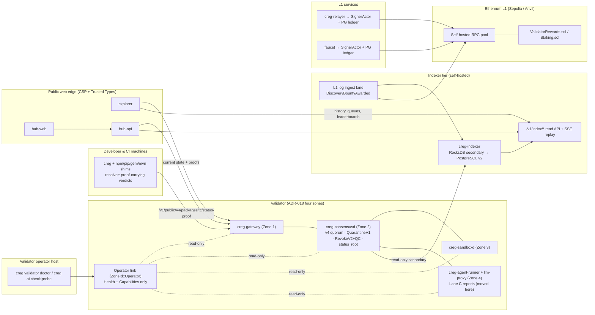

# ADR-019: Agentic-Era Ecosystem Re-Architecture (Proof-Carrying Clients, Operator Tooling, Indexer, L1 Services, Explorer & Hub)

- **Status:** Proposed (Phase 0 blueprint, 2026-11-23). Awaiting maintainer sign-off on [Section 11](#11-open-decisions-for-maintainer-sign-off). Increment 1 implemented 2026-11-23; see [Section 13](#13-implementation-status).
- **Baseline commit audited:** `1445d3b` (`main`, ADR-018 Increments 1–7 complete).
- **Extends / aligns with:** [ADR-005](./ADR-005-EVIDENCE-AND-POLICY.md) (Evidence & Policy), [ADR-010](./ADR-010-CLIENT-FRESHNESS.md) (Client Freshness), [ADR-015](./ADR-015-ECOSYSTEM-INTEGRATION.md) (Ecosystem Integration), [ADR-017](./ADR-017-HYBRID-POST-QUANTUM-SIGNATURES.md) (Hybrid PQ), [ADR-018](./ADR-018-AGENTIC-KERNEL-VALIDATOR-ARCHITECTURE.md) (Agentic Kernel-Isolated Validator).
- **Remediates:** All 42 findings (`ECA-01` – `ECA-42`) in [ECOSYSTEM_DEEP_DIVE_AUDIT.md](../architecture/ECOSYSTEM_DEEP_DIVE_AUDIT.md).

---

## Summary & Context Decision Record

### Context / Problem

ADR-018 re-architected the validator into four isolated zones, with Class A/B/C evidence, `TriggerWitnessV1`, and hybrid-PQ `creg-vote-v4`. The 2026-11-23 ecosystem audit found that the components that **consume** the validator's output have not followed:

1. **No v4 producer or read contract.** The node still emits legacy votes, never constructs `PackageStatus::Quarantined`, never attaches witnesses, and publishes no v4 schemas, DTOs or events (`ECA-01`, `ECA-05`). Downstream v4 work has no data to consume.
2. **The client verification spine trusts the node.** Proof checks are compiled out of the standalone `creg` (`ECA-08`), PBFT commits are checked as Ed25519-only (`ECA-09`), current status is never proven (`ECA-10`), and quarantined code installs through the break-glass flag (`ECA-07`).
3. **Revocation is single-signer.** Any active validator can revoke any package, and clients make that permanent (`ECA-02`).
4. **Supporting services carry dead weight.** The developer CLI links the analyzer, sandbox and retired ZK stacks (`ECA-16`). `cross-chain` keeps an unused `ethers` and a fabricated "live" relay (`ECA-26`, `ECA-27`). Hot wallets race on EOA nonces (`ECA-28`). Three crates depend on unmaintained `sled`.
5. **The web edge is not ready for attacker-influenced telemetry.** There is no CSP or HSTS, nginx header inheritance strips headers from the explorer document, client-IP limiters are spoofable, an open RPC proxy exists, and the explorer shows `RevokeV2` as success (`ECA-34`–`ECA-38`).

### Options Considered

- **Option A — Patch each component in place against today's REST shapes.** Rejected. It cannot fix `ECA-01`/`ECA-02`/`ECA-10`, which are producer- and wire-level. Five consumers would each re-derive v4 semantics, sanitisation and quorum math, reproducing the drift ADR-018 removed from the validator.
- **Option B — Trusted aggregation API.** Clients, the explorer and the hub all trust a CREG-operated indexer or hub API for status. Rejected. It re-centralises trust in exactly the component a supply-chain attacker would target. It contradicts ADR-001/ADR-010 (clients verify) and the project's self-hosted, verify-at-the-edge posture.
- **Option C (chosen) — Proof-carrying ecosystem on one shared view model.** Finish the v4 producer and expose a single versioned read contract (`crates/registry-view`). Every security decision on a client is derived from consensus-verified proofs using the **same** verification functions the validators use. Indexer, explorer and hub are untrusted presentation layers over proven or public data, with a uniform untrusted-text containment discipline.

### Decision Summary & Implications

- **Decision:** Adopt **Option C** across seven increments ([Section 9](#9-incremental-migration-plan-7-increments)). Increment 1 ships client and edge stop-bleed fixes with no wire changes. Increment 2 completes the v4 producer and bundles the remaining wire additions into the **not-yet-scheduled** v4 activation (no chain spec in the repository sets `hybrid_signature_activation_height`; confirm the live fleet spec matches before Inc 2).
- **Security implications:** Install decisions become proof-carrying end to end. Quarantine and revocation become hard, certified client states. Single-validator revocation is closed. Hot wallets become single-writer. The web edge gains CSP with Trusted Types.
- **Operational implications:** Validators gain `creg validator doctor` and `creg ai check|probe` over a read-only operator link. Developers get a smaller `creg` binary. Operators run `creg-indexer` (PostgreSQL) for explorer and hub history, and point relayer, faucet and explorer at self-hosted RPC endpoints.
- **Migration implications:** `consensus_golden_vectors.rs` and `signed_message_formats.rs` stay byte-identical. Every new consensus field uses `#[serde(default, skip_serializing_if = ...)]` and is mandatory only at or after the activation height. The relayer migrates its journal from `sled` through a JSON export from the last `sled`-based release.

---

## 1. Ecosystem Invariants

These extend ADR-018's `INV-01`–`INV-10` to every component outside the validator.

| ID | Invariant | Hard requirement |
| --- | --- | --- |
| **`ECO-INV-01`** | **Proof-carrying client decisions** | `creg install`, the PATH shims, `creg verify`, `creg audit` and `creg status` decide only from a PBFT-QC-verified publication proof **and** a QC-verified, freshness-bounded current-status proof. Node assertions, caches and indexer rows are never evidence. |
| **`ECO-INV-02`** | **Fail-closed status lattice** | `Revoked` ⊐ `Quarantined` ⊐ {`Unproven`, `Pending`, `Unknown`} ⊐ `Verified`. Break-glass (`--unverified`, `CREG_ALLOW_UNVERIFIED`) lifts only `Pending`/`Unknown`, never `Quarantined`, `Revoked` or `Unproven`. A `Quarantined` package past `expires_at_unix` is `Revoked`. |
| **`ECO-INV-03`** | **Verifier parity** | Clients, indexer and explorer back-ends call the consensus crate's own functions (`verify_pbft_phase_signature_at_height`, `VoteV4Envelope::verify`, `TriggerWitnessV1::verify`, `verify_revocation_qc`). Re-implemented signing messages or quorum arithmetic are forbidden. |
| **`ECO-INV-04`** | **Certified revocation & quarantine** | A revocation or quarantine transition is honoured, and becomes sticky in client journals, only when it is an owner/controller self-revocation or carries a committee quorum certificate valid at its height. |
| **`ECO-INV-05`** | **Untrusted-text containment** | Every string derived from packages, validator reasons, sandbox telemetry or LLMs crosses the read contract as a bounded `DisplayText` with C0/C1/ESC/bidi controls stripped, and is rendered only as a text node. LLM prose is never presented as a verdict. |
| **`ECO-INV-06`** | **Least linkage** | Client binaries (`creg` and the shims) link no analyzer, sandbox, LLM, ZK or L1-signer crate. `creg-consensusd` links no PostgreSQL or LLM client. This is enforced by a CI `cargo tree` deny-list. |
| **`ECO-INV-07`** | **Single-writer hot wallets** | Each L1 hot key is owned by exactly one `SignerActor` with a durable EOA nonce ledger. No code path builds an ad-hoc signing provider. |
| **`ECO-INV-08`** | **Bounded edges** | Downloads, SSE/WS buffers and subscriptions, caches, limiter maps and challenge stores all enforce byte, count and time ceilings before allocating. |
| **`ECO-INV-09`** | **Hardened web edge** | Every HTML response carries CSP (with Trusted Types), HSTS, `frame-ancestors 'none'`, `nosniff`, `Referrer-Policy` and `Permissions-Policy`. Client IP is derived only from a configured trusted-proxy hop. No open RPC or HTTP proxies. |
| **`ECO-INV-10`** | **Supply-chain minimalism** | No unmaintained storage engines or dead dependencies. `deny.toml` ignores only upstream-blocked advisories with a review date. `sled` and `ethers` are banned. |

---

## 2. Target Ecosystem Topology



**Trust rule:** the arrows into `CREG` carry proofs, and the client verifies them. The arrows into `EXP`/`HUBA` carry display data. The explorer may show "verified by node" badges, but each such badge links to a `creg evidence …` command that re-verifies independently.

---

## 3. Increment 2 Prerequisite: v4 Producer Completion & Public Read Contract

This is validator-side work. It is listed here because every downstream track depends on it (`ECA-01`). It can be filed as an ADR-018 addendum if maintainers prefer; the design does not change.

### 3.1 Producer wiring (`crates/node/src/validator_pipeline.rs`)

1. At heights where `ConsensusParams::vote_v4_active_at(h)` is true, votes are `VoteV4Envelope`s signed with the hybrid key. `ValidatorSignature` carries `pq_signature`, `voter_key_id`, `semantic_vote` and `trigger_witness_digest`.
2. Outcome aggregation calls `consensus::vote_v4::aggregate_vote_v4_quorum`. Witness replays pass through `WitnessReplayGuard`.
3. Outcomes map to transactions:
   - `Approved` → `PublishAuthorizedV1` (status `Verified`).
   - `Quarantined` → `QuarantineV1`.
   - `Rejected` → `RevokeV2 { witness, quorum_certificate }`.
4. Deterministic expiry: applying a block with `header.timestamp >= expires_at_unix` moves the package to `Revoked` via `resolve_quarantine_timeout`, with no transaction needed. Indexers and clients apply the same rule.

### 3.2 Wire additions (all `serde(default, skip_serializing_if)`, so pre-activation bytes are unchanged)

```rust
// crates/common/src/vote_v4.rs — ADR-019 additions (pre-activation; mandatory at/after activation)

pub const REVOKE_QC_DOMAIN: &str = "creg-revoke-qc-v1";
pub const QUARANTINE_QC_DOMAIN: &str = "creg-quarantine-qc-v1";

/// Closed vocabulary for TriggerWitnessV1.observed_violations. This is the existing
/// sandbox enum `validator::kernel_sandbox::schema::KernelViolationCode` (schema.rs:131-151),
/// promoted unchanged into `common` so the wire validator, indexer and renderers share it.
/// The wire stays `Vec<String>`; post-activation `validate_wire_budget` rejects any string
/// that does not parse into this enum.
#[derive(Debug, Clone, Copy, PartialEq, Eq, PartialOrd, Ord, Hash, Serialize, Deserialize)]
pub enum KernelViolationCode {
    #[serde(rename = "KB-CANARY-EXFIL")]           KbCanaryExfil,
    #[serde(rename = "KB-MEMFD-EXEC")]             KbMemfdExec,
    #[serde(rename = "KB-PTRACE-ESCAPE")]          KbPtraceEscape,
    #[serde(rename = "KB-IOURING-EVASION")]        KbIouringEvasion,
    #[serde(rename = "KB-NET-UNDECLARED")]         KbNetUndeclared,
    #[serde(rename = "KB-FS-PERSIST")]             KbFsPersist,
    #[serde(rename = "KB-SECCOMP-VIOLATION")]      KbSeccompViolation,
    #[serde(rename = "KB-ROOTFS-DIGEST-MISMATCH")] KbRootfsDigestMismatch,
    #[serde(rename = "KB-PROC-UNDECLARED")]        KbProcUndeclared,
}

/// Closed Class C finding taxonomy (renderers never display free-form category text).
#[derive(Debug, Clone, Copy, PartialEq, Eq, PartialOrd, Ord, Hash, Serialize, Deserialize)]
#[serde(rename_all = "snake_case")]
pub enum CregFindingCategoryV1 {
    CredentialExfiltration, RemoteCodeFetch, InstallHookAbuse, ObfuscatedPayload,
    NativeDropper, Backdoor, AuthBypass, CryptoWeakening, Typosquat,
    DependencyConfusion, DestructivePayload, PromptInjectionBait, Other,
}

#[derive(Debug, Clone, PartialEq, Eq, Serialize, Deserialize)]
#[serde(deny_unknown_fields)]
pub struct SemanticVoteV4 {
    pub disposition: SemanticDispositionV4,
    pub model_family: String,
    #[serde(default)]
    pub finding_digests: Vec<String>,
    /// ADR-019: quantized to multiples of 500 bp (0..=10_000). Display-only:
    /// `aggregate_vote_v4_quorum` MUST NOT read it (INV-05).
    #[serde(default, skip_serializing_if = "Option::is_none")]
    pub confidence_bp: Option<u16>,
    /// ADR-019: <= 8 entries, sorted + deduped before digest.
    #[serde(default, skip_serializing_if = "Vec::is_empty")]
    pub finding_categories: Vec<CregFindingCategoryV1>,
}

/// Committee certificate making a validator-originated revocation independently verifiable.
#[derive(Debug, Clone, PartialEq, Eq, Serialize, Deserialize)]
#[serde(deny_unknown_fields)]
pub struct CommitteeQuorumCertificateV1 {
    pub domain: String,                  // REVOKE_QC_DOMAIN | QUARANTINE_QC_DOMAIN
    pub package_canonical: String,
    pub content_hash: String,
    pub evidence_digest: String,
    pub committee_digest: String,        // sha256(canonical AnalysisCommittee members|seed|effective_size)
    pub authority_height: u64,           // height whose authenticated ValidatorSet applies
    #[serde(default, skip_serializing_if = "Option::is_none")]
    pub witness_digest: Option<String>,  // TriggerWitnessV1::canonical_digest when Class B
    pub signatures: Vec<QcSignatureV1>,  // sorted by validator_id, unique
}

#[derive(Debug, Clone, PartialEq, Eq, Serialize, Deserialize)]
#[serde(deny_unknown_fields)]
pub struct QcSignatureV1 {
    pub validator_id: String,
    pub voter_key_id: String,
    pub signature: String,
    #[serde(default, skip_serializing_if = "Option::is_none")]
    pub pq_signature: Option<String>,
}
```

```rust
// crates/common/src/block.rs — Transaction additions (serde tag = "type", snake_case)

RevokeV2 {
    request: SignedRevocationRequest,
    evidence_hash: String,
    #[serde(default, skip_serializing_if = "Option::is_none")]
    witness: Option<crate::vote_v4::TriggerWitnessV1>,
    /// ADR-019 (ECA-02): mandatory post-activation unless `request.revoker_pubkey`
    /// is the package owner or namespace controller (self-revocation).
    #[serde(default, skip_serializing_if = "Option::is_none")]
    quorum_certificate: Option<crate::vote_v4::CommitteeQuorumCertificateV1>,
},
/// Class C hold; expires_at_unix is derived at apply time as
/// `header.timestamp + CLASS_C_QUARANTINE_TTL_SECS` (never proposer-chosen).
QuarantineV1 {
    record: ChainRecord,                 // status = Pending on the wire
    reason_code: crate::vote_v4::CregFindingCategoryV1,
    quorum_certificate: crate::vote_v4::CommitteeQuorumCertificateV1,
},
QuarantineResolutionV1 {
    package_canonical: String,
    content_hash: String,
    outcome: QuarantineOutcomeV1,        // Release | Reject
    quorum_certificate: crate::vote_v4::CommitteeQuorumCertificateV1,
},
```

```rust
// crates/common/src/block.rs — BlockHeader addition (ECA-10)
/// Sparse-Merkle root over sha256(canonical) -> sha256(PackageStatusLeafV1).
/// None (omitted) pre-activation, keeping header hashes byte-identical.
#[serde(default, skip_serializing_if = "Option::is_none")]
pub status_root: Option<String>,
```

New verifier in `crates/consensus/src/vote_v4.rs`, used by the node **and** clients (`ECO-INV-03`):

```rust
pub fn verify_committee_qc(
    qc: &CommitteeQuorumCertificateV1,
    expected_domain: &str,
    committee: &AnalysisCommittee,
    authority: &ValidatorSet,          // height-authenticated set at qc.authority_height
    params: &ConsensusParams,
) -> Result<usize /* distinct valid signers */>;
```

`validate_revoke_v2` (`namespace_consensus.rs`) drops the "any active validator" branch at and after activation, and requires `verify_committee_qc(..) >= vote_quorum_threshold(committee.effective_size)`.

### 3.3 Read contract: `crates/registry-view` (new)

This crate is pure data and depends only on `common` and `serde` (plus optional `utoipa`). It is the single source for OpenAPI, the generated TypeScript types, the CLI renderers and the indexer's JSON columns.

```rust
pub struct DisplayText(String); // <= N graphemes; C0/C1/ESC/U+202A-E/U+2066-9 stripped

pub enum EvidenceClass { A, B, C } // pure fn evidence_class(&ValidatorSignature, Option<&TriggerWitnessV1>)

#[serde(tag = "state", rename_all = "snake_case")]   // stable, internally tagged
pub enum PackageStatusViewV1 {
    Pending,
    Verified   { height: u64, block_hash: String },
    Quarantined{ height: u64, expires_at_unix: i64, reason_code: CregFindingCategoryV1,
                 committee: CommitteeSummaryV1 },
    Revoked    { height: u64, authority: RevocationAuthorityV1, reason: DisplayText,
                 witness_digest: Option<String>, certificate: Option<CertificateSummaryV1> },
}

pub enum RevocationAuthorityV1 { Owner, Controller, CommitteeQuorum, LegacySingleValidator }

pub struct CommitteeSummaryV1 {
    pub effective_size: u32, pub approvals: u32, pub quarantine_reviews: u32,
    pub rejections: u32, pub abstentions: u32,
    pub model_families: BTreeMap<String, u32>,      // normalized family -> votes
    pub hybrid_signers: u32, pub classical_signers: u32,
}

pub struct WitnessViewV1 {
    pub digest: String, pub package_canonical: String, pub content_hash: String,
    pub prover_id: String, pub prover_key_scheme: KeyScheme,
    pub env_overrides: Vec<(DisplayText, DisplayText)>, pub clock_offset_secs: i64,
    pub entry_function: Option<DisplayText>, pub args: Vec<DisplayText>,
    pub violations: Vec<KernelViolationCode>, pub graph_canonical_digest: String,
    pub verification: WitnessVerificationV1,         // OnChainCertified{height} | GossipOnly
}
```

**Node routes (gateway-public):**

- `GET /v1/public/v4/packages/:canonical/status-proof`, returning `{ tip_header, tip_commit_signatures, authority_history, leaf: PackageStatusLeafV1, smt_proof, publication_proof }`.
- `GET /v1/public/v4/packages/:canonical/evidence`, returning `{ status: PackageStatusViewV1, votes: [VoteViewV1], witnesses: [WitnessViewV1] }`.
- **SSE v2:** `GET /v1/public/v4/events`. Typed kinds `package_verified`, `package_quarantined`, `quarantine_resolved`, `quarantine_expired`, `package_revoked_v2`, `witness_verified`, `block_committed`. Each carries `id: <height>.<tx_index>`, supports `Last-Event-ID` resume from the indexer's replay buffer, and is capped at 2,048 global and 8 per-IP subscribers.

**Lane C relocation (`ECA-03`).** `node/src/intelligence/*` moves to `creg-agent-runner`. The public intelligence route returns only `SemanticVoteV4`-derived quantized fields. Free-form prose is removed from public routes (open decision #7).

---

## 4. Track 1 — Client Verification Spine, Operator CLI & Indexer

### 4.1 `crates/resolver`: proof-carrying verdicts

**Verdict pipeline**, the only path for every security-relevant command (`ECA-13`):

```
resolve(canonical)
  ├─ load signed ChainSpec (binary-pinned signer; no compile-time gate)      ECA-08
  ├─ GET status-proof
  │    ├─ verify tip commit QC per signature with
  │    │    consensus::vote_v4::verify_pbft_phase_signature_at_height         ECA-09
  │    ├─ authenticate authority history from signed genesis (existing)
  │    ├─ freshness: now - tip.timestamp <= max_staleness (default 15 min)
  │    │             and tip.height >= journal.last_tip_height                 ECA-12
  │    ├─ verify SMT proof: leaf ∈ tip.status_root                             ECA-10
  │    └─ if leaf = Revoked/Quarantined via QC: verify_committee_qc            ECA-02
  ├─ verify publication proof (existing Merkle + QC), bind content_hash
  ├─ journal: pin first-seen (canonical -> content_hash) forever;
  │           certified Revoked is sticky; Quarantined -> {Revoked | Verified(cert)} only
  └─ ProofCarryingVerdict { status: PackageStatusViewV1, proven_at_height, evidence }
```

**Pre-activation interim (no `status_root` yet):** require `k`-of-`n` agreement (default 2-of-3) on current status from observer endpoints listed in the signed chain spec, plus ADR-010 witnessed heads when configured. Disagreement yields `Unproven` (`ECO-INV-02`). This is open decision #8.

**Changes by file:**

| File | Change | Findings |
| --- | --- | --- |
| `chain_client.rs` | Delete the gRPC verdict path entirely. REST only, to `/v1/public/v4/...`, falling back to v1 REST pre-activation. | `ECA-11` |
| `install_gate.rs` | `evaluate_install` over the `ECO-INV-02` lattice. New block codes `quarantined`, `quarantine_expired`, `revoked_certified`, `unproven_status`. Messages embed a `DisplayText` evidence summary: witness digest, `KernelViolationCode` list, `CregFindingCategoryV1` tags, committee families. | `ECA-07` |
| `light_client.rs` | Remove the non-phase-C authority branch. Replace `verify_pbft_consensus` with a loop over the consensus verifier that tolerates invalid signatures and counts distinct valid members. Read `package_status` and the SMT proof. | `ECA-08`–`ECA-10` |
| `freshness.rs` | Journal v2: `{ canonical → { content_hash, kind, certified: bool, height } }`, `last_tip_height`, `accepted_tree_size`. Write `tmp → fsync → rename → fsync(dir)` without the pre-delete, under an advisory lock file. | `ECA-12`, `ECA-15` |
| `cache.rs` | Replace `sled` with a bounded proof cache: a single JSON file, at most 5,000 entries, LRU, keyed `(canonical, content_hash)`. It stores proofs, not verdicts, and every hit re-checks tip freshness. Corruption is quarantined and the operation fails closed. | `ECA-15` |
| `downloader.rs` | Strict CID grammar, `reqwest` timeout, streaming SHA-256 into a `NamedTempFile` in a private `0700` dir, `max_bytes` (default 64 MiB, matching `INV-09`), abort losing futures. Returns a verified path handle. | `ECA-14` |
| `Cargo.toml` | Remove `sled` and the direct `tonic`/`prost` deps (they remain transitively through `common`'s proto types). Add `consensus` (already lightweight: `common`, `serde`, `sha2`, `ed25519-dalek`), `registry-view`, `fs2`-style locking, `tempfile`. | `ECA-15`, `ECA-33` |

### 4.2 `crates/cli`: v4 evidence UX & crate diet

**Dependency diet (`ECA-16`, `ECO-INV-06`).** `creg` links `common`, `consensus` (verification-only), `resolver`, `registry-view`, `ai-config` and `zone-ipc` only. Each current heavy call site moves:

- `creg advanced *` (ZK/ML/WASM local validation), `creg stress`, `creg osv-snapshot build` (uses `ml_validator::osv_client`) and the `creg relayer` soak tooling move to a new non-default `crates/dev-cli` (`creg-dev`), or are deleted with their retired back-ends.
- The current `creg doctor` fleet checks (YARA rules, `AnalysisBundleSet`, scanner version; `doctor.rs:153-171`) become fields of the sandbox zone's `Capabilities` report (§4.3). A CI step fails if `cargo tree -p chain-registry-cli -e normal` contains `validator`, `wasmtime`, `yara-x`, `ark-*`, `ethers`, `sled` or `libp2p`.

**Rendering contract.** Every untrusted string goes through `DisplayText::for_terminal()` (`ECA-17`). Evidence panels are shared by `install`, `info`, `verify`, `audit`, `diff` and the TUI:

```
✗ BLOCKED  npm:left-padx@1.4.2 — QUARANTINED (Class C committee hold)
  fails closed → REVOKED at 2026-11-26 14:02 UTC (in 61h 12m)
  committee  7 assigned · 1 approve · 4 quarantine_review · 0 reject · 2 abstain
  families   qwen2.5-coder ×2 · gemini ×1 · claude ×1      signers 7 hybrid / 0 classical
  categories credential_exfiltration · obfuscated_payload
  proof      status_root @ h=48211 (tip 3m old) · QC 5/7 verified locally
  override   none (ECO-INV-02)
```

Class B renders the witness: violation codes come from the static dictionary, never from the wire. Trigger env keys and values and args are shown truncated as `DisplayText`, with the clock offset humanised. Class A lists deterministic finding IDs and severities.

**Command changes:**

| Command | Change | Findings |
| --- | --- | --- |
| `creg install`, shims | Proof-carrying verdict; quarantine/revocation hard blocks with the evidence panel; verified download handle. | `ECA-07`, `ECA-14` |
| `creg verify` | Status proof plus publication proof. `--json` emits `ProofCarryingVerdict`. Removes the cached pre-check. | `ECA-13` |
| `creg audit` | Install-grade resolution. Exit codes `0` ok, `2` quarantined present, `3` revoked present, `4` unproven. | `ECA-13` |
| `creg info` / `creg diff` | Consensus-evidence section (votes, families, key scheme, witness, certificate). `diff` adds a manifest-permission and evidence delta. | `ECA-05` |
| `creg watch` | SSE v2 with `Last-Event-ID`, 256 KiB pending-frame cap. `--ci` fails on `package_quarantined`, `quarantine_expired`, `package_revoked*`, `witness_verified`. | `ECA-18` |
| `creg evidence verify-witness <digest\|file>` | New. Offline `TriggerWitnessV1::verify` + wire budget + prover membership at height, from the signed spec. No replay, zero LLM. (`creg witness` keeps its existing transparency-log meaning.) | `ECO-INV-03` |
| `creg console` (TUI) | New tabs: Quarantine queue, Evidence, Committee diversity. Operator tab over the operator link (§4.3). | `ECA-21` |
| `creg login` / `testnet stake-*` | `--key-file` / `--key-ref` only. Decimal-string → `U256` amounts. Publisher key generated locally and bound by a wallet signature over a challenge that includes the new public key. Loopback CORS restricted to the bridge origin. | `ECA-19`, `ECA-20` |

### 4.3 Operator diagnostics: `creg validator doctor`, `creg ai check|probe`

**`crates/ai-config` (new, extracted from `validator::ai_agent::config`).** It holds `ValidatorAiConfig`, `ProviderKind`, `RoutingConfig` and `SecretRef`, and is consumed by both `creg-agent-runner` and the CLI.

- `SecretRef` grammar: `env:VAR`, `vault:path#field`, and new `file:/abs/path`. The file must be owner-only (`0600` on Unix, owner-only DACL on Windows, the same rule as `keygen.rs`) and at most 4 KiB. Inline secrets stay rejected.

**`creg ai check [--config path] [--json]`** is static and offline. It runs schema validation (`deny_unknown_fields`), checks that routing tiers reference defined providers, and checks budgets (`max_steps <= 8`, `max_sandbox_replays <= 3`, spend cap present for API kinds). It resolves each `SecretRef` for **existence and permissions only**: values are never printed or held beyond a `Zeroizing` scope. It reports a diversity advisory (`>= 2` distinct `model_family` across tiers when the operator targets committees of 6 or more) and classifies each endpoint as loopback, LAN or API against the SSRF blocklist.

**`creg ai probe [--provider name]`** is live and delegated. It sends `ZoneRequest::ProbeProvider { provider }` over the operator link. `creg-agent-runner` runs a fixed canary prompt through `creg-llm-proxy` that must return a schema-valid structured tool call (`{"tool":"list_files","args":{"max_entries":1}}`). The probe reports latency, the resolved model ID, the normalised family and schema pass/fail. **API keys never leave Zone 4**, and the CLI never calls providers directly.

**`creg validator doctor [--zones] [--json]`** sends `ZoneRequest::Capabilities {}` to each zone. Every zone answers with a MAC'd `ZoneCapabilityReportV1`:

| Zone | Reported facts (read-only) |
| --- | --- |
| `creg-gateway` | Public/admin bind addresses, TLS on/off, `grpc_enabled`, per-route body caps, CORS mode, public metrics exposure flag (`ECA-39`) |
| `creg-consensusd` | `chain_id`, tip height, `hybrid_signature_activation_height`, `vote_v4_active`, signing scheme and PQ `key_id`, secrets backend (`env`/`vault`), peer count, PBFT view |
| `creg-sandboxd` | Tier 1: `/dev/kvm`, Firecracker/jailer versions, guest kernel digest, in-guest BTF/BPF-LSM. Tier 2: `nsjail` version, `seccomp_unotify`, per-ecosystem rootfs `CREG-ROOTFS-TREE-V1` digest vs pinned (`resolve_rootfs_strict`, `detect_nsjail_ready`). Tier 3: `wasmtime` version |
| `creg-agent-runner` | `agent.mode`, providers (name, kind, family, endpoint class), remaining daily budget, last probe result |

**Operator link (`ECA-04`).** `zone-ipc` moves from one shared token to HKDF-derived **per-link** keys (`info = "creg-zone-link-v1" ‖ sender ‖ target`). Each zone holds only the keys for its links. The new `ZoneId::Operator` link key authorises only `Health`, `Capabilities` and `ProbeProvider`. Every frame carries a per-link monotonic `request_id`, and servers reject replays within a sliding window. Unix sockets are created `0600` in a `0700` runtime dir and enforce an `SO_PEERCRED` UID allowlist. The MAC becomes HMAC-SHA256. The operator key is written by `creg-node-supervisor` to an owner-only file, so the operator shell never needs `CREG_ZONE_IPC_TOKEN`.

### 4.4 `crates/db-sync` → `crates/indexer`: PostgreSQL v2

**Topology (`ECA-25`).** Delete the in-process `SyncWorker` from `creg-consensusd` (`node/src/main.rs`). `creg-indexer` becomes its own crate. It opens a RocksDB **secondary** instance once and calls `try_catch_up_with_primary` per tick. In remote mode it pulls blocks over the public API and verifies them with the same light-client rules. Health binds loopback by default.

**Schema v2.** Embedded `sqlx::migrate!` migrations are the single source of truth (`ECA-24`). All wei columns are `NUMERIC(78,0)` (`ECA-23`).

```sql
-- migrations/0002_v4_evidence.sql (abridged)
ALTER TABLE blocks
  ADD COLUMN validator_set_hash TEXT, ADD COLUMN view_number INT,
  ADD COLUMN status_root TEXT, ADD COLUMN vote_v4_active BOOLEAN NOT NULL DEFAULT FALSE,
  ADD COLUMN commit_signatures JSONB NOT NULL DEFAULT '[]';

CREATE TABLE package_status_history (
  canonical TEXT NOT NULL, content_hash TEXT NOT NULL,
  status TEXT NOT NULL CHECK (status IN ('pending','verified','quarantined','revoked')),
  reason_code TEXT, reason TEXT, height BIGINT NOT NULL, tx_index INT NOT NULL,
  quarantine_expires_at TIMESTAMPTZ, source_tx_type TEXT NOT NULL,
  PRIMARY KEY (canonical, height, tx_index));

CREATE TABLE vote_signatures (
  canonical TEXT NOT NULL, validator_id TEXT NOT NULL, voter_key_id TEXT,
  scheme TEXT NOT NULL CHECK (scheme IN ('ed25519','hybrid_ed25519_mldsa44_v1')),
  approved BOOLEAN NOT NULL, reject_reason TEXT, evidence_digest TEXT NOT NULL,
  scanner_profile_digest TEXT, is_mandatory BOOLEAN NOT NULL, signed_at TIMESTAMPTZ NOT NULL,
  trigger_witness_digest TEXT, PRIMARY KEY (canonical, validator_id));

CREATE TABLE semantic_votes (
  canonical TEXT NOT NULL, validator_id TEXT NOT NULL,
  disposition TEXT NOT NULL CHECK (disposition IN ('approve','quarantine_review','reject')),
  model_family TEXT NOT NULL, confidence_bp SMALLINT CHECK (confidence_bp BETWEEN 0 AND 10000),
  finding_categories TEXT[] NOT NULL DEFAULT '{}', finding_digests TEXT[] NOT NULL DEFAULT '{}',
  PRIMARY KEY (canonical, validator_id));

CREATE TABLE trigger_witnesses (
  witness_digest TEXT PRIMARY KEY, canonical TEXT NOT NULL, content_hash TEXT NOT NULL,
  manifest_sha256 TEXT NOT NULL, sandbox_policy_bundle_id TEXT NOT NULL,
  trigger_spec JSONB NOT NULL, observed_violations TEXT[] NOT NULL,
  graph_canonical_digest TEXT NOT NULL, prover_id TEXT NOT NULL, prover_key_id TEXT NOT NULL,
  hybrid BOOLEAN NOT NULL, height BIGINT NOT NULL, tx_index INT NOT NULL);

CREATE TABLE revocations (
  canonical TEXT NOT NULL, height BIGINT NOT NULL, tx_index INT NOT NULL,
  tx_type TEXT NOT NULL CHECK (tx_type IN ('revoke','revoke_v2','quarantine_expiry')),
  authority TEXT NOT NULL CHECK (authority IN ('owner','controller','committee_quorum','legacy_single_validator','ttl_expiry')),
  reason TEXT, revoker_pubkey TEXT, evidence_hash TEXT,
  witness_digest TEXT REFERENCES trigger_witnesses(witness_digest),
  quorum_certificate JSONB, PRIMARY KEY (canonical, height, tx_index));

CREATE TABLE quarantines (
  canonical TEXT PRIMARY KEY, content_hash TEXT NOT NULL, reason_code TEXT NOT NULL,
  opened_height BIGINT NOT NULL, opened_at TIMESTAMPTZ NOT NULL, expires_at TIMESTAMPTZ NOT NULL,
  resolved_height BIGINT, resolution TEXT CHECK (resolution IN ('released','rejected','expired')),
  committee_summary JSONB NOT NULL);

CREATE TABLE validator_events (
  height BIGINT NOT NULL, tx_index INT NOT NULL,
  kind TEXT NOT NULL CHECK (kind IN ('join','leave','slash')),
  validator_id TEXT NOT NULL, amount_wei NUMERIC(78,0), reason TEXT,
  PRIMARY KEY (height, tx_index));

CREATE TABLE discovery_bounties (            -- L1 lane (ECA-42)
  l1_chain_id BIGINT NOT NULL, l1_block_number BIGINT NOT NULL, l1_block_hash TEXT NOT NULL,
  l1_tx_hash TEXT NOT NULL, log_index INT NOT NULL,
  witness_digest TEXT NOT NULL, package_hash TEXT NOT NULL, prover_address TEXT NOT NULL,
  prover_bonus_wei NUMERIC(78,0) NOT NULL, committee_share_wei NUMERIC(78,0) NOT NULL,
  committee_share_status TEXT NOT NULL CHECK (committee_share_status IN ('reserved','distributed')),
  PRIMARY KEY (l1_chain_id, l1_tx_hash, log_index));

ALTER TABLE publisher_stats ALTER COLUMN stake_wei TYPE NUMERIC(78,0);
CREATE VIEW v_quarantine_queue AS SELECT * FROM quarantines WHERE resolution IS NULL ORDER BY expires_at;
```

**Apply semantics.** One transaction per block: rows, `blocks` insert and cursor advance. Abort if the `(height, hash)` conflict differs or `prev_hash` breaks continuity. `RotatePublisherKey` matches an exact `package_namespace` column, not `LIKE`. Deterministic quarantine expiry is applied with the ingested block's `header.timestamp`, the same rule as consensus. `Slash`, `ValidatorJoin` and `ValidatorLeave` are indexed (`ECA-22`).

**L1 lane.** Decode `DiscoveryBountyAwarded` logs with `alloy::sol!` from `ValidatorRewards.sol`'s ABI through `common::l1_rpc` quorum reads (§5.2). Use finalized-tag or 12-block confirmation depth, store the block hash, and join on `witness_digest` to `trigger_witnesses`.

**Indexer read API (`/v1/index/*`).** Served by `creg-indexer`, read-only and rate-limited: `quarantine-queue`, `packages/:c/evidence-history`, `committee-diversity?epoch=`, `bounties/leaderboard`, and `events?after=<height.tx_index>`, which is the SSE v2 replay buffer. Everything returns `registry-view` DTOs.

Remove `sled` and `tokio-cron-scheduler` from `db-sync/Cargo.toml`.

---

## 5. Track 2 — Relayer, Cross-Chain, Faucet & Supply Chain

### 5.1 `crates/cross-chain`: retire, don't port (`ECA-26`, `ECA-27`)

`cross-chain` contains no `ethers` code, so no alloy port is needed. The plan:

1. Increment 1: `L1RelayerService` refuses `dry_run = false` with an explicit error. `creg relayer soak --live` is removed.
2. Increment 6: move `merkle_proof::{build_merkle_tree, generate_inclusion_proof, verify_merkle_path}` into `common::test_support` (used by `node/tests/high_throughput_stress_test.rs` and `cli/src/stress_test.rs`). Delete `crates/cross-chain` from the workspace, from `cli/Cargo.toml` and from `node` dev-dependencies. L1 state-root anchoring stays solely in the existing alloy-based `node/src/bridge.rs`.

### 5.2 Shared L1 transaction layer: `crates/l1-tx` (new)

**Transport is reused, not reinvented.** `common::l1_rpc` (feature `l1-rpc`) already provides `parse_rpc_endpoints`, `build_provider_from_urls` and a `FailoverTransport` that sends security-relevant reads to every configured endpoint and fails closed without a strict-majority quorum. `crates/l1-tx` adds only the write side on top of it:

```rust
// transport: common::l1_rpc::build_provider_from_urls(&endpoints) — self-hosted endpoints listed first

pub struct SignerActor { /* owns Zeroizing<PrivateKeySigner>; single Tokio task */ }
pub enum SignerCommand { Submit { tx: TransactionRequest, reply: oneshot::Sender<Result<TxTicket>> } }
// - durable EOA nonce ledger: reserved → broadcast(tx_hash, fee) → mined|replaced|dropped
// - sequential nonce allocation; gap detection vs quorum-read pending nonce (FailoverTransport)
// - EIP-1559 fee bump on stuck tx; reconciler runs until terminal state (no 180s give-up)

pub trait NonceLedger { /* PostgreSQL implementation via sqlx; SERIALIZABLE txns */ }
```

### 5.3 `crates/relayer` hardening

| Area | Decision | Findings |
| --- | --- | --- |
| Hot key | `SignerActor` only. No `private_key: String` in config. Loaded once via `chain-registry-secrets` into `Zeroizing`. | `ECA-28`, `ECA-32` |
| Durable state | PostgreSQL (`relayer_owner_nonces`, `relayer_quotas`, `relayer_requests`, `eoa_nonce_ledger`) under `SERIALIZABLE` transactions, replacing `sled`. Startup fails closed without PG. Migration: the last `sled` release gains `creg-relayer export-journal --out journal.json`; the new release imports it once (`meta:legacy-nonces-migrated` semantics preserved). | `ECA-33` |
| RPC | `common::l1_rpc` endpoint list (self-hosted first) with quorum reads, replacing the single `RELAYER_RPC_URL`. The receipt reconciler replaces the 90×2 s watcher. | `ECA-30` |
| Client IP | Configured `trusted_proxy_hops`; take XFF entry N from the **right**; IPv6 `/64` buckets. | `ECA-29` |
| CORS | Production refuses to start without `RELAYER_ALLOWED_ORIGINS`. | `ECA-32` |

### 5.4 `crates/faucet` hardening

| Area | Decision | Findings |
| --- | --- | --- |
| Sends | `SignerActor` (token and native). | `ECA-28` |
| PoW | Stateless `HMAC(k, ts‖rand‖ip_bucket)` challenges; single-use recorded in the existing PG claim transaction; per-IP challenge rate; adaptive difficulty. | `ECA-31` |
| Admin | Separate loopback listener; token through `chain-registry-secrets`; constant-time compare kept. | `ECA-32` |
| PG | TLS required (or UNIX socket); `sqlx` pool replaces `Arc<Mutex<Client>>`. | `ECA-32` |
| CORS / bind | Allowlist mandatory in production; public listener carries only `/api/*` + `/health`. | `ECA-32` |

### 5.5 `deny.toml` target state (`ECA-33`, `ECO-INV-10`)

- Remove the **15** ignores enumerated in the audit's [§10 ledger](../architecture/ECOSYSTEM_DEEP_DIVE_AUDIT.md#10-denytoml-burn-down-ledger): 11 ethers-only, 2 `sled`+`ethers`, 2 `zk-validator`. That leaves 35 upstream-blocked ignores, each with a review date.
- `[bans]`: `wildcards = "deny"`; `deny = [{ name = "sled" }, { name = "ethers" }, { name = "ethers-providers" }]` to prevent regressions; `multiple-versions = "warn"` stays until libp2p/alloy duplicates converge.
- Add a `[licenses]` allowlist (MIT, Apache-2.0, BSD-2/3-Clause, ISC, Unicode-3.0, MPL-2.0, Zlib, CC0-1.0) and add `licenses` to the CI command once it is green.
- `zk-validator`: unlinked from every built crate (CLI included). Deleting the crate is a maintainer choice, because ADR-009 already retired it.

---

## 6. Track 3 — Explorer, Hub & Public API

### 6.1 Untrusted-content rendering contract (`ECO-INV-05`, `ECO-INV-09`)

1. **Source-side:** every free-text field leaves the node or indexer as `DisplayText`. Codes and categories leave as closed enums.
2. **Render-side:** one `<UntrustedText value maxGraphemes>` component renders a text node with `unicode-bidi: isolate; white-space: pre-wrap`, monospace, and an "untrusted" affordance. ESLint `react/no-danger: error` blocks `dangerouslySetInnerHTML`, and the hub-web markdown sink is deleted or allowlisted to `https:`/`mailto:` (`ECA-41`).
3. **Policy:** one `security-headers.conf` is `include`d in **every** nginx `location` (fixing `add_header` inheritance, `ECA-35`):

   ```
   Content-Security-Policy: default-src 'self'; script-src 'self'; style-src 'self';
     img-src 'self' data:; connect-src 'self' https://<self-hosted-rpc>; object-src 'none';
     base-uri 'none'; frame-ancestors 'none'; form-action 'self';
     require-trusted-types-for 'script'; trusted-types creg-default
   Strict-Transport-Security: max-age=63072000; includeSubDomains
   X-Content-Type-Options: nosniff
   Referrer-Policy: strict-origin-when-cross-origin
   Permissions-Policy: camera=(), microphone=(), geolocation=()
   Cross-Origin-Opener-Policy: same-origin
   ```

4. **Verification:** Playwright asserts the headers on `/`, a deep link (SPA fallback) and an asset. A CSP `report-to` endpoint counts violations in staging.

### 6.2 Agentic-era explorer modules

| Module | Data source | Security notes |
| --- | --- | --- |
| **Status & revocation timeline** | `PackageStatusViewV1` + `/v1/index/packages/:c/evidence-history` | All `Transaction` types mapped from generated enums. `revoke_v2`, `quarantine_v1` and `quarantine_resolution_v1` get distinct red and amber badges. An unknown type is a TS compile error and renders neutral `UNKNOWN` (`ECA-34`). |
| **Validator zones & AI committee telemetry** | **Public:** chain-derived `CommitteeSummaryV1` per package and per epoch (family distribution, abstention rate, hybrid vs classical signers, disposition agreement). Optional self-signed `ValidatorCapabilityAdvertisementV1` (sandbox tiers, AI mode), labelled **self-reported**. **Operator-only:** zone health and capability reports appear in `creg console`, never on the public web. | No operator credential in any browser bundle (current behaviour kept). |
| **`TriggerWitnessV1` inspector** | `WitnessViewV1` | Violation titles from a static dictionary. Env, args and `entry_function` as `<UntrustedText>`, truncated, with an escaped "show full" view. Verification state is `OnChainCertified{height}` or `GossipOnly`. Each panel shows a copyable `creg evidence verify-witness <digest>`. |
| **`Quarantined` 72h escalation queue** | `/v1/index/quarantine-queue` | Countdown from server-supplied `now` to avoid client clock skew. "Fails closed to REVOKED at expiry" banner. Committee summary chips. |
| **`DiscoveryBounty` leaderboard** | `/v1/index/bounties/leaderboard` | Prover 25% shown as paid. Committee 75% shown as **reserved, not distributed** until the `ValidatorRewards.sol` fix (`ECA-42`). L1 tx links only to hex-validated hashes on the configured explorer origin. |
| **Real-time** | SSE v2 | `Last-Event-ID` resume. Polling only in degraded mode, at 30 s or more (`ECA-37`). |

### 6.3 Edge services

- **Explorer nginx:** shared header include; `/rpc` points to a self-hosted RPC with a JSON-RPC method allowlist (`eth_chainId`, `eth_blockNumber`, `eth_call`, `eth_estimateGas`, `eth_getTransactionReceipt`), `limit_req` and a 64 KiB body cap (`ECA-38`). Set `X-Real-IP $remote_addr` and stop appending client XFF (`ECA-29`).
- **hub-api:** bounded LRU limiter keyed by the trusted client IP, failing closed with 503 in production when the IP is unknown; `/api/status/public` cached for 5–10 s with single-flight (`ECA-36`); atomic SIWE nonce consumption before verify; generic error bodies; periodic session purge; `Secure` cookies by default (`ECA-40`). New read-through routes proxy `/v1/index/*` aggregates for the hub dashboard.
- **hub-web nginx:** shared header include; same proxy-header rule.
- **Node API:** `expose_public_metrics_docs` passed as a `bool` from `NodeConfig`, default `false` (`ECA-39`); OpenAPI generated from `registry-view`; SSE/WS subscriber caps; the WS handler reads and answers control frames.

---

## 7. Workspace Restructuring

| Crate | Change | Zone / tier |
| --- | --- | --- |
| `crates/registry-view` **(new)** | v4 view DTOs, `DisplayText`, `evidence_class()`, code dictionaries, OpenAPI derives | Shared, pure data |
| `crates/ai-config` **(new)** | Extracted `validator-ai.toml` model + `SecretRef` (`env:`/`file:`/`vault:`) | Shared (Zone 4 + operator CLI) |
| `crates/l1-tx` **(new)** | `SignerActor`, `NonceLedger` (PG) over the existing `common::l1_rpc` transport | L1 services |
| `crates/indexer` **(new, from `db-sync` + `node/src/bin/creg_indexer.rs`)** | Secondary-instance ingest, PG v2 migrations, L1 lane, `/v1/index/*` | Indexer tier |
| `crates/dev-cli` **(new, optional)** | `creg-dev`: stress, local analyzer experiments | Developer-only, non-default |
| `crates/resolver` | Proof-carrying spine; drops `sled` and the gRPC verdict client; adds `consensus`, `registry-view` | Client |
| `crates/cli` | Drops `validator`/`zk-validator`/`ml-validator`/`wasm-sandbox`/`cross-chain` | Client + operator |
| `crates/zone-ipc` | Per-link HKDF keys, `ZoneId::Operator`, replay window, peer-cred, HMAC | Validator |
| `crates/relayer`, `crates/faucet` | `l1-tx` actors; PG ledgers; no `sled` | L1 services |
| `crates/cross-chain` | **Retired** (helpers → `common::test_support`) | — |
| `crates/db-sync` | **Merged into `crates/indexer`** | — |

---

## 8. Traceability Matrix (`ECA-01` – `ECA-42`)

| Finding | Sev | Resolution component & mechanism | Inc |
| --- | :---: | --- | :---: |
| `ECA-01` | CRIT | §3.1 producer wiring behind `vote_v4_active_at` | 2 |
| `ECA-02` | CRIT | §3.2 `CommitteeQuorumCertificateV1` + `verify_committee_qc`; client stickiness only when certified | 2, 3 |
| `ECA-03` | HIGH | §3.3 Lane C moved to Zone 4; public prose removed; UI disclosure | 2, 7 |
| `ECA-04` | HIGH | §4.3 per-link HKDF keys, `ZoneId::Operator`, replay window, peer-cred, HMAC | 4 |
| `ECA-05` | HIGH | §3.3 `registry-view`, v4 routes, SSE v2, OpenAPI | 2 |
| `ECA-06` | MED | §3.2 promote `KernelViolationCode` to `common`; `CregFindingCategoryV1`; `DisplayText` | 2 |
| `ECA-07` | CRIT | §4.1 lattice: quarantine hard block, expiry → revoked | 1 |
| `ECA-08` | HIGH | §4.1 remove compile gate; signed-spec authority always | 3 |
| `ECA-09` | HIGH | §4.1 per-signature `verify_pbft_phase_signature_at_height` | 3 |
| `ECA-10` | HIGH | §3.2 `status_root` + §4.1 SMT proof; interim k-of-n | 2, 3 |
| `ECA-11` | HIGH | §4.1 delete gRPC verdict path | 1 |
| `ECA-12` | HIGH | §4.1 journal v2: content-hash pin, height monotonicity | 3 |
| `ECA-13` | HIGH | §4.2 single proof-carrying path for audit/verify/status | 1 |
| `ECA-14` | MED | §4.1 bounded streaming downloader, private temp dir | 1 |
| `ECA-15` | MED | §4.1 JSON proof cache + crash-safe journal; drop `sled` | 3 |
| `ECA-16` | HIGH | §4.2 crate diet + CI `cargo tree` deny-list | 4 |
| `ECA-17` | MED | §4.2 `DisplayText::for_terminal` everywhere | 1 |
| `ECA-18` | MED | §4.2 256 KiB cap (Inc 1); v4 CI kinds + resume (Inc 4) | 1, 4 |
| `ECA-19` | MED | §4.2 key files/refs only; `U256` amounts | 1 |
| `ECA-20` | MED | §4.2 local keygen + wallet binding; loopback CORS allowlist | 4 |
| `ECA-21` | LOW | §4.3 `creg validator doctor`, `creg ai check|probe` | 4 |
| `ECA-22` | HIGH | §4.4 schema v2 tables | 5 |
| `ECA-23` | HIGH | §4.4 `NUMERIC(78,0)` (hot-fix migration in Inc 1) | 1 |
| `ECA-24` | MED | §4.4 `sqlx::migrate!`, single-tx cursor, continuity checks | 5 |
| `ECA-25` | MED | §4.4 standalone indexer, RocksDB secondary, no in-process mode | 5 |
| `ECA-26` | HIGH | §5.1 refuse live path (Inc 1); retire crate (Inc 6) | 1, 6 |
| `ECA-27` | MED | §5.1 delete `ethers` | 6 |
| `ECA-28` | HIGH | §5.2 `SignerActor` + durable EOA nonce ledger | 6 |
| `ECA-29` | MED | §5.3/§6.3 trusted-hop right-side XFF, `X-Real-IP`, `/64` buckets | 1 |
| `ECA-30` | MED | §5.2/§5.3 `common::l1_rpc` quorum transport + reconciler | 6 |
| `ECA-31` | MED | §5.4 stateless HMAC PoW | 6 |
| `ECA-32` | MED | §5.3/§5.4 secrets, TLS, loopback admin, CORS allowlist, PG pool | 6 |
| `ECA-33` | MED | §5.5 `sled` retirement, `zk-validator` unlink, bans, licenses | 6 |
| `ECA-34` | HIGH | §6.2 generated enums; `revoke_v2` + quarantine badge hot-fix in Inc 1 | 1, 7 |
| `ECA-35` | HIGH | §6.1 shared header include, CSP + Trusted Types, HSTS | 1 |
| `ECA-36` | HIGH | §6.3 bounded limiter, status cache | 1 |
| `ECA-37` | MED | §3.3/§6.2 SSE v2 caps, IDs, resume; SSE-first UI | 7 |
| `ECA-38` | MED | §6.3 RPC allowlist, self-hosted upstream | 1 |
| `ECA-39` | MED | §6.3 explicit `bool`, default false | 1 |
| `ECA-40` | LOW | §6.3 atomic SIWE nonce, session hygiene | 7 |
| `ECA-41` | LOW | §6.1 delete or allowlist markdown sink | 7 |
| `ECA-42` | MED | §4.4 L1 lane; §6.2 "reserved" labelling; contract fix tracked separately | 5, 7 |

---

## 9. Incremental Migration Plan (7 Increments)

Every increment must pass, from `chain-registry/` with `$env:LIBCLANG_PATH` and `$env:CARGO_BUILD_JOBS = "2"` set:

- `cargo fmt --all -- --check`
- `cargo clippy --locked --workspace --all-targets -- -D warnings`
- `cargo clippy --locked -p chain-registry-node --features phase-c-real-fleet --all-targets -- -D warnings`
- `cargo deny --workspace check advisories bans sources`
- Unchanged `consensus_golden_vectors.rs` and `signed_message_formats.rs`
- JS packages: `npm run lint`/`build`/`test` (explorer, hub-api, hub-web)

| Increment | Scope & key deliverables | Findings | Exit gate |
| --- | --- | --- | --- |
| **Inc 1 — Client & Edge Stop-Bleed (no wire changes)** | Resolver: `VerdictStatus::Quarantined` hard block + expiry → revoked; delete gRPC verdict path; audit/verify/status on install-grade resolution; bounded downloader with private temp dir. CLI: `DisplayText::for_terminal`; `watch` 256 KiB cap; argv-secret refusal; `U256` amounts. db-sync: `NUMERIC(78,0)` hot-fix migration. cross-chain: refuse `dry_run=false`. Edge: shared nginx header include with CSP/HSTS, `/rpc` allowlist, trusted-hop IP derivation, hub-api bounded limiter + status cache. Explorer: `revoke_v2` and quarantine badges. Node: metrics/docs flag as `bool` default false. | `ECA-07`, `11`, `13`, `14`, `17`, `18`*, `19`, `23`, `26`*, `29`, `34`*, `35`, `36`, `38`, `39` | `eco-adv-01`, `02`, `07`, `08`, `09`, `12`, `13` green; Playwright header assertions; no node/consensus wire change in the diff |
| **Inc 2 — v4 Producer Completion & Public Read Contract** *(validator-side, pre-activation bundle)* | §3.1 wiring; §3.2 `SemanticVoteV4` extension, closed codes, `CommitteeQuorumCertificateV1`, `QuarantineV1`/`QuarantineResolutionV1`, `RevokeV2.quorum_certificate`, `BlockHeader.status_root` (SMT + `CF_STATUS_SMT`); `verify_committee_qc`; `validate_revoke_v2` tightening; §3.3 `registry-view`, v4 routes, SSE v2, OpenAPI; Lane C → Zone 4. | `ECA-01`, `02`*, `03`*, `05`, `06`, `10`* | Multi-node test produces `Approved`, `Quarantined` → expiry → `Revoked`, `QuarantineResolutionV1(Release)`, and `RevokeV2` + QC; single-validator `RevokeV2` rejected post-activation (`eco-adv-05`); golden vectors untouched; `vote_v4_hybrid_convergence.rs` extended; OpenAPI snapshot contains v4 schemas |
| **Inc 3 — Resolver Proof-Carrying Verification Spine** | §4.1 in full: signed-spec authority always; consensus verifiers; SMT status proof + tip freshness; journal v2 (hash pin, height monotonicity, certified stickiness); JSON proof cache; `sled` and the gRPC verdict client removed; pre-activation k-of-n interim. | `ECA-02`*, `08`, `09`, `10`*, `12`, `15` | `eco-adv-03`, `04`, `05`, `06` (lying-node suite) green; standalone `cargo build -p chain-registry-cli` verifies proofs |
| **Inc 4 — CLI v4 Evidence UX, Operator Diagnostics & Crate Diet** | §4.2 panels and commands; `creg evidence verify-witness`; TUI tabs; `crates/ai-config` with `file:` SecretRef; `creg ai check|probe`; `creg validator doctor`; zone-ipc per-link keys + `ZoneId::Operator` + `Capabilities`/`ProbeProvider`; CLI crate diet + CI `cargo tree` deny-list; login key-binding redesign. | `ECA-04`, `16`, `18`*, `20`, `21` | `cargo tree -p chain-registry-cli -e normal` free of `validator`/`wasmtime`/`yara-x`/`ark-*`/`ethers`/`sled`/`libp2p`; zone tests: forged sender, replayed `request_id`, wrong UID rejected; doctor `--json` schema snapshot |
| **Inc 5 — Indexer v2 + L1 Bounty Ingest** | `crates/indexer`; RocksDB secondary; `sqlx::migrate!` v2; single-tx apply; continuity checks; deterministic quarantine expiry; validator events; L1 `DiscoveryBountyAwarded` lane via `common::l1_rpc`; `/v1/index/*` + SSE replay; in-process worker removed from consensusd. | `ECA-22`, `24`, `25`, `42`* | Re-apply idempotency test; injected hash-conflict aborts; `NUMERIC` round-trip of `2^255`; bounty log fixture decoded; `creg-consensusd` no longer links `sqlx` |
| **Inc 6 — L1 Services Modernization & Supply-Chain Burn-Down** *(parallelisable with Inc 3–5)* | Retire `cross-chain`; `crates/l1-tx`; relayer → `SignerActor` + PG ledger + export/import migration; faucet → `SignerActor`, stateless PoW, loopback admin, PG TLS + pool; `deny.toml`: −15 ignores, bans for `sled`/`ethers`, `wildcards = "deny"`, licenses allowlist. | `ECA-26`*, `27`, `28`, `30`, `31`, `32`, `33` | `eco-adv-10` (100 parallel sponsor + drip requests → contiguous EOA nonces, zero replacement errors) on Anvil; `cargo deny` green with 35 ignores; `cargo tree -i sled` and `-i ethers` empty |
| **Inc 7 — Explorer & Hub Agentic-Era UI** | §6.2 modules (timeline, committee telemetry, witness inspector, quarantine queue, bounty leaderboard); `<UntrustedText>`; Trusted Types policy; SSE-first data layer; hub dashboard aggregates; SIWE/session fixes; markdown sink removal. | `ECA-03`*, `34`*, `37`, `40`, `41`, `42`* | `eco-adv-11` (witness XSS/bidi corpus) inert with zero CSP reports; Playwright flows for each module; SSE resume across reconnect |

\* Finding is split across increments as shown in §8.

**Ordering.** Inc 1 ships first and alone. Inc 2 is the hard prerequisite for Inc 3, 4 (v4 parts), 5 and 7. Inc 6 has no dependency on Inc 2–5 and can run in parallel. This keeps the brief's upstream-to-downstream order (Track 1 → 2 → 3) while front-loading safety fixes that need no wire change.

---

## 10. Ecosystem Adversarial Corpus (`tests/ecosystem_adversarial/`)

| ID | Scenario | Required outcome |
| --- | --- | --- |
| `eco-adv-01` | Node reports `quarantined`; `CREG_ALLOW_UNVERIFIED=true creg install` | `Block { code: "quarantined" }`; no PM delegation |
| `eco-adv-02` | `pkg@1` revoked, `pkg@2` verified, node gRPC enabled | `pkg@1` blocked `revoked`; no gRPC traffic from the resolver |
| `eco-adv-03` | Node answers REST "verified" + valid publication proof; status proof says revoked | Block; `freshness`/`unproven_status` code |
| `eco-adv-04` | Post-activation commit QC with Ed25519 halves only | Proof rejected |
| `eco-adv-05` | `RevokeV2` signed by one validator, no QC, post-activation | Block invalid at consensus; client ignores it as uncertified |
| `eco-adv-06` | Same `name@version`, different `content_hash` on a later query | `freshness_mix_and_match` block |
| `eco-adv-07` | Reject reason containing `ESC]52;c;…BEL`, `\r`, and U+202E | Stripped in `watch`, `info`, TUI, logs |
| `eco-adv-08` | SSE stream of 10 MiB with no frame separator | `creg watch` drops the connection at 256 KiB |
| `eco-adv-09` | 10,000 requests with random `X-Forwarded-For` | Limiter keys the trusted client IP; bounded map size |
| `eco-adv-10` | 100 concurrent sponsor/drip requests | Contiguous EOA nonces; zero `replacement underpriced` / `nonce too low` |
| `eco-adv-11` | Witness env value `` + bidi override + 4 KiB value | Rendered inert and truncated; zero CSP violations |
| `eco-adv-12` | Block containing `revoke_v2` | Explorer shows a red revocation badge, never "finalized" success |
| `eco-adv-13` | IPFS gateway streams an endless body | Downloader aborts at cap; no temp file left behind |

---

## 11. Open Decisions for Maintainer Sign-Off

| # | Decision | Recommended default | Trade-off |
| --- | --- | --- | --- |
| **1** | **Current-status proof mechanism** (`ECA-10`) | `BlockHeader.status_root` (sparse Merkle tree) bundled into the v4 activation | Consensus-level change, but proofs are self-contained and fast. A witnessed-log-only design depends on external witness liveness for every install. |
| **2** | **Quarantine override** (`ECA-07`) | **None.** Quarantined is not installable until certified release or expiry. | Strongest ADR-005 posture. The alternative, an org `policy.toml` pin of `(canonical, content_hash, expires_at)`, adds a footgun that CI will cargo-cult. |
| **3** | **`RevokeV2` authority post-activation** (`ECA-02`) | Owner/controller self-revocation **or** `CommitteeQuorumCertificateV1` (`>= 2m/3 + 1`) | Closes single-validator griefing. The alternative (single validator + slashing) leaves clients permanently affected before slashing lands. |
| **4** | **`SemanticVoteV4` extension** | Add optional `confidence_bp` (500 bp buckets, display-only) and closed `finding_categories` pre-activation | Gives the brief's indexer and UI fields with no consensus influence. Rejecting it limits Class C display to disposition + family. |
| **5** | **Relayer durable store** (`ECA-33`) | PostgreSQL (shared pattern with the faucet) | One operational store; `SERIALIZABLE` semantics. SQLite would avoid a PG dependency for solo operators but splits the code paths. |
| **6** | **Operator diagnostics channel** (`ECA-04`) | HKDF per-link keys + read-only `ZoneId::Operator` over zone-ipc | Reuses the authenticated transport. A separate loopback admin HTTP API per zone means four more listeners to harden. |
| **7** | **LLM prose on public surfaces** (`ECA-03`) | Remove from public API and explorer; quantized fields only | Strictest ADR-005 reading. Keeping a disclosed "AI notes" tab is possible, but it remains a social-engineering channel. |
| **8** | **Pre-activation interim install policy** | `k`-of-`n` (2-of-3) observer agreement from the signed chain spec; witnessed heads when configured | Works before `status_root` exists. Requires adding `public_status_observers` to the signed spec if absent. |

---

## 12. Rejected Alternatives & Revisit Conditions

### Rejected Alternatives

- **Porting `cross-chain` to alloy.** There is nothing to port. The only L1-writing code in the crate is fabricated, and real anchoring already exists in `node/src/bridge.rs`.
- **Giving `creg doctor` the shared `CREG_ZONE_IPC_TOKEN`.** That would hand operator shells the ability to forge any zone's frames.
- **Indexer-as-source-of-truth for clients.** This is Option B. It centralises trust in the component least protected by consensus.
- **Keeping `sled` for the resolver cache "because it works".** It is unmaintained, panics on corruption at open, and is responsible for two advisory ignores. A bounded JSON proof cache is simpler and auditable.
- **Rendering LLM explanations with an "AI" badge as the primary package-safety narrative.** This violates ADR-005 and invites prompt-injection-driven trust spoofing.

### Revisit Conditions

1. If v4 activation is scheduled **before** Inc 2 lands, the §3.2 additions move to a follow-up activation (`creg-vote-v4.1`) instead of being bundled.
2. If sparse Merkle tree update cost exceeds 5% of block apply time at 500 packages/hour, consider a per-epoch status snapshot root instead of a per-block root.
3. If browser-side WASM verification of `TriggerWitnessV1` and the PBFT QC becomes small enough (under 300 KiB), the explorer may verify proofs locally and drop the "verified by node" label.
4. When libp2p/hickory upstream releases unblock, re-run the `deny.toml` ledger and target fewer than 15 total ignores.

---

## 13. Implementation Status

### Increment 1 — Client & Edge Stop-Bleed (implemented 2026-11-23, committed in `47ea7b9` + Step B follow-ups)

No consensus wire type, signed message, block or header format changed. The only node changes are REST/OpenAPI additions and a fail-closed router flag. `consensus_golden_vectors.rs` and `signed_message_formats.rs` are untouched.

| Finding | What shipped | Where |
| --- | --- | --- |
| `ECA-07` | `VerdictStatus::Quarantined { reason, content_hash, expires_at_unix }`. It is a hard block that `--unverified` / `CREG_ALLOW_UNVERIFIED` cannot override. At or after the deadline it becomes `quarantine_expired`, which is permanent like revoked. The anti-rollback journal gained a `quarantined` kind: it keeps the first-seen deadline, may only end in revoked or (before the deadline) a verified release, and becomes revoked once the deadline passes. A previously quarantined or revoked package stays blocked when the node is unreachable, including in PATH shims. Unrecognised node status strings fail closed. **Correction to the audit:** `GET /v1/{public/,}packages/:c` reported quarantined records as `pending`; it now returns `quarantined` plus `quarantine_reason` and `quarantine_expires_at_unix`. | `common/verdict.rs`, `resolver/{chain_client,install_gate,freshness,cache}.rs`, `node/api.rs`, `node/openapi.rs`, CLI status renderers, `registry_proxy.rs` |
| `ECA-11` | gRPC verdict path deleted. The resolver uses per-version REST only. `tonic`/`prost` were removed from `resolver/Cargo.toml`. | `resolver/chain_client.rs`, `Cargo.lock` |
| `ECA-13` | `resolve` / `resolve_id` (audit, status, verify, batch) run the install-grade path: positive cache entries live at most 5 min, `Unknown` is never cached, and phase-C builds verify proofs. Also fixed: `creg audit --json` compared a nested object with a string, so its revoked count was always 0 and it exited 0 with revoked packages present. Quarantined packages now count as blocking (exit 1). | `resolver/{lib,cache}.rs`, `cli/audit.rs`, `cli/batch.rs` |
| `ECA-14` | Bounded verifying downloader: strict CID grammar, request timeout, streaming SHA-256 into a `create_new` file inside a private per-download `TempDir`, a 64 MiB cap (`CREG_MAX_DOWNLOAD_BYTES`), losing futures cancelled with their partial files removed. `creg install` hands the package manager the verified handle's path and deletes it afterwards. | `resolver/downloader.rs`, `cli/install.rs` |
| `ECA-15` (partial) | Journal writes `fsync` the temp file and no longer delete the journal before `rename`. The advisory lock and `sled` removal remain Inc 3. | `resolver/freshness.rs` |
| `ECA-17` | `common::DisplayText` / `sanitize_for_terminal` strip C0 (except tab), DEL, C1, ESC and bidi controls, map line breaks to spaces, and bound length by scalar value. It is applied to `watch`, `info`, `install`, `audit`, `verify`, verdict output, proxy reasons and resolver block messages. `creg info` also no longer slices node strings by byte offset, which a multi-byte value could make panic. | `common/display_text.rs`, `cli/{watch,info,output,audit,verify,install}.rs` |
| `ECA-18` (Inc 1 part) | `creg watch` drops a stream once 256 KiB is pending without a frame separator. `--ci` also fails on `package_revoked*`, `package_quarantined`, `quarantine_expired` and `witness_verified`. | `cli/watch.rs` |
| `ECA-19` | `creg login --private-key-file/--private-key-ref` and `creg testnet stake-* --key-file/--key-ref` (`env:`/`file:`; on Unix the file must be owner-only and at most 4 KiB). The old argv flags are hidden and refused unless `CREG_ALLOW_ARGV_SECRETS=1`. Amounts are exact decimal strings converted to integer wei (`u128`, no `f64`). | `cli/{secret_input,main,testnet}.rs` |
| `ECA-23` | `publisher_stats.stake_wei` is `NUMERIC(78,0)`: in fresh DDL, in an idempotent startup hot-fix, and in `migrations/003_stake_wei_numeric.sql` (kept in sync by a unit test). | `db-sync/{schema,sync_worker}.rs`, `migrations/` |
| `ECA-26` (Inc 1 part) | `L1RelayerService` refuses `dry_run = false` before consuming the queue. Dry-run receipts are `RelayTxStatus::Simulated`. `creg relayer soak --broadcast` was removed and the output is labelled SIMULATED. | `cross-chain/l1_relayer_service.rs`, `cli/relayer_cli.rs` |
| `ECA-29` | Relayer: `RELAYER_TRUSTED_PROXY_HOPS` (legacy `RELAYER_TRUST_PROXY=true` means 1), XFF entry *N* counted from the right, non-IP values ignored, IPv6 `/64` buckets. hub-api: forwarding headers are believed only from loopback/private peers, `X-Real-IP` first, then XFF right to left. nginx (explorer, hub-web): realip from private-network peers with `real_ip_recursive`. **Deviation from §6.3:** nginx keeps *appending* to `X-Forwarded-For`, because the production edge (Caddy) writes the real client there and the node already parses right-most-untrusted (VNA-08). Replacing it would have collapsed every client into the Caddy address. | `relayer/main.rs`, `hub-api/src/middleware/clientAddress.ts`, `explorer/nginx.conf`, `hub-web/nginx.conf` |
| `ECA-34` (Inc 1 part) | One mapping (`txDisplayStatus`, `packageStatusVariant`): `revoke`/`revoke_v2` are red "revoked" (target taken from `request.package_canonical`), quarantine is amber, and unknown types and statuses render neutral, never success. It is used by the block, transaction, package, proof and dashboard pages. | `explorer/src/api/normalize.js`, pages |
| `ECA-35` | A per-app `security-headers.conf` is `include`d in **every** nginx location: CSP (`script-src 'self'`, `object-src 'none'`, `base-uri 'none'`, `frame-ancestors 'none'`), HSTS, `nosniff`, `X-Frame-Options: DENY`, Referrer-Policy, Permissions-Policy and COOP. Swagger UI gets a docs-only CSP. **Deferred to Inc 7:** Trusted Types, removing `style-src 'unsafe-inline'` (the WalletConnect modal injects styles), narrowing `connect-src`, and self-hosting Google Fonts. | `explorer/security-headers*.conf`, `hub-web/security-headers.conf`, Dockerfiles |
| `ECA-36` | hub-api: LRU-bounded limiter (`HUB_RATE_LIMIT_MAX_KEYS`, default 10 000) keyed by the trusted client address. Returns 503 in production when no address can be established. `/api/status/public` is served from a 7.5 s single-flight cache. | `hub-api/src/middleware/rateLimit.ts`, `hub-api/src/status/singleFlight.ts`, `hub-api/src/index.ts` |
| `ECA-38` | Explorer `/rpc`: POST only, 64 KiB body cap, 10 r/s per client (burst 20), and an njs JSON-RPC method allowlist (wallet reads plus the signed-raw-transaction lifecycle used by `creg testnet stake-*`; batches of at most 20). Caddy `request_body` 64 KB caps were added on the Sepolia proxy routes. **Step B:** Caddy no longer proxies any L1 JSON-RPC itself. The explorer vhost passes `/rpc` to the explorer container, and `api…/sepolia` plus the faucet vhost's `/rpc` are forwarded to the explorer's allowlisted gateway (`CREG_EXPLORER_RPC_GATEWAY`). The explorer's own upstream (`CREG_SEPOLIA_RPC_UPSTREAM`) now defaults to a real Sepolia RPC instead of `api…/sepolia`, which would have looped; Caddy also stamps `X-CREG-Edge-Hop` on the forwarded request and answers 508 to any request that comes back carrying it. | `explorer/{nginx.conf,nginx-main.conf,rpc-allowlist.js,Dockerfile}`, `testnet/caddy/`, `testnet/docker-compose.*.yml` |
| `ECA-39` | The router fails **closed**: a contended state lock while building the router keeps `/metrics` and API docs operator-only. | `node/api.rs` |

**Adversarial corpus.** The corpus is implemented as unit tests next to the code they pin, not under `tests/ecosystem_adversarial/`:
- `eco-adv-01`: `install_gate.rs`.
- `eco-adv-02`: the gRPC path no longer exists, and `chain_client.rs` maps per-version records.
- `eco-adv-07`: `display_text.rs`, `watch.rs`.
- `eco-adv-08`: `watch.rs`.
- `eco-adv-09`: `hub-api/src/middleware/rateLimit.test.ts`.
- `eco-adv-12`: `explorer/src/api/normalize.test.js`.
- `eco-adv-13`: `downloader.rs`.

The edge-header Playwright gate is `explorer/e2e/security-headers.spec.js`. It runs against the nginx image with `E2E_EXPECT_EDGE_HEADERS=1`.

**Verification (local, 2026-11-23, rustc 1.98.1, `CARGO_BUILD_JOBS=2`).** These all passed:
- `cargo fmt --all -- --check`
- `cargo clippy --locked --workspace --all-targets -- -D warnings`
- `cargo clippy --locked -p chain-registry-node --features phase-c-real-fleet --all-targets -- -D warnings`
- `cargo deny --workspace check advisories bans sources`

Test results:

| Test run | Passed |
| --- | --- |
| `cargo test -p common -p resolver -p chain-registry-cli -p db-sync -p cross-chain -p chain-registry-relayer` | All pass: CLI 109, common 100, resolver 52, cross-chain 17, relayer 7, db-sync 1. Includes the frozen `consensus_golden_vectors.rs` (10/10). |
| `cargo test -p consensus --test signed_message_formats` (frozen) | Pass |
| `cargo test -p chain-registry-node --lib api::` | 59/59 |
| `cargo test -p chain-registry-node --test integration resolver_tests` | 3/3 |
| Explorer `node --test` | 12/12 |
| hub-api limiter and single-flight tests under Node 24 type stripping | 9/9 |

**Edge validation (2026-11-23, `nginx:alpine` = nginx 1.31.9, digest `sha256:fb465858…`).** The real explorer and hub-web configs were mounted into throwaway containers, each with a stub JSON-RPC upstream. The explorer used the image's own envsubst template step and the njs module.
- `nginx -t` passed for both.
- A dependency-free mirror of `e2e/security-headers.spec.js` ran 183/183 checks. Every header (CSP, HSTS, `nosniff`, `DENY`, Referrer-Policy, Permissions-Policy) is present on `/`, the SPA deep link (including `no-store`), assets, `/health`, the proxied 502s and every `/rpc` outcome, and each header is sent once. The docs-only CSP is served on `/api-docs`.
- `/rpc` results:
  - GET returns 405.
  - `eth_getLogs` returns 403 without reaching the upstream.
  - A malformed body returns 400.
  - A batch containing one denied method returns 403.
  - A 70 KiB body returns 413.
  - An allowlisted single call or batch returns 200 through the upstream, as `application/json`.
  - A burst of 60 requests produced 44 × 429.

**Not yet verified:**
- `npm run build` / `lint` for explorer, hub-api and hub-web: no `node_modules` are installed and no network install was performed.
- The Playwright runner itself has not run.
- hub-web pins `nginx:1.27-alpine` and was validated on 1.31.9. It uses only core directives (`realip`, `add_header … always`, `include`) that 1.27 also has.
- The realip trust path was not exercised: Docker NAT makes every host request arrive from a private gateway address.
- The Caddy edits have not been loaded by Caddy.

**Step B follow-ups (2026-11-23).** These close gaps found while implementing Increment 1:
- `node::publisher_index::PublisherStats.stake_wei` and `validator::reputation` stake fields are `u128` (they were `u64`, which saturates near 18.4 tokens). The publisher index is a node-local `serde_json` index, not consensus state, and existing `u64` values deserialize unchanged. Test: `large_stake_above_u64_max_scores_correctly`.
- `creg console` (`explorer_tui.rs`) sanitises every fetched API and SSE field through `common::sanitize_for_terminal`, truncates by scalar value, and drops an SSE stream once 256 KiB is pending without a frame separator. Test: `tui_sse_frame_strips_osc52_cr_and_bidi`. Publisher-index and reputation `tracing` lines sanitise package names, keys and remote error text.
- Every public Caddy API vhost answers `/metrics*` with 403 (`Caddyfile.{unified,fleet,hybrid}`).
- Caddy L1 RPC routing, as described in the `ECA-38` row.

**Remaining gaps:**
1. `creg testnet stake-*` still passes the key to Foundry `cast` on the child process's argv. The fix is an in-process signer via `crates/l1-tx` (Inc 6).
2. The legacy cloud-edge explorer configs (`testnet/nginx/explorer-{bootstrap,fleet,hybrid}`) replace the image's nginx config and still proxy `/rpc` to a public Sepolia RPC without the method allowlist.
3. The deployed explorer images predate Increment 1, so they lack the `/rpc` allowlist until rebuilt. Redeploy the explorer (new image and `CREG_EXPLORER_SEPOLIA_RPC_*` env) before reloading Caddy with these routes, or `/sepolia` answers 508.

### Increment 2, part 1 — v4 wire layer, verifiers and read contract (implemented 2026-11-23)

Decisions applied: #1 (`status_root` as `Option<[u8; 32]>`, two-level tree), #3 (committee QC on the approval, `PublishAuthorizedV1.committee_qc`), #4 (`QuarantineV1` / `QuarantineResolutionV1`) and #7 (`legacy_v3_quorum` label). Increment 2 is split in three parts because it changes consensus: this part adds the wire types, verifiers and read contract with **no change to pre-activation behaviour**; part 2 wires the node producer and block application; part 3 serves the v4 routes and SSE v2 and moves Lane C out of `creg-consensusd`.

| Area | What shipped | Where |
| --- | --- | --- |
| Closed vocabularies (`ECA-06`) | `KernelViolationCode` (the sandbox's 9 codes, with static titles) and `CregFindingCategoryV1` promoted into `common`. Unknown values fail to decode. | `common/src/committee.rs` |
| Committee QC (`ECA-02`) | `CommitteeQuorumCertificateV1` / `QcSignatureV1` with domains for revocation, quarantine, quarantine resolution and approval. The signed message binds the domain, package, content hash, evidence digest, committee digest, authority height, witness digest and (for resolutions) the decision. Verification counts only distinct committee members that are active in the authority set, whose key id matches and whose signature verifies; garbage or outsider signatures are skipped, never fatal. Hybrid signatures are required exactly from activation, and Ed25519-only halves do not count after it. `consensus::verify_committee_qc` is the single entry point (`ECO-INV-03`). | `common/src/committee.rs`, `consensus/src/vote_v4.rs` |
| Status commitment (`ECA-10`) | Two-level compact sparse Merkle tree: package key → root of that package's version tree → `StatusLeafV1` (`verified` / `quarantined{expires_at_unix, reason_code}` / `revoked{certified}`). Single-entry subtrees collapse, so proofs are about `log2(n)` siblings. `StatusProofV2` proves a leaf, an absent version, or an absent package. | `common/src/status_tree.rs` |
| Wire fields | `BlockHeader.status_root` and `PreparedBlockHeader.status_root` (hex, omitted when `None`); `PublishAuthorizedV1.committee_qc`; `RevokeV2.quorum_certificate`; new `Transaction::QuarantineV1` and `Transaction::QuarantineResolutionV1`. All new fields use `serde(default, skip_serializing_if)`, so historical header and transaction bytes, hashes and the frozen vectors are unchanged (tests: `absent_status_root_keeps_header_bytes_and_present_one_is_bound`, `new_wire_fields_are_omitted_when_unused`). | `common/src/block.rs` |
| Activation guard | `NodeConfig.vote_v4_activation_height` comes only from the signed spec. `namespace_consensus::reject_unvalidated_vote_v4_data` runs inside `validate_block` (proposals, sync and inserts) and refuses `status_root` and every v4-only transaction field at every height: before activation they are invalid, and after activation this build cannot yet validate them, so it refuses them rather than accepting unchecked data. Existing post-activation behaviour (hybrid PBFT signatures) is unchanged. | `node/src/{config,namespace_consensus}.rs` |
| Read contract (`ECA-05`) | New `crates/registry-view`: `PackageViewV4`, `PackageStatusViewV1` (the `ECO-INV-02` lattice, with deterministic quarantine expiry), `ProofBundleV2`, `RevocationStatusV2`, `WitnessViewV1` / `WitnessBundleV1` (violations rendered from the static dictionary; unknown codes become `UNKNOWN(<sha256-8>)`), `CommitteeSummaryV1`, `QuorumLabelV1`, `evidence_class()`, and `SseEnvelopeV2` with `<height>.<tx_index>` ids. `DisplayText` now re-sanitises on decode (`ECO-INV-05`). | `crates/registry-view/`, `common/src/display_text.rs` |

**Adversarial coverage added:** `eco-adv-05` (`committee::tests::eco_adv_05_single_signer_and_outsiders_never_reach_quorum`), `eco-adv-03` at the proof level (`status_tree::tests::eco_adv_03_status_proofs_bind_the_current_state`), and an `eco-adv-04` analogue for certificates (`hybrid_is_required_after_activation_and_refused_before`).

**Verification (local, 2026-11-23).** `cargo fmt --check`, both clippy gates (`-D warnings`) and `cargo deny` (advisories, bans and sources ok) pass. Tests:
- `common` 98, including golden vectors 10/10 (frozen, unchanged);
- `registry-view` 6;
- `consensus` 77, including `signed_message_formats` 6/6 (frozen, unchanged) and `vote_v4_hybrid_convergence` 5/5;
- node lib under `phase-c-real-fleet` 307 (1 ignored);
- node `integration` 11, `high_throughput_stress_test` 1 and `multi_node_testnet_simulation` 1;
- resolver 52.

**Remaining for Increment 2:**
- *Part 2 (node):*
  - produce votes as `VoteV4Envelope` from activation and aggregate with `aggregate_vote_v4_quorum`;
  - persist `WitnessReplayGuard` state in `cf_meta`;
  - collect committee QC signatures over gossip;
  - emit `QuarantineV1`, `QuarantineResolutionV1` and certified `RevokeV2`;
  - apply deterministic quarantine expiry at `header.timestamp`;
  - compute `status_root` in the producer and check it in validation;
  - tighten `validate_revoke_v2` after activation (owner/controller or QC);
  - index witnesses (`witness:<package>:<version>`, `witness_id:<hex32>`);
  - lift the activation guard once all of the above validates.
- *Part 3:* serve `/v1/public/v4/packages/:name/:version/{status,proof-bundle,witnesses}` and `/v1/public/v4/quarantine`, add SSE v2, generate OpenAPI from `registry-view`, and move Lane C (`node/src/intelligence/*`) into `creg-agent-runner`.

### Increment 2, part 2a — status index, `status_root` and certified transitions (implemented 2026-11-23)

The validation and state half of part 2. Every node now derives the same package-status history from the chain, and from `hybrid_signature_activation_height` on it validates and applies the v4 transactions and the header's `status_root`. Pre-activation block validity is unchanged; the frozen test files are untouched.

| Area | What shipped | Where |
| --- | --- | --- |
| Status index (`ECA-10`) | New column family `package_status_v1`: `StatusLeafV1` per version, a quarantine-deadline index and the last root. It is written in the same `WriteBatch` as the block, kept at **every** height (so the first post-activation root covers the whole registry), cleared and replayed by `rebuild_package_index` (and so by reorg preflight and adoption). A store that predates the index is detected at startup (`package_status_index_is_stale`) and rebuilt once. From activation a lagging index is refused rather than used. | `node/src/{package_status,chain_store,main}.rs` |
| Transitions | One pass per block, in order: (1) quarantines whose deadline is `<= header.timestamp` become `revoked{certified}` through `consensus::vote_v4::resolve_quarantine_timeout` (fail-closed, `ECO-INV-02`); (2) publications → `verified`, revocations → `revoked{certified}` (owner/controller self-revocation or QC), `QuarantineV1` → `quarantined{header.timestamp + 72h}`, `QuarantineResolutionV1` → `verified` or `revoked`. After activation a quarantined or revoked version cannot be republished and a committed version cannot change content hash. `ChainRecord.status` follows the leaf. | `node/src/package_status.rs` |
| `status_root` (decision #1) | `validate_block` now checks the header against the root after the block: `None` before activation, the exact root from it. The producer seals new proposals with the root from `validate_block_body`; transaction selection and the lifecycle API preflight use `validate_block_transitions`, which skips the root. Blocks without status changes reuse the stored root. | `node/src/{namespace_consensus,block_producer,api}.rs` |
| Certificates (`ECA-02`, `ECO-INV-04`) | Every QC is checked with `consensus::vote_v4::verify_committee_qc_with_activation` (new; `verify_committee_qc` delegates to it). The signing committee is the record's snapshot-bound analysis committee when its assignment proof is valid, otherwise the full active validator set at the QC's `authority_height` (legacy records and never-published versions). `authority_height` may trail the block by at most 1024 blocks. Approval QCs must bind the record's evidence digest and revocation QCs the `evidence_hash`; a resolution QC must bind its decision. `validate_revoke_v2` drops the "any active validator" branch at activation: a validator-signed `RevokeV2` then needs a QC. Unsigned legacy `Revoke` is invalid after activation. | `node/src/{package_status,namespace_consensus}.rs`, `consensus/src/vote_v4.rs` |
| Witness index (decision #3) | A `RevokeV2` witness is verified after activation (target, active prover at the block height, `TriggerWitnessV1::verify`) and must match the QC's `witness_digest`; a QC naming a witness the transaction lacks is refused. Verified witnesses are indexed in the `meta` column family as `witness:<package>:<version>` (newest 16) and `witness_id:<hex32>`. A rebuild clears only these two prefixes. | `node/src/{package_status,chain_store}.rs` |
| Activation guard | `reject_unvalidated_vote_v4_data` becomes `reject_pre_activation_vote_v4_data`: v4 data stays invalid before activation and is validated, not refused, after it. | `node/src/namespace_consensus.rs` |

**Tests** (`package_status::tests`): pre-activation index without a root; post-activation header must carry the exact root (missing or wrong root refused, proof verifies, empty block keeps the root, rebuild reproduces it, legacy `Revoke` refused); quarantine needs 2m/3+1 in the right domain, holds one second before the deadline and becomes certified `revoked` at it, and rebuild reproduces the result; a resolution QC must bind its outcome, a released hold no longer expires, a validator `RevokeV2` needs a QC and a QC naming a missing witness is refused; owner self-revocation is certified without a committee; a QC older than the authority window is refused.

**Verification (local, 2026-11-23).** `cargo fmt --check`, both clippy gates (`-D warnings`) and `cargo deny` (advisories, bans and sources ok) pass. Tests: golden vectors 10/10 (frozen, unchanged); `consensus` 77, including `signed_message_formats` 6/6 (frozen, unchanged) and `vote_v4_hybrid_convergence` 5/5; node lib under `phase-c-real-fleet` 313 (1 ignored; 6 new); node `integration` 11, `high_throughput_stress_test` 1 and `multi_node_testnet_simulation` 1.

**Deviation:** `QuarantineV1` targets a version that is already published (verified, in an earlier block or earlier in the same block) and must match its content hash and publisher. A new package therefore enters quarantine as "publish + hold" in one block and is never `verified` at a committed height. Accepting an unpublished record would let a committee certificate introduce a version whose publisher authorization no node verified.

**Not yet done (part 2b):**
- The node never loads its ML-DSA key (`CREG_VALIDATOR_PQ_KEY` appears only in the supervisor, `zone-ipc` and docs), so after activation it cannot produce hybrid PBFT or committee signatures. The producer half needs that key first.
- Producer: `VoteV4Envelope` votes and `aggregate_vote_v4_quorum`, committee QC signature collection over gossip, emission of `QuarantineV1` / `QuarantineResolutionV1` / certified `RevokeV2`, and `WitnessReplayGuard` state in `cf_meta`. Until then, after activation the pipeline's validator-signed rejections are deferred by transaction selection rather than included.
- `committee_digest` commits to `effective_size`, but the pipeline expands `effective_size` while votes arrive, so QC signatures collected before an expansion would stop verifying. Part 2b drops `effective_size` from the digest (the signer set and threshold still follow it). Nothing on chain uses the digest before activation.
- **Activation must not be scheduled in any chain spec before part 2b ships.**

### Increment 2, part 2b — hybrid validator key and certificate collection (implemented 2026-11-23)

The producer half of part 2, plus two corrections to 2a found while wiring it. Pre-activation behaviour is unchanged: certificate signatures are only produced and gossiped from activation on, and the new gossip field is omitted before it.

| Area | What shipped | Where |
| --- | --- | --- |
| Hybrid validator key (`ADR-017`) | New secrets role `ValidatorMlDsa44` (`CREG_VALIDATOR_PQ_KEY`, Vault path `secret/data/creg/validator-pq`, covered by the Vault-exclusivity check). The node loads it as `NodeConfig.validator_pq_seed`, and `validator_signing_keys()` returns the Ed25519 key and the hybrid key; `for_height` picks the hybrid key exactly from activation. Startup fails when activation is scheduled and a validator has no seed, or when the seed does not derive the ML-DSA-44 public key registered for this validator. | `secrets/src/lib.rs`, `node/src/config.rs` |
| Certificate collection (`ECA-02`, decision #3) | From activation each committee member signs the certificate for its own decision (approval or rejection domain, its evidence digest, the admitted committee, `authority_height` = the committee's snapshot height) with its hybrid key and sends it in the new optional `VoteGossip.committee_qc_signature`. Receivers keep one signature per voter in the package round. When an approval finalizes, `approval_qc_for_record` assembles the agreeing signatures and attaches the certificate to `PublishAuthorizedV1.committee_qc` only if it passes the check block validation applies (same committee resolution, signer rule and verifier); otherwise the publication goes out without one. | `node/src/{committee_qc,state,p2p,gossip,validator_pipeline}.rs` |
| `committee_digest` | Now `sha256("creg-committee-v2|" + members + "|" + seed)`: `effective_size` is out of the digest, so signatures made before the pipeline expands the committee stay valid. The signer set and the 2m/3+1 threshold still follow `effective_size`. The record committee's assignment proof is checked with `effective_size = size`, the value it was made with at admission. | `common/src/committee.rs`, `node/src/package_status.rs` |
| Signer rule (replaces the 2a window) | A certificate signer counts only when it is active with the same key id (hybrid after activation) both at the certificate's `authority_height` and at the block's height (`package_status::signing_authority`). This removes the 1024-block window: committee snapshot heights can be far older than that, while validators that left or rotated keys still cannot sign. | `node/src/package_status.rs` |
| Rejections of unpublished versions (refines 2a) | After activation a validator-signed `RevokeV2` needs a certificate only when the version is committed. Rejecting a never-published submission changes no state and stays uncertified, so clients ignore it (`ECO-INV-04`); its committee is not on chain, so no certificate could be checked anyway. | `node/src/{namespace_consensus,package_status}.rs` |
| `WitnessReplayGuard` persistence | `snapshot()` / `restore()` with a sorted, versioned `WitnessReplayGuardStateV1` (restored budgets are clamped, never raised). `ChainStore::{load,save}_witness_replay_guard` keep it in `meta` under `witness_guard:v1`, which a rebuild does not clear. | `consensus/src/vote_v4.rs`, `node/src/chain_store.rs` |

**Tests:** `signatures_survive_committee_expansion` (common); the guard round trip in `witness_replay_guard_enforces_auth_before_budget` (consensus); `scheduled_hybrid_activation_requires_the_matching_ml_dsa_seed` (node config); `gossiped_signatures_assemble_into_a_certificate_peers_accept` (node `committee_qc`); `signers_must_be_active_with_the_same_key_at_both_heights`, `expanded_record_committee_keeps_its_assignment_proof`, `uncertified_rejection_of_an_unpublished_version_changes_nothing` and `witness_replay_guard_survives_rebuild_and_reopen` (node `package_status`); the ML-DSA-44 seed role (secrets).

**Verification (local, 2026-11-23).** `cargo fmt --check`, both clippy gates (`-D warnings`) and `cargo deny` (advisories, bans and sources ok) pass. Tests: `common` 99 plus golden vectors 10/10 (frozen, unchanged), `hybrid_differential_corpus` 2 (1 ignored) and `mldsa44_acvp` 3; `chain-registry-secrets` 6; `consensus` 77, including `signed_message_formats` 6/6 (frozen, unchanged) and `vote_v4_hybrid_convergence` 5/5; node lib under `phase-c-real-fleet` 318 (1 ignored; 5 new); node `integration` 11, `high_throughput_stress_test` 1 and `multi_node_testnet_simulation` 1.

**Still open, moved to part 3** (they need the semantic votes that the Lane C move into `creg-agent-runner` produces):
- votes as `VoteV4Envelope` aggregated with `aggregate_vote_v4_quorum`, and therefore the emission of `QuarantineV1` and `QuarantineResolutionV1` (Class C holds come only from v4 aggregation);
- committee-certified revocation of an already published version (a re-analysis flow), and the witness-replay consumer that uses the persisted guard.

**Before activation can be scheduled:**
- PBFT block signing must use the hybrid key from activation. The node now holds that key, but its PBFT signing path (`sign_pbft_phase_at_height`) is not wired; that is ADR-017 work.
- An approval certificate is checked against the validator set at finalization. If a signer leaves the set before the block that includes it, the publication no longer validates and transaction selection defers it instead of including it. Re-finalizing without the certificate is not automated yet.

### Increment 6 — L1 Services Modernization & Supply-Chain Burn-Down (implemented 2026-11-23)

Decisions applied: #5 (relayer store = PostgreSQL) and #6 (single faucet instance, stateless HMAC PoW, shared `sqlx` pool). No consensus wire type, signed message, block or header format changed; the frozen test files are untouched.

| Finding | What shipped | Where |
| --- | --- | --- |
| `ECA-26`, `ECA-27` | `crates/cross-chain` is deleted, and with it `ethers 2.0.14` and the fabricated "live" relay. The Merkle helpers moved to `common::test_support::merkle_proof` (used by `creg stress` and the node simulation tests). `creg relayer soak` is removed. L1 anchoring stays in `node::bridge`. | `common/src/test_support/`, `cli/src/{main,stress_test}.rs`, `node/tests/` |
| `ECA-28`, `ECO-INV-07` | New `crates/l1-tx`. One `SignerActor` per `(chain_id, signer_address)` owns the key in zeroizing memory and serialises submissions through one bounded `mpsc` queue. Each transaction is signed and written to the EOA nonce ledger (`l1_tx_ledger`, state `signed`) **before** it is broadcast, so a crash can always rebroadcast the exact bytes. A PostgreSQL session advisory lock per signer makes a second process using the same key refuse to start. Nonces resynchronise once from the chain's pending nonce when the key was used outside the ledger. | `crates/l1-tx/` |
| `ECA-30` | The actor's reconciler follows every open transaction until `confirmed`, `reverted` or `displaced`, with no give-up timeout. It checks receipts for every broadcast attempt, waits for a confirmation depth, returns reorged transactions to `pending`, rebroadcasts dropped ones as the same bytes, and replaces stuck ones with EIP-1559 fees raised by at least 10% (default 13%) under operator caps. Transport is `common::l1_rpc` (quorum chain id; nonce reads and submissions to the primary only). The relayer reads permit nonces, gas and receipts through the same endpoint list (`RELAYER_RPC_URL` + `RELAYER_RPC_FALLBACKS`). | `l1-tx/src/{signer,fees,rpc}.rs`, `relayer/src/main.rs` |
| `ECA-33` (relayer) | The relayer runs on PostgreSQL (`RELAYER_DATABASE_URL`, required): `relayer_checkpoints` (next sponsor nonce per owner), `relayer_batches` (daily quota windows per wallet/IP key), `relayer_outbox` (sponsor requests and their l1-tx correlation id) and `relayer_meta`. A reservation (owner nonce check and advance, both quotas, outbox insert) is one `SERIALIZABLE` transaction with retry. An outbox reconciler maps l1-tx ledger states onto the public status record; rows imported from the sled era are followed by receipt. A sled journal in `RELAYER_DATA_DIR` blocks startup until it is exported with the standalone `tools/relayer-sled-export` (its own workspace, so `sled` stays out of the main graph) and imported via `RELAYER_LEGACY_JOURNAL_EXPORT`, or discarded with `RELAYER_LEGACY_SLED_DISCARD=true`. | `relayer/src/{main,store}.rs`, `tools/relayer-sled-export/` |
| `ECA-31` | Faucet PoW challenges are stateless: `v1.<issued>.<random>.<difficulty>.<HMAC-SHA256 tag>`, where the tag binds the issue time, difficulty and the requester's IP bucket. Redemption is single-use through `faucet_pow_redemptions` in PostgreSQL. Issuance is limited per IP per minute (default 20) with a hard cap on tracked IPs, and difficulty rises with the global issuance rate (base 20, up to 26). Clients still solve `SHA-256(challenge‖nonce)`, so the wire contract is unchanged. | `faucet/src/pow.rs`, `faucet/src/main.rs` |
| `ECA-32` | Hot keys never sit in config structs; they go straight from `chain-registry-secrets` into the signer actor. PostgreSQL connections (relayer and faucet) must use TLS (`sslmode=require/verify-*`, rustls), a UNIX socket or loopback; plaintext to another host needs `*_PG_ALLOW_PLAINTEXT_PRIVATE_NETWORK=true` (set only for single-host compose networks). The faucet uses a bounded `sqlx` pool instead of one mutexed `tokio_postgres` client. Faucet `/metrics` and `/admin/*` moved to a loopback operator listener (`FAUCET_ADMIN_BIND`, default `127.0.0.1:9086`); the admin token is resolved once through `chain-registry-secrets` (`FAUCET_ADMIN_TOKEN_REF`). Both services refuse to start outside testnet without a CORS allowlist (`RELAYER_ALLOWED_ORIGINS`, `FAUCET_ALLOWED_ORIGINS`). | `l1-tx/src/pg.rs`, `relayer/src/main.rs`, `faucet/src/main.rs` |
| `ECA-33` (supply chain) | `zk-validator` is unlinked from the CLI and moved to the workspace `exclude` list (source kept; deleting it is a maintainer decision). `creg advanced zk-proof` is removed. `db-sync` drops the unused `sled` and `tokio-cron-scheduler`. `deny.toml` drops 13 advisory ignores (50 → 37): the 11 ethers-only entries and the 2 zk-validator entries. `[bans]` now denies `ethers`, `ethers-core` and `ethers-providers`, and allows `sled` only as a direct dependency of `resolver`. | `Cargo.toml`, `cli/`, `db-sync/Cargo.toml`, `deny.toml` |

**Faucet correctness note.** A fee-bump replacement can be mined under a different hash than the one first journaled, while the faucet's receipt recovery and Transfer-log matching key on the hash. The faucet therefore follows the l1-tx ledger: `sync_claims_with_signer_ledger` (before every recovery pass) and the inline wait loop record the ledger's current or mined hash on the claim.

**Deviations from §5:**
- The `fxhash` and `instant` ignores (2 of the 15 in the §10 ledger) remain, because the resolver cache still uses `sled`. They go with Increment 3, which replaces that cache; `cargo tree -i sled` then becomes empty.
- `wildcards = "deny"` and the `[licenses]` allowlist are not enabled yet. Path dependencies count as wildcards unless every crate sets `publish = false`.
- Table names follow decision #5 as signed off (`relayer_batches`, `relayer_outbox`, `relayer_checkpoints`) rather than §5.3's working names; `relayer_batches` holds the daily quota windows.

**Adversarial corpus.** `eco-adv-10` is `l1-tx/src/signer/tests.rs::eco_adv_10_concurrent_submissions_get_contiguous_nonces`: 100 concurrent sponsor and drip submissions against a mock chain with a mempool and geth's 10% replacement rule get nonces 0–99 with no `nonce too low` or `replacement underpriced` outcome, then all reach `confirmed`. It has not yet run against Anvil.

**Verification (local, 2026-11-23, rustc 1.98.1, `CARGO_BUILD_JOBS=2`).** These all passed:
- `cargo fmt --all -- --check`
- `cargo clippy --locked --workspace --all-targets -- -D warnings`
- `cargo clippy --locked -p chain-registry-node --features phase-c-real-fleet --all-targets -- -D warnings`
- `cargo deny --workspace check advisories bans sources`: advisories, bans and sources ok, with 37 ignores and none unmatched.
- `cargo tree -i ethers` and `cargo tree -i ring@0.16.20` match nothing; `cargo tree -i sled` shows only `resolver` (and its dependents).

| Test run | Passed |
| --- | --- |
| `cargo test -p l1-tx -p chain-registry-relayer -p faucet -p common -p db-sync` | l1-tx 28, relayer 15, faucet 43, common 104 + golden vectors 10/10, db-sync 1. The PostgreSQL tests ran against a throwaway local `postgres:16-alpine` (`CREG_TEST_DATABASE_URL`). |
| `cargo test -p chain-registry-cli` | 108 (1 ignored, pre-existing) |
| `cargo test -p consensus --test signed_message_formats` (frozen) | Pass |
| `cargo test -p chain-registry-node --test high_throughput_stress_test --test multi_node_testnet_simulation` | 2/2 (Merkle helpers from `common::test_support`) |
| `cargo build --offline --manifest-path tools/relayer-sled-export/Cargo.toml` | Builds; not run against a real sled journal |

**Not yet done:**
- `creg testnet stake-*` still passes the key to Foundry `cast` on argv; moving it onto `crates/l1-tx` is open.
- The pinned faucet and relayer images in `testnet/` predate this increment. Deploying the new faucet needs `FAUCET_ALLOWED_ORIGINS` (outside testnet) and, on the compose networks, the plaintext opt-in already added to the compose files.
