# Target architecture

CREG is an evidence-first verification service with a witnessed append-only
transparency log. Package bytes, source, builds, scanner output, SBOMs, and
private evidence remain off-chain. A minimal L2 contract anchors witnessed log
roots and may hold bonds; it does not verify package safety.

## Components

1. Authenticated submission gateway: schema, limits, replay, identity, and ownership.
2. Durable orchestrator: idempotent jobs, retries, deadlines, quotas, and dead letters.
3. Isolated workers: static, malware, secrets, license, dependency, sandbox, provenance, and reproducible-build jobs.
4. Evidence store: typed signed envelopes over content-addressed immutable objects.
5. Deterministic policy engine: named profiles, hard blockers, freshness, and explainable bounded claims.
6. Merkle log and independent witnesses: inclusion, consistency, checkpoint, and split-view detection.
7. Derived query services: rebuildable PostgreSQL/search indexes and evidence-aware APIs.
8. Exact-byte clients: verify digest, identity, evidence, inclusion, freshness, policy, and revocation before installation.

## Trust model

No component claims absolute safety. Workers attest to observations, policy
signers attest to a profile evaluation, witnesses attest to log consistency,
and clients enforce a local installation policy. A failure or missing artifact
produces `evidence_incomplete`, `expired`, or `unknown`, never an implicit pass.

## Deployment rule

Phase 1 is centrally operated for correctness. Phase 2 adds independent
witnesses and reviewers. An appchain is a separate research decision; if ever
needed, use a mature framework with a small application state machine.
