# Trust boundaries

| Zone | Inputs | Outputs | Must not possess |
|---|---|---|---|
| Client | Package name, policy, metadata | Install/no-install decision | Governance or worker credentials |
| Gateway | Signed submission | Receipt and job | Worker execution privilege |
| Workers | Immutable job and package bytes | Signed evidence | Log append authority, treasury keys |
| Policy | Typed evidence and profile | Signed bounded decision | Ability to alter raw evidence |
| Log/witness | Events and evidence digests | Inclusion/consistency/checkpoint proofs | Package execution privilege |
| Settlement | Witness roots and bond events | L2 anchor/escrow state | Package-safety authority |
| Derived services | Canonical event history | Search/API/UI views | Authority to rewrite history |

Control domains, infrastructure domains, signing keys, and data-retention
domains must be disclosed separately. A common cloud account is not
independent merely because it uses multiple wallet addresses.
