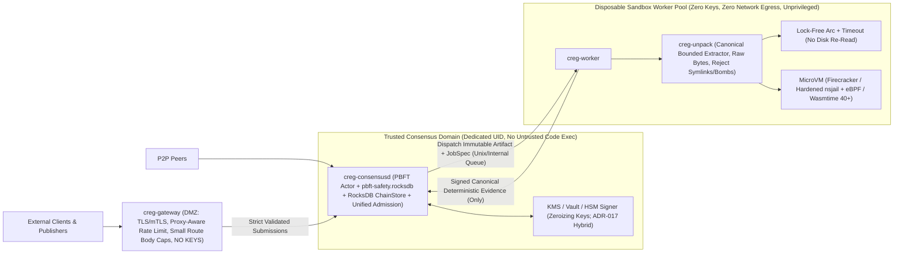

# CREG Validator Node (`creg-node`) — Deep-Dive Architectural & Security Audit

**Audit date:** 2026-11-22  
**Repository HEAD audited:** `0d5d5840d5a8cb2cab1fe37883de249488aebab7` (`main`)  
**Scope:** Validator node runtime (`chain-registry/crates/node`), validation & scanner crates (`validator`, `ml-validator`, `wasm-sandbox`, `zk-validator`), consensus & cryptography (`consensus`, `common`), secret loading (`secrets`), container/build pipeline (`Dockerfile`, `Dockerfile.secure`, `testnet/phase-c/Dockerfile.committed-source`, `Cargo.toml`), and architectural alignment against `docs/`.  
**Audit posture:** Read-only code, build, and supply-chain verification (including `cargo tree` and `cargo-deny` offline runs). No production code was modified, and no commits or pushes were made.

---

## Table of Contents

1. [Executive Summary & Scorecard](#1-executive-summary--scorecard)
2. [System Architecture, Structure & Component Inventory](#2-system-architecture-structure--component-inventory)
3. [Build System, Feature Flags, Deployment Drift & Supply-Chain Audit](#3-build-system-feature-flags-deployment-drift--supply-chain-audit)
4. [End-to-End System Workflow & Package Validation Deep Dive](#4-end-to-end-system-workflow--package-validation-deep-dive)
5. [Security & Engineering Audit Findings Register (`VNA-01` – `VNA-32`)](#5-security--engineering-audit-findings-register-vna-01--vna-32)
6. [Documentation vs. Code Reality Gap Analysis](#6-documentation-vs-code-reality-gap-analysis)
7. [Comprehensive Re-Architecture & Remediation Blueprint](#7-comprehensive-re-architecture--remediation-blueprint)
8. [Appendix: Reproducibility & Verification Commands](#8-appendix-reproducibility--verification-commands)

---

## 1. Executive Summary & Scorecard

### Overall Verdict

`creg-node` has serious, thoughtful Byzantine-safety engineering in isolated places — most notably its fsynced `pbft-safety.rocksdb` lock journal, fail-closed production env checks, CR-07 deterministic namespace rules, and ADR-017 hybrid post-quantum crypto primitives in `common::crypto`. However, **the validator node as an integrated system is not safe for public testnet or mainnet exposure.**

Four systemic flaws undermine the entire stack:

1. **Collapsed Trust Boundaries in One Monolithic Process:** Untrusted package tarballs, arbitrary external sidecars (`authority_adapter.rs`), gRPC/HTTP ingress, P2P gossip, RocksDB state, and validator/bridge signing keys all execute inside a single OS process sharing one UID and one global `Arc<RwLock<NodeState>>`.
2. **Broken Admission & Blind Behavioral Sandboxing:** P2P submission gossip bypasses publisher authentication and triggers **unauthenticated package revocation** via shielded hash mismatch (`VNA-01`), single invalid UTF-8 bytes silently blind every content scanner (`VNA-09`), and all four sandbox engines (`nsjail`, `gVisor`, `Docker`, `WASM`) are currently non-functional, blind, or fail-open (`VNA-14` – `VNA-16`).
3. **Fatal Consensus & Determinism Contradictions:** Vote aggregation (`evidence_votes.rs`) and block verification (`sync.rs`) disagree on both quorum denominator and `evidence_digest` equality (`VNA-19`), compounded by 11 distinct sources of validator-to-validator non-determinism (`VNA-20`) and feature-gated PBFT view-change recovery (`PBFT_VIEW_CHANGE_READY` off by default).
4. **Exposed Network & Supply-Chain Surface:** Plaintext unauthenticated gRPC is hardcoded on `0.0.0.0:50051` (`VNA-04`), unauthenticated HTTP `DELETE` can evict live validators from `validator_set` (`VNA-02`), anti-Sybil/peer-scoring P2P modules are dead code, and `creg-node`'s runtime dependency graph compiles remote-panic `libp2p-gossipsub 0.46.1` plus **two vulnerable major versions of `wasmtime` (`18.0.4` and `40.0.4`) simultaneously**.

### Delta Since Baseline Audit (`2026-11-14`)

Compared with [CREG-DEEP-DIVE-AUDIT-2026-11-14.md](../CREG-DEEP-DIVE-AUDIT-2026-11-14.md) (which audited `e8f18d5`):
- **Improved:** Multi-RPC L1 quorum reads added via `l1_quorum.rs` and wired into `validator_set_sync.rs` ([validator_set_sync.rs](../../chain-registry/crates/node/src/validator_set_sync.rs#L339-L426)); durable PBFT safety journal (`pbft_safety.rs`) hardened with identity binding, commit locks, and prepared-certificate recovery; ADR-016 `EquivocationMonitor` added ([equivocation_monitor.rs](../../chain-registry/crates/node/src/equivocation_monitor.rs)); CR-07 deterministic namespace validation ([namespace_consensus.rs](../../chain-registry/crates/node/src/namespace_consensus.rs)); ADR-017 Increments 1–2 implemented hybrid `Ed25519 + ML-DSA-44` keys in `common::crypto` and v2 key files.
- **Still Open / Newly Surfaced in Deep Validator Dive:** `EquivocationMonitor` remains opt-in and detection-only with no slashing wired; default Docker builds still omit `phase-c-real-fleet` (`PBFT_VIEW_CHANGE_READY = false`); and deep inspection of `validator`, `ml-validator`, `wasm-sandbox`, `zk-validator`, `p2p.rs`, `api.rs`, and `grpc/server.rs` revealed the critical admission, scanner, sandbox, quorum, and dependency vulnerabilities documented below.

### Validator Node Engineering & Security Scorecard

| Subsystem Domain | Maturity | Security | Core Blocking Issues |
| --- | :---: | :---: | --- |
| System Architecture & Concurrency | 5/10 | 3/10 | Global `Arc<RwLock<NodeState>>` held across HTTP `.await`, sleep pauses, and fsync; unbounded maps (`state.rs:204-262`). |
| Build, Containers & Supply Chain | 3/10 | 2/10 | Broken `Dockerfile.secure` empty rootfs; mismatched specs/toolchains; 747 runtime crate-versions with remote-crash `libp2p-gossipsub` & dual `wasmtime 18+40`. |
| Admission & Package Scanners | 3/10 | 1/10 | P2P admission bypass + unauthenticated revoke; UTF-8 silent scanner bypass; untrusted manifest ecosystem spoofing; 5 zip-bomb/OOM vectors. |
| Behavioral Sandboxing (`nsjail`/Container/WASM) | 2/10 | 1/10 | `nsjail` unmounted tarball + `ALLOW` seccomp + `/` fallback; `gVisor` `>/dev/null 2>&1`; `Docker` broken `strace`; dummy `.wasm` bypasses fail-closed + Windows no fuel. |
| Consensus, PBFT & Cryptography | 6/10 | 3/10 | `evidence_votes` vs `sync` halt/split (`n > 150`); 11 non-determinism sources; forgeable BLS `hash_to_g1`; vacuous `zk-validator`; `PBFT_VIEW_CHANGE_READY` gated off. |
| Network, P2P, HTTP & gRPC Surface | 3/10 | 2/10 | Open plaintext gRPC `:50051` (64 MiB/stream pre-auth RAM); unauthenticated validator `DELETE`; dead `p2p_peer_score`/`p2p_subnet_filter`; broken P2P rate-limiter validator check. |
| Persistence & Secrets Management | 6/10 | 5/10 | Good `pbft-safety.rocksdb` sync & 16-CF RocksDB; offset by plain-`String` unzeroized keys in `NodeConfig`, env-over-Vault precedence, dead `PruningConfig`, full-chain boot load. |

### Top 10 Critical Findings at a Glance

| ID | Severity | Area | Short Summary | Primary Location |
| --- | :---: | --- | --- | --- |
| `VNA-01` | CRITICAL | P2P / Pipeline | Unauthenticated arbitrary package revocation via P2P shielded hash-mismatch | [p2p.rs](../../chain-registry/crates/node/src/p2p.rs#L831-L904), [validator_pipeline.rs](../../chain-registry/crates/node/src/validator_pipeline.rs#L131-L167) |
| `VNA-02` | CRITICAL | REST API | Unauthenticated `DELETE` evicts active validators from live `validator_set` | [api.rs](../../chain-registry/crates/node/src/api.rs#L248-L251), [api.rs](../../chain-registry/crates/node/src/api.rs#L1383-L1421) |
| `VNA-03` | CRITICAL | P2P Admission | `creg/v1/submissions` bypasses `admit_publish_request` & stalls swarm loop up to 30s | [p2p.rs](../../chain-registry/crates/node/src/p2p.rs#L819-L904) |
| `VNA-04` | CRITICAL | gRPC Ingress | Unauthenticated plaintext gRPC on `0.0.0.0:50051` + 64 MiB pre-auth stream RAM | [main.rs](../../chain-registry/crates/node/src/main.rs#L1145-L1169), [grpc/server.rs](../../chain-registry/crates/node/src/grpc/server.rs#L140-L212) |
| `VNA-05` | CRITICAL | P2P / Supply Chain | Remote panic CVEs in `libp2p-gossipsub 0.46.1` + unwired `p2p_peer_score`/`p2p_subnet_filter` | [p2p.rs](../../chain-registry/crates/node/src/p2p.rs#L597-L662), [p2p_rate_limit.rs](../../chain-registry/crates/node/src/p2p_rate_limit.rs#L169-L178) |
| `VNA-09` | CRITICAL | Scanners | Single invalid UTF-8 byte silently bypasses Stage 1, YARA, Threat Intel, & Stage 4 LLM | [static_analysis.rs](../../chain-registry/crates/validator/src/static_analysis.rs#L1065), [deep_scan.rs](../../chain-registry/crates/ml-validator/src/deep_scan.rs#L415) |
| `VNA-10` | CRITICAL | Scanners | Ecosystem/identity spoofed from untrusted tarball manifests; `package.json` skipped | [static_analysis.rs](../../chain-registry/crates/validator/src/static_analysis.rs#L311-L325), [static_analysis.rs](../../chain-registry/crates/validator/src/static_analysis.rs#L1079-L1158) |
| `VNA-14`–`16` | CRITICAL | Sandboxing | All 4 engines (`nsjail`, `gVisor`, `Docker`, `WASM`) blind, unmounted, fail-open, or OOM/escape-prone | [sandbox.rs](../../chain-registry/crates/validator/src/sandbox.rs#L577-L955), [wasm-sandbox/lib.rs](../../chain-registry/crates/wasm-sandbox/src/lib.rs#L232-L382) |
| `VNA-19` | CRITICAL | Consensus | `evidence_votes` (committee cap 100) vs `sync.rs` (full `2n/3+1`) halts if `n > 150` & splits digests | [evidence_votes.rs](../../chain-registry/crates/consensus/src/evidence_votes.rs#L21-L92), [sync.rs](../../chain-registry/crates/node/src/sync.rs#L1416-L1560) |
| `VNA-11` | CRITICAL | DoS / Memory | Unconditional unbounded tar decompression (`llm::extract_tarball`) & full-body IPFS buffering | [llm.rs](../../chain-registry/crates/validator/src/llm.rs#L599-L618), [admission_scan.rs](../../chain-registry/crates/node/src/admission_scan.rs#L81-L106) |

---

## 2. System Architecture, Structure & Component Inventory

### High-Level Validator Node Topology

```mermaid
flowchart TD
    subgraph Ingress["Untrusted Network Ingress"]
        HTTP["REST / JSON-RPC / SSE / WS (:8080, Axum)"]
        GRPC["Plaintext gRPC (0.0.0.0:50051, Tonic)"]
        SWARM["libp2p Swarm (:9000, Noise + Yamux + Gossipsub + Kad)"]
    end

    subgraph Core["Single creg-node Process (Shared OS UID & Address Space)"]
        STATE["Global NodeState behind single Arc<RwLock<NodeState>>"]
        P2PW["P2P Worker (p2p::run)"]
        PIPE["Validator Pipeline (4+ sem permits)"]
        PROD["Block Producer & PBFT Engine"]
        SYNC["Linear HTTP Chain Sync (10s)"]
        VSYNC["L1 Staking Sync (Quorum Polling)"]
        CADM["Consensus Admission (EIP-712)"]
        REVG["Revocation Outbox Worker (10s)"]
        BRDG["L1 Bridge & Governance API"]
        CR07["CR-07 Authority Sidecar Runner"]
        INTW["Intelligence Worker (opt-in)"]
    end

    subgraph Engines["Validation & Sandbox Subsystems"]
        ML["ml-validator (yara-x + Pinned OSV/Threat DB, NO ONNX)"]
        STAT["validator Stage 1/3/4/5 (Static, Diff, LLM, PGP)"]
        SBX["Stage 2 Sandboxes (nsjail / runsc / docker / wasmtime 18)"]
        ZKV["zk-validator (Groth16 startup key check only; unused at runtime)"]
        SEC["secrets crate (Env / Vault) + Plain String Keys in NodeConfig"]
    end

    subgraph Storage["Local Persistence (CREG_DATA_DIR)"]
        RDB["RocksDB ChainStore (16 Column Families)"]
        PFS["pbft-safety.rocksdb (fsynced WriteOptions)"]
        JSON["Flat JSON Files (pending, history, cursor, outbox, archive)"]
    end

    HTTP --> STATE
    GRPC --> STATE
    SWARM --> P2PW
    P2PW --> STATE
    PIPE --> STATE
    PIPE --> STAT
    STAT --> ML
    STAT --> SBX
    HTTP --> CR07
    PROD --> STATE
    PROD --> PFS
    PROD --> RDB
    SYNC --> RDB
    VSYNC --> STATE
    BRDG --> SEC
    CADM --> BRDG
    REVG --> STATE
    INTW --> RDB
    STATE --> RDB
    STATE --> JSON
```



### Workspace & Validator-Relevant Crate Map

Out of the 17 workspace crates declared in [Cargo.toml](../../chain-registry/Cargo.toml#L1-L20), `creg-node` links 9 internal crates at runtime (plus `secrets` and `validator`), while `cross-chain` is compiled only as a `[dev-dependency]` ([node/Cargo.toml](../../chain-registry/crates/node/Cargo.toml#L30-L90)):

| Crate | Path | Runtime Status in `creg-node` | Core Role & Observations |
| --- | --- | --- | --- |
| `chain-registry-node` (`node`) | `crates/node` | **Primary binary (`creg-node`)** | Monolithic node coordinator, REST/gRPC/P2P servers, RocksDB `ChainStore`, PBFT driver, sync, bridge. Also builds `creg-indexer` and `creg_recovery_inspect`. |
| `validator` | `crates/validator` | **Live (Core validation)** | 6-stage `validate_package` orchestrator: static rules, 4 sandbox engines, manifest/sandbox diff, LLM review, PGP, reputation, risk scoring, intelligence generator. |
| `ml-validator` | `crates/ml-validator` | **Live (Misnamed)** | Despite crate name and `Cargo.toml` ONNX workspace entries, **contains zero ONNX/neural inference**. Provides `yara-x` rule engine, regex/AST rule scorer, OSV snapshot, SHA-256 threat DB. |
| `wasm-sandbox` | `crates/wasm-sandbox` | **Live (Fallback only)** | `wasmtime 18.0.4` + custom WASI preview1 capability stubs; only invoked if `.wasm` files exist or name ends `-wasm`. |
| `zk-validator` | `crates/zk-validator` | **Startup check only / Unused** | Only called in `main.rs:610-616` to assert key loading when `config.zk_validation` is true, then immediately dropped. Circuits lack cryptographic soundness. |
| `consensus` | `crates/consensus` | **Live (PBFT + Evidence)** | `PbftEngine`, `evidence_votes`, `slashing_relay` (`EquivocationDetector`), `forced_inclusion`, `vrf` (Ed25519 signature VRF), and dead/forgeable `bls_aggregate`. |
| `common` | `crates/common` | **Live (Shared primitives)** | Block/Tx/Package types, ADR-017 `crypto` (`Ed25519` + `ML-DSA-44` hybrid), L1 RPC types, chain spec verifier, transparency log helpers, `l1-rpc` feature. |
| `chain-registry-secrets` (`secrets`) | `crates/secrets` | **Live (Partial)** | Env & HashiCorp Vault KV v2 loader for `Bridge` and `ValidatorEd25519` roles; bypassed by env precedence in `config.rs` and un-used by `governance_api.rs`. |
| `db-sync` | `crates/db-sync` | **Opt-in (`CREG_PG_SYNC_IN_PROCESS`)** | Legacy in-process Postgres indexer (`sqlx`); disabled by default in favor of standalone `creg-indexer` binary. |
| `resolver` | `crates/resolver` | **Library dependency** | Linked by `node` ([node/Cargo.toml](../../chain-registry/crates/node/Cargo.toml#L36)); pulls `sled`. |
| `threshold-encryption` | `crates/threshold-encryption` | **Live (Feature-flagged / Partial)** | Shamir secret sharing + AES-GCM helpers for `shielded` packages. |
| `cross-chain` | `crates/cross-chain` | **`dev-dependencies` only** | Retired from production `creg-node` binary ([node/Cargo.toml](../../chain-registry/crates/node/Cargo.toml#L86-L90)). |
| Other workspace crates (`cli`, `faucet`, `relayer`, `ipfs-pinner`, `insurance`) | `crates/*` | **Out of `creg-node` binary** | Separate binaries/services in the workspace. |

### `crates/node` Internal Module Inventory

All 47 modules declared in [lib.rs](../../chain-registry/crates/node/src/lib.rs#L6-L54) and [main.rs](../../chain-registry/crates/node/src/main.rs):

- **Boot, Config, State & Process Control:**
  - `main.rs` (1,351 lines): CLI/env boot, signed chain-spec verification, startup checks, `PublisherIndex` rebuild, background worker spawning, plaintext gRPC server, HTTP/TLS listener.
  - `config.rs` (1,734 lines): `NodeConfig::load()`, `CorsConfig`, `PruningConfig`/`NodeMode` (dead), `validate()`, `validate_production_security()`, `validate_mal001_public_validator()`.
  - `state.rs` (559 lines): `NodeState`, `PackageRound`, `P2PStatus`, `BridgeStatus`, `ReorgEvent`, `reconcile_committed_pbft_rounds()`, `reconcile_committed_pending_packages()`.
  - `pidlock.rs`: Single-instance lock file for non-testnet runs.
- **Admission, Validation Pipeline & Namespace Authority:**
  - `package_admission.rs` (2,086 lines): `admit_publish_request()`, `verify_publish_auth()` (Ed25519 + EVM dual proof + L1 stake + CR-07), `compute_analysis_committee_at_admission()`, `update_performance_scores()`.
  - `admission_scan.rs` (183 lines): `run_pre_mempool_yara_gate()` (IPFS fetch + YARA-X scan; skips `shielded`).
  - `pending_pool.rs`: Persists admitted pending submissions & committees under `CREG_DATA_DIR`.
  - `validator_pipeline.rs` (947 lines): 4-permit (default `available_parallelism*2` or env) async pipeline, IPFS fetch, shielded decryption, `validate_package()`, Ed25519 vote signing, `creg/v1/votes` gossip, hybrid committee polling, final `Transaction` enqueueing.
  - `finalized_tx.rs`: Bounded channel + RocksDB `CF_FINALIZED_WORK` durable delivery queue.
  - `authority_adapter.rs` (1,921 lines): CR-07 upstream npm/PyPI verifier sidecar launcher, cleared-env temp workspace, stdin/stdout JSON protocol, Windows Job/DACL hardening.
  - `authority_archive.rs` (801 lines): Content-addressed local archive for CR-07 evidence with byte/entry quotas.
  - `namespace_consensus.rs` (643 lines): Deterministic validation of `PublishAuthorizedV1`, `NamespaceLifecycleV2`, delegations, and authority certificates inside blocks.
- **Consensus, PBFT & Validator Set Governance:**
  - `block_producer.rs` (1,837 lines): `PBFT_VIEW_CHANGE_READY`, ticker loop, `drive_pbft_view_changes`, `drive_pbft_vote_rebroadcast`, `prepare_proposer_context`, `produce_block`, `pause_after_durable_commit_if_armed`.
  - `block_time.rs`: Deterministic monotonic block timestamp rules.
  - `pbft_safety.rs` (1,010 lines): Separate fsynced RocksDB `pbft-safety.rocksdb` enforcing PREPARE per-view lock, COMMIT height-wide lock, and recoverable view-change certificates.
  - `equivocation_monitor.rs` (580 lines): ADR-016 wrapper around `consensus::EquivocationDetector`; opt-in via `CREG_EQUIVOCATION_DETECTION`.
  - `validator_set_sync.rs` (1,815 lines): `Staking.sol` event polling with L1 quorum reads (`ChainAuthoritative` mode).
  - `validator_set_history.rs`: Persists height-indexed authenticated `ValidatorSet` transitions and weak-subjectivity checkpoints.
  - `validator_registry_gossip.rs`: Dual-signed `(evm_address, node_id, ed25519_pubkey)` registration persistence and periodic gossip.
  - `consensus_admission.rs` (816 lines): Validator applicant EIP-712 `approveByConsensus` attestation collector & L1 submitter.
  - `revocation_gossip.rs` (206 lines): Outbox-backed `creg/v1/revocations` propagation and signature verification.
- **Networking, Sync & API Surfaces:**
  - `p2p.rs` (2,658 lines): libp2p Swarm (TCP + Noise + Yamux + Gossipsub + Kademlia + Identify), 8 topic handlers.
  - `p2p_bootnodes.rs`: Seed multiaddr helpers.
  - `p2p_rate_limit.rs` (534 lines): Token-bucket limiter used by `p2p.rs` (`spawn_purge_task` never called; broken peer ID check).
  - `p2p_peer_score.rs` (205 lines): **Dead code** (never instantiated in runtime).
  - `p2p_subnet_filter.rs` (201 lines): **Dead code** (never instantiated in runtime).
  - `sync.rs` (2,323 lines): Linear HTTP block sync, transition history reconciliation, reorg up to depth 64, `verify_block_signatures()`, `verify_block_consensus_certificate()`.
  - `gossip.rs`: Canonical message digests (`VoteGossip`, `canonical_vote_message`, `canonical_authorized_vote_message`).
  - `api.rs` (7,974 lines): Axum router, CORS, `private_api_acl_middleware`, OpenAPI `/api-docs` + `/v1/openapi.json`, all REST + WS + SSE routes.
  - `json_rpc.rs` (383 lines): `/rpc` and `/jsonrpc` handlers (`creg_chainId`, `creg_blockNumber`, `creg_getBlockByNumber`, `creg_health`).
  - `grpc/server.rs` (510 lines): Tonic `RegistryService`, `WatchService`, `ExplorerService` bound on `0.0.0.0:50051`.
  - `rate_limit.rs` (326 lines): IP-based HTTP sliding-window rate limiter.
  - `governance_api.rs` (833 lines): L1 `Governance.sol` proposal viewer & operator write relay (`CREG_GOVERNANCE_KEY`).
  - `events.rs`, `metrics.rs`, `openapi.rs`, `explorer.rs`.
- **Storage, L1 Transport & Post-Consensus Intelligence:**
  - `chain_store.rs` (4,489 lines): RocksDB 16-CF store, block insertion, reorg journal, transparency log proofs, finalized work queue, legacy `sled` migration.
  - `publisher_index.rs`: In-memory publisher statistics rebuilt across all blocks on startup.
  - `l1_quorum.rs`, `rpc_failover.rs`, `bridge.rs`, `bridge_anchors.rs`, `proof.rs`.
  - `intelligence/{mod,store,worker}.rs`: Opt-in Lane C post-commit report generator (reads finalized verified blocks, downloads from IPFS up to 512 MiB).
  - `db_sync_proxy.rs`: Helpers for optional DB sync / indexer.

### Global Lock Contention & Unbounded In-Memory Growth

`NodeState` ([state.rs](../../chain-registry/crates/node/src/state.rs#L204-L262)) wraps virtually every subsystem behind a single `tokio::sync::RwLock<NodeState>`. Several critical handlers perform **blocking disk I/O or async network `.await` calls while holding this global lock**:

- **Public `/v1/public/health` HTTP `.await` under `read()` lock:** [api.rs](../../chain-registry/crates/node/src/api.rs#L686-L700) acquires `state.read().await` (`line 691`) and then runs `validator::sandbox::engine_status().await` and potentially `fleet_sandbox_from_peers(&s.config.peers).await` (looping over peer URLs with 3s timeouts!) **without dropping `s`**. On any observer node with unreachable peers, unauthenticated `GET /v1/health` requests pin `state.read()`, starving `state.write().await` for block production, P2P commits, and sync.
- **PBFT Proposer & Follower `.await` + fsync under `write()` lock:** `produce_block` ([block_producer.rs](../../chain-registry/crates/node/src/block_producer.rs#L1190-L1453)) acquires `state.write().await` for the entire block assembly, RocksDB safety journal `fsync`, CR-07 validation, Ed25519 signature verification, optional `pause_after_durable_commit_if_armed(...).await` (up to 30 seconds sleep under `phase-c-real-fleet`!), and final RocksDB block commit before calling `drop(s)` at `line 1453`. P2P follower commit signing in `sign_and_record_commit` ([p2p.rs](../../chain-registry/crates/node/src/p2p.rs#L220-L290)) similarly sleeps inside the state write guard when armed (`lines 274-280`) while holding `s = state.write().await` (`line 1550`).
- **Unbounded In-Memory Maps:** `package_rounds`, `package_committees`, `vrf_proofs` (cleared only in proposer's `produce_block` at [block_producer.rs](../../chain-registry/crates/node/src/block_producer.rs#L1451), never cleared on followers/observers), `decryption_shares`, `validator_registrations`, `view_change_certs`, `publisher_stake_cache` (no sweep/cap on insertion), `AttestationStore::inner` ([consensus_admission.rs](../../chain-registry/crates/node/src/consensus_admission.rs#L178)), and `EquivocationDetector::evidence` ([slashing_relay.rs](../../chain-registry/crates/consensus/src/slashing_relay.rs#L269)) lack global hard entry bounds.

### Persistence Layout (`CREG_DATA_DIR`)

| Store | Engine | Purpose & Contents | Durability / Pruning Notes |
| --- | --- | --- | --- |
| Primary chain DB | RocksDB (`chain_store.rs:54-69`) | 16 CFs: `blocks_by_hash`, `blocks_by_height`, `packages`, `namespace_controllers`, `namespace_lifecycle_nonces`, `applied_namespace_lifecycle_nonces`, `applied_publisher_authorization_nonces`, `namespace_delegations`, `publisher_admission_nonces`, `publisher_rotation`, `finalized_work`, `finalized_work_dead_letter`, `transparency_events`, `transparency_leaves`, `transparency_heads`, `reorg_journal`. | Internally thread-safe `rocksdb::DB`, yet wrapped inside `RwLock<NodeState>`. **`NodeMode` (`Full`/`Light`/`Pruned`) and `PruningConfig` (`config.rs:84-100,284-286`) are completely dead/unwired.** Legacy `sled` (`chain_store.rs:979-987`) remains compiled solely for migration. |
| PBFT Safety Journal | RocksDB `pbft-safety.rocksdb` (`pbft_safety.rs:13-68,507-511`) | Separate RocksDB bound to `(genesis_hash, validator_id, validator_pubkey)`. Stores `decision/prepare`, `decision/commit` (height-wide lock), `local-view-lock/`, `prepared/` certs, `received-view-change/`. | Uses `WriteOptions::set_sync(true)` + in-process `Mutex` to survive crash/reorg rollback. **Strong component.** |
| Authority / Validator History & Outboxes | JSON / flat files | `pending_pool/`, `validator-set-history`, `validator-set-sync.cursor.json`, `revocation-outbox/`, `authority-archive/`, `intelligence/`, `equivocation-evidence/`, `p2p/identity.key`. | `revocation_gossip` & `pbft_safety` fsync properly; **`equivocation_monitor::persist` (`344-355`) lacks `file.sync_all()` + dir fsync**. |

---

## 3. Build System, Feature Flags, Deployment Drift & Supply-Chain Audit

### Cargo Features & Build-Time Environment Embeds

1. **Feature Split Between Tested Builds and Fleet Builds:**
   - [crates/node/Cargo.toml](../../chain-registry/crates/node/Cargo.toml#L101-L105) defines `default = []`, `embedded-explorer`, `tls`, and `phase-c-real-fleet = ["common/phase-c-canonical-transactions", "ml-validator/phase-c-real-fleet"]`.
   - Crucially, `PBFT_VIEW_CHANGE_READY` ([block_producer.rs](../../chain-registry/crates/node/src/block_producer.rs#L17)) is `cfg!(feature = "phase-c-real-fleet")`. Any node compiled with default features (including standard `cargo build` and root `Dockerfile`) **disables all PBFT view-change recovery and backup leadership at compile time**!
   - Under `phase-c-real-fleet`, `ml-validator/src/scanner_profile.rs` strictly enforces `CREG_SCANNER_PROFILE_DIGEST` pinning (`lines 83-98`) and availability of both threat-intel and OSV snapshots (`lines 44-58`). Under default features, missing threat-intel/OSV assets silently degrade unless blocked elsewhere.
2. **Build Script Pinning ([crates/node/build.rs](../../chain-registry/crates/node/build.rs#L1-L30)):**
   - Embeds `CREG_SPEC_SIGNING_PUBKEY` and `CREG_EFFECTIVE_VERSION` into compile-time `rustc-env`. Rebuilds cleanly when those env vars change, though different Dockerfiles inject conflicting pubkeys.
3. **47 Global Workspace Lint Suppressions ([chain-registry/Cargo.toml](../../chain-registry/Cargo.toml#L84-L143)):**
   - Allows `dead_code`, `unused_imports`, `unused_variables`, `unused_mut`, `unused_assignments`, `deprecated`, `if_same_then_else`, `large_enum_variant`, `result_large_err`, plus 38 other clippy lints workspace-wide. This directly masks dead security controls (`p2p_peer_score`, `p2p_subnet_filter`, `PruningConfig`, unused `zk-validator`) so `cargo clippy -- -D warnings` stays green despite critical security code never running.

### Dockerfile & Runtime Packaging Drift Matrix

| Artifact | Rust Version | Features Passed | Spec Signing Pubkey Default | Critical Runtime / Sandbox Defects |
| --- | :---: | --- | --- | --- |
| [Dockerfile](../../chain-registry/Dockerfile#L12-L248) | `1.90-slim-bookworm` | `CREG_NODE_FEATURES=default` | `51ff9f3e...` | Disables PBFT view-change (`default`); installs `docker.io`, `strace`, `libopenblas0` in runtime; copies placeholder `/app/models` (`lines 225-227`); `glibc` Ubuntu 24.04 chosen for ONNX (`line 27-28`) even though `ort` was removed from `ml-validator`! |
| [Dockerfile.secure](../../chain-registry/Dockerfile.secure#L8-L46) | Inherits `CREG_BASE_IMAGE` | Inherits | Inherits | Clones unpinned `github.com/google/nsjail.git` `HEAD` over HTTPS (`line 23`); creates **completely empty directories** `/app/config/sandbox/rootfs/{npm,cargo,python}` (`lines 38-40`) with no `/bin/sh`, `node`, `cargo`, or `python3` — guaranteed `nsjail` chroot failure (`rootfs` Dockerfiles in `config/sandbox/rootfs/Dockerfile.*` are never built into it). |
| [Dockerfile.committed-source](../../chain-registry/testnet/phase-c/Dockerfile.committed-source#L3-L122) | `1.93.0-slim-bookworm` | `phase-c-real-fleet` | `3fe87833...` | Better reproducible source-manifest check & `phase-c-real-fleet`, **but** layers binaries onto an opaque pre-baked GCP Artifact Registry image (`us-central1-docker.pkg.dev/.../creg-node@sha256:ca4d04e7...` at `line 85`), decoupling runtime assets, rootfs, YARA rules, and `nsjail` binary from Git source. |
| [docker-compose.validator.yml](../../chain-registry/testnet/docker-compose.validator.yml#L20-L76) | N/A | N/A | Via `.env` | Pulls mutable `:latest` tag; exposes unauthenticated plaintext gRPC `50051:50051` to host/network (`line 76`); configures no sandbox rootfs/cap-drop/pids-limit/AppArmor/seccomp for the validator container itself. |

### Dependency & RustSec Supply-Chain Audit (`creg-node` Runtime Graph)

Running `cargo-deny --offline --workspace check advisories` against [Cargo.lock](../../chain-registry/Cargo.lock) and correlating strictly with `cargo tree --offline --locked --edges normal -p chain-registry-node` (`747` unique runtime crate-versions inside the compiled `creg-node` binary) reveals **117 distinct workspace RUSTSEC advisories across 155 error diagnostics** (`117` in total; note `deny.toml` sets `ignore = []`, so CI currently keeps `dependency-audit` advisory-only — see [deny.toml](../../chain-registry/deny.toml#L3-L19)):

#### Critical & High Advisories Directly in `creg-node` Normal Runtime Tree

| Crate & Version | Runtime Count | Key Advisories / Impact Verified | Pulled Via |
| --- | :---: | --- | --- |
| `libp2p-gossipsub 0.46.1` | 4 | **Remote panic** from oversized `PRUNE` backoff & heartbeat; unbounded `PRUNE`/`GRAFT` memory growth (`RUSTSEC-2026-0534`..`0537` area). Any P2P peer can crash `creg-node`. | `libp2p 0.53.2` (`node`) |
| `wasmtime 18.0.4` + `wasmtime-wasi 18.0.4` | 26 + 9 | WASI `path_open(TRUNCATE)` & hard-link/rename sandbox escapes, Windows device filename bypass, host panic in `fd_renumber`, fuel/Cranelift bugs, unbounded host memory. | `validator` & `wasm-sandbox` |
| `wasmtime 40.0.4` | **24** | Pulled separately by `yara-x 1.14`! **Two incompatible `wasmtime` majors (`18.0.4` AND `40.0.4`) ship inside `creg-node`**, both carrying known CVEs (`flags` panic, 64-bit table leakage, segfaults). | `yara-x 1.14.0` (`ml-validator`) |
| `cap-primitives 2.0.2` & `3.4.5` | 2 + 1 | Symlink/trailing-slash WASI filesystem escape (`3.4.5` + `2.0.2`) & Windows device filename escape (`2.0.2`). Duplicate major versions pulled by `wasm-sandbox` (`cap-std 2`) vs `validator` (`cap-std 3`). | `wasm-sandbox` / `validator` |
| `hickory-proto 0.24.4` + `hickory-resolver 0.24.4` | 12 + 1 | CPU exhaustion `O(n²)` compression, DNS message count memory amplification, parser panics (`alpn`, single-quote SVCB, 4096-char zone token), DNSSEC bypasses. | `libp2p` DNS (`with_dns()`) |
| `zip 8.5.0` | 8 | `ZipArchive::extract` symlink traversal & SUID/SGID preservation in runtime tree (whereas `zip 1.1.4` is dev/build-only). | `yara-x` transitive dep |
| `rustls 0.23.37` + `rustls-webpki 0.103.10` | 4 + 4 | TLS 1.3 handshake issue, Brotli cert decompression DoS, URI name-constraint & CRL panic bugs. | HTTPS / Tokio TLS / `tonic` |
| `h2 0.3.27` + `h2 0.4.13` | 1 + 1 | HTTP/2 unbounded empty `DATA` frames DoS (`RUSTSEC-2026-0258` class) impacting Tonic gRPC (`:50051`) & `reqwest`. | `tonic 0.12.3` + `reqwest` / `axum` |
| `pgp 0.11.0` + `rsa 0.9.10` | 1 + 1 | **Panic on malformed untrusted PGP keys/signatures** fed by publishers (`Stage 5`); Marvin key-recovery timing side channel in `rsa`. | `validator` (`pgp 0.11`) |
| `zstd 0.13.3` + `zstd-safe 5.0.2/7.2.4` + `zstd-sys 2.0.16` | 1 + 2 + 1 | Uninitialized memory exposure & stream data leak on decompression (`Seekable::decompress`, WASM allocator corruption). | `zip` / `rocksdb` ecosystem |
| `tokio 1.50.0`, `ring 0.17.9`, `sqlx 0.7.4`, `tracing-subscriber 0.2.25`, `lru 0.12.5`, `anyhow 1.0.102`, `rand 0.8.5` | 1–2 each | `AsyncFd::new` unsoundness, `ring` AES overflow panic, `sqlx` binary protocol misinterpretation, ANSI log poisoning (older `0.2.25` duplicate), `lru` use-after-free/Stacked Borrows, `anyhow` downcast unsoundness. (`openssl 0.10.76` carries 8 vulnerabilities at workspace level.) | Direct & transitive deps |

---

## 4. End-to-End System Workflow & Package Validation Deep Dive

### End-to-End Submission-to-Finality Flow

```mermaid
sequenceDiagram
    participant Pub as "Publisher / Peer"
    participant HTTP as "REST or gRPC (:8080 / :50051)"
    participant P2P as "libp2p Swarm (:9000)"
    participant Adm as "Admission & YARA Gate"
    participant Pool as "PendingPool + Committee"
    participant Val as "Validator Pipeline (Stage 1-6)"
    participant PBFT as "Block Producer & PBFT + Journal"
    participant DB as "RocksDB (16 CFs)"

    alt "Trusted REST/gRPC Path"
        Pub->>HTTP: "Submit PublishRequest / Stream"
        HTTP->>Adm: "admit_publish_request (Ed25519 + EVM + Stake + CR-07)"
        Adm->>Adm: "IPFS fetch + Hash + YARA (skipped if shielded)"
        Adm->>Pool: "Persist request + Committee (max 100)"
        Adm->>P2P: "Broadcast creg/v1/submissions"
    else "Untrusted P2P Gossip Path (BYPASS)"
        Pub->>P2P: "Gossip PublishRequest on creg/v1/submissions"
        P2P->>P2P: "Report Accept BEFORE parse; stall loop up to 30s"
        P2P->>Adm: "Only YARA gate (SKIPS auth, status, CR-07, nonces)"
        Adm->>Pool: "Insert unauthenticated request into PendingPool"
    end

    Pool->>Val: "Poll ready_for_validation()"
    Val->>Val: "IPFS fetch (up to 512 MiB) -> Shielded Decrypt (if key_bundle)"
    alt "Hash Mismatch (even unauthenticated P2P shielded req!)"
        Val->>PBFT: "Enqueue Transaction::Revoke -> PERMANENT REVOKE"
    else "Hash Matches & Node in Mandatory Committee"
        Val->>Val: "Stage 1 Static + yara-x -> Stage 2 Sandbox -> Diff -> LLM -> PGP -> Risk"
        Val->>P2P: "Sign & Broadcast VoteGossip on creg/v1/votes"
    end

    P2P->>Pool: "Record votes in PackageRound"
    Val->>PBFT: "aggregate_evidence_votes quorum reached -> enqueue_finalized_work"
    PBFT->>PBFT: "Propose -> PrePrepare -> Durable Prepare -> Durable PreparedCert + Commit"
    PBFT->>DB: "insert_block_with_outcome (Atomic batch + transparency log)"
```

### Detailed Package Validation Walkthrough (Stage by Stage)

#### Step 1: Dual Ingestion Paths (`REST`/`gRPC` vs. `P2P`)
- **REST/gRPC Path ([api.rs](../../chain-registry/crates/node/src/api.rs#L2491), [grpc/server.rs](../../chain-registry/crates/node/src/grpc/server.rs#L109-L212)):** Calls `package_admission::admit_publish_request`, verifying `PackageId` format, publisher Ed25519 + optional EIP-712 EVM dual signature, L1 staking threshold (single RPC failover unless multi-RPC used), package status (`AlreadyVerified` / `Revoked`), CR-07 namespace claim rules, nonces, and `run_pre_mempool_yara_gate`, then stores the request and deterministic committee in `PendingPool` and broadcasts to `creg/v1/submissions`. Note: `stream_publish_package` ([grpc/server.rs](../../chain-registry/crates/node/src/grpc/server.rs#L140-L212)) reads up to 64 MiB of binary chunks into RAM just to recompute `sha256` and update `content_hash`, then **discards the streamed bytes**, forcing the node to re-fetch from IPFS anyway!
- **P2P Path ([p2p.rs](../../chain-registry/crates/node/src/p2p.rs#L819-L904)):** Marks `submissions` messages as `MessageAcceptance::Accept` before JSON parsing (`line 822`), skips **all** publisher authentication, L1 staking, `AlreadyVerified`/`Revoked` checks, and CR-07 authorization, and runs only `run_pre_mempool_yara_gate` inline inside the Swarm event loop before inserting into `PendingPool` (`lines 838-893`).

#### Step 2: Pre-Mempool YARA Gate ([admission_scan.rs](../../chain-registry/crates/node/src/admission_scan.rs#L111-L160))
- **Shielded Escape Hatch (`lines 115-123`):** If `request.shielded == true`, YARA scanning and IPFS fetching are **completely skipped** (`return Ok(())`). Combined with `VNA-03`, an unauthenticated peer can inject any verified package ID with `shielded: true` directly into every validator's `PendingPool`.
- **Non-Shielded Fetch (`lines 51-109`):** Interpolates `request.ipfs_cid` directly into `format!("{}/api/v0/cat?arg={}", ...)` (`line 53`), checks `content_length()`, then downloads the entire body (`response.bytes().await` at `line 92`) into memory before re-checking size (`line 100`).

#### Step 3: Committee Selection & Pipeline Entry ([validator_pipeline.rs](../../chain-registry/crates/node/src/validator_pipeline.rs#L45-L299))
- Polls `s.pending_pool.ready_for_validation()`, acquires a `PIPELINE_SEMAPHORE` permit, fetches up to 512 MiB from IPFS (`fetch_from_ipfs`), and if `req.shielded`, attempts decryption **only if `req.key_bundle` is `Some`** (`lines 131-145`).
- Computes `common::sha256_hex(&tarball)`. If mismatched (`lines 148-167`), the validator **immediately emits `Transaction::Revoke`** directly into the finalized transaction queue!
- Checks `is_validator && is_mandatory` (`line 289`) against the persisted `AnalysisCommittee` (`max 100` mandatory members). **Bug:** non-mandatory validators skip analysis (`line 348-356`) **and immediately call `cleanup(&state, &canonical)` (`line 354`), removing the package from `PendingPool` & `package_rounds`!** Consequently, primary validators cannot expand committees cleanly if non-mandatory peers drop state, and non-analyzers discard local vote tracking before timeout.

#### Step 4: The 6-Stage `validator::validate_package` Engine ([validator/src/lib.rs](../../chain-registry/crates/validator/src/lib.rs#L52-L260))
1. **Stage 1 — Static Analysis + `ml-validator` ([static_analysis.rs](../../chain-registry/crates/validator/src/static_analysis.rs#L305-L530), [deep_scan.rs](../../chain-registry/crates/ml-validator/src/deep_scan.rs#L340-L480), [yara_scanner.rs](../../chain-registry/crates/ml-validator/src/yara_scanner.rs#L228-L298)):**
   - Calls `typosquat::maybe_refresh().await` (live unpinned HTTP JSON fetch if `CREG_TYPOSQUAT_URL` is set) and spawns `assess_publisher` (live `GET /v1/publishers/:pubkey` HTTP call).
   - `extract_text_files` (`static_analysis.rs:1045-1074`) uses `limited.read_to_string(&mut content).is_ok()` — **any single non-UTF-8 byte in a file silently drops the entire file with zero error and zero finding!** Furthermore, there is no total uncompressed size cap, entry-count cap, or decompression-ratio cap.
   - `extract_package_identity` (`1079-1158`) parses the **first matching `package.json`, `Cargo.toml`, or `setup.py` in tar iteration order**, ignoring `&req.id` completely! Dropping a dummy `a/Cargo.toml` before `package/package.json` tricks both `static_analysis` and `deep_scan` (`443-480`) into treating an npm package as Cargo (`rs`/`toml`), skipping all `.js`/`.ts` YARA & pattern rules.
   - `is_source_file` (`991-1017`) and `is_source_file_for_ecosystem` (`deep_scan.rs:443-480`) **do not include `.json`** (`package.json`), leaving inline malicious `postinstall` commands unscanned by regexes, entropy checks, escape checks, and YARA.
   - `ml_validator::deep_scan`: Contains zero real ML/ONNX models (`ort` and `tract-onnx` are not in [ml-validator/Cargo.toml](../../chain-registry/crates/ml-validator/Cargo.toml)); runs `RuleBasedModel` + `yara-x` + local `threat_intel` + `osv_snapshot` (`pkg_info = None` disables OSV lookup in `static_analysis.rs:515`!). Runs in a detached `std::thread::Builder` (`deep_scan.rs:347-352`) that leaks if `recv_timeout(30s)` fires, while `yara_scanner::scan_files` (`228-298`) **re-reads & SHA-256 hashes all `.yar` files from disk per scan AND holds the global `COMPILED_RULES` `Mutex` across the entire scan with no `yara_x::Scanner::set_timeout`!**
2. **Stage 2 — Behavioral Sandbox ([sandbox.rs](../../chain-registry/crates/validator/src/sandbox.rs#L388-L955), [wasm-sandbox/src/lib.rs](../../chain-registry/crates/wasm-sandbox/src/lib.rs#L232-L382)):**
   - Waterfall: `nsjail` → (`CREG_DEV_SANDBOX` bypass if dev testnet) → `runsc` (`gVisor`) → `docker` → `WASM/WASI` → fail-closed error (`abstain`).
   - Cache lookup (`RESULT_CACHE`) hashes `(tarball, ecosystem, timeout, memory, network_mode)` **but omits `PackageManifest`** (`sandbox.rs:388-406`). Pre-resolves `manifest.allowed_network_hosts` via live async DNS (`408-427`), making IP findings non-deterministic across validator locations/times.
   - **All 4 engines fail to isolate or observe real behavior:** see `VNA-14`, `VNA-15`, `VNA-16`.
3. **Stage 3 — Version Diff ([diff.rs](../../chain-registry/crates/validator/src/diff.rs#L16-L151)):**
   - Diffs `req.manifest` against `prev_manifest` (deterministic) AND diffs current `SandboxResult` against `prev_sandbox` fetched from in-memory `CANONICAL_STORE` (`validator_pipeline.rs:281-283`), which is populated only for packages this specific node validated in this process lifetime (`DF005`–`DF007` fire on some validators and not others).
4. **Stage 4 — Advisory LLM & Entropy ([llm.rs](../../chain-registry/crates/validator/src/llm.rs#L1158-L1220), [llm/context.rs](../../chain-registry/crates/validator/src/llm/context.rs#L20-L46)):**
   - Calls `EvidencePacketBuilder::build` -> `llm::extract_tarball(tarball)` (`llm.rs:599-618`) **unconditionally on every package even when `CREG_LLM_ENABLED=false`**, decompressing every tar entry with **zero size, entry-count, or ratio limits** (`read_to_end`). Then `context.rs:27` silently drops non-UTF-8 files (`std::str::from_utf8(&data).ok()?`).
5. **Stage 5 — PGP Verification ([validator/src/lib.rs](../../chain-registry/crates/validator/src/lib.rs#L120-L169)):** Uses `pgp 0.11` (known panic on malformed untrusted PGP inputs) and checks revoked fingerprints returned from the live HTTP `reputation` query.
6. **Stage 6 — Risk Aggregation & Vote Signing ([risk.rs](../../chain-registry/crates/validator/src/risk.rs#L165-L210), [validator_pipeline.rs](../../chain-registry/crates/node/src/validator_pipeline.rs#L378-L505)):**
   - `RiskAggregator` promotes `advisory_review = advisory_score >= review_threshold` (potentially driven by non-deterministic LLM/reputation inputs!) into `RiskDisposition::Review` (`risk.rs:182-187`), altering `deterministic_risk` and `evidence_digest`.

#### Step 5: Quorum & PBFT Finalization (`evidence_votes` vs. `sync` vs. `pbft.rs`)
- Every voting validator signs `VoteGossip` with Ed25519 (`validator_pipeline.rs:411-432`) and gossips on `creg/v1/votes`.
- `validator_pipeline` polls `consensus::aggregate_evidence_votes`: groups mandatory committee approvals by `(scanner_profile_digest, decision, band, disposition)` (**deliberately excluding `evidence_digest`** so isolated workers don't fork on trace differences — see comment in [evidence_votes.rs](../../chain-registry/crates/consensus/src/evidence_votes.rs#L21-L36)) and commits when `approvals >= (2 * committee.size / 3) + 1`.
- Block proposer builds `Block`, calls `sync::verify_block_signatures` ([block_producer.rs](../../chain-registry/crates/node/src/block_producer.rs#L1262)) and `namespace_consensus::validate_block` (`line 1260`), then drives PBFT PrePrepare → Prepare → durable `record_prepared` + `record_decision(Commit)` → `insert_block_with_outcome`.
- **Conflict (`VNA-19`):** `sync::verify_block_signatures` ([sync.rs](../../chain-registry/crates/node/src/sync.rs#L1416-L1560)) ignores `AnalysisCommittee`, requires `(2 * n / 3) + 1` of the **entire active validator set `n`**, AND groups signatures by **`(scanner_profile_digest, evidence_digest)`** — directly breaking consensus whenever `n > 150` or any two validators differ in `evidence_digest`!

### Implementation Truth Table: Live vs. Flag-Gated vs. Theater vs. Dead Code

| Feature / Mechanism | Status | Evidence & Exact Behavior |
| --- | --- | --- |
| REST/gRPC dual-key admission, CR-07 checks & pre-mempool YARA | **LIVE** | [package_admission.rs](../../chain-registry/crates/node/src/package_admission.rs), [admission_scan.rs](../../chain-registry/crates/node/src/admission_scan.rs) (bypassed by P2P `submissions`!) |
| PBFT PrePrepare / Prepare / Commit + `pbft-safety.rocksdb` | **LIVE** | [pbft.rs](../../chain-registry/crates/consensus/src/pbft.rs), [pbft_safety.rs](../../chain-registry/crates/node/src/pbft_safety.rs) |
| L1 `Staking.sol` quorum sync (`ChainAuthoritative`) | **LIVE** | [validator_set_sync.rs](../../chain-registry/crates/node/src/validator_set_sync.rs), `main.rs:1105-1108` |
| Revocation outbox & gossip (`creg/v1/revocations`) | **LIVE** | [revocation_gossip.rs](../../chain-registry/crates/node/src/revocation_gossip.rs) |
| RocksDB 16-CF store & transparency log proofs | **LIVE** | [chain_store.rs](../../chain-registry/crates/node/src/chain_store.rs#L54-L69) |
| PBFT view-change & backup leadership | **FLAG-GATED (`phase-c-real-fleet`)** | Disabled (`false`) in default builds & `Dockerfile` ([block_producer.rs](../../chain-registry/crates/node/src/block_producer.rs#L17)) |
| CR-07 authoritative namespace enforcement | **FLAG-GATED (`activation_height`)** | Only rejects legacy publish/rotate/un-certified first claims at `height >= activation_height` ([namespace_consensus.rs](../../chain-registry/crates/node/src/namespace_consensus.rs#L40-L43)) |
| ADR-016 PBFT equivocation monitor | **FLAG-GATED & DETECTION-ONLY** | Disabled unless `CREG_EQUIVOCATION_DETECTION` set; no slashing relay connected ([main.rs](../../chain-registry/crates/node/src/main.rs#L907)) |
| Stage 4 LLM / Lane C Intelligence | **FLAG-GATED (`false` by default)** | `CREG_LLM_ENABLED=false` & `CREG_INTELLIGENCE_ENABLED=false` (though `llm::extract_tarball` still runs unconditionally!) |
| P2P `auto_ban` | **FLAG-GATED (`false` by default)** | `CREG_P2P_AUTO_BAN`; broken validator ID comparison caused honest validator bans (`p2p_rate_limit.rs:9-14`) |
| **4 Behavioral Sandboxes (`nsjail`, `runsc`, `Docker`, `WASM`)** | **BROKEN / THEATER** | Unmounted tarballs, `ALLOW` seccomp, `>/dev/null 2>&1`, broken `strace`, dummy `.wasm` bypasses fail-closed |
| **ONNX / ML neural threat detection** | **THEATER / REMOVED** | `ort`/`tract-onnx` not in `ml-validator/Cargo.toml`; placeholder `models/` copied in `Dockerfile` |
| **`zk-validator` Groth16 proofs** | **THEATER / UNUSED** | 0-constraint `PrivatePackageCircuit`, unbound `complexity_score`; loaded & dropped in `main.rs:610-616` |
| `POST /v1/internal/appeals/:id/audit` & `blocks/announce` & gRPC stream bytes | **STUB / DISCARD** | `submit_audit` returns `501 Not Implemented` (`api.rs:5061-5072`); `blocks/announce` only logs (`api.rs:3096-3153`); `stream_publish_package` discards streamed bytes |
| `p2p_peer_score`, `p2p_subnet_filter`, `spawn_purge_task`, `NodeMode`/`PruningConfig`, `bls_aggregate.rs`, VRF proposer randomness | **DEAD CODE** | Never called at runtime (masked by `dead_code = "allow"` in workspace `Cargo.toml`) |

---

## 5. Security & Engineering Audit Findings Register (`VNA-01` – `VNA-32`)

### Group A — Admission, P2P & Authentication

#### `VNA-01` [CRITICAL] Unauthenticated Arbitrary Package Revocation via P2P Shielded Hash-Mismatch
- **Evidence:** [p2p.rs:831-904](../../chain-registry/crates/node/src/p2p.rs#L831-L904), [admission_scan.rs:115-123](../../chain-registry/crates/node/src/admission_scan.rs#L115-L123), [validator_pipeline.rs:131-167](../../chain-registry/crates/node/src/validator_pipeline.rs#L131-L167), [namespace_consensus.rs:207](../../chain-registry/crates/node/src/namespace_consensus.rs#L207), [chain_store.rs:1479-1494](../../chain-registry/crates/node/src/chain_store.rs#L1479-L1494)
- **Attack Scenario:** Any unauthenticated P2P peer gossips a `GossipMessage::PublishRequest` on `creg/v1/submissions` targeting an already-verified package ID with `shielded: true`, `key_bundle: None`, a valid reachable `ipfs_cid`, and an arbitrary `content_hash` different from the CID payload's SHA-256. P2P skips publisher auth and already-verified status checks; `run_pre_mempool_yara_gate` returns `Ok(())` immediately because `shielded == true`; `validator_pipeline` downloads the CID, skips decryption because `key_bundle` is `None`, triggers `actual != req.content_hash` (`lines 149-167`), and emits `Transaction::Revoke` (`evidence_hash: ""`) straight to `finalized_tx`. Neither `namespace_consensus::validate_block` (`line 207` wildcard `_ => Ok(())`) nor `chain_store.rs:1479-1494` checks any cryptographic authorization on `Transaction::Revoke`, permanently revoking the legitimate package across the network.
- **Remediation:** Never auto-emit `Transaction::Revoke` on pre-vote hash mismatch (drop the invalid submission instead); unify P2P submission handling through `admit_publish_request`; require on-chain verification of `SignedRevocationRequest` inside `namespace_consensus::validate_block`.

#### `VNA-02` [CRITICAL] Unauthenticated Validator Eviction via `DELETE /v1/validators/registrations/:evm_address`
- **Evidence:** [api.rs:248-251](../../chain-registry/crates/node/src/api.rs#L248-L251), [api.rs:322-325](../../chain-registry/crates/node/src/api.rs#L322-L325), [api.rs:1383-1421](../../chain-registry/crates/node/src/api.rs#L1383-L1421)
- **Exploit Scenario:** Both `/v1/validator/registrations/:evm_address` (`validator_routes()`) and `/v1/validators/registrations/:evm_address` (`legacy_public_routes()`) sit **outside** `private_api_acl_middleware` and verify **zero** cryptographic signatures or caller identity! An unauthenticated remote attacker sending `DELETE /v1/validator/registrations/<target_validator_evm>` immediately deletes the registration AND executes `s.validator_set.validators.retain(...)` (`lines 1401-1405`), instantly evicting honest validators from the node's live `validator_set` (breaking vote & PBFT validation until restart/re-sync, and freeing the `(node_id, pubkey)` slot).
- **Remediation:** Move all mutating `DELETE` / registration-admin routes behind `private_api_acl_middleware` or require a signed challenge/proof from the registered key; never mutate `s.validator_set` from an unauthenticated HTTP route.

#### `VNA-03` [CRITICAL] P2P `creg/v1/submissions` Bypasses Admission Gate & Stalls Swarm Loop
- **Evidence:** [p2p.rs:461-465](../../chain-registry/crates/node/src/p2p.rs#L461-L465), [p2p.rs:819-904](../../chain-registry/crates/node/src/p2p.rs#L819-L904)
- **Failure Scenario:** `requires_payload_validation_before_acceptance` omits `submissions`, so unparseable/malicious payloads receive `MessageAcceptance::Accept` before `serde_json::from_slice` (`line 822`), amplifying spam across the mesh. Valid JSON requests then skip `validate_package_id`, Ed25519 + EVM dual proof, L1 staking, `AlreadyVerified`/`Revoked` checks, CR-07 checks, and nonces, and await `run_pre_mempool_yara_gate` (up to 30s HTTP timeout + CPU YARA scan) **directly on the single-threaded libp2p Swarm task**, freezing PBFT/vote gossip for all peers.
- **Remediation:** Validate submission signatures, status, and bounds before `MessageAcceptance::Accept`; offload IPFS fetch/YARA off the Swarm task via a bounded queue into one shared `admit_publish_request` path.

#### `VNA-04` [CRITICAL] Open Plaintext gRPC Server on `0.0.0.0:50051` with Pre-Auth 64 MiB Stream Buffering
- **Evidence:** [main.rs:1145-1169](../../chain-registry/crates/node/src/main.rs#L1145-L1169), [grpc/server.rs:140-212](../../chain-registry/crates/node/src/grpc/server.rs#L140-L212), [grpc/server.rs:321-341](../../chain-registry/crates/node/src/grpc/server.rs#L321-L341), [docker-compose.validator.yml:76](../../chain-registry/testnet/docker-compose.validator.yml#L76)
- **Exploit Scenario:** Hardcodes `0.0.0.0:50051` with zero TLS, zero authentication/rate-limit interceptors, and `.expect("gRPC server failed")`. Worse, `stream_publish_package` buffers up to `64 MiB` (`Vec::new()` -> `full_payload.extend_from_slice` at `lines 161-174`) **before checking `verify_publish_auth` (`line 190`)**. Opening 32 concurrent streams causes >2 GiB instant heap OOM from an unauthenticated attacker, while exposed `h2 0.4` lacks HTTP/2 flood protections (`RUSTSEC-2026-0258`).
- **Remediation:** Verify publisher signatures/stake on the metadata chunk **before** buffering stream chunks; disable gRPC by default or bind to `127.0.0.1` behind mTLS + concurrency/rate limits.

#### `VNA-05` [CRITICAL] P2P Remote-Crash CVEs, Dead Defenses & Broken Rate Limiter
- **Evidence:** [p2p.rs:597-662](../../chain-registry/crates/node/src/p2p.rs#L597-L662), [p2p.rs:760-828](../../chain-registry/crates/node/src/p2p.rs#L760-L828), [p2p_rate_limit.rs:169-178](../../chain-registry/crates/node/src/p2p_rate_limit.rs#L169-L178), [p2p_rate_limit.rs:361](../../chain-registry/crates/node/src/p2p_rate_limit.rs#L361), [lib.rs:27-28](../../chain-registry/crates/node/src/lib.rs#L27-L28), [p2p_peer_score.rs](../../chain-registry/crates/node/src/p2p_peer_score.rs), [p2p_subnet_filter.rs](../../chain-registry/crates/node/src/p2p_subnet_filter.rs)
- **Bugs Identified:**
  1. `libp2p-gossipsub 0.46.1` has **4 critical advisories** including remote panic from oversized `PRUNE` backoffs & unbounded `GRAFT`/`PRUNE` state.
  2. Both anti-Sybil/anti-abuse modules (`PeerScoreTracker` and `SubnetConnectionFilter`) are completely unused dead code; libp2p Swarm configures **no** connection limits or Yamux stream caps.
  3. `P2PRateLimiter::get_multiplier` (`p2p_rate_limit.rs:169-178`) matches `peer.to_string()` (a libp2p `PeerId`) against `validator.id` (e.g., `"validator-1"` / pubkey), which **never matches** (as admitted in the comment at `p2p_rate_limit.rs:9-14`!), giving validators the `1.0x` limit (10 blocks/min) instead of stake-weighted headroom, and `spawn_purge_task` (`line 361`) is never called in `main.rs` or `p2p.rs`, so `P2PRateLimiter::peers` grows forever on churning PeerIds.
  4. `gossipsub_config` (`p2p.rs:613-618`) never sets `.max_transmit_size(...)` (defaulting libp2p gossipsub to **64 KiB**, silently dropping valid PBFT blocks/bundles far below the manual 1 MiB check at `line 798`!) and uses non-cryptographic SipHash `DefaultHasher` (`lines 607-610`) for `message_id_fn`.
  5. `p2p.rs:761` uses `state.try_read()`, falling back to `vec![]` validators whenever any write lock is active.
- **Remediation:** Upgrade `libp2p` (or patch `libp2p-gossipsub`), set SHA-256 `message_id_fn` + explicit `.max_transmit_size(2 * 1024 * 1024)`, wire `SubnetConnectionFilter` + `PeerScoreTracker` + `P2PRateLimiter::spawn_purge_task` + libp2p `connection_limits::Behaviour`, and bind authenticated validator `PeerId`s cleanly.

#### `VNA-06` [HIGH] Unauthenticated `VrfProof` Map Poisoning & Unbounded Memory Leak
- **Evidence:** [p2p.rs:906-924](../../chain-registry/crates/node/src/p2p.rs#L906-L924), [block_producer.rs:1022](../../chain-registry/crates/node/src/block_producer.rs#L1022), [block_producer.rs:1451](../../chain-registry/crates/node/src/block_producer.rs#L1451)
- **Flaw:** `p2p.rs:907-921` inserts `s.vrf_proofs.insert(validator_id, ...)` after checking only that `(pubkey, output, proof)` verifies as **some** Ed25519 signature — **it never verifies that `validator_id` belongs to the active `validator_set` or that `pubkey == validator.pubkey`!** Any peer can spam arbitrary `validator_id` keys into `s.vrf_proofs` (never cleared on observers or non-proposer backups, since `s.vrf_proofs.clear()` only runs inside `produce_block` at `block_producer.rs:1451`).
- **Remediation:** Verify active validator membership & exact `pubkey` match, key `vrf_proofs` by `(epoch_seed, validator_id)` with bounded retention, or remove `vrf_proofs` gossip entirely if proposer ranking stays deterministic.

#### `VNA-07` [HIGH] Premature Gossipsub `Accept` on `blocks`/`revocations` & Mutable `validator_set` Validation
- **Evidence:** [p2p.rs:461-465](../../chain-registry/crates/node/src/p2p.rs#L461-L465), [p2p.rs:813-828](../../chain-registry/crates/node/src/p2p.rs#L813-L828), [p2p.rs:1035-1046](../../chain-registry/crates/node/src/p2p.rs#L1035-L1046), [p2p.rs:1525-1531](../../chain-registry/crates/node/src/p2p.rs#L1525-L1531), [p2p.rs:1585-1591](../../chain-registry/crates/node/src/p2p.rs#L1585-L1591)
- **Flaw:** `PbftPrepare` and `PbftCommit` messages on `creg/v1/blocks` receive `MessageAcceptance::Accept` (`line 822`) before signature verification (`lines 1525, 1585`), allowing spoofed/garbage PBFT vote propagation across the mesh; meanwhile `PbftPrepare`/`PbftCommit` (`1526, 1586`) and `creg/v1/votes` (`1165`) validate against mutable `&s.validator_set` rather than the height-authenticated authority snapshot (`verification_set_at`). Also, `revocations` only `Ignore` malformed envelopes (`line 1039-1042`) instead of `Reject`.
- **Remediation:** Validate all PBFT phase messages before reporting `Accept`, reject malformed/invalid-sig payloads (`MessageAcceptance::Reject`), and verify PBFT votes against the round's immutable authenticated authority set.

#### `VNA-08` [HIGH] Public Health Lock Hold, HTTP Rate-Limiter Bypasses, CORS Runtime Panic & Auth Timing Leak
- **Evidence:** [api.rs:120](../../chain-registry/crates/node/src/api.rs#L120), [api.rs:519-542](../../chain-registry/crates/node/src/api.rs#L519-L542), [api.rs:670-682](../../chain-registry/crates/node/src/api.rs#L670-L682), [api.rs:686-700](../../chain-registry/crates/node/src/api.rs#L686-L700), [main.rs:538-555](../../chain-registry/crates/node/src/main.rs#L538-L555), [rate_limit.rs:50-188](../../chain-registry/crates/node/src/rate_limit.rs#L50-L188)
- **Flaws:**
  1. `/v1/health` & `/v1/public/health` holds `state.read().await` across outbound peer HTTP polling (`api.rs:691-699`), stalling writers node-wide.
  2. `main.rs:538-555` omits CORS errors from `hard_errors`, causing `build_cors_layer` (`api.rs:519, 539`) to **panic at runtime** via `.expect(...)`.
  3. `rate_limit.rs:50` allows `3000/min` on `check_general`, covering all non-legacy mutating endpoints (`/v1/publisher/packages/:c/revoke`, `/v1/publisher/rotate-key`, `/v1/publisher/namespaces/*`, `/v1/validator/register`, `/v1/validator/set-transitions`, `/rpc`); behind a reverse proxy `ConnectInfo<SocketAddr>` collapses all callers onto one proxy IP bucket (`lines 184-188`), and unbounded `HashMap<IpAddr, Bucket>` sweeps only every 60s.
  4. Global `RequestBodyLimitLayer::new(50 * 1024 * 1024)` (`api.rs:120`) applies even to lightweight JSON routes (e.g., JSON-RPC, votes, revocations).
  5. `constant_time_eq` (`api.rs:670-682`) returns early on `left.len() != right.len()`, leaking `CREG_OPERATOR_API_KEY` exact length.
- **Remediation:** Drop `state` read lock immediately after cloning config/peers in `health()`; make CORS/config validation fatal; apply per-route body caps + explicit buckets for all mutating routes; use `subtle::ConstantTimeEq`.

---

### Group B — Package Scanners, Tarball Parsing & Resource Exhaustion

#### `VNA-09` [CRITICAL] Single Invalid UTF-8 Byte Silently Bypasses All 4 Static/ML/LLM Content Scanners
- **Evidence:** [static_analysis.rs:1065](../../chain-registry/crates/validator/src/static_analysis.rs#L1065), [deep_scan.rs:415](../../chain-registry/crates/ml-validator/src/deep_scan.rs#L415), [llm/context.rs:27](../../chain-registry/crates/validator/src/llm/context.rs#L27)
- **Exploit Scenario:** Every content scanner discards files on invalid UTF-8 with **zero warning and zero finding**:
  - Stage 1 `extract_text_files`: `if limited.read_to_string(&mut content).is_ok() && !content.is_empty()` (`static_analysis.rs:1065`)
  - Stage 1 / Pre-mempool YARA `extract_source_files`: `if handle.read_to_string(&mut content).is_ok() && !content.is_empty()` (`deep_scan.rs:415`)
  - Stage 4 LLM `EvidencePacketBuilder::build`: `let content = std::str::from_utf8(&data).ok()?;` (`llm/context.rs:27`)
  Embedding a single `0xFF` byte inside a JavaScript comment (`// \xff` followed by `eval(...)` / credential exfiltration) or Python string comment makes pre-mempool YARA, Stage 1 regex/entropy/escape/rule-ML, deep YARA-X, threat-intel hashing, AND Stage 4 LLM blind to the entire file.
- **Remediation:** Read raw `Vec<u8>` up to the strict byte cap; scan raw bytes directly in `yara_scanner` (`yara_x::Scanner::scan(&bytes)`); emit a `High`/`Critical` unexpected binary-data finding on invalid UTF-8 inside declared source extensions while lossily decoding for text analyzers.

#### `VNA-10` [CRITICAL] Untrusted Tarball Manifest Spoofs Ecosystem & Skips `package.json` Lifecycle Scripts
- **Evidence:** [validator/src/lib.rs:72](../../chain-registry/crates/validator/src/lib.rs#L72), [static_analysis.rs:311-325](../../chain-registry/crates/validator/src/static_analysis.rs#L311-L325), [static_analysis.rs:990-1017](../../chain-registry/crates/validator/src/static_analysis.rs#L990-L1017), [static_analysis.rs:1079-1158](../../chain-registry/crates/validator/src/static_analysis.rs#L1079-L1158), [deep_scan.rs:443-480](../../chain-registry/crates/ml-validator/src/deep_scan.rs#L443-L480)
- **Exploit Scenario:** `static_analysis::run(tarball, &req.manifest)` does not receive `&req.id` (`lib.rs:72`). Instead `extract_package_identity` (`1079-1158`) accepts the **first** `package.json`, `Cargo.toml`, or `setup.py` encountered in tar archive iteration order. Prepending a harmless `a/Cargo.toml` in an `npm` submission sets `(pkg_name, ecosystem) = ("harmless", "cargo")`, disabling all `npm`-scoped static patterns (`lines 320-325`), typosquat checks against npm (`445-449`), and `.js`/`.ts` YARA scanning in `deep_scan::is_source_file_for_ecosystem` (`deep_scan.rs:450-455`)! Moreover, neither `is_source_file` nor `is_source_file_for_ecosystem("npm")` scans `.json` (`package.json`), leaving `scripts.postinstall` shell one-liners unflagged by Stage 1 text/YARA scans.
- **Remediation:** Always pass & bind `&req.id.ecosystem` and `&req.id.name` as the authoritative identity (fail/flag if tarball manifest conflicts); explicitly parse & scan `package.json` `scripts`, `Cargo.toml` build scripts (`build.rs`), and `setup.py`/`pyproject.toml`.

#### `VNA-11` [CRITICAL] Five Independent Zip-Bomb, Unbuffered Download & Thread-Leak OOM Vectors
- **Evidence:** [llm.rs:599-618](../../chain-registry/crates/validator/src/llm.rs#L599-L618), [llm.rs:1165](../../chain-registry/crates/validator/src/llm.rs#L1165), [static_analysis.rs:1045-1074](../../chain-registry/crates/validator/src/static_analysis.rs#L1045-L1074), [deep_scan.rs:347-362](../../chain-registry/crates/ml-validator/src/deep_scan.rs#L347-L362), [deep_scan.rs:400-437](../../chain-registry/crates/ml-validator/src/deep_scan.rs#L400-L437), [wasm_sandbox.rs:6-27](../../chain-registry/crates/validator/src/wasm_sandbox.rs#L6-L27), [admission_scan.rs:81-106](../../chain-registry/crates/node/src/admission_scan.rs#L81-L106), [validator_pipeline.rs:804-825](../../chain-registry/crates/node/src/validator_pipeline.rs#L804-L825), [intelligence/worker.rs:23-47](../../chain-registry/crates/node/src/intelligence/worker.rs#L23-L47)
- **Attack Vectors:**
  1. `llm::review_package` unconditionally calls `EvidencePacketBuilder::build` -> `llm::extract_tarball` (`line 599`, **even when `CREG_LLM_ENABLED=false`**) reading every tar entry into memory via `read_to_end` with **zero file size, file count, or decompression ratio cap**. A 1 MiB gzip bomb (1 GiB zeroes) crashes every validating node instantaneously with OOM.
  2. `static_analysis::extract_text_files` caps single files (`5 MiB`) but lacks total decompressed bytes, entry-count, and ratio limits (e.g., 1,000 × 4 MiB files = 4 GiB RAM).
  3. `deep_scan::extract_source_files` only increments `total_extracted_bytes` when `is_source_file_for_ecosystem` returns `true` (`line 412, 423`), allowing unbounded non-source inflation/CPU burn, and `deep_scan` spawns detached OS threads (`347-352`) that continue spinning on zip-bombs after the 30s timeout.
  4. `wasm_sandbox::extract_wasm_files` calls unbounded `read_to_end` on `.wasm` entries (`line 22`).
  5. `admission_scan`, `validator_pipeline`, and `intelligence::worker` buffer entire chunked/no-Content-Length IPFS streams via `response.bytes().await` **before** checking max byte bounds (`64 MiB` / `512 MiB`), allowing chunked-transfer OOM from a malicious IPFS response, and `intelligence::schedule_for_block` (`worker.rs:23-47`) spawns unbounded concurrent `512 MiB` tasks per verified transaction.
- **Remediation:** Replace all ad-hoc tar extractors with one canonical bounded extractor (hard limits: entry count `<= 4,096`, per-file `<= 4 MiB`, total uncompressed `<= 64 MiB`, compression ratio `<= 20:1`, reject symlinks/hardlinks/`..`); stream IPFS responses chunk-by-chunk with running byte cap; remove unconditional `llm::extract_tarball` when LLM is disabled.

#### `VNA-12` [HIGH] Global YARA `Mutex` Serialization, Per-Scan Disk Re-Read & Missing Scan Timeout
- **Evidence:** [yara_scanner.rs:228-298](../../chain-registry/crates/ml-validator/src/yara_scanner.rs#L228-L298)
- **Failure Scenario:** `scan_files` reads and SHA-256 hashes every `.yar`/`.yara` rule file on disk **on every single call** (`lines 229-235`), acquires the global `rules_cache().lock()` `Mutex` (`line 236`), and holds that global mutex while scanning **all extracted files** (`lines 244-294`) **with no `yara_x::Scanner::set_timeout(...)`**. This serializes all concurrent pre-mempool admission scans and Stage 1 validations behind a single thread and allows pathological YARA regex backtracking inputs to freeze all nodes.
- **Remediation:** Load & compile rules into immutable `Arc<yara_x::Rules>` once (reload only via explicit watcher/version bump); release any lock before creating per-task `yara_x::Scanner`; enforce `scanner.set_timeout(Duration::from_secs(5))`.

#### `VNA-13` [HIGH] Unvalidated `ipfs_cid` Query-String Injection Across 3 IPFS Fetchers
- **Evidence:** [admission_scan.rs:53](../../chain-registry/crates/node/src/admission_scan.rs#L53), [validator_pipeline.rs:786](../../chain-registry/crates/node/src/validator_pipeline.rs#L786), [intelligence/worker.rs:86](../../chain-registry/crates/node/src/intelligence/worker.rs#L86)
- **Flaw:** `format!("{}/api/v0/cat?arg={}", ipfs_url.trim_end_matches('/'), cid)` embeds raw `req.ipfs_cid` with no CID syntax check or URL encoding. Strings like `bafy...&offline=true` or `#...` manipulate IPFS Kubo API parameters against the node's local Kubo daemon (`127.0.0.1:5001`).
- **Remediation:** Strictly validate `ipfs_cid` against CIDv0 (`Qm...` Base58btc) / CIDv1 (`b...` Base32lower, alphanumeric only) at admission (`admit_publish_request`) and use `reqwest`'s `.query(&[("arg", cid)])` builder.

---

### Group C — Behavioral Sandboxing & CR-07 Sidecar Isolation

#### `VNA-14` [CRITICAL] `nsjail` Sandbox Is Non-Functional & Fails Open
- **Evidence:** [sandbox.rs:721-811](../../chain-registry/crates/validator/src/sandbox.rs#L721-L811), [sandbox.rs:1004-1095](../../chain-registry/crates/validator/src/sandbox.rs#L1004-L1095), [nsjail-seccomp.cfg:78-145](../../chain-registry/config/sandbox/nsjail-seccomp.cfg#L78-L145), [Dockerfile.secure:38-40](../../chain-registry/Dockerfile.secure#L38-L40)
- **Compounded Bugs:**
  1. **Host `/` Fallback (`721-740`):** If ecosystem rootfs doesn't exist, `resolve_rootfs` silently falls back to `--chroot /` (exposing host OS trees inside the jail namespace!).
  2. **Empty Rootfs in `Dockerfile.secure` (`38-40`):** `Dockerfile.secure` creates empty `/app/config/sandbox/rootfs/{npm,cargo,python}` dirs without `/bin/sh` or runtimes, ensuring every `nsjail` invocation immediately fails `execve("/bin/sh")`!
  3. **Tarball Never Mounted (`752-789`):** `tarball_path` sits in host `/tmp/creg-sandbox-.../package.tar.gz`, which is **never bind-mounted** into the `nsjail` rootfs (`/tmp` inside the jail is a fresh empty `tmpfs` per `nsjail-seccomp.cfg:70-74`). The install command always fails file-not-found, `cmd.output()` ignores the non-zero exit code (`lines 790-810` only copy `exit_code` into `metrics` without emitting a finding or error!), and the package **passes Stage 2 with 0 findings**!
  4. **Silent Policy Drop & Fictional Parser (`759-769, 1004-1093`):** Missing `nsjail_config_path` logs a warning and runs `nsjail` with **zero seccomp policy** and host env inherited (`keep_env` only lives in the `.cfg`); meanwhile `nsjail-seccomp.cfg` uses `ALLOW { socket, connect, ..., memfd_create, setrlimit, clone, clone3, fork }` without any `LOG` action or PID `pids_max` limit, so `parse_nsjail_output` (`1004-1093`) looking for `[SECCOMP] connect(` / `open(` / `execve(` captures nothing (even ignoring the `>/dev/null 2>&1` on `nsjail_install_args` lines 680–697!).
- **Remediation:** Fail closed if ecosystem rootfs image, seccomp policy, or tarball bind-mount are missing; build real ecosystem rootfs images from `config/sandbox/rootfs/Dockerfile.*`; replace fictional `nsjail` stderr grep with `seccomp-notify` / eBPF ring-buffer syscall capture or ephemeral Firecracker microVMs; treat unexpected non-zero install exits as high-severity/failure.

#### `VNA-15` [CRITICAL] `gVisor` & `Docker` Sandboxes Are Blind, Unhardened & Break Determinism
- **Evidence:** [sandbox.rs:533-572](../../chain-registry/crates/validator/src/sandbox.rs#L533-L572), [sandbox.rs:815-955](../../chain-registry/crates/validator/src/sandbox.rs#L815-L955), [sandbox.rs:1104-1260](../../chain-registry/crates/validator/src/sandbox.rs#L1104-L1260)
- **Defects:**
  - **`gVisor` (`815-884`):** Executes `sh -c "<install_cmd> >/dev/null 2>&1"` (`line 824`) and then runs `parse_docker_output(&output.stderr)` (`line 856`) — redirecting both stdout & stderr to `/dev/null` makes it **100% blind**, and injects an engine-specific `SB013` finding (`lines 858-865`) that breaks cross-engine consensus with `nsjail`/`Docker` nodes! Also lacks `--cap-drop=ALL`, `--security-opt=no-new-privileges`, `--pids-limit`, `--user`, image digest pinning, and leaks orphaned containers on timeout (`lines 847-853`).
  - **`Docker` (`888-955`):** Wraps install inside `strace -f ...` (`lines 898-902`) in standard images (`node:20-slim`, `python:3-slim`, `rust:1-slim`) that **do not have `strace` installed** (plus [docker-seccomp.json](../../chain-registry/config/sandbox/docker-seccomp.json) blocks `ptrace`!). `sh -c "strace ..."` exits 127 without running the installer; non-zero `exit_code` is ignored; `cat /tmp/strace.log` fails, returning 0 behavioral findings (masked only by `SB010` Medium). Worse, giving `creg-node` access to `/var/run/docker.sock` grants host-root privilege escalation.
- **Remediation:** Never grant `docker.sock` to the validator core; deprecate `Docker`+`strace` and fix `gVisor` strace/trace-log collection via `runsc --debug-log` / dedicated monitor outside container stdout, enforce `--cap-drop=ALL --pids-limit=64 --user 99999:99999 --security-opt=no-new-privileges`, clean up timed-out containers via `--cidfile`, and standardize findings so engine metadata never leaks into deterministic consensus votes.

#### `VNA-16` [CRITICAL] `WASM` Sandbox Fail-Closed Bypass, 1-Syscall OOM & `wasmtime 18` Escapes
- **Evidence:** [sandbox.rs:577-608](../../chain-registry/crates/validator/src/sandbox.rs#L577-L608), [sandbox.rs:659-672](../../chain-registry/crates/validator/src/sandbox.rs#L659-L672), [wasm-sandbox/src/lib.rs:232-382](../../chain-registry/crates/wasm-sandbox/src/lib.rs#L232-L382)
- **Exploit Scenario:** On a node without `nsjail`/`runsc`/`docker`, a malicious `npm`/`PyPI` package containing a 20-byte valid `noop.wasm` triggers `tarball_contains_wasm` (`sandbox.rs:659-672`). Engine 4 executes only `noop.wasm` (`exit_code: 0`, 0 findings) and **returns `Ok(SandboxResult)` (`line 598`), completely bypassing the fail-closed abstention gate (`lines 610-627`)** while never executing JS/Python install scripts! Inside `wasm-sandbox/src/lib.rs`:
  - `wasi_fd_write` (`232-288`) has **zero buffer cap** on `state.stdout` / `state.stderr`: a 1-page WASM module repeatedly calling `fd_write` allocates gigabytes of host RAM per syscall until host OOM.
  - Windows builds disable fuel (`#[cfg(not(windows))] engine_config.consume_fuel(true);` at `line 303`) AND disable epoch interruption (`line 293`), so an infinite loop `loop {}` permanently leaks a Tokio blocking OS thread per run.
  - `Module::new(&self.engine, wasm_bytes)` (`line 342`) compiles untrusted WASM synchronously on an async Tokio worker thread without `timeout` (Cranelift compilation-bomb DoS).
  - Runs on `wasmtime 18.0.4` + `cap-primitives 2.0.2` (35+ known vulnerabilities/escapes).
- **Remediation:** Restrict Engine 4 strictly to true WASM-only packages (never let an embedded `.wasm` silence non-WASM install hooks or fail-closed abstention); unify on a patched `wasmtime` (`>=40` latest patched) with `Module::new` in bounded blocking pool, capped stdout/stderr (`64 KiB`), and epoch interruption on all OSes.

#### `VNA-17` [HIGH] Sandbox `RESULT_CACHE` Key Omits `PackageManifest` Permissions
- **Evidence:** [sandbox.rs:388-406](../../chain-registry/crates/validator/src/sandbox.rs#L388-L406), [sandbox.rs:441-449](../../chain-registry/crates/validator/src/sandbox.rs#L441-L449)
- **Flaw:** `compute_cache_key` hashes `(tarball_bytes, ecosystem, timeout_secs, memory_mb, network_mode)` — **it excludes `manifest`** (`allowed_network_hosts`, `allowed_fs_writes`, `allowed_process_spawns`). Re-submitting an identical tarball with restricted manifest permissions returns cached findings computed under permissive manifest rules (or vice versa), enabling cache poisoning across versions/packages sharing tarball bytes.
- **Remediation:** Include canonical serialized `manifest` digest in `compute_cache_key`.

#### `VNA-18` [HIGH] CR-07 Authority Sidecar Runs Unsandboxed with Windows DACL Bug & Unix Orphan Leak
- **Evidence:** [authority_adapter.rs:150-208](../../chain-registry/crates/node/src/authority_adapter.rs#L150-L208), [authority_adapter.rs:351-525](../../chain-registry/crates/node/src/authority_adapter.rs#L351-L525), [authority_adapter.rs:990-1035](../../chain-registry/crates/node/src/authority_adapter.rs#L990-L1035), [authority_archive.rs:203](../../chain-registry/crates/node/src/authority_archive.rs#L203), [namespace_consensus.rs:296-299](../../chain-registry/crates/node/src/namespace_consensus.rs#L296-L299)
- **Flaws:** Sidecar verifier binary executes with the **same OS UID, full filesystem access, host network access, and unbounded memory** as `creg-node` (any compromise of a Python/Node verifier steals node private keys directly); Windows `harden_windows_directory` (`456-525`) sets `PROTECTED_DACL_SECURITY_INFORMATION` while passing back the **unmodified inherited `dacl`**, freezing permissive ACEs rather than creating a restricted owner-only ACL; Unix `ProcessTreeGuard` (`362-389`) has `Drop` only on `#[cfg(windows)]` (`line 446`), leaking process groups if dropped early/cancelled; `scan_archive` (`authority_archive.rs:203`) performs a full `HARD_MAX_ARCHIVE_ENTRIES` filesystem walk per attestation; pre-activation `authoritative: false` namespaces are blocked from publishing post-activation (`namespace_consensus.rs:297-299`) without an explicit migration flow.
- **Remediation:** Isolate CR-07 verifiers under dedicated unprivileged user / `nsjail` / systemd cgroup limits with zero access to `CREG_DATA_DIR`/keys; construct an explicit owner-only DACL on Windows; implement Unix `Drop` in `ProcessTreeGuard`; maintain an indexed archive size ledger.

---

### Group D — Consensus, Determinism, PBFT & Cryptography

#### `VNA-19` [CRITICAL] Quorum & `evidence_digest` Conflict Between `evidence_votes` and `sync.rs`
- **Evidence:** [evidence_votes.rs:13-95](../../chain-registry/crates/consensus/src/evidence_votes.rs#L13-L95), [sync.rs:1416-1425](../../chain-registry/crates/node/src/sync.rs#L1416-L1425), [sync.rs:1540-1560](../../chain-registry/crates/node/src/sync.rs#L1540-L1560)
- **Failure Scenario:** Two fatal disagreements exist between how packages are finalized into blocks and how proposers/sync verify blocks:
  1. **Denominator mismatch -> Guaranteed network halt at `n > 150`:** `aggregate_evidence_votes` uses mandatory committee size (`committee.size`, hard-capped at `100` in hybrid committee design). `sync::verify_block_signatures` (`1416-1425`) requires `quorum = (2 * n / 3) + 1` of the **entire active validator set `n`**. Once `n > 150`, `2n/3 + 1 > 100`, making every committee-finalized block fail `verify_block_signatures` (`block_producer.rs:1262` and `p2p.rs:1326`) — permanently halting block production!
  2. **Grouping mismatch -> Split finality:** `evidence_votes.rs:21-36` explicitly omits `evidence_digest` so isolated validators with minor trace differences still reach quorum (`(scanner_profile_digest, decision, band, disposition)`), whereas `sync.rs:1540-1545` requires byte-identical **`scanner_profile_digest:evidence_digest`**, rejecting valid blocks whenever any two validators differ in non-deterministic evidence digests.
- **Remediation:** Align `sync::verify_block_signatures` with the authenticated `AnalysisCommittee` quorum rule (`(2 * committee.size / 3) + 1`) verified against the block's height authority, and unify grouping on canonical deterministic verdict + profile digest (or make `evidence_digest` strictly deterministic).

#### `VNA-20` [CRITICAL] 11 Sources of Validator Non-Determinism Splitting `evidence_digest` & State
- **Evidence & Locations:**
  1. **Engine-specific findings:** `gVisor` adds `SB013` (`sandbox.rs:858-865`), `Docker` adds `SB010` (`sandbox.rs:541-548`), `dev-bypass` adds `SB012` (`sandbox.rs:495-501`) directly into `report.findings` hashed into `evidence_digest`.
  2. **Process-local `prev_sandbox` (`validator_pipeline.rs:281-283`, `diff.rs:74-127`):** Validators that processed `v1.0.0` in the same process emit `DF005`–`DF007`; restarted/new validators emit none.
  3. **Live DNS resolution in sandbox (`sandbox.rs:408-427`):** `resolve_manifest_domains` returns geo/TTL-dependent IPs across validators.
  4. **Live HTTP typosquat list (`validator/src/lib.rs:68`, `typosquat.rs:104-180`):** Asynchronous 1-hour HTTP refresh via `CREG_TYPOSQUAT_URL` with unpinned merge can update validators out of lockstep.
  5. **Live HTTP reputation query (`validator/src/lib.rs:73`, `reputation.rs:28-90`):** Queries `GET /v1/publishers/:pubkey` off local node mid-sync/lag; failures turn `confidence_delta` to `-25`, altering `RiskSummary.score` and `disposition` (`risk.rs:170-177`).
  6. **Advisory LLM promotion (`risk.rs:178-190`):** `advisory_score` (from non-deterministic LLM/entropy heuristics) promotes `disposition` to `Review` (`line 186`).
  7. **Non-deterministic `update_performance_scores` (`package_admission.rs:303-360`, `validator_pipeline.rs:604`):** Uses host `SystemTime::now()` (`line 309`) vs receiver-stamped `signed_at: Utc::now()` (`p2p.rs:421`) and mutates `s.validator_set` **pre-finality** when `aggregate_evidence_votes` finishes, rather than deterministically on canonical block commit!
  8. **Broken committee expansion (`validator_pipeline.rs:354, 544-553`):** Comment at `line 551` admits expansion doesn't update `pending_pool`, while non-primary validators already deleted their `PendingPool` entry at `line 354`.
  9. **Timestamp / OS timing variance in sandbox outputs** (`strace` / container logs).
  10. **`consensus_admission` ACL & storage (`consensus_admission.rs:176-205, 625-662`):** `broadcast_to_peers` POSTs `/v1/consensus/admission-attestation` without sending `X-Operator-Key` (silently failing HTTP `401`/`503` on peer routes protected by `private_api_acl_middleware`), while `AttestationStore` grows unboundedly (`verify_attestation_for_epoch` runs on single failover RPC).
  11. **Feature-gated recovery (`block_producer.rs:17`):** `PBFT_VIEW_CHANGE_READY` differs between `phase-c-real-fleet` and `default` builds.
- **Remediation:** Strictly separate **deterministic consensus inputs** (pinned snapshot hashes, raw content scans, on-chain prev-manifest diff, canonical risk score) from **advisory/local telemetry** (sandbox wall time, engine ID, DNS, LLM prose, off-chain HTTP reputation); move performance-score updates strictly inside canonical `on_block_committed` using block timestamps; sign `signed_at` or derive timeliness from `(block.header.timestamp - submission_block_height)`.

#### `VNA-21` [HIGH] Cryptographically Forgeable BLS `hash_to_g1` & Rogue-Key Vulnerability (Latent)
- **Evidence:** [bls_aggregate.rs:100-110](../../chain-registry/crates/consensus/src/bls_aggregate.rs#L100-L110), [bls_aggregate.rs:151-193](../../chain-registry/crates/consensus/src/bls_aggregate.rs#L151-L193)
- **Flaw:** `hash_to_g1(message)` computes `G1 * Fr(Sha256(DST || len || message))` — outputting a point with **publicly known discrete logarithm `s = H(m)` relative to `G1`!** From a single valid signature $\sigma = G_1 \cdot (s_0 \cdot sk)$ on message $m_0$, any attacker can compute $\sigma' = \sigma \cdot (s_1 \cdot s_0^{-1}) = G_1 \cdot (s_1 \cdot sk)$ to trivially forge an aggregate/individual signature on **any arbitrary message $m_1$** without knowing $sk$. Also lacks Proof-of-Possession (allowing rogue-key cancellation of honest validators' keys) and lacks zero/identity point checks on deserialized public keys and aggregate signatures.
- **Remediation:** Although currently unused in live PBFT, **remove or replace** `bls_aggregate.rs` with audited IETF/IRTF `blst` (`min_pk`) using RFC 9380 `hash_to_curve` and mandatory Proofs-of-Possession before any module invokes it.

#### `VNA-22` [HIGH] Vacuous Groth16 "Theater" Circuits & Toxic-Waste Setup (`zk-validator`)
- **Evidence:** [circuits.rs:96-246](../../chain-registry/crates/zk-validator/src/circuits.rs#L96-L246), [circuits.rs:330-450](../../chain-registry/crates/zk-validator/src/circuits.rs#L330-L450), [zk-validator/src/lib.rs](../../chain-registry/crates/zk-validator/src/lib.rs), [main.rs:610-616](../../chain-registry/crates/node/src/main.rs#L610-L616)
- **Flaw:**
  - `PackageValidationCircuit` (`96-212`) only enforces that prover-supplied numbers satisfy `static_analysis_score >= 80`, `sandbox_safe == true`, `no_vulnerable_deps == true`, and `complexity_score <= 90` — `complexity_score` isn't even bound to public inputs, and **nothing binds any flag to actual tarball analysis!**
  - `PrivatePackageCircuit` (`225-246`) allocates witness and public inputs with **ZERO constraints (`Ok(())`)** — a comment admits *"Hash verification would go here... For now, simplified constraint"*. Any random bytes pass!
  - `DoubleSignCircuit` (`330-382`) only enforces `vote1_hash != vote2_hash` with zero Ed25519 signature constraints.
  - `BatchStateTransitionCircuit` (`440-512+`) only enforces `tx_count != 0`.
  - Ephemeral keys fall back to `thread_rng()` (toxic waste retained in process) off `CREG_PRODUCTION`, and `main.rs:610-616` builds and discards `ZkValidator::new()`.
- **Remediation:** Retire `zk-validator` from `creg-node` dependencies (keep proofs honest per `BridgeStatus::proof_mode` until real SNARK circuits are implemented and trusted-setup ceremonies executed).

#### `VNA-23` [MEDIUM] PBFT Engine Bounds, Double Verification, Lock-Held Pause & Unwired Equivocation
- **Evidence:** [pbft.rs:654-710](../../chain-registry/crates/consensus/src/pbft.rs#L654-L710), [block_producer.rs:169-206](../../chain-registry/crates/node/src/block_producer.rs#L169-L206), [block_producer.rs:1190-1453](../../chain-registry/crates/node/src/block_producer.rs#L1190-L1453), [equivocation_monitor.rs:344-364](../../chain-registry/crates/node/src/equivocation_monitor.rs#L344-L364), [slashing_relay.rs:267-271](../../chain-registry/crates/consensus/src/slashing_relay.rs#L267-L271), [vrf.rs:62-96](../../chain-registry/crates/consensus/src/vrf.rs#L62-L96)
- **Issues:** `PbftEngine::rounds`, `view_change_votes`, and `certified_views` rely on periodic cleanup and lack hard memory caps against view-flooding if `PBFT_VIEW_CHANGE_READY` is enabled; `verify_view_change_certificate` (`pbft.rs:688, 691`) calls `verify_prepared_certificate` twice per vote (inside `verify_view_change_vote` and again on `line 691`); `EquivocationMonitor::persist` (`344-355`) omits `file.sync_all()` + directory fsync and `EquivocationDetector::evidence` (`slashing_relay.rs:269`) has no max cap and no L1 slashing relay; `vrf.rs:62-96` uses non-unique Ed25519 signature VRF (mitigated today because `rank_proposers` ignores VRF randomness and hashes validator IDs, but still unsafe if VRF unpredictability is relied upon).

#### `VNA-24` [MEDIUM] Signature Verification Mode Drift (`Permissive`) & Incomplete ADR-017 Rollout
- **Evidence:** [revocation_gossip.rs:42-46](../../chain-registry/crates/node/src/revocation_gossip.rs#L42-L46), [api.rs:3113](../../chain-registry/crates/node/src/api.rs#L3113)
- **Flaw:** `revocation_gossip::verify_signature` and `api::receive_block_announcement` still pass `VerifyMode::Permissive` (accepting non-canonical/small-order Ed25519 encodings) whereas P2P votes and PBFT use `VerifyMode::Strict`. In addition, while ADR-017 Increment 2 implemented `HybridEd25519MlDsa44V1` in `common::crypto` and `creg keygen`, all live node consensus paths (`pbft`, `votes`, `revocations`, `validator_set_history`, `chain-spec`) remain classical Ed25519-only pending Increments 3–5.

---

### Group E — Core Node, Storage, Secrets & Build Hygiene

#### `VNA-25` [HIGH] Plaintext Unzeroized Private Keys in `NodeConfig` + Env Overrides Vault
- **Evidence:** [config.rs:216](../../chain-registry/crates/node/src/config.rs#L216), [config.rs:263-268](../../chain-registry/crates/node/src/config.rs#L263-L268), [config.rs:370](../../chain-registry/crates/node/src/config.rs#L370), [config.rs:422-439](../../chain-registry/crates/node/src/config.rs#L422-L439), [secrets/src/lib.rs:86-145](../../chain-registry/crates/secrets/src/lib.rs#L86-L145)
- **Flaw:** `NodeConfig` derives `#[derive(Debug, Clone, Default)]` while holding plain `String` secrets `validator_privkey` and `bridge_privkey` — no `Zeroizing<T>`, and any debug log of `NodeConfig` dumps raw secret keys. Furthermore, `config.rs:370` reads `CREG_VALIDATOR_KEY` unconditionally and `line 429` (`if config.validator_privkey.is_none()`) lets the env var **silently override HashiCorp Vault even when `CREG_SECRETS_BACKEND=vault`**, while `if let Ok(secrets) = SecretsProvider::from_env()` (`line 422`) swallows Vault init errors silently! Finally, `HotKeyRole::ValidatorEd25519` is fetched via `try_secp256k1_signing_key_hex` (`lines 430-434`).
- **Remediation:** Replace plain `String` keys with `zeroize::Zeroizing<String>` + custom redacted `Debug`; enforce backend exclusivity (fail closed if `vault` configured or `CREG_VALIDATOR_KEY` set alongside `vault`); surface `SecretsProvider` errors immediately on startup.

#### `VNA-26` [HIGH] Build & Docker Image Drift (`Dockerfile`, `Dockerfile.secure`, `Dockerfile.committed-source`)
- **Evidence:** [Dockerfile:12-227](../../chain-registry/Dockerfile#L12-L227), [Dockerfile.secure:23-40](../../chain-registry/Dockerfile.secure#L23-L40), [Dockerfile.committed-source:3-85](../../chain-registry/testnet/phase-c/Dockerfile.committed-source#L3-L85), [docker-compose.validator.yml:20,76](../../chain-registry/testnet/docker-compose.validator.yml#L20)
- **Flaw:** Conflicting Rust versions (`1.90` vs `1.93.0`), conflicting features (`default` disabling PBFT view-change vs `phase-c-real-fleet`), conflicting spec keys (`51ff9f3e...` vs `3fe87833...`), unpinned `git clone` of `nsjail`, empty sandbox rootfs dirs, opaque GCP runtime base digest (`sha256:ca4d04e7...`), and default Docker compose exposing `:50051`.
- **Remediation:** Converge onto a single reproducible `Dockerfile` building `creg-node` with Rust `1.93.0+`, pinned `nsjail` release tag, prebuilt ecosystem rootfs images from `config/sandbox/rootfs/Dockerfile.*`, YARA rules/OSV/threat snapshots from Git/verified artifacts, and non-root minimal runtime.

#### `VNA-27` [MEDIUM] Startup Validation Downgrades Fatal Errors to Warnings & Misses Boolean Forms
- **Evidence:** [main.rs:532-561](../../chain-registry/crates/node/src/main.rs#L532-L561), [config.rs:685-713](../../chain-registry/crates/node/src/config.rs#L685-L713)
- **Flaw:** `main.rs:538-555` filters `config.validate()` errors against a hardcoded substring list, turning invalid CORS settings (causing `api.rs:519,539` panic), `block_interval_secs == 0` (panics `tokio::time::interval`), and invalid `CREG_IPFS_URL` into mere warnings. Meanwhile `validate_production_security` (`config.rs:692, 700`) only checks `.as_deref() == Ok("true")` — unlike `env_flag_sandbox` (which accepts `"1"` and `"TRUE"`), allowing `CREG_DEV_SANDBOX=1` or `CREG_PBFT_ALLOW_SMALL_CLUSTER_QUORUM=1` on a non-testnet node unless stopped later by `CREG_PUBLIC_VALIDATOR`.
- **Remediation:** Fail startup on **all** `config.validate()` errors cleanly (no substring filter), and standardize boolean env parsing on one shared strict helper across `config.rs` and `validator`.

#### `VNA-28` [MEDIUM] Full-Chain Startup RAM Load & Dead Storage Config (`PruningConfig`/`sled`)
- **Evidence:** [main.rs:810-821](../../chain-registry/crates/node/src/main.rs#L810-L821), [config.rs:84-100,284-286](../../chain-registry/crates/node/src/config.rs#L84-L100), [chain_store.rs:979-987](../../chain-registry/crates/node/src/chain_store.rs#L979-L987)
- **Flaw:** Booting `creg-node` allocates `let mut blocks = Vec::new()` and loads **every block from `0..=tip` into RAM** (`main.rs:813-819`) to rebuild `PublisherIndex` — an O(N) memory wall as chain height grows. Meanwhile `NodeMode` and `PruningConfig` are unused dead fields, and `sled 0.34.7` remains linked solely for one-off legacy DB migration.
- **Remediation:** Persist `PublisherIndex` incrementally in a dedicated RocksDB CF (or stream blocks one by one without `Vec<Block>` accumulation); implement real pruning or remove dead config options; move `sled` migration into an offline CLI subcommand.

#### `VNA-29` [MEDIUM] Un-triaged Runtime Dependency CVEs & 47 Workspace Lint Suppressions
- **Evidence:** [Cargo.toml:84-143](../../chain-registry/Cargo.toml#L84-L143), [deny.toml:3-19](../../chain-registry/deny.toml#L3-L19), [Cargo.lock](../../chain-registry/Cargo.lock)
- **Details:** Beyond `libp2p-gossipsub` and dual `wasmtime` (`VNA-05`, `VNA-16`), `creg-node`'s runtime links vulnerable `h2 0.3/0.4`, `hickory-proto 0.24.4`, `pgp 0.11.0`, `rsa 0.9.10`, `zip 8.5.0`, `rustls 0.23.37`, `rustls-webpki 0.103.10`, `tracing-subscriber 0.2.25`, `lru 0.12.5`, `anyhow 1.0.102`, `zstd*`, and duplicate `cap-primitives`/`h2`/`wasmtime` versions. Global lint allows hide dead code and silenced warnings.
- **Remediation:** Upgrade vulnerable crates, eliminate duplicate majors (`wasmtime 18`, `h2 0.3`, `tracing-subscriber 0.2`, `cap-primitives 2`, `sled`), remove unimplemented `dead_code` crates, and burn down the 47 lint suppressions so `cargo deny check advisories` can gate CI.

#### `VNA-30` [LOW] `Transaction::Revoke` Lacks On-Chain Cryptographic Authorization Proof
- **Evidence:** [chain_store.rs:1479-1494](../../chain-registry/crates/node/src/chain_store.rs#L1479-L1494), [namespace_consensus.rs:207](../../chain-registry/crates/node/src/namespace_consensus.rs#L207), [revocation_gossip.rs:17-24](../../chain-registry/crates/node/src/revocation_gossip.rs#L17-L24)
- **Flaw:** `Transaction::Revoke` carries only strings (`package_canonical`, `reason`, `revoked_by`, `evidence_hash`) without the signed `SignedRevocationRequest` proof (`signature`, `chain_id`, `genesis_hash`, `signature_version`). Followers/sync nodes blindly execute any `Revoke` included in a block by a block proposer (even if signed without verifying revoker authorization on-chain).
- **Remediation:** Add `Transaction::RevokeV2` carrying the complete `SignedRevocationRequest` and verify revoker authorization deterministically against package owner / active validator set inside `namespace_consensus::validate_block`.

#### `VNA-31` [LOW] Duplicate gRPC Auth Check & Ignored `WatchService` Filter
- **Evidence:** [grpc/server.rs:116-129](../../chain-registry/crates/node/src/grpc/server.rs#L116-L129), [grpc/server.rs:321-341](../../chain-registry/crates/node/src/grpc/server.rs#L321-L341)
- **Flaw:** `MyRegistry::submit_package` and `stream_publish_package` call `verify_publish_auth` manually before immediately calling `admit_publish_request` with `verify_publisher_auth: true` (executing cryptographic signature checks + L1 RPC calls twice per gRPC submission); `MyWatcher::stream_events` ignores `request.filter` (`_request`) and has no subscriber limit.

#### `VNA-32` [LOW] `CREG_GOVERNANCE_KEY` Bypasses `secrets` Crate & Unauthenticated Public `/api-docs` / `/metrics`
- **Evidence:** [governance_api.rs:324-350](../../chain-registry/crates/node/src/governance_api.rs#L324-L350), [api.rs:117](../../chain-registry/crates/node/src/api.rs#L117), [api.rs:313](../../chain-registry/crates/node/src/api.rs#L313)
- **Flaw:** `load_governance_signer` reads raw env var `CREG_GOVERNANCE_KEY` into a plain `String` outside `crates/secrets` (no Vault support, no zeroization). `/api-docs` Swagger UI, `/v1/openapi.json`, and `/metrics` are exposed unauthenticated on the primary public HTTP port alongside operator/internal routes (which rely on header/bearer ACL rather than separate listener isolation).

---

## 6. Documentation vs. Code Reality Gap Analysis

Comparing [TARGET_ARCHITECTURE.md](./TARGET_ARCHITECTURE.md), [TRUST_BOUNDARIES.md](./TRUST_BOUNDARIES.md), [THREAT_MODEL.md](../security/THREAT_MODEL.md), and [RISK_REGISTER.md](../security/RISK_REGISTER.md) against `HEAD 0d5d584`:

| Architectural Contract (`docs/`) | Documented Requirement | Actual `creg-node` Reality (`0d5d584`) |
| --- | --- | --- |
| [TRUST_BOUNDARIES.md](./TRUST_BOUNDARIES.md#L7-L13) | **Gateway** must lack worker execution privilege; **Workers** must lack log append authority & treasury/signing keys; **Log/witness** must lack package execution privilege. | **Violated:** Single `creg-node` OS process holds validator Ed25519 keys, L1 bridge secp256k1 keys, governance key, REST/gRPC gateway, RocksDB/PBFT log, AND runs untrusted install hooks & CR-07 sidecars under the same UID. |
| [TARGET_ARCHITECTURE.md](./TARGET_ARCHITECTURE.md#L12-L26) | Missing/failing scanner artifact yields `evidence_incomplete` or explicit fail-closed, *"never an implicit pass."* | **Violated:** Non-UTF-8 files silently skip all scanners with `Ok`; unmounted `nsjail`, `>/dev/null` `gVisor`, broken `Docker`+`strace`, and dummy `.wasm` fallback all yield 0 behavioral findings or bypass abstention. |
| [THREAT_MODEL.md](../security/THREAT_MODEL.md#L6-L10) | *"Disposable isolated workers, no ambient credentials, resource limits"* tested against malicious corpus & decompression bombs. | **Violated:** `llm::extract_tarball` runs unconditionally without size/ratio caps; `wasm_sandbox` `wasi_fd_write` OOMs host; CR-07 sidecar sees host env/FS/network; `Docker` needs host Docker socket. |
| [RISK_REGISTER.md](../security/RISK_REGISTER.md#L10-L12) | *"ZK and legacy batch paths frozen"*; Consensus *"Research-only posture"*; *"Typed profile/disposition quorum implementing."* | **Mixed:** `zk-validator` is frozen at runtime (though still built & checked on startup), PBFT has real `pbft_safety.rs` hardening, **but** `evidence_votes` and `sync` implement incompatible quorum rules (`VNA-19`). |

---

## 7. Comprehensive Re-Architecture & Remediation Blueprint

To move CREG from a vulnerable monolithic prototype to an independently auditable, Byzantine-resilient production validator, stop patching around the single-process architecture and execute a clean **process-boundary separation + deterministic core cleanup**.

### Target Re-Architected Validator Node Topology



### Five Core Architectural Pillars for Redesign

1. **Split Process Trust Domains (Enforce `TRUST_BOUNDARIES.md`):**
   - **`creg-gateway` (Edge):** Terminates TLS/HTTPS and optional authenticated mTLS gRPC; enforces strict per-route payload caps (e.g., `64 KiB` JSON-RPC/votes, `1 MiB` metadata, chunk-streamed artifact upload forwarded directly to object store rather than buffered in RAM); uses proxy-aware IP extraction; holds **zero** validator/bridge/governance keys.
   - **`creg-consensusd` (State & PBFT Core):** Holds **only** consensus signing capability (`Vault`/`Zeroizing<SigningKey>`); runs upgraded `libp2p` with connection caps, `SubnetConnectionFilter`, `PeerScoreTracker`, fixed `P2PRateLimiter` purge task & `PeerId↔ValidatorId` binding, and deterministic RocksDB state transitions. **Never executes `sh`, `npm`, `pip`, `docker`, `nsjail`, or external CR-07 verifier scripts in-process.**
   - **`creg-worker` (Stateless Disposable Analyzers):** Runs in an isolated VM/container pool with zero access to `CREG_DATA_DIR`, keys, or egress network; receives immutable `(content_hash, ecosystem, manifest)` jobs; returns signed deterministic observations.
2. **Decompose `NodeState` (`RwLock` Bottleneck Removal):**
   - `ChainStore` is already a thread-safe `rocksdb::DB` wrapper — move it out from behind `RwLock<NodeState>`.
   - Separate state into focused, bounded actors/locks: `PbftActor`, `PendingPoolStore`, `ValidatorRegistry` (immutable epoch-indexed snapshots), and `MetricsReadModel`. **Forbid holding any lock across `.await`, network RPCs, or `fsync` calls.**
3. **One Canonical Admission & Bounded Scanner Engine:**
   - Route **both** HTTP/gRPC and P2P `submissions` through one shared `admit_publish_request` service off the Swarm event loop (never auto-`Accept` gossip before validation; never emit `Revoke` on pre-vote hash mismatch).
   - Build a single shared `creg-unpack` crate performing streaming bounded decompression (`<= 4,096` files, `<= 4 MiB/file`, `<= 64 MiB` total, `<= 20:1` ratio, path canonicalization, reject symlinks/hardlinks), scanning **raw bytes** (never `read_to_string`) including `package.json` lifecycle scripts, and always binding scanner rules strictly to `&req.id.ecosystem`.
   - Compile YARA rules once into lock-free `Arc<yara_x::Rules>` with `Scanner::set_timeout`.
4. **Real Disposable Sandboxing (Fix or Replace All 4 Engines):**
   - Standardize Linux validator workers on **ephemeral Firecracker microVMs** (best isolation + clean kernel trace collection) or **fixed `nsjail` + prebuilt Alpine rootfs images (`config/sandbox/rootfs/Dockerfile.*`) + bind-mounted read-only `/pkg` + `seccomp-notify`/eBPF syscall trace collector** with explicit `pids_max`. Retire `Docker`+`strace` completely.
   - Restrict `wasm-sandbox` strictly to standalone WASM modules (never bypass fail-closed abstention when `.wasm` sits inside an npm/PyPI/Cargo package), upgrade to `wasmtime >= 40` latest patched across both `ml-validator` and `wasm-sandbox`, cap stdout/stderr at `64 KiB`, and enable epoch interruption on all OS targets.
5. **Deterministic Consensus, Honest Cryptography & Clean Dependency Tree:**
   - Unify `evidence_votes.rs` and `sync::verify_block_signatures` on the authenticated `AnalysisCommittee` quorum (`2m/3 + 1`) and deterministic evidence hash (stripping wall times, engine IDs, DNS IPs, local `prev_sandbox`, off-chain HTTP reputation/typosquat refreshes, and advisory LLM scores from consensus-grade `evidence_digest`).
   - Add `Transaction::RevokeV2` carrying `SignedRevocationRequest` so block execution verifies revoker authority deterministically.
   - Make `PBFT_VIEW_CHANGE_READY` unconditional once `PbftEngine` maps are capped; enforce `VerifyMode::Strict` everywhere; complete ADR-017 Increments 3–5 to migrate PBFT/votes/revocations to `HybridEd25519MlDsa44V1`.
   - Delete dead `zk-validator`, `sled`, `bls_aggregate.rs` (unless rebuilt on RFC 9380 `blst`), vestigial ONNX Docker layers, and burn down the 47 lint suppressions so `cargo deny` & `clippy` enforce safety by default.

---

### Phased Engineering Remediation Roadmap

| Phase | Target Window | Actionable Deliverables (Mapped to Findings) |
| --- | :---: | --- |
| **P0 — Stop-Bleeding Hotfixes** | Days 1–3 *(Before any public exposure)* | - Remove hash-mismatch auto-revoke & force P2P `submissions` through full `admit_publish_request` spawned off the Swarm loop (`VNA-01`, `VNA-03`).<br>- Put `DELETE /v1/*/registrations/:evm` behind `private_api_acl_middleware` + signed proof (`VNA-02`).<br>- Disable gRPC by default / bind `127.0.0.1` + verify auth before stream buffering (`VNA-04`).<br>- Upgrade `libp2p` past `libp2p-gossipsub` remote-panic CVEs & set `max_transmit_size = 2 MiB` (`VNA-05`).<br>- Drop `state.read()` before peer HTTP calls in `health()` (`VNA-08`).<br>- Remove unconditional `llm::extract_tarball` when LLM is off + stream-cap IPFS reads (`VNA-11`). |
| **P1 — Scanner, Sandbox & Consensus Integrity** | Weeks 1–3 | - Replace all extractors with bounded raw-byte `creg-unpack` (no silent UTF-8 drop, bind `req.id.ecosystem`, scan `package.json`) (`VNA-09`, `VNA-10`, `VNA-11`, `VNA-13`).<br>- Refactor `yara_scanner` to lock-free `Arc<Rules>` + scan timeout (`VNA-12`).<br>- Fix `nsjail` rootfs build + `/pkg` bind-mount + fail-closed policy + real syscall tracing (`VNA-14`, `VNA-15`), fix `wasm-sandbox` caps & bypass (`VNA-16`), key sandbox cache on manifest (`VNA-17`).<br>- Unify `evidence_votes` & `sync` quorum + strip all 11 non-determinism sources (`VNA-19`, `VNA-20`).<br>- Require on-chain `SignedRevocationRequest` (`VNA-30`), fix `validate_production_security` + `Zeroizing<String>` + Vault precedence (`VNA-25`, `VNA-27`). |
| **P2 — Re-Architecture & Hardening** | Weeks 4–8 | - Decompose `NodeState` lock & isolate `creg-worker` out-of-process with zero host keys/network (`§7`).<br>- Wire `p2p_peer_score`, `p2p_subnet_filter`, `spawn_purge_task`, connection caps, and Validator-PeerId binding (`VNA-05`, `VNA-06`, `VNA-07`).<br>- Unify onto one reproducible `Dockerfile` (Rust `1.93+`, pinned assets & built rootfs); remove `zk-validator`, `sled`, `bls_aggregate.rs`, and the 47 lint suppressions (`VNA-21`, `VNA-22`, `VNA-26`, `VNA-29`).<br>- Stream `PublisherIndex` from incremental RocksDB CF instead of full-chain boot load (`VNA-28`). |
| **P3 — PQ & Mainnet Readiness** | Weeks 9–12 | - Complete ADR-017 Increments 3–5 (hybrid `Ed25519 + ML-DSA-44` PBFT, package votes, revocations, chain spec).<br>- Wire ADR-016 fsynced `EquivocationMonitor` to L1 slashing (`VNA-23`).<br>- Implement real storage pruning or remove `NodeMode`/`PruningConfig`, and add automated adversarial regression suite (zip bombs, UTF-8 bypasses, P2P fuzzing, sandbox escapes). |

---

## 8. Appendix: Reproducibility & Verification Commands

All checks above were verified offline against `HEAD 0d5d5840d5a8cb2cab1fe37883de249488aebab7` using read-only commands:

```powershell
# 1. Inspect runtime dependency tree of creg-node specifically (excluding dev/build deps)
cd chain-registry
cargo tree --offline --locked --edges normal -p chain-registry-node --depth 1

# 2. Check specific duplicate runtime majors inside creg-node
cargo tree --offline --locked --edges normal -p chain-registry-node -i wasmtime@18.0.4
cargo tree --offline --locked --edges normal -p chain-registry-node -i wasmtime@40.0.4
cargo tree --offline --locked --edges normal -p chain-registry-node -i libp2p-gossipsub@0.46.1

# 3. Reproduce full workspace RUSTSEC advisory count (requires local advisory-db)
cargo-deny --offline --workspace check advisories
```
